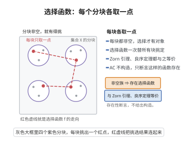

# 选择公理的等价形式

> **一句话大白话**：选择公理（AC）、Zorn 引理、良序定理三个看似不同的命题，在 ZF 中其实是同一个内容的三种说法——谁真谁就都真，谁假谁就都假。
>
> **小例子**：要从无穷多个非空集合里每个选一个代表（AC）；要给每个偏序集的链加上界后再找一个"极大元"（Zorn）；要能把任意集合排成一个"从第一到无穷"的良序（良序）。这三件事在 ZF 里彼此等价。

## 一、定理介绍

> **前置依赖**：选择公理、Zorn引理、良序定理、Hartogs引理、超穷递归定理、偏序集与链。

选择公理是 ZFC 中最富争议的一条公理。它有三种最常用的等价表述——选择公理、Zorn 引理、良序定理。三者在 ZF（不假设 AC）中是两两等价的。这使数学家在不同场景下自由选用最方便的形式：泛函分析用 Zorn 取极大理想，代数用 Zorn 取基，集合论用良序定理处理基数。

## 几何直观

图意在说明：选择公理断言存在一个函数，能同时替每个非空分块挑定一个代表元素。

## 二、原理思路

等价性证明环环相扣：
- **AC ⇒ Zorn**：反设偏序集无极大元，用选择函数 $f(x)>x$ 经超穷递归构造一条严格递增的序数长链，与 Hartogs 引理（存在无法嵌入该偏序的序数）矛盾。
- **Zorn ⇒ 良序**：在全体"$A$ 的良序子集"上定义偏序，用 Zorn 取极大良序，若它不等于 $A$ 则可再添末尾元素而矛盾。
- **良序 ⇒ AC**：把 $\bigcup\mathcal{F}$ 良序化，每个非空成员取最小元即为选择函数。

## 三、定理的严格表述

**定理（等价形式）**：以下命题在 ZF 中两两等价：

1. **选择公理 (AC)**：每个由非空集合构成的族 $\mathcal{F}$ 都有选择函数 $f$（$f(A)\in A$ 对所有 $A\in\mathcal{F}$）。
2. **Zorn 引理**：若非空偏序集 $P$ 的每条链都有上界，则 $P$ 有极大元。
3. **良序定理**：每个集合都可以被良序化。

## 四、证明过程

**(1) ⇒ (2)**：设 $(P,\le)$ 中每条链有上界。反设无极大元，则每个 $U_x=\{y\in P:y>x\}$ 非空。由 AC 取选择函数 $f$ 使 $f(x)>x$。取 $x_0\in P$，用超穷递归定义 $x_\alpha$：后继步 $x_{\beta+1}=f(x_\beta)$，极限步取链 $\{x_\beta\}_{\beta<\alpha}$ 的上界。这给出严格递增的序数长链，与 Hartogs 引理矛盾。故 $P$ 有极大元。

**(2) ⇒ (3)**：设 $A$ 为任意集合，$W$ 为所有 $(B,<_B)$ 之集（$B\subseteq A$，$<_B$ 为 $B$ 上良序），按"初始段扩张"定义偏序。链的上界由 $B=\bigcup_iB_i$ 及其兼容良序给出，故由 Zorn 引理 $W$ 有极大元 $(M,<_M)$。若 $M\neq A$，取 $a\in A\setminus M$ 置于 $M$ 末端得更优元素，矛盾。故 $M=A$，$A$ 被良序化。

**(3) ⇒ (1)**：设 $\mathcal{F}$ 为非空集合族，$\bigcup\mathcal{F}$ 可被良序化。对每个 $A\in\mathcal{F}$，$A$ 是该良序集的非空子集，取 $f(A)=\min(A)$，则 $f$ 是 $\mathcal{F}$ 上的选择函数。$\square$

## 五、应用与意义

选择公理的三个等价形式是现代数学日用不察的基础：Zorn 引理保证每个向量空间有基、每个环有极大理想、Tychonoff 定理，良序定理保证基数可比性，AC 保证选择函数存在。三者的等价性把看似独立的"存在性假设"统一起来；同时其争议性（构造性数学拒绝它、蕴含 Banach-Tarski 悖论）推动了弱选择公理与可确定性理论的发展。

## 课堂问答

**老师**：AC、Zorn 引理、良序定理三个命题形式差别那么大，凭什么说它们在 ZF 中互相等价？

**学生**：结论：循环证明 $\mathrm{AC}\Rightarrow\mathrm{Zorn}\Rightarrow\text{良序}\Rightarrow\mathrm{AC}$。AC 到 Zorn：反设偏序每条链有上界却无极大元，则每个 $U_x=\{y:y>x\}$ 非空，用选择函数取 $f(x)>x$，超穷递归造出严格递增的长链 $x_{\beta+1}=f(x_\beta)$，与 Hartogs 引理给出的"无法嵌入该偏序的序数"矛盾。

**老师（追问）**：那 Zorn 到良序、良序回 AC 两步的关键在哪？

**学生**：Zorn 到良序：在"$A$ 的良序子集"按初始段扩张构成的偏序集上用 Zorn 取极大良序 $(M,<_M)$，若 $M\ne A$ 就取 $a\notin M$ 接在末尾得更优元，矛盾，故 $M=A$。良序回 AC：把 $\bigcup\mathcal F$ 良序化，令 $f(A)=\min A$ 即得选择函数。常见误区是把 Zorn 用于空偏序集，或忘记验证"每条链确有落在偏序集内的上界"。

**老师（拓展）**：这三种形式各自的"主战场"是什么？

**学生**：AC 直接声明选择函数存在，是一切无穷选取的许可证；Zorn 在代数与泛函中最顺手——每个向量空间有基、每个环有极大理想、Tychonoff 定理；良序定理让任意集合尤其基数可比。它们等价意味着拒绝 AC 就要同时放弃这三类结果，这正是构造性数学与 ZFC 分歧的焦点。
