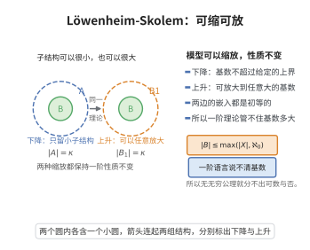

# Löwenheim-Skolem 定理

> **一句话大白话**：一阶理论一旦有无限模型，就既能造出任意小的无限模型（小到可数），也能造出任意大的无限模型（大到给定基数）——一阶公理无法"锁死"模型的大小。
>
> **小例子**：自然数算术的理论有可数标准模型，也可能有不可数模型；集合论 ZFC 甚至有可数模型，尽管它在模型内部"认为是处理所有集合的"（Skovolem 悖论）。一阶语言够不着"到底有多大的模型"。

## 一、定理介绍

> **前置依赖**：紧致性定理、Skolem化（存在公式引入函数）、Tarski-Vaught判别法、模型理论基本概念、基数的上界求和。

Löwenheim-Skolem 定理（简称 LS）断言一阶逻辑无法控制无限模型的大小：
- **下降版**：任何结构都有任意小（含指定子集 $X$、基数不超过 $\max(|X|,|\mathcal{L}|,\aleph_0)$）的初等子结构。
- **上升版**：任何无限结构都有任意大的（含无穷不可数）初等扩张。

## 几何直观

图意在说明：一阶理论既有小的初等子结构，也能扩张到任意大基数，基数大小不受一阶语言约束。

## 二、原理思路

下降版可用 **Skolem 函数**证明：对每个存在公式选一个 Skolem 函数，把 $X$ 在全体 Skolem 函数下的像闭包作为初等子结构的论域，再用 Tarski-Vaught 判别法验证初等子结构性。上升版可用**紧致性**证明：加入表示新元素互异的新常元，构造有限可满足的理论，取模型再下降控制基数。

## 三、定理的严格表述

**定理（下降版）**：设 $\mathfrak{A}$ 是 $\mathcal{L}$-结构，$X\subseteq A$。则存在初等子结构 $\mathfrak{B}\subseteq\mathfrak{A}$，$X\subseteq B$，且 $|B|\le\max(|X|,|\mathcal{L}|,\aleph_0)$。

**定理（上升版）**：设 $\mathfrak{A}$ 是无限 $\mathcal{L}$-结构，$\kappa$ 为基数，则存在初等扩张 $\mathfrak{B}$ 使 $|B|\ge\kappa$（若 $\kappa\ge\max(|\mathcal{L}|,|T|)$ 且 $\mathfrak{A}\models T$，可精确取 $|B|=\kappa$）。

## 四、证明过程

**下降版证明**：对每个公式 $\exists x\varphi(x,y_1,\dots,y_n)$ 取 Skolem 函数 $f_\varphi:A^n\to A$，满足若 $\mathfrak{A}\models\exists x\varphi(x,\bar a)$ 则 $\mathfrak{A}\models\varphi(f_\varphi(\bar a),\bar a)$。令 $B_0=X$，$B_{m+1}$ 为 $B_m$ 在全体 Skolem 函数下的像并，$B=\bigcup_mB_m$。因公式至多 $|\mathcal{L}|$ 个，$|B_{m+1}|\le|B_m|\cdot|\mathcal{L}|\cdot\aleph_0$，迭代求和得 $|B|\le\max(|X|,|\mathcal{L}|,\aleph_0)$。由 Tarski-Vaught 判别法，$\mathfrak{B}$（论域 $B$）是初等子结构。$\square$

**上升版证明（紧致性方法）**：扩展语言加入常量 $c_a\ (a\in A)$ 与 $d_\alpha\ (\alpha<\kappa)$，考虑 $T=\operatorname{Th}(\mathfrak{A}_A)\cup\{d_\alpha\not\approx d_\beta:\alpha<\beta<\kappa\}$。任一有限片段只含有限个 $d_\alpha$，可在 $\mathfrak{A}$ 中解释为互异元素而满足，故 $T$ 有限可满足；由紧致性 $T$ 有模型 $\mathfrak{B}^*$，限制回 $\mathcal{L}$ 得初等扩张 $\mathfrak{B}$，$|B|\ge\kappa$。再用下降版把基数精确控制为 $\kappa$。$\square$

## 五、应用与意义

LS 定理表明一阶逻辑无法唯一确定无限模型的大小，是非标准模型理论、饱和模型、分类理论（Vaught 猜想）的源头。它一方面制造了 Skolem 悖论（ZFC 有可数模型却自认处理全体集合），一方面也为一阶逻辑作为可公理化逻辑的性质奠定基础。

## 课堂问答

**老师**：为什么一阶理论一旦有无限模型，就既压不小也拦不住它变大？"锁死基数"为什么做不到？

**学生**：结论：下降版给出含指定 $X$ 的初等子结构 $\mathfrak B\preccurlyeq\mathfrak A$ 且 $|B|\le\max(|X|,|\mathcal L|,\aleph_0)$；上升版给出任意大的初等扩张。下降版用 Skolem 函数取闭包配合 Tarski-Vaught 判别法，上升版用紧致性加"互异新常元"逼大。

**老师（追问）**：下降版的基数上界为什么恰好是那个 $\max$？

**学生**：对每个存在公式 $\exists x\varphi$ 选 Skolem 函数 $f_\varphi$，把 $X$ 在全体 Skolem 函数下迭代取闭包。每步 $|B_{m+1}|\le|B_m|\cdot|\mathcal L|\cdot\aleph_0$（公式至多 $|\mathcal L|$ 个，每个函数元数有限），可数步取并后基数不超过 $\max(|X|,|\mathcal L|,\aleph_0)$。正因闭包对见证封闭，再用 Tarski-Vaught 判别法即知 $\mathfrak B$ 是初等子结构。常见误区是想造出比 $|\mathcal L|$ 更小的模型——语言自身的符号数就是下界。

**老师（拓展）**：上升版与紧致性、Skolem 悖论是什么关系？

**学生**：上升版是紧致性的标准应用：加入常元 $d_\alpha\ (\alpha<\kappa)$ 与句子 $d_\alpha\not\approx d_\beta$，任意有限片段都能在 $\mathfrak A$ 中实现，紧致性给出模型，再下降控制基数。由此 ZFC 若有模型就有可数模型，而模型内部却"证明"实数不可数——这正是 Skolem 悖论，说明绝对基数概念无法被一阶语言从语法上固定。
