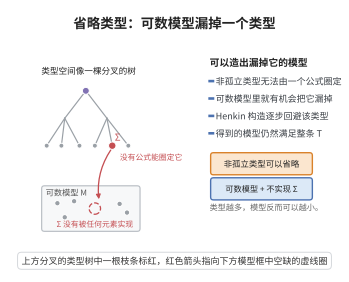

# 省略类型定理

> **一句话大白话**：如果一个理论 $T$ 中的某个"完全类型" $\Sigma(x)$ 不是孤立的（即没有一个单独公式能概括它），那么 $T$ 能造出一个可数模型，其中没有任何元素实现 $\Sigma$——存在一个模型"完全避开"这个类型。
>
> **小例子**：$\mathbb{Q}$ 里类型 $\Sigma(x)=\{x>n:n\in\mathbb{N}\}$（"比所有自然数都大"）在稠密线性序中有限可满足却无实现。省略类型定理保证存在可数稠密线性序模型，其中没有任何元素同时满足整个 $\Sigma$——因为它在 $\mathbb{Q}$ 中"太特殊、不被单一公式抓住"。

## 一、定理介绍

> **前置依赖**：类型的定义与孤立性、Henkin构造、极大一致理论、紧致性定理、词项模型。

省略类型定理（Omitting Types Theorem）刻画了"哪些类型可以在一阶理论的模型中不被实现"。它为构造"不带某类元素"的模型提供了系统方法，是紧致性、Henkin 构造的深化。与"类型可实现"相对，本定理关注类型的省略，是模型论经典封面问题（充分小模型、Vaught 定理背景）中的重要工具。

## 几何直观

图意在说明：非孤立类型无法被单个公式圈定，因此可以造出一个可数模型，其中没有元素实现它。

## 二、原理思路

证明基于 Henkin 构造，并在构造极大一致切链 $T_n$ 的过程中，主动对每个 Henkin 常量 $c_m$ 加入某个 $\neg\sigma(c_m)$（$\sigma\in\Sigma$）。能够做到的根源在于 $\Sigma$ **非孤立**：若每个 $\neg\sigma(c_m)$ 都无法加入，则 $c_m$ 将实现 $\Sigma$ 的一个有限一致扩张，从而迫使 $\Sigma$ 被孤公式蕴含，矛盾。这样构造出的项模型中每个带名元素都"被排除在 $\Sigma$ 之外"，$\Sigma$ 因而被整体省略。

## 三、定理的严格表述

**定理（省略类型定理）**：设 $T$ 是可数完备的一阶 $\mathcal{L}$-理论，$\Sigma(x)$ 是 $T$ 中的非孤立类型。则 $T$ 有一个可数模型省略 $\Sigma(x)$（即没有任何 $a\in M$ 使 $\mathfrak{M}\models\Sigma(a)$）。

（类型 $\Sigma$ 是**孤立的**，若存在公式 $\varphi(x)$ 蕴含 $\Sigma$ 且与 $T$ 一致，即 $\Sigma$ 被单个公式"抓住"。）

## 四、证明过程

**证明（Henkin 构造）**：

**第一步（构造 Henkin 理论链）**：扩展语言 $\mathcal{L}^*=\mathcal{L}\cup\{c_0,c_1,\dots\}$，构造递增 $T_0\subseteq T_1\subseteq\cdots$ 满足：$T_0=T$；每 $T_n$ 是 Henkin 理论；$T_n\not\vdash\sigma(c_m)$ 对任意 $\sigma\in\Sigma,m$；每个 $\mathcal{L}^*$-句子最终被某 $T_n$ 决定。

**第二步（保证类型被省略）**：在由 $T_n$ 构造 $T_{n+1}$ 时，对每个已引入的 Henryka 常量 $c_m$，若对每个 $\sigma$，$T_{n+1}\cup\{\sigma(c_m)\}$ 都一致，则由 $\Sigma$ 与 $T$ 的一致性递归可推出 $c_m$ 实现一个有限一致类型扩张，迫使 $\Sigma$ 孤立，与非孤立矛盾。故总能选 $\sigma\in\Sigma$ 把 $\neg\sigma(c_m)$ 并入 $T_{n+1}$（注意这与决定句子、添加 Henkin 公理的操作兼容）。

**第三步（构造模型）**：令 $T_\infty=\bigcup_nT_n$，$T_\infty$ 为极大一致 Henkin 理论，按紧致性证明的方式构造项模型 $\mathfrak{M}$。

**第四步（验证省略）**：任取 $a\in M$，$a$ 是某闭项 $t$ 的等价类；因 $T_\infty$ 是 Henkin 理论，存在常量 $c$ 使 $T_\infty\vdash c\approx t$。由构造存在 $\sigma\in\Sigma$ 使 $\neg\sigma(c)\in T_\infty$，故 $\mathfrak{M}\not\models\sigma(a)$，$a$ 不实现 $\Sigma$。$\square$

## 五、应用与意义

省略类型定理是构造"不含特定元素"模型的经典工具，用于证明 Vaught 定理、构造素数模型与原子模型、确定可数理论可数模型的数量、以及模型完备性相关结论。它与紧致性定理互补：一个保证能实现类型（紧致性），一个保证能省略类型（本节定理），合起来为可数模型的结构理论提供了有力的"透明度"。

## 课堂问答

**老师**：一个类型 $\Sigma(x)$ 在某个模型里没被实现，凭什么保证"存在"一个模型完全省略它，而不是碰巧？

**学生**：结论：当 $T$ 可数完备且 $\Sigma$ 非孤立（没有单个公式 $\varphi$ 与 $T$ 一致地蕴含 $\Sigma$）时，$T$ 有一个可数模型省略 $\Sigma$。构造用 Henkin 方法，在逐层扩张一致理论时主动把某个 $\neg\sigma(c_m)$ 并入，使每个带名元素都被排除在 $\Sigma$ 之外。

**老师（追问）**：凭什么总有 $\neg\sigma(c_m)$ 可加入？这不正是要证的结论本身吗？

**学生**：不会循环——若对常量 $c_m$ 每个 $\sigma\in\Sigma$ 都能与当前理论一致地加入 $\sigma(c_m)$，那 $c_m$ 就实现了一个 $\Sigma$ 的一致扩张，递归地要求 $\Sigma$ 被某单个公式 $\varphi(x)$ 蕴含，即 $\Sigma$ 孤立，与非孤立矛盾，故总能挑到 $\sigma$ 使 $\neg\sigma(c_m)$ 可并入。常见误区是以为"每个模型都能省略 $\Sigma$"——孤立类型必被每个模型实现，省略定理针对的正是非孤立类型。最后在项模型里，每个元素是某常量 $c$ 的等价类，由构造 $\neg\sigma(c)\in T_\infty$ 而整体省略。

**老师（拓展）**：省略类型定理与紧致性定理方向相反，怎样配合使用？

**学生**：紧致性保证"有限可实现 $\Rightarrow$ 有模型实现"（能实现类型），省略定理保证"非孤立 $\Rightarrow$ 有模型省略"（能避开类型），一正一反是可数模型构造的调节阀。用省略定理可造每个类型尽可能少被实现的素数模型、原子模型，用于估计可数理论可数模型的个数（Vaught 定理背景），是模型论可数结构理论的支柱。
