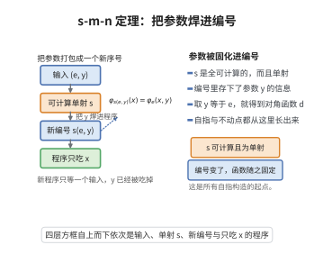

# s-m-n 定理

> **一句话大白话**：可以把一部分输入“焊死”进程序里——给定一个接受 $m+n$ 个数的程序，就能可计算地（而且一对一地）造出一个新程序的编号，这个新程序只接受 $n$ 个数，但会自动把 $m$ 个固定参数补在前面，再运行原程序。
> **小例子**：把“加法程序”的第一个参数固定为 $3$，就得到一个“加 $3$”程序的编号；而且从旧编号与常数 $3$ 算出新编号这件事本身是可以被机器执行的（甚至原始递归可计算），这就是“部分应用”（函数式语言中的柯里化）。

## 一、定理介绍

> **前置依赖**：部分可计算函数与全可计算函数、图灵机／寄存器机与程序的 Gödel 编码、通用枚举机器的构造、配对函数与原始递归函数、Church–Turing 论题、程序填充（padding）引理

s-m-n 定理由 Kleene 于 1943 年在《Recursive predicates and quantifiers》中提出，名称来自其记号 $S^m_n$，故称 **s-m-n 定理**，又称**参数化定理**（parameter theorem）或**迭代定理**（iteration theorem）。它是可计算性理论中最基本的“技术引理”：几乎所有关于可计算函数编号的结论都要用到它。

定理的内容是把“多元函数对前若干个变量的部分固定”这一操作**内化**为对程序编号的可计算操作。设 $\varphi^{(k)}_e$ 表示第 $e$ 个 $k$ 元部分可计算函数，则对每个 $m,n\ge1$ 存在全可计算且单射的函数 $s^m_n$，使得编号 $s^m_n(e,\bar x)$ 所对应的 $n$ 元函数恰是“把 $\bar x$ 焊在 $\varphi^{(m+n)}_e$ 前 $m$ 个位置上”所得的函数。

定理的关键在于**一致性**：得到的不仅是对每个固定 $(e,\bar x)$ 存在一个新程序，而是存在一个统一可计算的变换 $s^m_n$，它同时处理所有输入。正是这种一致性使得“程序构造”本身成为可计算的，从而可以构造自指程序（Kleene 第二递归定理）、证明 Rice 定理、实现 Myhill 同构定理与 Turing 度理论中的诸多归约。

由 Rogers 的工作可知：一个编号是可接受的（acceptable）当且仅当它同时满足通用性（Enumeration Theorem）与 s-m-n 定理。因此 s-m-n 定理是“良编号”的公理之一。

## 几何直观

图意在说明：参数 y 被打包进新编号，新程序只等一个输入，其行为与原二元函数完全一致。

## 二、原理思路

构造的核心是“硬编码常数 + 通用仿真”：

1. **常数装载（prelude）**：写一段固定结构的前导程序，把 $n$ 个输入搬到后面若干个寄存器，并把 $m$ 个常数 $x_1,\dots,x_m$ 写入前面的寄存器——这是“焊死参数”。
2. **通用仿真**：在前导之后接上一段通用仿真程序，它以 $e$ 为参数模拟第 $e$ 个程序在寄存器内容 $(x_1,\dots,x_m,y_1,\dots,y_n)$ 上的运行。
3. **可计算性**：前导程序的代码长度只依赖常数的大小，由“循环 $x_i$ 次写一条指令”实现，故整段代码是对 $(e,\bar x)$ 的**原始递归**函数；拼接（concatenation）也是原始递归的。于是 $s^m_n$ 全可计算。
4. **单射性**：程序编码包含冗余（同一函数有无穷多个编号），在第 $1$ 条指令后插入任意多条“空操作”指令（$R_0^+\!\to I$ 后紧跟 $R_0^-\!\to I',I''$，净效果为零）不改变程序行为。用这种填充把编码做成前缀无关（prefix-free）的，即得单射。

## 三、定理的严格表述

**（s-m-n 定理）** 固定一个**可接受编号** $\{\varphi^{(k)}_e\}_{e\in\mathbb N,\,k\ge1}$：即对每个 $k\ge1$，$e\mapsto\varphi^{(k)}_e$ 是全体 $k$ 元部分可计算函数的枚举，且 $(e,\bar y)\mapsto\varphi^{(k)}_e(\bar y)$ 是部分可计算的（通用性）。则对任意 $m,n\ge1$，存在**全可计算**且**单射**的函数

$$
s^m_n:\mathbb N^{m+1}\to\mathbb N,\qquad (e,x_1,\dots,x_m)\mapsto s^m_n(e,\bar x),
$$

使得对一切 $e\in\mathbb N$、$\bar x=(x_1,\dots,x_m)\in\mathbb N^m$、$\bar y=(y_1,\dots,y_n)\in\mathbb N^n$ 有

$$
\varphi^{(n)}_{s^m_n(e,\bar x)}(\bar y)\ \simeq\ \varphi^{(m+n)}_e(\bar x,\bar y),
$$

其中 $\simeq$ 表示“或两边同时无定义，或同时有定义且取值相等”。进一步，$s^m_n$ 可取为**原始递归**函数；其单射形式可使得 $\varphi^{(n)}_{s^m_n(e,\bar x)}=\varphi^{(m+n)}_e(\bar x,\cdot)$ 且 $s^m_n$ 为单射。

**（对角特例）** 令 $d(e):=s^1_1(e,e)$，则 $d$ 是原始递归单射，且
$$
\varphi^{(1)}_{d(e)}(y)\simeq\varphi^{(2)}_e(e,y).
$$

**（逆命题式的完备性说明）** 反之，若某编号同时满足通用性与上述 s-m-n 性质，则它是可接受编号，即它与任何可接受编号之间存在可计算的同构（Myhill 定理），故 s-m-n 性质是编号可接受性的公理化特征之一。

## 四、证明过程

**步骤 0：固定计算模型与编码**

采用**寄存器机**作为计算模型（与图灵机等价，构造更直观）：机器有寄存器 $R_0,R_1,R_2,\dots$（$0\in\mathbb N$ 上取值），程序是有限条带标号的指令，指令形如

$$
R_i^{+}\!\to I_j\quad(\text{把 }R_i\text{ 加 }1\text{ 后转到 }I_j),\qquad
R_i^{-}\!\to I_j,I_k\quad(\text{若 }R_i\ne0\text{ 则 }R_i\text{ 减 }1\text{ 转到 }I_j,\ \text{否则转 }I_k).
$$

约定：$k$ 元输入置于 $R_1,\dots,R_k$，输出置于 $R_1$；若程序运行不停机，则该输入处函数无定义。对程序 $P$ 的指令表用配对函数 $\langle\cdot,\cdot\rangle$ 递归编码，得代码 $\ulcorner P\urcorner\in\mathbb N$；第 $e$ 个程序 $P_e$ 由代码 $e$ 解出，令 $\varphi^{(k)}_e$ 为 $P_e$ 在 $k$ 元输入约定下计算的函数。由标准编码的性质，$(e,\bar y)\mapsto\varphi^{(k)}_e(\bar y)$ 部分可计算（通用程序存在）。

以下固定 $m,n\ge1$。为记号简洁，下面把 $(\bar x,\bar y)=(x_1,\dots,x_m,y_1,\dots,y_n)$ 全部装进寄存器 $R_1,\dots,R_{m+n}$。

**步骤 1：构造常数装载前导程序 $C_{\bar x}$**

目标是写一个程序，它把“当前在 $R_1,\dots,R_n$ 中的输入 $\bar y$”搬到 $R_{m+1},\dots,R_{m+n}$，并把常数 $x_1,\dots,x_m$ 写进 $R_1,\dots,R_m$。

（1a）**搬移**：先把 $R_1,\dots,R_n$ 的内容按“从后往前”或借辅助寄存器 $R_{m+n+1}$ 逐个搬移到目标位置，这段指令表是固定的、长度只依赖 $n$ 的有限段（可直接写出：对 $i$ 从 $1$ 到 $n$，用 $R_{m+n+i}$ 暂存，再用标准“复制循环”写回）。这段代码是常数（不依赖 $\bar x$），记其代码为 $K_n$。

（1b）**写入常数**：要把数值 $x_i$ 写进 $R_i$，先用指令 $R_i^{-}\!\to I,I$ 把 $R_i$ 清零，再连续执行 $x_i$ 条指令 $R_i^{+}\!\to(\text{后继})$。于是“写入常数 $x_i$”对应的指令序列长度恰为 $x_i$，而 $x_i\mapsto$（该序列的编码）是原始递归函数（由“循环 $x_i$ 次拼接同一指令”实现，即“编码长度参数”本身是原始递归操作）。对 $i=1,\dots,m$ 依次拼接这 $m$ 段序列，得常数装载段 $C^{(c)}_{\bar x}$，其编码为

$$
\mathrm{code}\big(C^{(c)}_{\bar x}\big)=\mathrm{concat}\big(G(x_1),G(x_2),\dots,G(x_m)\big)
$$

其中 $G(x)$ 是“重复 $x$ 次同一指令”的编码函数（原始递归），$\mathrm{concat}$ 是列表拼接的编码（原始递归）。于是 $(\bar x)\mapsto\mathrm{code}(C^{(c)}_{\bar x})$ 是原始递归的。

（1c）**前导**：令 $C_{\bar x}$ 为 $K_n$ 后接 $C^{(c)}_{\bar x}$。由 (1a)(1b)，$(\bar x)\mapsto\ulcorner C_{\bar x}\urcorner$ 是原始递归函数，且 $C_{\bar x}$ 是有限程序，它的行为是：输入 $\bar y$ 时把寄存器内容变为 $(x_1,\dots,x_m,y_1,\dots,y_n)$（其余寄存器的值与 $K_n$ 的暂存约定一致）。$\square$

**步骤 2：构造仿真程序**

存在固定的有限程序 $U$（通用程序，由通用性保证）满足：对任意 $e$ 与任意输入 $(z_1,\dots,z_{m+n})$，

$$
U\text{ 在输入 }(e,z_1,\dots,z_{m+n})\text{ 上停机}\iff P_e\text{ 在 }(z_1,\dots,z_{m+n})\text{ 上停机},
$$

且停机时输出相同。把 $U$ 的代码作为固定常数 $u$ 记下（$u$ 只依赖 $m,n$ 与模型，是常数）。

**步骤 3：拼接得到 $P_{e,\bar x}$，并定义 $s^m_n$**

定义程序 $P_{e,\bar x}$ 为以下三段拼接：

$$
P_{e,\bar x}\ =\ C_{\bar x}\ \ \|\ \ S_e\ \ \|\ \ T,
$$

其中 $\|\ $ 表示“把前一段的停机出口接到后一段的入口”的标准拼接（只需把前段的“停”指令改为跳转到后段入口，这是对代码的原始递归操作）；$S_e$ 是把 $e$ 作为数据搬入寄存器 $R_{m+n+1}$ 的固定-长度段（其代码由 $e$ 的二进制展开构成，长度随 $e$ 变化，编码 $e\mapsto\ulcorner S_e\urcorner$ 原始递归）；$T$ 是把 $U$ 的代码 $u$ 装配进来的固定段，其作用是先调 $U$ 再删除 $e$ 所占的寄存器使输出位于 $R_1$。

于是 $\ulcorner P_{e,\bar x}\urcorner$ 由 $(e,\bar x)$ 通过“原始递归函数 $G$、拼接、以及把 $e$ 写成数据”的复合得到，故映射

$$
g:\mathbb N^{m+1}\to\mathbb N,\qquad g(e,\bar x)=\ulcorner P_{e,\bar x}\urcorner
$$

是原始递归的。先取 $s^m_n:=g$（下面再修正为单射）。

**步骤 4：验证正确性 $\varphi^{(n)}_{g(e,\bar x)}(\bar y)\simeq\varphi^{(m+n)}_e(\bar x,\bar y)$**

设 $P_e$ 在输入 $(\bar x,\bar y)$ 上停机，则

- 步骤 1 的前导把输入 $\bar y$（在 $R_1,\dots,R_n$）改写为寄存器内容 $(x_1,\dots,x_m,y_1,\dots,y_n)$；
- 步骤 3 的 $S_e$ 把 $e$ 放到 $R_{m+n+1}$；
- $T$ 段调用通用程序 $U$，由步骤 2，$U$ 在输入 $\big(e,(x_1,\dots,x_m,y_1,\dots,y_n)\big)$ 上模拟 $P_e$ 并停机、输出相同；
- 末了删除 $e$ 所占寄存器，输出位于 $R_1$，即 $\varphi^{(m+n)}_e(\bar x,\bar y)$。

反之若 $P_e$ 在 $(\bar x,\bar y)$ 上不停机，则 $U$ 亦不停机，整个程序不停机。故

$$
\varphi^{(n)}_{g(e,\bar x)}(\bar y)\simeq\varphi^{(m+n)}_e(\bar x,\bar y).
$$

又由 $g$ 的原始递归性，$\varphi^{(n)}_{g(e,\bar x)}(\bar y)$ 作为 $(e,\bar x,\bar y)$ 的函数是部分可计算的（与通用性一致）。$\square$

**步骤 5：单射化（程序填充引理）**

（5a）**空操作块**：考虑“空操作”指令组
$$
N:\quad I:\ R_0^{+}\!\to I+1;\qquad I+1:\ R_0^{-}\!\to I+2,\ I+2;\qquad I+2:\ (\text{转入后继})
$$
即“给 $R_0$ 加 $1$ 后再立即减 $1$”。执行该组指令后 $R_0$ 的值不变、控制流照常前进，故插入任意多组 $N$ 不改变程序的输入输出行为（只要求插入位置之后不再有依赖 $R_0$ 初值的指令，这可通过在 $P_{e,\bar x}$ 开头把 $R_0$ 清零来保证）。

（5b）**编码的唯一解析性**：约定编码具有前缀无关性：程序的代码由“指令序列编码 + 一个由固定符号构成的结束标记”组成，且这段结束标记不出现在其它构件中。同时把常数装载段的长度参数改为 $t:=\pi(\bar x)$（$\pi$ 为 $\mathbb N^m\to\mathbb N$ 的配对双射），即用长度为 $\pi(\bar x)$ 的“数据块”记录 $\bar x$：由于数据块中的符号与指令符号集不交（数据用另一种记号写入），解析时可由代码唯一地读出 $t$，再由 $\pi$ 的单射性唯一地恢复 $\bar x$。

（5c）**定义填充**：令 $p(e,\bar x)$ 为上面求得的 $g$ 的编码中 $e$ 与 $\bar x$（经由 $t=\pi(\bar x)$）所处的“位置参数”，定义为 $p(e,\bar x)=\langle g(e,\bar x),\ t\rangle$ 之值（配对函数与 $g$、$\pi$ 皆原始递归，故 $p$ 原始递归）。定义
$$
s^m_n(e,\bar x)=\text{“在 }P_{e,\bar x}\text{ 的第 1 条指令后插入 }p(e,\bar x)\text{ 组空操作 }N\text{ 所得的程序的代码”}.
$$
由 (5a)，$\varphi^{(n)}_{s^m_n(e,\bar x)}=\varphi^{(n)}_{g(e,\bar x)}$，故步骤 4 的等式对 $s^m_n$ 同样成立。由 (5b)，代码 $s^m_n(e,\bar x)$ 可被唯一解析为“$(e,\bar x)$ 与填充长度 $p(e,\bar x)$”，因此
$$
s^m_n(e,\bar x)=s^m_n(e',\bar x')\ \Longrightarrow\ e=e'\ \text{且}\ \bar x=\bar x',
$$
即 $s^m_n$ 单射。（若填充长度与 $(e,\bar x)$ 的编码仍可能碰撞，可再插入长度为 $\langle p,\ 1\rangle,\langle p,\ 2\rangle,\dots$ 的填充块并取 $p$ 的最后一分量为 $1$，同样不影响行为。）$s^m_n$ 由 $g,\pi,\langle\cdot,\cdot\rangle$ 与插入操作复合而成，故为原始递归。

**步骤 6：对角特例**

取 $m=n=1$，令 $d(e)=s^1_1(e,e)$。$d$ 原始递归且单射（$s^1_1$ 单射，$e\mapsto(e,e)$ 单射）。由步骤 3、4 的等式（取 $x_1=e$）得 $\varphi^{(1)}_{d(e)}(y)\simeq\varphi^{(2)}_e(e,y)$。$\blacksquare$

## 五、应用与意义

**在递归论中的应用**：

1. **Kleene 第二递归定理（自指定理）**：设 $f$ 全可计算，令 $\psi(e,y)\simeq\varphi^{(1)}_{f(s^1_1(e,e))}(y)$；$\psi$ 部分可计算，设 $\psi=\varphi^{(1)}_a$，取 $e=s^1_1(a,a)$，则由 s-m-n 定理 $e$ 满足 $\varphi^{(1)}_e=\varphi^{(1)}_{f(e)}$，即程序可“引用自身编号”。
2. **Rice 定理**：定义 $\psi(e,y)\simeq\varphi^{(1)}_e(y)$ 型的“收缩”归约，配合 s-m-n 定理可把任意外延性质的不判定性归约为停机问题。
3. **Myhill 同构定理**：所有可接受编号彼此可计算同构，证明的关键正是把“程序”与“编号”通过 s-m-n 定理互相翻译。
4. **索引集的刻画与 m-完全性**：$\{e:\varphi_e\ \text{有某性质}\}$ 的 m-度由 s-m-n 定理确定的归约给出。

**在计算机科学中的意义**：s-m-n 定理就是“部分应用／柯里化”可计算性的形式化陈述：编译器把多元函数 $\lambda \bar x\,\bar y.\ t$ 变换为 $\lambda \bar x.\lambda\bar y.\,t$ 的过程，正是构造 $s$ 的过程；泛型解释器、闭包、可计算函数编码（如 de Bruijn 编码下的解释器写解释器）都依赖它。它也出现在定理证明器的“反射”技术与可计算模型论中。

**推广**：s-m-n 定理对任意可接受编号成立（与编号无关），并推广到多类型部分可计算函数（“sms 引理”）、部分可计算泛函（有效算子）、带或acles 的编号（相对化 s-m-n）以及依赖类型论中的“替换引理”（其中 s-m-n 对应“抽象/一般化”规则：$\Gamma,x:A\vdash t:B$ 与 $\Gamma\vdash u:A$ 给出 $\Gamma\vdash t[u/x]:B[u/x]$）；在抽象可计算性中，它刻画了“可计算泛函可由程序索引计算”这一性质（Kreisel–Lacombe–Shoenfield 定理的初等形态）。

## 课堂问答

**老师**：这个定理为什么叫"参数化"？它究竟把什么操作变成了可计算的操作？

**学生**：它把"固定前若干个参数"这个操作内化成了对程序编号的可计算变换。具体说，对任意 $m,n\ge1$ 存在原始递归单射 $s^m_n$，使 $\varphi^{(n)}_{s^m_n(e,\bar x)}(\bar y)\simeq\varphi^{(m+n)}_e(\bar x,\bar y)$。关键不是"每个 $(e,\bar x)$ 都能配到新程序"，而是这个对应本身一致可计算——正因如此才能构造自指。

**老师（追问）**：为什么一定要强调 $s^m_n$ 是单射？非单射不行吗？

**学生**：单射用来给编码留出"唯一解析"的能力。程序编码本就无穷对一，构造时先靠硬编码常数加通用仿真的拼接得到 $g$，再用空操作填充（$R_0^{+}\!\to I$ 后接 $R_0^{-}\!\to I',I''$）撑长代码并配合前缀无关编码，使 $s^m_n(e,\bar x)=s^m_n(e',\bar x')$ 能反推出 $e=e'$、$\bar x=\bar x'$。常见误区是以为单射靠"更聪明的编码"，其实靠填充把信息写进长度。

**老师（拓展）**：取对角特例 $d(e)=s^1_1(e,e)$ 有什么后果？

**学生**：$d$ 仍原始递归且单射，且 $\varphi^{(1)}_{d(e)}(y)\simeq\varphi^{(2)}_e(e,y)$——把自身编号当参数喂回去，这正是 Kleene 第二递归定理的自指引擎。更一般地，Rogers 指出"通用性加 s-m-n"恰是可接受编号的公理化特征，Myhill 定理随之给出任意两个可接受编号之间的可计算同构。
