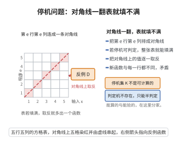

# 停机问题的不可判定性

> **一句话大白话**：没有任何程序能始终判断"任意给定程序（输入自己）是否会停下来"——停机问题是不可计算的，为"可计算程序的某些事情无法用程序判定"树立了第一个铁证。
>
> **小例子**：假设存在万能停机判定器 $h(e)$（对程序 $e$ 判断 $\varphi_e(e)$ 是否停机）。用它造一个"若判定停机就死循环，若判定不停机就输出1"的程序 $g$。让 $g$ 判定自己，则无论怎样都自相矛盾——于是这样的判定器不可能存在。

## 一、定理介绍

> **前置依赖**：部分可计算函数的指标化（$\varphi_e$）、对角线论证、可计算函数、通用函数、反证法。

停机问题的不可判定性（Unsolvability of the Halting Problem）是递归论（可计算性理论）的奠基性结论。集合
$$
K=\{e\mid \varphi_e(e)\downarrow\}
$$
（其中 $\varphi_e$ 是第 $e$ 个部分可计算函数）被证明是不可计算的。它开创性地展示了"存在计算机程序无法解决的数学问题"，是后续 Rice 定理、算术层次不可判定性等的结果源头。

## 几何直观

图意在说明：若停机可判定则整张表可填满，把对角线上的取值全部取反，就得到一个不在表中的函数。

## 二、原理思路

证明采用经典的对角线法（Cantor 对角线法在可计算性上的翻版）：假设 $K$ 可计算，则存在判定 $h$。由 $h$ 构造一个"自我指涉"的部分函数 $g$，使 $g$ 停机的行为恰与 $h$ 的判定相反。让 $g$ 对自身索引求值，无论 $h$ 判定 $g$ 停机还是不停机，都导出矛盾。这类"自己算自己"的构造正是下述递归定理的预演。

## 三、定理的严格表述

**定理（停机问题的不可判定性）**：停机集 $K=\{e\mid \varphi_e(e)\downarrow\}$ 不是可计算的。

## 四、证明过程

**证明（对角线法）**：

假设 $K$ 可计算，则存在可计算函数 $h:\mathbb{N}\to\{0,1\}$ 满足：
$$
h(e)=\begin{cases}
1, & \varphi_e(e)\downarrow,\\
0, & \varphi_e(e)\uparrow.
\end{cases}
$$

利用 $h$ 构造 $g:\mathbb{N}\to\mathbb{N}$：
$$
g(n)=\begin{cases}
1, & h(n)=0,\\
\uparrow, & h(n)=1.
\end{cases}
$$
$g$ 是部分可计算的：先算 $h(n)$，若为 $0$ 输出 $1$，否则进入无限循环。故存在索引 $e_0$ 使 $\varphi_{e_0}=g$。

问 $e_0\in K$ 吗？
- 若 $e_0\in K$，则 $\varphi_{e_0}(e_0)\downarrow$，即 $g(e_0)\downarrow$，由 $g$ 定义知 $h(e_0)=0$，即 $\varphi_{e_0}(e_0)\uparrow$，矛盾。
- 若 $e_0\notin K$，则 $\varphi_{e_0}(e_0)\uparrow$，即 $g(e_0)\uparrow$，由 $g$ 定义知 $h(e_0)=1$，即 $\varphi_{e_0}(e_0)\downarrow$，矛盾。

两种情况皆矛盾，故假设不成立，$K$ 不可计算。$\square$

## 五、应用与意义

停机问题的不可判定性是整个不可判定性理论的基石：它直接蕴含"一般程序验证/终止性判定不可行"，并用于归约证明大量集合不可计算（如 $\{e:\varphi_e(0)\downarrow\}$）。它启动了递归论对不可判定问题结构的系统研究，也是数理逻辑、验证理论与"可计算性边界"讨论的出发点。

## 课堂问答

**老师**：为什么不能靠"限制输入"绕开停机问题？

**学生**：因为 $K=\{e:\varphi_e(e)\downarrow\}$ 本身不可计算。证明是对角线：若有判定函数 $h$，令 $g(n)=1$ 当 $h(n)=0$，否则 $\uparrow$；取 $e_0$ 使 $\varphi_{e_0}=g$，则 $e_0\in K\iff\varphi_{e_0}(e_0)\downarrow\iff g(e_0)\downarrow\iff h(e_0)=0\iff\varphi_{e_0}(e_0)\uparrow\iff e_0\notin K$，矛盾。

**老师（追问）**：这里"自己算自己"的机制，与递归定理是什么关系？

**学生**：停机证明是递归定理的"手工版"：$g$ 借助 $h$ 的对角值构造自我否定，等价于在 $\varphi_e(e)$ 上取不动点。常见误区是把矛盾归因于"程序太长"或"资源不足"，其实它纯粹来自逻辑自指，与物理限制无关。

**老师（拓展）**：这条结论能往下推出什么？

**学生**：它是不可判定性理论的源头：由 $K\le_m\{e:\varphi_e(0)\downarrow\}$ 等归约可证大批集合不可计算，再由 $K\le_m I(\mathcal{C})$ 导出 Rice 定理。它也是 Gödel 第一不完全性定理在递归论中的回声——两者都源自对角化。
