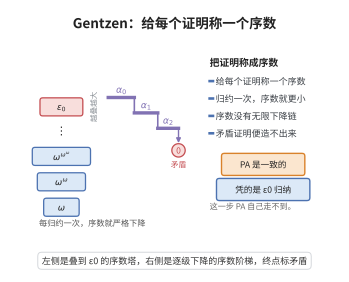

# Gentzen 的 PA 一致性证明

> **一句话大白话**：Peano 算术 PA 确实是一致的——但证明它的坚实依据是超穷序数归纳到 $\varepsilon_0$，这一步超出了 PA 自身的能力，因而并不违背 Gödel 第二不完全性定理。
>
> **小例子**：把每个 PA 证明"称重"配一个小于 $\varepsilon_0$ 的序数。若 PA 能推出矛盾，就有一个序数最小的矛盾证明；对它做一次"归约"得到矛盾的证明，且序数更小。由于低于 $\varepsilon_0$ 的序数没有无限下降链，矛盾——故 PA 一致。

## 一、定理介绍

> **前置依赖**：切断消除定理、序贯演算、序数分析与$\varepsilon_0$的良基性、超穷序数归纳、Gödel第二不完全性定理

Gentzen 的 PA 一致性证明（1936）是证明论最著名的一致性证明之一：PA 是一致的。其关键在于**序数分析**——为每个证明指派一个小于 $\varepsilon_0=\sup\{\omega,\omega^\omega,\omega^{\omega^\omega},\dots\}$ 的序数，构造使序数下降的矛盾归约，利用 $\varepsilon_0$ 的良基性导出矛盾。它合理规避了第二不完备定理的限制（归纳到 $\varepsilon_0$ 是不可在 PA 内论证的元数学资源）。

## 几何直观

图意在说明：把 PA 的每个证明配上小于 ε0 的序数，归约使序数严格下降，良基性便保证矛盾证明无法存在。

## 二、原理思路

将 PA 证明转成带归纳规则的切断自由序贯演算证明，为每个证明 $\pi$ 赋序数 $o(\pi)<\varepsilon_0$（公理为 $0$，精确规则算出，归纳规则对应极限运算）。定义使序数下降的归约 $\mathcal{R}$：若 PA 不一致则有无穷递减的序数序列 $o(\pi)>o(\pi')>\cdots$；但 $\varepsilon_0$ 良基（无无穷下降），矛盾。故不存在 $\Rightarrow\bot$ 的证明，PA 一致。

## 三、定理的严格表述

**定理（Gentzen 一致性证明）**：Peano 算术 PA 是一致的。

**序数记号**：$\varepsilon_0=\sup\{\omega,\omega^\omega,\omega^{\omega^\omega},\dots\}$。

## 四、证明过程

**证明思路（序数归纳到 $\varepsilon_0$）**：

**步骤1（标准化）**：将 PA 中的证明转换为切断自由的带归纳规则的序贯演算证明（利用切断消除，但归纳公理需另行处理），并给每个证明指派序数 $o(\pi)<\varepsilon_0$——公理序数 $0$，推理规则由前提序数经序数运算得出，归纳规则对应序数上的极限运算。

**步骤2（归约过程）**：定义归约 $\mathcal{R}$，把任何以 $\Rightarrow\bot$ 为结论的证明 $\pi$ 变为另一个以 $\Rightarrow\bot$ 为结论的证明 $\pi'$，且 $o(\pi')<o(\pi)$：
- 最高切断公式为复合（原子）时，用主（次）归约；
- 最高推理为归纳时，用序数递减的方式替换。

**步骤3（序数归纳）**：若 PA 不一致，则存在以 $\Rightarrow\bot$ 为结论的证明 $\pi$。反复应用 $\mathcal{R}$ 得到无限递减偶序数序列：
$$
o(\pi)>o(\pi')>o(\pi'')>\cdots.
$$
但 $\varepsilon_0$ 是良基的，不存在无限严格递减序。矛盾。

故不存在 $\Rightarrow\bot$ 的证明，PA 一致。$\square$

**注**：该证明依赖超穷序数归纳到 $\varepsilon_0$，PA 无法证明 $\varepsilon_0$ 的良基性，故不能在 PA 内形式化——这正体现第二不完备定理；但在 ZFC 或更弱元理论中有效。

## 五、应用与意义

Gentzen 的一致性和证明与序数分析并称，奠定了"渐进一致性纲领"：系统一致可由略强的良基原理证明，其序数也刻画系统的证明论强度。它把 Hilbert 纲领进一步合理化（一致性可在更广元理论中立于不悖），并开启了证明论中的序数分析传统，影响 PA 与若干弱算术、子系统的研究，是证明论与数学基础的分水岭。

## 课堂问答

**老师**：Gentzen 的 PA 一致性证明难道不违反 Gödel 第二不完全性定理吗？

**学生**：不违反。Gentzen 用的归纳跑到 $\varepsilon_0$，而 $\varepsilon_0$ 的良基性不能在 PA 内证明，所以整个论证无法在 PA 中形式化，正好绕开第二定理。结论是 PA 一致。

**老师（追问）**：序数是怎么派上用场的？

**学生**：给每个证明 $\pi$ 指派序数 $o(\pi)<\varepsilon_0$（公理为 $0$，规则由前提序数经序数运算得出，归纳规则对应极限运算）。定义归约 $\mathcal{R}$，把以 $\Rightarrow\bot$ 为结论的证明变为另一个以 $\Rightarrow\bot$ 为结论的证明，且 $o(\pi')<o(\pi)$。若 PA 不一致就得到 $o(\pi)>o(\pi')>\cdots$ 的无限下降，与 $\varepsilon_0$ 良基矛盾。

**老师（拓展）**：这里的序数意味着什么？

**学生**：序数同时刻画证明复杂度与系统的证明论强度——$\varepsilon_0$ 正是 PA 的证明论序数。常见误区是把"PA 一致"当成 PA 内可证的定理；正确说法是它在 ZFC 等更强元理论中可证，而在 PA 中不可证，这正是第二不完全性定理所限定的边界。
