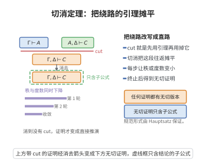

# 切断消除定理（Gentzen, 1935）

> **一句话大白话**：证明里绕来绕去的"中间引理再用掉"环节（切断规则）总能被去掉——任何证明都可以改写成一条"不再绕路"（切断自由）的直接证明，且它只含结论公式的原子子公式。
>
> **小例子**：含切断的证明可能"先绕到 $A\land B$ 再用掉它"；切消把这种往返摊平为直接用 $A$ 推出的直接推导。最终"成功化简到底"得到规范化证明，而化简过程保证总会终止（靠度数与秩双递减）。

## 一、定理介绍

> **前置依赖**：序贯演算与子公式性质、序贯演算与子公式性质、良基归纳（双重归纳）、主归约与次归约、序贯演算与子公式性质。

切断消除定理（Gentzen 的 Hauptsatz）是证明论的奠基定理：在序贯演算 LK 中，任何证明都可转化为不含切断规则的证明。它是证明论"结构化"的开端，赋予证明规范形式（子公式性质），并支撑一致性证明、Herbrand 定理、序数分析等深层结论。

## 几何直观

图意在说明：cut 相当于先证引理再用掉它，消去后得到同样结论的直接证明，且秩与度数双重下降保证过程终止。

## 二、原理思路

证明用双重归纳：对切断公式的**度数**（逻辑连接词与量词数量）作主归纳、对切断的**秩**作次归纳。当切断公式是复合公式时用**主归约**拆分成度数更低的切断；当是原子公式时用**次归约**把切断上移、降低秩。反复归约最终所有切断均被消除。

## 三、定理的严格表述

**定理（Hauptsatz / Cut Elimination）**：在 LK 中，任何证明 $\pi$ 都能通过一系列变换转化为一个不含切断规则的证明（切断自由证明）。

切断
$$
\frac{\Gamma\Rightarrow\Delta,A\quad A,\Gamma'\Rightarrow\Delta'}{\Gamma,\Gamma'\Rightarrow\Delta,\Delta'}(\text{Cut})
$$
中 $A$ 的度数 $d(A)$ 为其逻辑连接词与量词的个数，秩 $r=r_L+r_R$ 为上溯路径长度。

## 四、证明过程

**证明（对度数主归纳、对秩次归纳）**：

**主归约（度数归约）**：设切断公式为复合公式。

**情形1 $A=B\land C$**：若 $B\land C$ 是右前提主公式（$\land L$ 引入），则由 $\Gamma\Rightarrow\Delta,B\land C$ 逆用 $\land R$ 得 $\Gamma\Rightarrow\Delta,B$，与原右前提 $B,C,\Gamma'\Rightarrow\Delta'$ 构造两个度数更低的切断；若是侧公式则调整秩。

**情形3 $A=B\to C$**：左前提以 $(\to R)$ 结束，右前提以 $(\to L)$ 结束：
$$
\frac{B,\Gamma\Rightarrow\Delta,C}{\Gamma\Rightarrow\Delta,B\to C}(\to R)\qquad
\frac{\Gamma'\Rightarrow\Delta',B\quad C,\Gamma''\Rightarrow\Delta''}{B\to C,\Gamma',\Gamma''\Rightarrow\Delta',\Delta''}(\to L)
$$
用度数 $d(B),d(C)<d(A)$ 的切断组合替换原切断。

**情形4 $A=\forall xF(x)$**：左前提末为 $(\forall R)$，右前提末为 $(\forall L)$（代 $t$）：
$$
\frac{\Gamma\Rightarrow\Delta,F(a)}{\Gamma\Rightarrow\Delta,\forall xF(x)}(\forall R)\qquad
\frac{F(t),\Gamma'\Rightarrow\Delta'}{\forall xF(x),\Gamma'\Rightarrow\Delta'}(\forall L)
$$
代换 $a\mapsto t$（特征变元条件保证 $\Gamma,\Delta$ 不含 $a$）得切断公式 $F(t)$，度数 $d(F(t))<d(\forall xF(x))$。

**次归约（秩归约）**：切断公式为原子时度数为 $0$。若左/右前提的非公理规则上溯到切断公式，则把切断向上移、对消除该步骤降低秩。

**收敛**：主归约降度数、次归约降秩，序对 $(d,r)$ 良基递减，过程终止，得切断自由证明。$\square$

## 五、应用与意义

切消定理赋予证明"子公式性质"，使其透明可检查（便于机械验证），是序贯演算除了公理取反故有的一致性证明、Herbrand 定理、可计算性可判定性研究以及序数分析的基础。它让"证明可以规范化"成为证明论的核心武器，并对自动化证明、Lambda 演算规范化理论产生深远影响。

## 课堂问答

**老师**：切断消除定理的核心断言是什么？

**学生**：在 $\mathbf{LK}$ 中任何证明都能转化为不含切断规则的证明。它赋予证明规范形式（子公式性质），是证明论结构化的开端，也是一致性证明、Herbrand 定理与序数分析的支柱。

**老师（追问）**：主归约与次归约各降什么量？

**学生**：主归约处理复合切割公式，比如 $A=B\land C$ 时把大切割换成对 $B$、$C$ 的切割，度数 $d(A)$ 下降；$A=B\to C$ 与 $A=\forall x\,F(x)$（以 $a\mapsto t$ 代换）同理。次归约处理原子切割公式（度数 $0$），把切割上移越过侧规则以降低秩 $r=r_L+r_R$。两者合起来使序对 $(d,r)$ 良基递减、过程终止。

**老师（拓展）**：为什么说这"解释了切割为何能被去掉"？

**学生**：因为逻辑规则的前提都是结论的子公式，切割是唯一引入新公式的规则；只要把切割一路推到底并逐步缩小切割公式，最终就只剩受控的子公式。常见误区是把切断消除当成"算法优化"——它实为"每个证明都有规范形式"这一元定理，并深刻影响 λ 演算的规范化理论。
