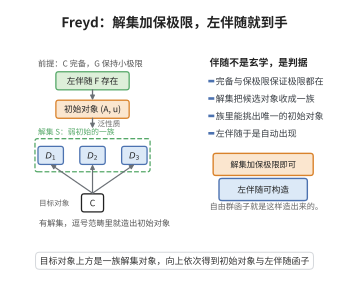

# Freyd 的伴随函子存在定理

> **一句话大白话**：一个函子 $G$ 到底在什么条件下才有"左伴随"？只要 $G$ 保持所有小极限、且满足一个温和的"溶液集条件"，左伴随就存在——伴随不是玄学，而是有明确判据的可构造对象。
>
> **小例子**：想给"遗忘函子 $G:\textbf{Grp}\to\textbf{Set}$"配左伴随（自由群函子），$G$ 保持极限（群的积/等化子可遗忘）且溶液集条件成立（集合被映射到某个有限自由群即可分解），故自由群函子存在。

## 一、定理介绍

> **前置依赖**：极限与乘积/等化子、极限保持、溶液集条件、自由对象与普适性质、完备范畴与局部小范畴。

Freyd 的伴随函子存在定理（SAFT / 一般伴随函子定理）给出了函子 $G:\mathcal{D}\to\mathcal{C}$ 存在左伴随的充要条件：$\mathcal{C}$ 完备（有所有小极限）、局部小，且 $G$ 保持所有小极限并满足**溶液集条件**。这是用极限保持与集合约束刻画随伴可存在性的基本定理。

## 几何直观

图意在说明：G 保持小极限且满足解集条件时，逗号范畴里能造出初始对象，泛性质随即给出左伴随。

## 二、原理思路

**必要性**：左伴随存在 ⇒ $G$ 保极限，且由单位 $\eta_A:A\to G(F(A))$，取 $S=\{F(A)\}$ 即满足溶液集条件。**充分性**为构造：对每个 $A$，由溶液集条件取覆盖态射族 $\{f_i:A\to G(D_i)\}$，作 $W=\prod_iD_i$；因 $G$ 保极限得 $G(W)=\prod_iG(D_i)$ 与唯一 $h:A\to G(W)$；取足够多"核对"的等化子 $e:F(A)\to W$（$G$ 保等化子），得单位 $\eta_A:A\to G(F(A))$ 使任意 $A\to G(D)$ 唯一分解，从而 $F(A)$ 为自由对象。

## 三、定理的严格表述

**定理（Freyd 伴随函子定理）**：设 $\mathcal{C}$ 完备、局部小。函子 $G:\mathcal{D}\to\mathcal{C}$ 有左伴随当且仅当 $G$ 保持所有小极限且满足**溶液集条件**：对任意 $A\in\mathcal{C}$，存在集合 $S\subseteq\text{Ob}(\mathcal{D})$ 与态射族 $\{f_i:A\to G(D_i)\}_{i\in I}$，使任意 $f:A\to G(D)$ 可分解为 $f=G(g)\circ f_i$（某 $i$、某 $g:D_i\to D$）。

## 四、证明过程

**证明**：

**必要性**：若 $G$ 有左伴随 $F$，则 $G$ 保持所有极限；对 $A$，取 $S=\{F(A)\}$、$f_A=\eta_A$，溶液集条件自动满足（$A\to G(D)$ 对应 $F(A)\to D$）。

**充分性**：

**步骤1**：由溶液集条件取 $\{f_i:A\to G(D_i)\}_{i\in I}$，令 $W=\prod_iD_i$；因 $G$ 保极限，$G(W)=\prod_iG(D_i)$，由积普适性质取唯一 $h:A\to G(W)$ 使 $\pi_i\circ h=f_i$。

**步骤2**：取所有核对 $u,v:W\rightrightarrows X$（使 $G(u)\circ h=G(v)\circ h$）的等化子集合，取这些核对的等化子 $e:F(A)\to W$ 使 $u\circ e=v\circ e$。因 $G$ 保等化子，$G(e):G(F(A))\to G(W)$ 是相应等化子；由构造 $h$ 穿过 $G(e)$，得唯一 $\eta_A:A\to G(F(A))$ 使 $G(e)\circ\eta_A=h$。

**步骤3（普适性）**：对 $f:A\to G(D)$，由溶液集条件有 $i,g$ 使 $f=G(g)\circ f_i$。而 $f_i=\pi_i\circ h=\pi_i\circ G(e)\circ\eta_A=G(\pi_i\circ e)\circ\eta_A$，故 $f=G(g\circ\pi_i\circ e)\circ\eta_A=G(\bar g)\circ\eta_A$（$\bar g=g\circ\pi_i\circ e$）。

**步骤4（唯一性）**：若 $g_1,g_2$ 均使 $f=G(g_t)\circ\eta_A$，则 $G(g_1)\circ\eta_A=G(g_2)\circ\eta_A$，由等化子构造 $g_1=g_2$。

故 $F(A)$ 是左伴随在 $A$ 上的值，$\eta_A$ 为单位。$\square$

## 五、应用与意义

Freyd 定理为"保证存在自由对象/左伴随"提供了可检查判据，广泛用于构建自由代数、自由群、自由环、张量代数、极限保持与随伴的可存在性证明；它在代数泛函，如"遗忘函子总能配自由函子"的意义下，把范畴理论中大量存在性结果统一起来。其溶液集条件是伴随构造的核心技术条件。

## 课堂问答

**老师**：一个函子 $G$ 到底什么时候才有左伴随？

**学生**：设 $\mathcal{C}$ 完备且局部小，则 $G:\mathcal{D}\to\mathcal{C}$ 有左伴随当且仅当 $G$ 保持所有小极限且满足溶液集条件：对每个 $A$，存在集合 $S\subseteq\text{Ob}(\mathcal{D})$ 与态射族 $\{f_i:A\to G(D_i)\}$，使任意 $f:A\to G(D)$ 都可分解为 $f=G(g)\circ f_i$。

**老师（追问）**：充分性的构造思路是什么？

**学生**：先由溶液集条件对诸 $D_i$ 取积 $W=\prod_iD_i$，因 $G$ 保极限得 $G(W)=\prod_iG(D_i)$，并由积的普遍性得唯一 $h:A\to G(W)$。再取"核对" $u,v:W\rightrightarrows X$（使 $G(u)\circ h=G(v)\circ h$）的等化子 $e:F(A)\to W$；因 $G$ 保等化子，$h$ 穿过 $G(e)$，给出 $\eta_A:A\to G(F(A))$，再验证其普适性与唯一性。

**老师（拓展）**：必要性那边为什么显然？

**学生**：若 $G$ 有左伴随 $F$，由伴随保极限立刻得 $G$ 保极限；对每个 $A$ 取 $S=\{F(A)\}$、$f_A=\eta_A$，任一 $A\to G(D)$ 经伴随转置后从 $F(A)$ 出发分解，溶液集条件自动成立。常见误区是忽略"局部小加完备"这类集合论前提——缺了它们构造可能失败。
