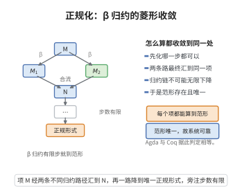

# Martin-Löf 类型论的正规化定理

> **一句话大白话**：在 Martin-Löf 类型论（MLTT）里，任何类型正确的项都能通过有限步"化简"（$\beta$-归约）走到一个再无可化简项的正规形式——计算总会终止，不陷入死循环。
>
> **小例子**：项 $(\lambda x:\mathbb{N}.\,x+1)(5)$ 规范化到 $5+1=6$。正规化定理保证这一化简过程必然有限步结束且结果唯一，从而类型论作为"可计算形式系统"是可靠且终局的。

## 一、定理介绍

> **前置依赖**：β-归约与计算、可还原性方法（Tait可计算性）、替换引理、类型结构归纳、归约终止性（正规化）。

Martin-Löf 类型论的正规化定理断言：MLTT 中每个好类型项都能经有限步 $\beta$-归约达到正规形式。它是类型论规范性（well-foundedness）、强度与可靠性的根本保证，使得类型论能作为构造性数学与证明助理（Agda、Coq）的基础而不失一致性。

## 几何直观

图意在说明：无论先化哪一步，归约都合流且不可能无限进行，所以范形存在唯一，计算总会停机。

## 二、原理思路

证明采用**可还原性方法**（Reducibility Method / Tait 可计算性）：为每个类型定义"可还原项"集合 $\text{Red}(A)$（基类型为归约到数字的项，函数类型按逐点定义）。证明"可还原蕴含可终止（存在归约序列到正规形式）"由类型结构归纳；再证明"所有好类型项可还原"由类型推导规则归纳，关键用**可还原替换引理**。

## 三、定理的严格表述

**定理（MLTT 正规化定理）**：在 Martin-Löf 类型论中，每个好类型项都可在有限步 $\beta$-归约内达到其正规形式（不含可归约表达式的形式）。

## 四、证明过程

**证明（可还原性方法）**：

**步骤1（定义可还原性）**：对每个类型 $A$ 定义 $\text{Red}(A)$：
- 基类型 $\text{Red}(\text{Nat})$：所有能归约到数字的项；
- 函数类型 $f\in\text{Red}(\Pi x{:}A.\,B(x))$ 当且仅当对任意 $a\in\text{Red}(A)$ 有 $f(a)\in\text{Red}(B(a))$。

**步骤2（可还原蕴含正规化）**：用类型 $A$ 的结构归纳证明：若 $t\in\text{Red}(A)$，则 $t$ 规范化（存在有限归约序列到正规形式）。

**步骤3（好类型项可疑还原）**：对类型推导归纳，证明每个类型规则若前提可还原则结论可还原。

**关键引理（可还原替换引理）**：若 $a\in\text{Red}(A)$ 且 $t[x]\in\text{Red}(B(x))$（在 $x:A$ 下），则 $t[a/x]\in\text{Red}(B(a))$。

**步骤4（结论）**：由步骤2与3，所有好类型项都是正规化的。$\square$

## 五、应用与意义

正规化定理保证 MLTT 的计算性/一致性基础，是类型论作为构造性数学框架与依赖类型编程语言（Agda、Coq、Idris）可靠性的支柱——"类型检查仍在着落、计算收敛"。它支撑证明自动化的递减性、程序的终止性与类型论的强度分析，是类型论与可计算性交汇处最重要的元定理之一。

## 课堂问答

**老师**：MLTT 的正规化定理断言什么？为什么它是这么关键的元定理？

**学生**：每个好类型项都能经有限步 $\beta$-归约到达正规形式，故计算必然终止、结果唯一。它保证类型论作为构造性数学与证明助理（Agda、Coq）基础的一致性，不会陷入死循环。

**老师（追问）**：证明用什么方法？难点落在哪里？

**学生**：用 Tait 的可还原性方法。对每个类型定义 $\text{Red}(A)$：基类型取能归约到数字的项，函数类型逐点定义——$f\in\text{Red}(\Pi x{:}A.\,B(x))$ 当且仅当对任意 $a\in\text{Red}(A)$ 有 $f(a)\in\text{Red}(B(a))$。难点在关键引理即"可还原替换引理"：若 $a\in\text{Red}(A)$ 且 $t[x]\in\text{Red}(B(x))$，则 $t[a/x]\in\text{Red}(B(a))$。

**老师（拓展）**：只对"可还原蕴含可终止"作类型结构归纳是否就够了？

**学生**：不够。结构归纳只给出"可还原 $\Rightarrow$ 终止"这一半，还须对类型推导规则归纳证明"每个好类型项都可还原"，两半合起来才是全称结论。常见误区是直接用纯语法的强正规化论证，忽略它依赖替换引理的良基性。$(\lambda x{:}\mathbb{N}.\,x+1)(5)\to 6$ 就是终止性的一个实例。
