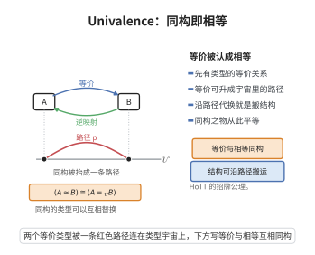

# Univalence 公理

> **状态：同伦类型论中的公理，不是 MLTT 内部已证定理。** 恒等 eliminator 可以构造“相等推出等价”的方向，而反方向的等价性由 Univalence 额外假定；模型构造提供相对一致性依据。

> **一句话大白话**：同构的类型在类型论里可以看成一回事——$(A\simeq B)\simeq(A=_\mathcal{U}B)$。"两个类型有结构等价"就等于"它们相等"，把同构提升为相等。
>
> **小例子**：布尔类型 $\mathbf{bool}$ 与 $\mathbf{unit}\sqcup\mathbf{unit}$ 之间天然同构。Univalence 说这种同构本身就可当作类型论里 $\mathbf{bool}=_\mathcal{U}(\mathbf{unit}\sqcup\mathbf{unit})$ 的一个证路——于是"被同构事物可以平等对待"在类型论中变成可操作的相等代换。

## 一、公理介绍

> **前置依赖**：恒等类型的性质、等价（同伦等价）定义、HoTT路径概念、类型宇宙（$\mathcal{U}$）、一致性的单纯集模型。

Univalence 公理（Voevodsky，2009）是类型论（尤其同伦类型论 HoTT）中一项深刻而现代的公理：
$$
(A\simeq B)\simeq(A=_\mathcal{U}B),
$$
即"等价 $(A\simeq B)$"与"在宇宙 $\mathcal{U}$ 中的相等 $(A=_\mathcal{U}B)$"构成等价。它极大扩展了类型论的表达能力，使证明在结构等价下可代换，是同构经济学与数学结构观念的革新。

## 几何直观

图意在说明：类型间的等价可以提升为宇宙中的路径，于是同构的类型在类型论里可以互相替换。

## 二、原理思路

构造从相等到等价的映射 $\text{IdToEquiv}:(A=_\mathcal{U}B)\to(A\simeq B)$：由 J 规则，对 $p:A=_\mathcal{U}B$ 取 $\text{IdToEquiv}(p)=J(\lambda X.\,(A\simeq X),\text{id}_A,B,p)$。Univalence 公理额外断言 $\text{IdToEquiv}$ 本身是等价，从而有逆映射 $\text{EquivToId}$；相对一致性依据来自 Voevodsky 的单纯集模型。

## 三、公理表述与相对一致性

**公理（Univalence，Voevodsky 2009）**：在 Martin-Löf 类型论的基础上额外断言
$$
(A\simeq B)\simeq(A=_\mathcal{U}B)
$$
其中 $\mathcal{U}$ 是类型宇宙，$A\simeq B$ 表示 $A$ 与 $B$ 之间存在等价。该断言不是由 MLTT 的 J 规则单独证明的；单纯集模型表明，在相应背景集合论及宇宙假设下可以解释 Univalence，从而给出相对于该背景理论的一致性结果。

## 四、构造与模型验证（不是公理的内部证明）

**构造 $\text{IdToEquiv}$**：

**步骤1（定义 $\text{IdToEquiv}$）**：对 $A,B:\mathcal{U}$，定义
$$
\text{IdToEquiv}:(A=_\mathcal{U}B)\to(A\simeq B),\quad
\text{IdToEquiv}(p)=J(\lambda X.\,(A\simeq X),\,\text{id}_A,\,B,\,p).
$$

**步骤2（加入 Univalence 公理）**：额外断言 $\text{IdToEquiv}$ 本身是等价，即
$$
\text{univalence}:\text{IsEquiv}(\text{IdToEquiv}),
$$
从而存在逆映射 $\text{EquivToId}:(A\simeq B)\to(A=_\mathcal{U}B)$。

**步骤3（模型与相对一致性）**：Voevodsky 的单纯集模型在相应背景集合论假设下解释 MLTT 与 Univalence。这是模型论意义上的相对一致性结果，不是在 MLTT 内证明 Univalence，也不是脱离背景理论的绝对一致性证明。

**推论**：Univalence 意味着"等价的类型可交换"（同构的即可等同），极大扩展了类型论的表达能力。

## 五、应用与意义

Univalence 是现代数学形式化与同伦类型论的核心理论支点：它使"结构保持同构的对象不可区分"这一朴素原则成为可代换的相等，简化了大量"重写/等价代换"证明，支撑 HoTT 中从初等对象到高阶结构的重新组织，并深刻影响范畴论、代数拓扑（路径、同伦等价）与定理助手的形式化实践。

## 课堂问答

**老师**：Univalence 公理的一句话表述与它的核心公式是什么？

**学生**：作为额外公理，Univalence 断言同构的类型可以看成一回事：$(A\simeq B)\simeq(A=_\mathcal{U}B)$，即“等价”与“宇宙 $\mathcal{U}$ 中的相等”构成等价，从而把同构提升为可代换的相等。它不是 MLTT 中由 J 规则推出的定理。

**老师（追问）**：从"相等到等价"的那个方向具体怎么造？

**学生**：用 J 规则造：
$$\text{IdToEquiv}:(A=_\mathcal{U}B)\to(A\simeq B),\quad \text{IdToEquiv}(p)=J(\lambda X.\,(A\simeq X),\,\text{id}_A,\,B,\,p).$$
Univalence 断言 $\text{IdToEquiv}$ 本身是等价，即 $\text{univalence}:\text{IsEquiv}(\text{IdToEquiv})$，于是存在逆映射 $\text{EquivToId}$。

**老师（拓展）**：它和 MLTT 的一致性冲突吗？一致性由谁担保？

**学生**：在相应背景集合论及宇宙假设下，Voevodsky 的单纯集模型同时解释 MLTT 与 Univalence，因此给出相对一致性依据；这不是无条件的绝对一致性断言，也不是公理在 MLTT 内的证明。常见误区是把相等仅当作外部命题，忽略在 HoTT 中 $=_A$ 本身就是一个类型（路径空间）；正因如此，Univalence 才能从 $\mathbf{bool}\simeq\mathbf{unit}\sqcup\mathbf{unit}$ 给出可操作的证路。

## 相关条目

- 本条使用的基本定义与记号见“分析”。
- [本级定理索引](./index.md)：查看同级的直接前置与后继条目。
- [总定理依赖表](../../index.md#定理分级表)：在完整依赖表中定位本条目。
