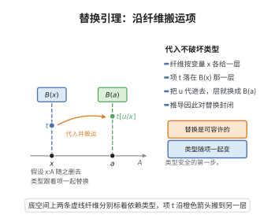

# 替换引理

> **一句话大白话**：把变量换成项不会破坏类型——若在“假设 $x$ 的类型是 $A$”的前提下 $t$ 有类型 $B$，而 $u$ 确实有类型 $A$，那么把 $u$ 代进 $t$ 得到的新项就有类型 $B[u/x]$，并且上下文里的 $x:A$ 也可以一并删掉。
> **小例子**：在 $\lambda$ 演算中，若 $x:\mathsf{Nat}\vdash(x+x):\mathsf{Nat}$ 且 $\vdash 3:\mathsf{Nat}$，则 $\vdash(3+3):\mathsf{Nat}$；类型检查器只需“代入并丢弃假设”，无需重新推理。

## 一、定理介绍

> **前置依赖**：上下文与判断（$\Gamma\vdash t:A$、$\Gamma\vdash A\ \mathsf{type}$）、$\lambda\Pi$（依赖函数类型）的推导规则、$\alpha$-等价与无捕获替换、β-归约与转换、推导树上的结构归纳法、自由变量集 $\mathrm{FV}$

替换引理（substitution lemma）是类型论中最重要的**元定理**之一，它断言“替换”这一操作在推导系统中是**可容许的**（admissible）：虽然它没有作为原始推理规则列出，但任何一条以 $x:A$ 为前提的推导，都可以在代入 $\Gamma\vdash u:A$ 后得到以 $B[u/x]$ 为结论的推导。换言之，演算对替换是封闭的。

它是几乎所有类型论基本定理的第一步。主题归约（subject reduction，即 $\beta$-归约保持类型）、完善性（progress）与类型安全、强正规化与合流性、以及依赖类型系统中的类型检查算法（上下文分裂与替换的正确性），都要先建立替换引理。在 Curry–Howard 对应下，它还对应着逻辑中“代入引理/切割消去”的一部分。

在 Martin-Löf 类型论中，替换有时被直接列为基本推理规则；在 $\lambda\Pi$（单纯依赖类型的核心演算）中它是一个可导出的元定理。下面的证明针对 $\lambda\Pi$ 给出完整归纳，同样的归纳可原样搬到含 $\Sigma$ 类型、恒等类型 $\mathrm{Id}$ 与归纳子的系统。

## 几何直观

图意在说明：把项 u 代入变量 x 后，项从纤维 B(x) 搬到 B(a)，类型随之一并替换，推导仍成立。

## 二、原理思路

对推导树作**结构归纳**：设已给 $\Gamma,x:A,\Delta\vdash\mathcal J$ 与 $\Gamma\vdash u:A$，要证 $\Gamma,\Delta[u/x]\vdash\mathcal J[u/x]$。逐条检查推导的最后一步所用规则：

1. **变量规则**：若判断的是 $x$ 自身（$\mathcal J$ 为 $x:A$），替换后成为 $u:A$，恰好是已知前提；若判断的是 $\Delta$ 或 $\Gamma$ 中的变量，替换要么不改变它（该变量不是 $x$），要么把它变成 $u$（此时新判断由已知前提提供）。
2. **弱化规则**：新加入的假设 $y:C$ 需要先对它使用归纳假设得到 $C[u/x]$ 的合法性，这是“上下文替换”部分（对 $\Delta$ 的长度归纳）。
3. **类型形成与引入／消去规则**：替换按语法构造分配，例如 $(\Pi y:C.D)[u/x]=\Pi y:C[u/x].D[u/x]$、$(\lambda y{:}C.s)[u/x]=\lambda y{:}C[u/x].s[u/x]$，再对子推导用归纳假设。
4. **绑定变元的重名**：处理 $\lambda,\Pi$ 时，先把绑定变元 $y$ 取为不在 $u,\Gamma,\Delta,A$ 中出现的“新鲜”变量（此操作由 $\alpha$-等价保持类型），从而替换不产生变量捕获。

## 三、定理的严格表述

**（替换引理）** 设 $\Gamma$、$\Delta$ 为 $\lambda\Pi$ 的良形成上下文（$\Delta$ 可空），$A$ 为类型，$u$ 为项，且
$$
\Gamma\vdash u:A .
$$
又设判断 $\mathcal J$（其形式为 “$B\ \mathsf{type}$”、“$t:B$” 或 “$B=B'$”）满足
$$
\Gamma,\ x:A,\ \Delta\ \vdash\ \mathcal J .
$$
则
$$
\Gamma,\ \Delta[u/x]\ \vdash\ \mathcal J[u/x],
$$
其中 $[u/x]$ 表示**无捕获替换**：把所有 $x$ 的自由出现替换为 $u$，并在遇到绑定变元与 $u$ 的自由变元冲突时先作 $\alpha$-换名。三种判断形式分别展开为：

- （类型形成保持）$\Gamma,x:A,\Delta\vdash B\ \mathsf{type}$ $\Longrightarrow$ $\Gamma,\Delta[u/x]\vdash B[u/x]\ \mathsf{type}$；
- （类型化保持）$\Gamma,x:A,\Delta\vdash t:B$ $\Longrightarrow$ $\Gamma,\Delta[u/x]\vdash t[u/x]:B[u/x]$；
- （类型相等保持）$\Gamma,x:A,\Delta\vdash B=B'$ $\Longrightarrow$ $\Gamma,\Delta[u/x]\vdash B[u/x]=B'[u/x]$。

**常用特例**（$\Delta$ 为空）：若 $\Gamma,x:A\vdash t:B$ 且 $\Gamma\vdash u:A$，则
$$
\Gamma\vdash t[u/x]:B[u/x] .
$$

**无捕获替换的定义与基本性质**：$t[u/x]$ 递归定义为

$$
x[u/x]=u,\qquad y[u/x]=y\ (y\ne x),\qquad (s\,t)[u/x]=s[u/x]\,t[u/x],
$$
$$
(\lambda y{:}C.s)[u/x]=\lambda y'{:}C[u/x].\ \big(s[y'/y]\big)[u/x],\qquad
(\Pi y{:}C.D)[u/x]=\Pi y'{:}C[u/x].\ \big(D[y'/y]\big)[u/x],
$$

其中 $y'$ 取为满足 $y'\notin\mathrm{FV}(u)\cup\{x\}\cup\mathrm{FV}(C)\cup\mathrm{FV}(D)\cup\mathrm{FV}(s)$ 的新鲜变量（由 $\alpha$-等价，这样的重命名不改变判断）。另有两个直接性质：

$$
\mathrm{FV}\big(t[u/x]\big)\subseteq\big(\mathrm{FV}(t)\setminus\{x\}\big)\cup\mathrm{FV}(u),\qquad
x\notin\mathrm{FV}(t)\ \Longrightarrow\ t[u/x]=t .
$$

## 四、证明过程

**步骤 0：$\lambda\Pi$ 的推导规则**

我们使用如下规则（判断均为“$t:B$”、“$B\ \mathsf{type}$”或“$B=B'$”）：

$$
\text{(Var)}\ \frac{\Gamma\vdash A\ \mathsf{type}}{\Gamma,x:A\vdash x:A},\qquad
\text{(Weak)}\ \frac{\Gamma\vdash A\ \mathsf{type}\quad\Gamma\vdash\mathcal J}{\Gamma,x:A\vdash\mathcal J},
$$
$$
\text{(}\Pi\text{-F)}\ \frac{\Gamma\vdash A\ \mathsf{type}\quad\Gamma,x:A\vdash B\ \mathsf{type}}{\Gamma\vdash(\Pi x{:}A.B)\ \mathsf{type}},
$$
$$
\text{(}\lambda\text{-I)}\ \frac{\Gamma,x:A\vdash b:B\quad\Gamma\vdash(\Pi x{:}A.B)\ \mathsf{type}}{\Gamma\vdash(\lambda x{:}A.b):(\Pi x{:}A.B)},
$$
$$
\text{(App-E)}\ \frac{\Gamma\vdash f:(\Pi x{:}A.B)\quad\Gamma\vdash a:A}{\Gamma\vdash f\,a:B[a/x]},
\qquad
\text{(Conv)}\ \frac{\Gamma\vdash t:A\quad\Gamma\vdash A'\ \mathsf{type}\quad A=_\beta A'}{\Gamma\vdash t:A'} .
$$

推导是有限树，故对其高度作归纳（下面称“对推导作归纳”）是良基的。$\square$

**步骤 1：上下文替换（对 $\Delta$ 的长度归纳）**

先证一个辅助结论：在 $\Gamma,x:A\vdash\Delta\ \text{上下文}$、$\Gamma\vdash u:A$ 之下，$\Gamma,\Delta[u/x]$ 是良形成上下文。对 $\Delta$ 的长度归纳：

- $\Delta$ 为空（或仅含 $\Gamma$ 中的假设）时显然。
- 设 $\Delta=(\Delta',y:C)$，且 $(\Gamma,x:A,\Delta')\vdash C\ \mathsf{type}$。由归纳假设 $\Gamma,\Delta'[u/x]$ 是良形成上下文，且需证 $\Gamma,\Delta'[u/x]\vdash C[u/x]\ \mathsf{type}$，这是替换引理在“类型形成”判断、$\Delta=\Delta'$ 时的情形。因此 $\Gamma,\Delta'[u/x],y:C[u/x]=\Gamma,\Delta[u/x]$ 是良形成上下文。$\square$

**步骤 2：变量规则**

设最后一步为 (Var)，即 $\mathcal J$ 为 $y:A_0$，其中 $y:A_0$ 是 $\Gamma,x:A,\Delta$ 中的某个假设。三种情形：

- $y=x$ 且该假设来自 $x:A$：则 $\mathcal J=x:A$，$A_0=A$。此时 $\mathcal J[u/x]=u:A$（因 $A[u/x]=A$，因为 $x\notin\mathrm{FV}(A)$：假设 $A$ 在加入 $x$ 之前已由 $\Gamma$ 检验为合法类型）。又由题设 $\Gamma\vdash u:A$，即 $\Gamma\vdash\mathcal J[u/x]$，结论成立。
- $y$ 是 $\Delta$ 中的假设：$\Delta=(\Delta_1,y:C,\Delta_2)$，且 $x\ne y$、$y\notin\mathrm{FV}(u)$（$u$ 在 $\Gamma$ 中，与 $y$ 无关）。此时 $\mathcal J[u/x]=y:C[u/x]$，而由步骤 1，$\Gamma,\Delta[u/x]$ 是良形成上下文，故其中的假设 $y:C[u/x]$ 可由 (Var) 导出。
- $y$ 是 $\Gamma$ 中的假设：$\mathcal J[u/x]=\mathcal J$（因 $x\ne y$），且 $\Gamma\subseteq\Gamma,\Delta[u/x]$，故仍可导出。$\square$

**步骤 3：弱化规则**

设最后一步为 (Weak)：由 $\Gamma,x:A,\Delta\vdash C\ \mathsf{type}$ 与 $\Gamma,x:A,\Delta\vdash\mathcal J_0$ 推出 $\Gamma,x:A,\Delta,y:C\vdash\mathcal J_0$（此时 $\mathcal J=\mathcal J_0$ 且原判断的参数 $x:A$ 位于 $\Gamma'=\Gamma,x:A,\Delta$ 中，故 $\Delta$ 应理解为 $\Delta,y:C$）。由归纳假设（对两个子推导分别使用）：

$$
\Gamma,\Delta[u/x]\vdash C[u/x]\ \mathsf{type},\qquad \Gamma,\Delta[u/x]\vdash\mathcal J_0[u/x] .
$$

再由 (Weak) 得 $\Gamma,\Delta[u/x],y:C[u/x]\vdash\mathcal J_0[u/x]$，即 $\Gamma,(\Delta,y:C)[u/x]\vdash\mathcal J[u/x]$。$\square$

**步骤 4：$\Pi$ 形成规则**

设最后一步为 ($\Pi$-F)：$\mathcal J$ 为 $(\Pi y{:}C.D)\ \mathsf{type}$，子推导为 $\Gamma,x:A,\Delta\vdash C\ \mathsf{type}$ 与 $\Gamma,x:A,\Delta,y:C\vdash D\ \mathsf{type}$。由步骤 1 的“变量规则—上下文”论证可先把 $y$ 重命名为新鲜变量（$\alpha$-等价，不影响判断），使 $y\notin\mathrm{FV}(u)\cup\{x\}$，从而 $(\Pi y{:}C.D)[u/x]=\Pi y{:}C[u/x].D[u/x]$。

由归纳假设得 $\Gamma,\Delta[u/x]\vdash C[u/x]\ \mathsf{type}$；再把归纳假设用于第二个子推导（以 $\Delta,y:C$ 代替 $\Delta$）得 $\Gamma,\Delta[u/x],y:C[u/x]\vdash D[u/x]\ \mathsf{type}$。由 ($\Pi$-F)：

$$
\Gamma,\Delta[u/x]\vdash\big(\Pi y{:}C[u/x].D[u/x]\big)\ \mathsf{type},
$$

即 $\Gamma,\Delta[u/x]\vdash(\Pi y{:}C.D)[u/x]\ \mathsf{type}$。$\square$

**步骤 5：$\lambda$ 引入规则**

设最后一步为 ($\lambda$-I)：$\mathcal J$ 为 $(\lambda y{:}C.b):(\Pi y{:}C.D)$，子推导为 $\Gamma,x:A,\Delta,y:C\vdash b:D$ 与 $\Gamma,x:A,\Delta\vdash(\Pi y{:}C.D)\ \mathsf{type}$。同样先把 $y$ 重命名为新鲜变量，使

$$
(\lambda y{:}C.b)[u/x]=\lambda y{:}C[u/x].b[u/x],\qquad (\Pi y{:}C.D)[u/x]=\Pi y{:}C[u/x].D[u/x] .
$$

由归纳假设：$\Gamma,\Delta[u/x],y:C[u/x]\vdash b[u/x]:D[u/x]$；由步骤 4 的结论：$\Gamma,\Delta[u/x]\vdash(\Pi y{:}C[u/x].D[u/x])\ \mathsf{type}$。由 ($\lambda$-I)：

$$
\Gamma,\Delta[u/x]\vdash\lambda y{:}C[u/x].b[u/x]:\big(\Pi y{:}C[u/x].D[u/x]\big),
$$

即 $\Gamma,\Delta[u/x]\vdash(\lambda y{:}C.b)[u/x]:(\Pi y{:}C.D)[u/x]$。$\square$

**步骤 6：应用（消去）规则**

设最后一步为 (App-E)：$\mathcal J$ 为 $f\,a:B[a/y]$，子推导为 $\Gamma,x:A,\Delta\vdash f:(\Pi y{:}C.B)$ 与 $\Gamma,x:A,\Delta\vdash a:C$。由归纳假设：

$$
\Gamma,\Delta[u/x]\vdash f[u/x]:(\Pi y{:}C.D)[u/x]\big|_{\text{记为 }\Pi y{:}C'.B'},\qquad
\Gamma,\Delta[u/x]\vdash a[u/x]:C[u/x] .
$$

为记号清晰，记 $C'=C[u/x]$、$B'=B[u/x]$（$y$ 已取为新鲜变量，故替换可逐点分配到 $C,B$ 内部）。由 (App-E) 得

$$
\Gamma,\Delta[u/x]\vdash (f[u/x])\,(a[u/x])\ :\ B'[\,a[u/x]/y\,] .
$$

另一方面 $(f\,a)[u/x]=(f[u/x])(a[u/x])$，且需要确认

$$
\big(B[a/y]\big)[u/x]=B'\,[\,a[u/x]/y\,]=B[u/x][\,a[u/x]/y\,] .
$$

这一等式由“替换的可交换性”给出：任取项 $\rho$，若 $y\ne x$ 且 $y\notin\mathrm{FV}(u)$、$x\notin\mathrm{FV}(a)$，则对 $\rho$ 的结构作归纳可证

$$
\big(\rho[a/y]\big)[u/x]=\big(\rho[u/x]\big)\big[\,a[u/x]/y\,\big]. \tag{$\ast$}
$$

（$\ast$ 的两边都等于“把 $\rho$ 的自由 $y$ 换成 $a$、再把自由 $x$ 换成 $u$”这一同时替换，因为 $y\notin\mathrm{FV}(u)$ 保证 $u$ 中的自由变量不被误改，$x\notin\mathrm{FV}(a)$ 保证 $a$ 中的自由变量不被误改；对绑定变元逐层取新鲜名即得。若某条件不成立，先对绑定变元作 $\alpha$-换名使其成立，这由 $\alpha$-等价保持判断。）取 $\rho=B$ 即得所需等式。故

$$
\Gamma,\Delta[u/x]\vdash\big(f\,a\big)[u/x]:\big(B[a/y]\big)[u/x],
$$

即 $\Gamma,\Delta[u/x]\vdash\mathcal J[u/x]$。$\square$

**步骤 7：转换规则与相等判断**

设最后一步为 (Conv)：由 $\Gamma,x:A,\Delta\vdash t:B$、$\Gamma,x:A,\Delta\vdash B'\ \mathsf{type}$、$B=_\beta B'$ 推出 $\Gamma,x:A,\Delta\vdash t:B'$。由归纳假设，$\Gamma,\Delta[u/x]\vdash t[u/x]:B[u/x]$ 且 $\Gamma,\Delta[u/x]\vdash B'[u/x]\ \mathsf{type}$。又 $\beta$-归约在替换下稳定：若 $B\to_\beta B''$，则 $B[u/x]\to_\beta B''[u/x]$（对归约步的结构归纳，用 $(\ast)$ 处理 $\beta$-redex $(\lambda y.s)\,a\to s[a/y]$），故 $B[u/x]=_\beta B'[u/x]$。由 (Conv) 得 $\Gamma,\Delta[u/x]\vdash t[u/x]:B'[u/x]$。类型相等判断的情形同理：对导出的等式作结构归纳，替换按语法构造分配即得。$\square$

**步骤 8：结论**

由推导树的良基性与步骤 2–7 的逐规则检查，归纳完成：一切情形下 $\Gamma,\Delta[u/x]\vdash\mathcal J[u/x]$ 成立。取 $\Delta$ 为空即得常用特例 $\Gamma\vdash t[u/x]:B[u/x]$。$\blacksquare$

**步骤 9：迭代替换**

反复使用特例即得：若 $\Gamma,x_1:A_1,x_2:A_2\vdash t:B$、$\Gamma\vdash u_1:A_1$、$\Gamma\vdash u_2:A_2[u_1/x_1]$，则
$$
\Gamma\vdash t[u_1/x_1][u_2/x_2]:B[u_1/x_1][u_2/x_2] .
$$
先对 $x_1$ 用引理（此时假设 $x_2:A_2$ 变为 $x_2:A_2[u_1/x_1]$），再对 $x_2$ 用引理。这也说明替换引理可以“沿上下文逐项”进行，这正是类型检查算法处理依赖类型时所需的性质。$\blacksquare$

## 五、应用与意义

**在类型论与证明论中的作用**：

1. **主题归约（subject reduction）**：若 $\Gamma\vdash t:B$ 且 $t\to_\beta t'$，则 $\Gamma\vdash t':B$。关键在于 $\beta$-步 $(\lambda x{:}A.s)\,a\to s[a/x]$ 的类型：由 (App-E) 给出类型 $B[a/x]$，而 $(s[a/x])$ 的类型恰由替换引理给出，两者一致。这是类型安全（progress + preservation）证明的第一块基石。
2. **正规化与合流性**：强正规化证明（如 Tait 的可归约性方法、逻辑关系方法）在定义“可归约”时必须以替换引理保证归约步骤的良类型性；Church–Rosser 与唯一性类型也依赖它。
3. **类型检查算法**：双向类型检查与细化系统需要“上下文分裂 + 替换”的正确性；处理依赖类型时必须保证 $\Gamma\vdash B[a/x]\ \mathsf{type}$，这正由本引理（类型形成保持）提供。
4. **Curry–Howard 对应**：替换对应于逻辑中的代入与作为“局部化切割消去”的一步，替换引理的良基归纳与切割消去定理的结构归纳同源。

**理论意义**：替换引理表明类型系统对“代换”这一最基本的语法操作封闭，从而保证了“语法—语义”翻译（赋值、求值、编译）的良定义性。它是元理论工作的标准起点：所有关于类型论/演算的性质证明几乎都从“先证替换引理”开始。

**推广与对应**：在递归论中，其对应物是 s-m-n 定理（把参数内化到程序中）；在一阶逻辑中对应项替换引理（$\varphi[t/x]$ 的真值不变性）；在范畴论中，替换引理与“上下文范畴／纤维化（comprehension category、split fibration）”的复合律同构，是“类属对象与替换函子”的语法体现；在依赖类型论中对 $\Sigma$、$\mathrm{Id}$、归纳子、宇宙层级与原语替换规则同样成立。

## 课堂问答

**老师**：替换引理说的是一种什么样的"可容许性"？

**学生**：把变量换成项不破坏类型。若 $\Gamma,x:A,\Delta\vdash\mathcal J$ 且 $\Gamma\vdash u:A$，则 $\Gamma,\Delta[u/x]\vdash\mathcal J[u/x]$，其中 $\mathcal J$ 可为 $B\ \mathsf{type}$、$t:B$ 或 $B=B'$ 三种形式。常用特例（$\Delta$ 空）：$\Gamma,x:A\vdash t:B$、$\Gamma\vdash u:A$ 蕴含 $\Gamma\vdash t[u/x]:B[u/x]$。

**老师（追问）**：证明的归纳结构如何？处理 $\lambda,\Pi$ 时最要小心什么？

**学生**：对推导树作良基归纳，逐条检查最后一步所用的规则：变量、弱化、$\Pi$ 形成、$\lambda$ 引入、应用、转换。处理 $\lambda,\Pi$ 时先把绑定变元 $y$ 重命名为不在 $u,\Gamma,\Delta$ 中出现的新鲜变量（由 $\alpha$-等价保持类型），于是 $(\lambda y{:}C.s)[u/x]=\lambda y{:}C[u/x].s[u/x]$，不会产生变量捕获。应用规则还要用到替换的可交换性 $(\rho[a/y])[u/x]=(\rho[u/x])[a[u/x]/y]$。

**老师（拓展）**：它为什么是主题归约与类型安全的第一步？

**学生**：看 $\beta$-步 $(\lambda x{:}A.s)\,a\to s[a/x]$：由应用规则该项类型为 $B[a/x]$，而 $s[a/x]$ 的类型恰由本引理给出也为 $B[a/x]$，两者一致，故归约保持类型。常见误区是忽略"无捕获"这一条件——不做 $\alpha$-换名就会发生变量捕获，语义随即出错。
