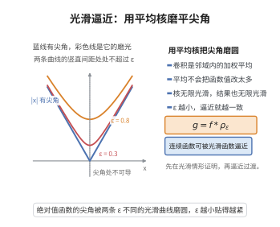

# 光滑逼近定理

> **一句话大白话**：只要函数连续，就能用无限光滑的函数把它"磨"得任意接近——拿一个光滑的"平均核"去局部搅匀即可。
>
> **小例子**：折线函数 $|x|$ 可被 $g_\varepsilon(x)=\sqrt{x^2+\varepsilon^2}$ 一致逼近，而每个 $g_\varepsilon$ 都是 $C^\infty$ 的。

## 介绍

光滑逼近定理断言：任何连续函数都可以用光滑（$C^\infty$）函数一致逼近。它说明"连续"与"光滑"这两个概念在一致收敛的意义下相距并不遥远，是分析中"先对光滑函数证明、再用逼近过渡到一般函数"这一常用策略的理论依据。

实现逼近的标准工具是磨光函数（mollifier）：取一个支集很小、积分为 $1$ 的 $C^\infty$ 非负函数 $\rho_\varepsilon$，用它与 $f$ 作卷积 $f*\rho_\varepsilon$。卷积起到"局部加权平均"的作用：它把 $f$ 的尖角磨圆，却几乎不改变函数值，且作为含参积分关于自变量光滑。

与之互补的经典结果是魏尔斯特拉斯逼近定理（用多项式逼近），而磨光方法还额外保证逼近函数保持支集、可任意阶求导，因此在偏微分方程与分布理论中更为常用。

## 几何直观

图意在说明：以磨光核作局部加权平均，能把连续的尖角变成任意阶可导的曲线。

## 分析

**前置依赖**：一致连续、连续函数的可积性、含参积分的可微性（在积分号下求导）、换元积分法、积分中值/估值

**定理内容**：设 $f$ 是 $\mathbb R$ 上的连续函数（或 $[a,b]$ 上的连续函数，可先连续延拓到 $\mathbb R$ 并取紧支集）。则对任意 $\varepsilon>0$，存在 $g\in C^\infty(\mathbb R)$，使得

$$
\sup_{x\in\mathbb R}|f(x)-g(x)|<\varepsilon
$$

若要求逼近在 $[a,b]$ 上一致，则只需 $f$ 在 $[a,b]$ 上连续。

**数学内涵**：
- 磨光不改变函数的支集太多：$\operatorname{supp}(f*\rho_\varepsilon)\subset\operatorname{supp}f+[-\varepsilon,\varepsilon]$。
- 若 $f$ 本身已光滑，则 $f*\rho_\varepsilon\to f$ 在各阶导数意义下也成立。

## 思考过程

先造一个"光滑的凸包"：$\rho(x)=C\,\exp\!\big(-\frac{1}{1-x^2}\big)$（$|x|<1$ 时），$|x|\ge1$ 时取 $0$，其中常数 $C$ 使 $\int_{\mathbb R}\rho=1$。这个函数在 $\pm1$ 处各阶导数都趋于 $0$，因此处处 $C^\infty$。再把它压缩：$\rho_\varepsilon(x)=\frac1\varepsilon\rho(x/\varepsilon)$，支集为 $[-\varepsilon,\varepsilon]$，积分仍为 $1$。

用 $f*\rho_\varepsilon(x)=\int f(x-y)\rho_\varepsilon(y)\,dy$ 作为逼近函数。它是"以 $x$ 为中心、半径 $\varepsilon$ 内 $f$ 的加权平均"，因此与 $f(x)$ 的差不超过 $f$ 在该邻域内的振幅。由一致连续性，振幅随 $\varepsilon\to0$ 一致趋于 $0$。光滑性来自在积分号下对 $x$ 求导：被积函数对 $x$ 任意阶可导且导数有界，故可逐阶求导。

## 证明过程

**步骤 1：构造磨光核。** 定义

$$
\rho(x)=\begin{cases} C\exp\!\left(-\dfrac{1}{1-x^2}\right), & |x|<1,\\[2mm] 0, & |x|\ge1,\end{cases}\qquad C=\left(\int_{-1}^{1}\exp\!\left(-\dfrac{1}{1-x^2}\right)dx\right)^{-1}
$$

因 $|x|\to1$ 时 $\exp(-1/(1-x^2))$ 及其各阶导数都趋于 $0$，故 $\rho\in C^\infty(\mathbb R)$，且 $\rho\ge0$，$\int_{\mathbb R}\rho=1$，$\operatorname{supp}\rho\subset[-1,1]$。

**步骤 2：缩放核。** 令 $\rho_\varepsilon(x)=\frac1\varepsilon\rho\!\left(\frac x\varepsilon\right)$。由换元积分，$\int_{\mathbb R}\rho_\varepsilon=1$，$\operatorname{supp}\rho_\varepsilon\subset[-\varepsilon,\varepsilon]$，且 $\rho_\varepsilon\in C^\infty$。

**步骤 3：定义磨光函数并证明光滑性。** 令

$$
g_\varepsilon(x)=(f*\rho_\varepsilon)(x)=\int_{\mathbb R} f(x-y)\rho_\varepsilon(y)\,dy=\int_{-\varepsilon}^{\varepsilon} f(x-y)\rho_\varepsilon(y)\,dy
$$

被积函数 $(x,y)\mapsto f(x-y)\rho_\varepsilon(y)$ 对 $x$ 可任意次求导（因 $\rho_\varepsilon\in C^\infty$），且 $f$ 连续、$\rho_\varepsilon^{(k)}$ 有界，故由含参积分在积分号下求导定理，

$$
g_\varepsilon^{(k)}(x)=\int_{-\varepsilon}^{\varepsilon} f(x-y)\rho_\varepsilon^{(k)}(y)\,dy,\qquad k=0,1,2,\dots
$$

右端积分存在且连续，故 $g_\varepsilon\in C^\infty(\mathbb R)$。

**步骤 4：一致逼近。** 因 $\int\rho_\varepsilon=1$，

$$
g_\varepsilon(x)-f(x)=\int_{-\varepsilon}^{\varepsilon}\big(f(x-y)-f(x)\big)\rho_\varepsilon(y)\,dy
$$

设 $f$ 在包含目标区间的紧集上一致连续。对给定的 $\varepsilon>0$，取 $\delta=\varepsilon$（或更小）使 $|y|\le\varepsilon$ 时 $|f(x-y)-f(x)|<\eta$ 对一切 $x$ 成立，则

$$
|g_\varepsilon(x)-f(x)|\le\int_{-\varepsilon}^{\varepsilon}\eta\,\rho_\varepsilon(y)\,dy=\eta
$$

对一切 $x$ 成立。对任意给定的精度 $\eta>0$，先取 $\varepsilon$ 足够小以满足一致连续性，即得 $\sup_x|g_\varepsilon(x)-f(x)|<\eta$。

**步骤 5：$[a,b]$ 情形。** 若 $f$ 只在 $[a,b]$ 上连续，则先用介于相邻区间端点的线性插值把它连续延拓为 $\mathbb R$ 上具紧支集的连续函数（例如在 $[b,b+1]$ 上线性降到 $0$，在 $[a-1,a]$ 上同样处理，外侧取 $0$）。延拓后应用步骤 1–4，再把 $g_\varepsilon$ 限制回 $[a,b]$ 即可。$\square$

## 课堂问答

**老师**：连续函数离光滑函数有多远？

**学生**：在一致范数下要多近有多近。对任意 $\varepsilon>0$ 存在 $g\in C^\infty$ 使 $\sup_x|f(x)-g(x)|<\varepsilon$。工具是磨光：取 $\rho(x)=C\exp\!\big(-1/(1-x^2)\big)$（$|x|<1$）为支集 $[-1,1]$、积分 $1$ 的 $C^\infty$ 核，再缩放
$$\rho_\varepsilon(x)=\frac1\varepsilon\rho\!\Big(\frac x\varepsilon\Big),\qquad g_\varepsilon=f*\rho_\varepsilon ,$$
$g_\varepsilon(x)$ 就是以 $x$ 为中心、半径 $\varepsilon$ 内 $f$ 的加权平均。

**老师（追问）**：光滑性与逼近性各来自哪里？

**学生**：光滑性来自积分号下求导：$\rho_\varepsilon$ 任意阶可导且导数有界，故 $g_\varepsilon^{(k)}(x)=\int f(x-y)\rho_\varepsilon^{(k)}(y)\,dy$ 存在且连续。逼近性来自 $\int\rho_\varepsilon=1$，于是
$$g_\varepsilon(x)-f(x)=\int_{-\varepsilon}^{\varepsilon}\big(f(x-y)-f(x)\big)\rho_\varepsilon(y)\,dy,$$
由一致连续性，邻域内振幅随 $\varepsilon\to0$ 一致趋零。注意 $C\exp\!\big(-1/(1-x^2)\big)$ 在 $\pm1$ 处各阶导数都趋于零，这正是它属于 $C^\infty$ 的原因。

**老师（拓展）**：它和魏尔斯特拉斯多项式逼近有何不同？

**学生**：两者都做一致逼近，但磨光更强：$f*\rho_\varepsilon$ 保持支集（$\operatorname{supp}(f*\rho_\varepsilon)\subset\operatorname{supp}f+[-\varepsilon,\varepsilon]$），可任意阶求导且各阶导数也逼近；甚至 $f$ 本身光滑时 $f*\rho_\varepsilon\to f$ 在导数意义下成立。因此在偏微分方程与分布理论中更常用——"先对光滑函数证明，再用逼近过渡"。

## 相关条目

- [隐函数定理](./隐函数定理.md)：分析中"局部化—线性化"的基本工具，与光滑逼近常配合使用。
- [拉格朗日乘数法](./拉格朗日乘数法.md)：约束极值方法，常先用光滑逼近把问题纳入可微框架。
