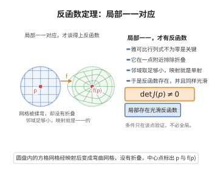

# 反函数定理

> **一句话大白话**：只要函数在某点的导数不等于 $0$（切线不是平的），那在这点附近就能“反着解”回原来的输入，且反函数照样可导。
>
> **小例子**：$f(x)=x^3+x$ 处处 $f'(x)=3x^2+1>0$，故处处局部可逆；且反函数导数为 $(f^{-1})'(y)=\frac1{f'(f^{-1}(y))}$。

## 介绍

反函数定理（Inverse Function Theorem）是微积分学中的基本定理之一，给出了函数在局部存在反函数的充分条件。该定理断言，若函数 $f$ 在 $x_0$ 处的导数非零，则 $f$ 在 $x_0$ 附近是一一映射，且其反函数可导。反函数定理是隐函数定理的直接推论，在微分几何、动力系统等领域有广泛应用。

## 几何直观

图意在说明：雅可比行列式不为零保证映射在一点附近不折叠，从而局部一一、可逆。

## 分析

**前置依赖**：隐函数定理、导数与连续性、中值定理

**定理内容**：设 $f$ 在点 $x_0$ 的某邻域内连续可导，且 $f'(x_0)\neq 0$，则存在 $x_0$ 的邻域 $U$ 和 $f(x_0)$ 的邻域 $V$，使得 $f:U\to V$ 是一一映射，其反函数 $f^{-1}:V\to U$ 连续可导，且
$$(f^{-1})'(y)=\frac{1}{f'(f^{-1}(y))},\quad \forall y\in V$$

**前置知识**：
- 隐函数定理：由 $F(x,y)=0$ 可解出 $y=f(x)$ 的条件

**数学内涵**：
反函数定理的几何意义是：如果函数在一点处的切线非水平，则函数在该点附近是局部可逆的。其导数关系反映了原函数和反函数的导数互为倒数这一事实。

该定理可以推广到多元函数：若 $f:\mathbb{R}^n\to\mathbb{R}^n$ 在 $x_0$ 处的 Jacobi 矩阵可逆，则 $f$ 在 $x_0$ 附近有反函数，且反函数的 Jacobi 矩阵等于原函数 Jacobi 矩阵的逆。

## 思考过程

反函数定理可以通过隐函数定理证明。考虑方程 $F(x,y)=f(x)-y=0$，其中 $y$ 视为参数，$x$ 为未知数。则 $F_x(x,y)=f'(x)$，在 $x=x_0$ 处 $f'(x_0)\neq 0$，因此由隐函数定理，可从 $f(x)-y=0$ 中解出 $x=g(y)$，其中 $g$ 即为 $f$ 的反函数。

由隐函数定理的求导公式：
$$g'(y)=-\frac{F_y(g(y),y)}{F_x(g(y),y)}=-\frac{-1}{f'(g(y))}=\frac{1}{f'(g(y))}$$

## 证明过程

**证明**：

**第一步：利用隐函数定理构造反函数。**

定义函数 $F(x,y)=f(x)-y$，则 $F(x_0,f(x_0))=f(x_0)-f(x_0)=0$。

$F$ 在 $(x_0,f(x_0))$ 附近连续可导，且 $F_x(x_0,f(x_0))=f'(x_0)\neq 0$。

由隐函数定理，存在 $x_0$ 的邻域 $U$ 和 $f(x_0)$ 的邻域 $V$，使得对任意 $y\in V$，存在唯一的 $x=g(y)\in U$，满足 $F(g(y),y)=0$，即 $f(g(y))-y=0$，亦即 $f(g(y))=y$。因此 $g$ 是 $f$ 在 $U$ 上的反函数，$g:V\to U$ 是一一映射。

**第二步：证明反函数的可导性。**

由隐函数定理，$g$ 在 $V$ 上连续可导，且
$$g'(y)=-\frac{F_y(g(y),y)}{F_x(g(y),y)}=-\frac{-1}{f'(g(y))}=\frac{1}{f'(g(y))}$$

由于 $f'$ 在 $U$ 上连续且 $f'(x)\neq 0$，$g'(y)$ 在 $V$ 上连续。

**第三步：验证高阶性质（可选）。**

若 $f$ 是 $C^k$ 的（$k$ 阶连续可导），则 $g$ 也是 $C^k$ 的。

$\square$

## 课堂问答

**老师**：什么条件下函数能局部反解出来？

**学生**：只要一点导数非零即可。设 $f$ 在 $x_0$ 邻域连续可导且 $f'(x_0)\ne0$，则存在邻域 $U,V$ 使 $f:U\to V$ 一一，反函数 $f^{-1}$ 连续可导，且
$$(f^{-1})'(y)=\frac{1}{f'(f^{-1}(y))},\qquad y\in V .$$

**老师（追问）**：这个定理怎么证？导数公式从哪来？

**学生**：由隐函数定理导出。令 $F(x,y)=f(x)-y$，则 $F(x_0,f(x_0))=0$ 且 $F_x(x_0,f(x_0))=f'(x_0)\ne0$，故可解出唯一 $x=g(y)$ 使 $f(g(y))=y$，即 $g=f^{-1}$。求导用隐函数公式
$$g'(y)=-\frac{F_y}{F_x}=-\frac{-1}{f'(g(y))}=\frac{1}{f'(g(y))},$$
这也直观解释了"原函数与反函数的导数互为倒数"。

**老师（拓展）**：它如何推广到多元？几何上是什么意思？

**学生**：多元版本即逆映射定理：若 $F:\mathbb{R}^n\to\mathbb{R}^n$ 在 $x_0$ 处 Jacobi 矩阵 $DF(x_0)$ 可逆，则局部是 $C^1$ 微分同胚，且 $DG(y)=[DF(G(y))]^{-1}$，即导数互为"逆矩阵"。几何上 $f'(x_0)\ne0$ 表示切线不水平、各方向没被压扁，故局部不折叠、可逆。例如极坐标映射在 $r>0$ 处 Jacobi 行列式为 $r\ne0$，处处局部可逆，只有原点退化。
