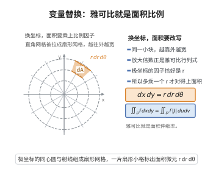

# 多重积分的变量替换公式

> **一句话大白话**：换元积分时，面积（体积）会被拉伸或压缩，补偿量就是雅可比行列式的绝对值——一元换元的 $|u'(x)|$ 在高维的推广。
>
> **小例子**：极坐标换元 $(x,y)=(r\cos\theta,r\sin\theta)$ 的 Jacobi 行列式为 $r$，故 $dx\,dy=r\,dr\,d\theta$。

## 介绍

多重积分的变量替换公式是重积分计算的核心工具。它断言：在可逆的 $C^1$ 变换下，重积分等于在新坐标下用"原函数乘以雅可比行列式绝对值"再积分。一元换元公式 $\int_{\varphi(a)}^{\varphi(b)} f(x)\,dx=\int_a^b f(\varphi(t))|\varphi'(t)|\,dt$ 正是它在一维的特例。

公式的几何含义是局部体积的伸缩：在每一点，可微变换 $\varphi$ 在无穷小尺度上近似为线性映射 $D\varphi$，而线性映射把单位体积放大 $|\det D\varphi|$ 倍——这正是雅可比行列式的几何意义。极坐标、球坐标、柱坐标等常用换元都是它的直接应用。

历史上，雅可比（C. G. J. Jacobi）系统研究了这种"函数行列式"，由此得名 Jacobi 行列式；该公式让重积分从"直角坐标"中解放出来，是数学物理与几何测度论的基本工具。

## 几何直观

图意在说明：换坐标后小格被拉伸，面积要乘上雅可比行列式，极坐标下这个因子就是 r。

## 分析

**前置依赖**：二重积分的定义、可微映射与 Jacobi 矩阵、线性变换的体积伸缩、可微映射的局部线性化（带皮亚诺余项的一阶展开）

**定理内容**：设 $D\subset\mathbb R^2$ 为有界区域，$\varphi:D\to\mathbb R^2$ 是 $C^1$ 单射且其 Jacobi 行列式在 $D$ 上恒不为零，记 $\Omega=\varphi(D)$。若 $f$ 在 $\Omega$ 上连续（或可积），则

$$
\iint_{\Omega} f(x,y)\,dx\,dy=\iint_{D} f(\varphi(u,v))\,\left|\frac{\partial(x,y)}{\partial(u,v)}\right|\,du\,dv
$$

其中

$$
\frac{\partial(x,y)}{\partial(u,v)}=\det\begin{pmatrix}\dfrac{\partial x}{\partial u}&\dfrac{\partial x}{\partial v}\\[2mm]\dfrac{\partial y}{\partial u}&\dfrac{\partial y}{\partial v}\end{pmatrix}
$$

**数学内涵**：
- 局部因子 $|\partial(x,y)/\partial(u,v)|$ 表示变换在 $(u,v)$ 处把面积放大的倍数。
- 对 $n$ 重积分，公式形式完全相同，只是行列式换为 $n\times n$。

## 思考过程

先看线性变换：若 $\varphi(u,v)=A(u,v)$ 为可逆线性映射，则 $\varphi$ 把每个小矩形映成平行四边形，面积恰好放大 $|\det A|$ 倍，因此结论成立。而一般的 $C^1$ 映射在小尺度上"几乎就是"它的微分 $D\varphi$：在点 $(u_0,v_0)$ 附近，$\varphi(u,v)\approx\varphi(u_0,v_0)+D\varphi(u_0,v_0)(u-u_0,v-v_0)$，误差是 $o(\text{直径})$。

于是把 $D$ 细分成许多小方块，每块上变换近似为线性映射，其像的面积约等于 $|\det D\varphi|\cdot$（原块面积），误差是更高阶的小量。对黎曼和求和，再把分割无限加细，误差趋于零，即得公式。这样，问题就归结为"线性情形 + 局部线性化取极限"两步。

## 证明过程

**步骤 1：线性变换的体积伸缩。** 设 $A$ 为可逆线性映射，$E\subset\mathbb R^2$ 为可测集，则

$$
\text{面积}(A(E))=|\det A|\cdot\text{面积}(E)
$$

证明：任何可逆矩阵都可分解为若干初等矩阵之积：对角放缩 $\operatorname{diag}(a,b)$、剪切 $\begin{pmatrix}1&s\\0&1\end{pmatrix}$、坐标交换 $\begin{pmatrix}0&1\\1&0\end{pmatrix}$。

- 对放缩，$E$ 被横向放大 $|a|$ 倍、纵向放大 $|b|$ 倍，面积放大 $|ab|=|\det|$ 倍。
- 对剪切，$(u,v)\mapsto(u+sv,v)$，每一水平条带仍是高度为 $dv$ 的条带，底边长度不变，由祖暅原理（卡瓦列里原理）面积不变，而 $|\det|=1$。
- 对坐标交换，面积不变，$|\det|=1$。

又行列式对乘积可乘：$\det(A_1A_2)=\det A_1\det A_2$，故一般可逆矩阵的面积伸缩因子为各因子之积，即 $|\det A|$。

**步骤 2：局部线性化。** 设 $\varphi$ 在 $D$ 上 $C^1$。因 $D\varphi$ 在有界闭区域上一致连续，对任意 $\varepsilon>0$，当小方块 $Q$（边长 $h$，中心 $c$）的边长足够小时，其像 $\varphi(Q)$ 与线性像 $\varphi(c)+D\varphi(c)(Q-c)$ 之间的点偏差不超过 $\varepsilon h$，从而两者面积之差不超过 $\varepsilon h\cdot(\text{周长})=O(\varepsilon h^2)$。结合步骤 1，

$$
\text{面积}(\varphi(Q))=\left(|\det D\varphi(c)|+o(1)\right)h^2,\qquad h\to0
$$

其中 $o(1)$ 关于方块一致地趋于 $0$。

**步骤 3：黎曼和取极限。** 用边长 $h$ 的小方块分割 $D$，设覆盖 $D$ 的方块为 $Q_1,\dots,Q_N$。在每个 $Q_i$ 上取样本点 $c_i$，则

$$
\sum_{i=1}^N f(\varphi(c_i))\,\text{面积}(\varphi(Q_i))=\sum_{i=1}^N f(\varphi(c_i))\left(|\det D\varphi(c_i)|+o(1)\right)h^2
$$

左端当 $h\to0$ 时趋于 $\iint_\Omega f(x,y)\,dx\,dy$（因 $\varphi(Q_i)$ 构成 $\Omega$ 的细分），右端趋于 $\iint_D f(\varphi(u,v))|\det D\varphi(u,v)|\,du\,dv$。由步骤 2 的 $o(1)$ 一致性，两极限相等，即得变量替换公式。$\square$

**注（极坐标）**：取 $\varphi(r,\theta)=(r\cos\theta,r\sin\theta)$，则 $\dfrac{\partial(x,y)}{\partial(r,\theta)}=r$，故 $dx\,dy=r\,dr\,d\theta$。

## 课堂问答

**老师**：换元后重积分的面积因子为什么是雅可比行列式？

**学生**：因为可微变换在无穷小尺度上就是它的微分，而线性映射把体积放大 $|\det D\varphi|$ 倍。公式为：$\varphi:D\to\Omega$ 是 $C^1$ 单射、Jacobi 行列式在 $D$ 上恒不为零时
$$\iint_\Omega f(x,y)\,dx\,dy=\iint_D f(\varphi(u,v))\left|\frac{\partial(x,y)}{\partial(u,v)}\right|du\,dv .$$
一元换元的 $|\varphi'(t)|$ 正是它的特例。

**老师（追问）**：怎么把线性情形推广到一般 $C^1$ 映射？

**学生**：分两步。先证线性：可逆矩阵分解为放缩、剪切、坐标交换，逐一验证面积伸缩因子为 $|\det A|$（剪切用祖暅原理面积不变）。再局部线性化：小方块 $Q$ 上 $\varphi$ 与 $\varphi(c)+D\varphi(c)(Q-c)$ 的点偏差不超过 $\varepsilon h$，面积差为 $O(\varepsilon h^2)$，故
$$\text{面积}(\varphi(Q))=\big(|\det D\varphi(c)|+o(1)\big)h^2,$$
$o(1)$ 关于方块一致。对黎曼和取极限即得公式。

**老师（拓展）**：举个常用例子，为什么一元情形要带绝对值？

**学生**：极坐标 $\varphi(r,\theta)=(r\cos\theta,r\sin\theta)$ 的 Jacobi 行列式为 $r$，故 $dx\,dy=r\,dr\,d\theta$，球坐标、柱坐标同理。取绝对值是因为面积恒为正，而 $\det$ 可正可负；一元的 $|u'(x)|$ 是同一个道理，定向翻转时符号被绝对值修正。

## 相关条目

- [格林定理](./格林定理.md)：平面区域上的积分公式，与重积分及坐标变换紧密相关。
- [高斯散度定理](./高斯散度定理.md)：高维积分定理，其证明与坐标变换、雅可比行列式密切相关。
