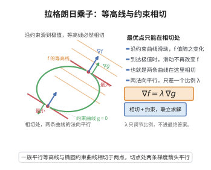

# 拉格朗日乘数法

> **一句话大白话**：在“只能待在某条曲线上”的约束下找最值，办法是让目标函数的梯度与约束曲线的法线平行，用乘数 $\lambda$ 把它们连起来建立方程组。
>
> **小例子**：求 $f(x,y)=x^2+y^2$ 在约束 $x+y=1$ 上的最小值，解 $\nabla f=\lambda\nabla g$，得 $x=y=\tfrac12$，最小值为 $\tfrac12$。

## 介绍

拉格朗日乘数法（Lagrange Multiplier Method）由法国数学家约瑟夫-路易·拉格朗日（Joseph-Louis Lagrange）于1788年提出，是求解约束优化问题的经典方法。该方法通过引入乘数 $\lambda$，将约束极值问题转化为无约束极值问题，在处理等式约束的优化问题中具有广泛的应用。

## 几何直观

图意在说明：约束下的极值出现在等高线与约束曲线相切处，此时两个梯度只差一个倍数。

## 分析

**前置依赖**：隐函数定理、链式法则多变量、梯度、费马引理

**定理内容**：设 $f(x,y)$ 和 $g(x,y)$ 在区域 $D$ 内连续可微，且 $\nabla g(x,y)\neq 0$。若 $f$ 在约束条件 $g(x,y)=0$ 下在点 $(x_0,y_0)$ 处取极值，则存在实数 $\lambda$，使得
$$\nabla f(x_0,y_0)=\lambda\nabla g(x_0,y_0)$$
即
$$\begin{cases}f_x(x_0,y_0)=\lambda g_x(x_0,y_0)\\f_y(x_0,y_0)=\lambda g_y(x_0,y_0)\\g(x_0,y_0)=0\end{cases}$$

**前置知识**：
- 隐函数定理：由 $F(x,y)=0$ 可解出 $y=f(x)$ 的条件
- 费马引理：若 $f$ 在 $x_0$ 可导且取极值，则 $f'(x_0)=0$

**数学内涵**：
拉格朗日乘数法的几何意义是：在约束曲线 $g(x,y)=0$ 上，目标函数 $f$ 的梯度 $\nabla f$ 必须垂直于约束曲线，即 $\nabla f$ 与 $\nabla g$ 平行。这是因为在极值点处，沿约束曲线的方向导数为零，而 $\nabla g$ 是约束曲线的法向量。

## 思考过程

假设在约束 $g(x,y)=0$ 下，$f$ 在 $(x_0,y_0)$ 取极值。由隐函数定理，若 $g_y(x_0,y_0)\neq 0$，则在 $(x_0,y_0)$ 附近可从 $g(x,y)=0$ 解出 $y=\varphi(x)$，代入 $f$ 得 $h(x)=f(x,\varphi(x))$。

$h$ 在 $x_0$ 处取极值，由费马引理，$h'(x_0)=0$：
$$h'(x_0)=f_x(x_0,y_0)+f_y(x_0,y_0)\varphi'(x_0)=0$$

由隐函数求导，$\varphi'(x_0)=-\frac{g_x(x_0,y_0)}{g_y(x_0,y_0)}$，代入得：
$$f_x(x_0,y_0)-f_y(x_0,y_0)\frac{g_x(x_0,y_0)}{g_y(x_0,y_0)}=0$$

整理得 $\frac{f_x(x_0,y_0)}{g_x(x_0,y_0)}=\frac{f_y(x_0,y_0)}{g_y(x_0,y_0)}$，记此比值为 $\lambda$，即得 $\nabla f=\lambda\nabla g$。

## 证明过程

**证明**：

设 $f$ 在约束 $g(x,y)=0$ 下在 $(x_0,y_0)$ 处取极值，且 $\nabla g(x_0,y_0)\neq 0$。不妨设 $g_y(x_0,y_0)\neq 0$（若 $g_x(x_0,y_0)\neq 0$，类似处理）。

**第一步：利用隐函数定理消去约束。**

由隐函数定理，存在 $(x_0,y_0)$ 的邻域 $U\times V$，使得对任意 $x\in U$，存在唯一的 $y=\varphi(x)\in V$，满足 $g(x,\varphi(x))=0$，且 $\varphi$ 在 $U$ 内可导，$\varphi(x_0)=y_0$，其导数为
$$\varphi'(x)=-\frac{g_x(x,\varphi(x))}{g_y(x,\varphi(x))}$$

**第二步：转化为无约束极值问题。**

定义复合函数 $h(x)=f(x,\varphi(x))$，则 $h$ 在 $x_0$ 处取极值（因为 $f$ 在约束下取极值，且 $\varphi$ 保持约束）。

由于 $h$ 在 $x_0$ 处可导且取极值，由费马引理，$h'(x_0)=0$。

**第三步：计算 $h'(x)$。**

由链式法则，
$$h'(x)=f_x(x,\varphi(x))+f_y(x,\varphi(x))\varphi'(x)$$

代入 $x_0$ 和 $\varphi'(x_0)$：
$$h'(x_0)=f_x(x_0,y_0)+f_y(x_0,y_0)\cdot\left(-\frac{g_x(x_0,y_0)}{g_y(x_0,y_0)}\right)=0$$

因此
$$f_x(x_0,y_0)g_y(x_0,y_0)=f_y(x_0,y_0)g_x(x_0,y_0)$$

即
$$\frac{f_x(x_0,y_0)}{g_x(x_0,y_0)}=\frac{f_y(x_0,y_0)}{g_y(x_0,y_0)}$$

记此公共值为 $\lambda$，则
$$\begin{cases}f_x(x_0,y_0)=\lambda g_x(x_0,y_0)\\f_y(x_0,y_0)=\lambda g_y(x_0,y_0)\end{cases}$$

即 $\nabla f(x_0,y_0)=\lambda\nabla g(x_0,y_0)$。结合约束条件 $g(x_0,y_0)=0$，即得拉格朗日乘数法方程组。

$\square$

## 课堂问答

**老师**：求约束极值为什么要令 $\nabla f=\lambda\nabla g$？

**学生**：因为在约束曲线 $g=0$ 上取极值时，$f$ 沿曲线的变化率为零，即 $\nabla f$ 垂直于曲线、与法向量 $\nabla g$ 平行。故存在 $\lambda$ 使
$$\nabla f(x_0,y_0)=\lambda\nabla g(x_0,y_0),\qquad g(x_0,y_0)=0 .$$
例如 $f=x^2+y^2$ 在 $x+y=1$ 上解得 $x=y=\tfrac12$，最小值为 $\tfrac12$。

**老师（追问）**：怎么严格证明？条件 $\nabla g\ne0$ 用在哪？

**学生**：用隐函数消元。由 $\nabla g\ne0$ 不妨设 $g_y\ne0$，于是约束局部可解出 $y=\varphi(x)$，且 $\varphi'(x_0)=-\dfrac{g_x}{g_y}$。代入 $h(x)=f(x,\varphi(x))$，它在 $x_0$ 取极值，由费马引理 $h'(x_0)=0$：
$$f_x+f_y\varphi'(x_0)=f_x-f_y\frac{g_x}{g_y}=0\ \Longrightarrow\ \frac{f_x}{g_x}=\frac{f_y}{g_y}=\lambda .$$
条件 $\nabla g\ne0$ 正是隐函数定理的前提，保证约束是正则曲线而非奇异点。

**老师（拓展）**：若 $\nabla g=0$ 会怎样？多约束怎么推广？

**学生**：若 $\nabla g(x_0,y_0)=0$，隐函数定理失效，极值可能落在约束的奇异点上，此时乘数法的结论未必适用，需单独检查。多约束 $g_1=\cdots=g_m=0$ 时推广为 $\nabla f=\sum_i\lambda_i\nabla g_i$，前提是各 $\nabla g_i$ 线性无关（正则性）。其本质是极值点处梯度张成的空间包含约束切空间的正交补。
