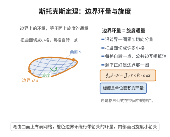

# 斯托克斯定理

> **一句话大白话**：一张曲面上的“旋转总强度”之和，等于沿它边界线绕一圈的“转圈总量”——把面上的小漩涡加在一起，就等于边框转一圈。
>
> **小例子**：电磁场中，磁感应强度沿闭合线圈的环量 $\oint_{\partial S}\mathbf F\cdot d\mathbf r$，等于旋度 $\nabla\times\mathbf F$ 穿过该面 $\iint_S$ 的通量。

## 介绍

斯托克斯定理（Stokes' Theorem）由英国数学家乔治·加布里埃尔·斯托克斯（George Gabriel Stokes）在1854年提出，是向量微积分中的核心定理之一。该定理建立了曲面上的曲面积分与其边界上的曲线积分之间的联系，将旋度的面积分等于环量的线积分。斯托克斯定理是格林定理在三维空间中的推广，在电磁学、流体力学等领域有极其重要的应用。

## 几何直观

图意在说明：沿曲面边界的环量，等于旋度穿过这张曲面的总通量。

## 分析

**前置依赖**：格林定理、曲面积分与曲线积分、曲面参数化、旋度

**定理内容**：设 $S$ 是 $\mathbb{R}^3$ 中的分片光滑有向曲面，其边界 $\partial S$ 是分段光滑的简单闭曲线，方向与 $S$ 的法向量满足右手定则。若向量场 $\mathbf{F}=(P,Q,R)$ 在包含 $S$ 的开区域上具有连续偏导数，则
$$\iint_S (\nabla\times\mathbf{F})\cdot\mathbf{n}\,dS = \oint_{\partial S} \mathbf{F}\cdot d\mathbf{r}$$

即
$$\iint_S\left[\left(\frac{\partial R}{\partial y}-\frac{\partial Q}{\partial z}\right)dy\wedge dz+\left(\frac{\partial P}{\partial z}-\frac{\partial R}{\partial x}\right)dz\wedge dx+\left(\frac{\partial Q}{\partial x}-\frac{\partial P}{\partial y}\right)dx\wedge dy\right] = \oint_{\partial S}P\,dx+Q\,dy+R\,dz$$

**前置知识**：
- 格林定理：$\oint_{\partial D}Pdx+Qdy=\iint_D(\frac{\partial Q}{\partial x}-\frac{\partial P}{\partial y})dA$

**数学内涵**：
斯托克斯定理可以看作格林定理从平面到曲面的推广。其核心思想是：向量场 $\mathbf{F}$ 沿边界 $\partial S$ 的环量等于 $\nabla\times\mathbf{F}$ 通过曲面 $S$ 的通量。该定理揭示了旋度的整体积分性质，是电磁学中麦克斯韦方程组的基础之一。

## 思考过程

斯托克斯定理的证明思路是将三维问题通过参数化转化为二维格林定理。

设曲面 $S$ 由参数方程 $\mathbf{r}(u,v)=(x(u,v),y(u,v),z(u,v))$ 给出，$(u,v)\in D$（$D$ 是 $uv$ 平面上的区域）。则边界 $\partial S$ 对应 $\partial D$。

通过参数化，可将曲面积分和曲线积分都转化为 $uv$ 平面上的二重积分和曲线积分，然后应用格林定理得到等式。

## 证明过程

**证明**：

**第一步：将曲面参数化。**

设曲面 $S$ 由参数方程 $\mathbf{r}(u,v)=(x(u,v),y(u,v),z(u,v))$ 给出，其中 $(u,v)\in D$，$D$ 是 $uv$ 平面上的有界区域，$\partial D$ 是分段光滑的简单闭曲线。参数化是一一映射，且 $\mathbf{r}_u\times\mathbf{r}_v\neq 0$。

**第二步：转化边界曲线积分。**

边界 $\partial S$ 对应 $\partial D$ 在参数映射下的像：
$$\oint_{\partial S}\mathbf{F}\cdot d\mathbf{r} = \oint_{\partial D}\mathbf{F}(\mathbf{r}(u,v))\cdot(\mathbf{r}_u du+\mathbf{r}_v dv) = \oint_{\partial D}\left[(\mathbf{F}\cdot\mathbf{r}_u)du+(\mathbf{F}\cdot\mathbf{r}_v)dv\right]$$

记 $P_1(u,v)=\mathbf{F}\cdot\mathbf{r}_u$，$Q_1(u,v)=\mathbf{F}\cdot\mathbf{r}_v$，则
$$\oint_{\partial S}\mathbf{F}\cdot d\mathbf{r} = \oint_{\partial D}P_1\,du+Q_1\,dv$$

**第三步：应用格林定理。**

由格林定理，
$$\oint_{\partial D}P_1\,du+Q_1\,dv = \iint_D\left(\frac{\partial Q_1}{\partial u}-\frac{\partial P_1}{\partial v}\right)dudv$$

**第四步：计算被积函数。**

计算 $\frac{\partial Q_1}{\partial u}-\frac{\partial P_1}{\partial v}$：
$$\frac{\partial Q_1}{\partial u} = \frac{\partial}{\partial u}(\mathbf{F}\cdot\mathbf{r}_v) = (\nabla\mathbf{F}\cdot\mathbf{r}_u)\cdot\mathbf{r}_v + \mathbf{F}\cdot\mathbf{r}_{uv}$$
$$\frac{\partial P_1}{\partial v} = \frac{\partial}{\partial v}(\mathbf{F}\cdot\mathbf{r}_u) = (\nabla\mathbf{F}\cdot\mathbf{r}_v)\cdot\mathbf{r}_u + \mathbf{F}\cdot\mathbf{r}_{uv}$$

相减得：
$$\frac{\partial Q_1}{\partial u}-\frac{\partial P_1}{\partial v} = (\nabla\mathbf{F}\cdot\mathbf{r}_u)\cdot\mathbf{r}_v - (\nabla\mathbf{F}\cdot\mathbf{r}_v)\cdot\mathbf{r}_u$$

可以验证，上式等于 $(\nabla\times\mathbf{F})\cdot(\mathbf{r}_u\times\mathbf{r}_v)$。

**第五步：转化为曲面积分。**

$$\iint_D(\nabla\times\mathbf{F})\cdot(\mathbf{r}_u\times\mathbf{r}_v)dudv = \iint_S(\nabla\times\mathbf{F})\cdot\mathbf{n}\,dS$$

因此
$$\iint_S(\nabla\times\mathbf{F})\cdot\mathbf{n}\,dS = \oint_{\partial S}\mathbf{F}\cdot d\mathbf{r}$$

$\square$

## 课堂问答

**老师**：曲面上的旋度积分与边界环量有什么关系？

**学生**：两者相等。设 $S$ 分片光滑、$S$ 的方向与 $\partial S$ 满足右手定则，则
$$\iint_S(\nabla\times\mathbf{F})\cdot\mathbf{n}\,dS=\oint_{\partial S}\mathbf{F}\cdot d\mathbf{r}.$$
这是格林定理从平面到曲面的推广。

**老师（追问）**：三维问题怎么证？

**学生**：用参数化降维成二维再套格林定理。设曲面为 $\mathbf{r}(u,v)$、$(u,v)\in D$，把边界积分写成 $\oint_{\partial D}P_1\,du+Q_1\,dv$，其中 $P_1=\mathbf{F}\cdot\mathbf{r}_u$、$Q_1=\mathbf{F}\cdot\mathbf{r}_v$。对 $(u,v)$ 用格林定理：
$$\oint_{\partial D}P_1\,du+Q_1\,dv=\iint_D\Big(\frac{\partial Q_1}{\partial u}-\frac{\partial P_1}{\partial v}\Big)du\,dv,$$
计算得被积函数即 $(\nabla\times\mathbf{F})\cdot(\mathbf{r}_u\times\mathbf{r}_v)$，再换回 $dS$ 即得结论。方向约定（右手定则）保证符号一致。

**老师（拓展）**：它在物理和更一般的框架里是什么？

**学生**：物理上是"环量—旋度"对偶：$\oint\mathbf{F}\cdot d\mathbf{r}$ 是磁感应沿线圈的环量，等于 $\nabla\times\mathbf{F}$ 穿过该面的通量，是麦克斯韦方程组的积分形式之一。更一般地，它是广义斯托克斯定理 $\int_{\partial M}\omega=\int_M d\omega$ 的向量形式，格林定理与高斯散度定理都可纳入这一框架。
