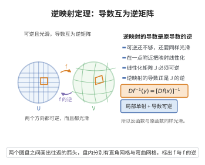

# 逆映射定理

> **一句话大白话**：只要一个光滑映射在某一点的 Jacobi 矩阵可逆（各个方向都没有被"压扁"），它在这点附近就能一对一地反解回来，而且反解出来的映射同样光滑。

> **小例子**：极坐标映射 $F(r,\theta)=(r\cos\theta,\,r\sin\theta)$ 的 Jacobi 行列式等于 $r$，在 $r>0$ 处非零，故除原点外处处局部可逆；其局部反函数 $(x,y)\mapsto(\sqrt{x^2+y^2},\,\arctan(y/x))$ 在每个小片上都光滑。

## 介绍

逆映射定理（Inverse Mapping Theorem）是多元微积分的核心定理之一，由意大利数学家 Ulisse Dini 于 19 世纪末系统证明（故又称 Dini 定理）。它断言：若 $C^1$ 映射 $F:\mathbb{R}^n\to\mathbb{R}^n$ 在点 $x_0$ 处的 Jacobi 矩阵 $DF(x_0)$ 可逆，则 $F$ 在 $x_0$ 附近是 $C^1$ 微分同胚——存在 $x_0$ 的开邻域 $U_0$ 与 $F(x_0)$ 的开邻域 $V_0$，使 $F:U_0\to V_0$ 为双射且 $F^{-1}:V_0\to U_0$ 也是 $C^1$ 的。它要解决的根本问题是：非线性映射的局部可逆性是否可以由线性化条件完全决定？答案是可以。这一"线性化"思想是微分几何中局部微分同胚、流形间映射理论、李群与李代数、乃至数值求解非线性方程组（Newton 法）的共同基础。

## 几何直观

图意在说明：映射局部可逆且光滑时，逆映射的导数恰是原映射导数矩阵的逆。

## 分析

**前置依赖**：反函数定理、隐函数定理、Jacobi 矩阵、中值不等式（有限增量定理）、Banach不动点定理。

**定理内容**：设 $U\subseteq\mathbb{R}^n$ 是开集，$F:U\to\mathbb{R}^n$ 是 $C^1$ 映射，$x_0\in U$，且 $DF(x_0)$ 可逆。则存在 $x_0$ 的开邻域 $U_0\subseteq U$ 与 $y_0=F(x_0)$ 的开邻域 $V_0$，使得 $F|_{U_0}:U_0\to V_0$ 是双射，且逆映射 $G=(F|_{U_0})^{-1}$ 是 $C^1$ 的，满足

$$DG(y)=\big[DF(G(y))\big]^{-1},\qquad y\in V_0 .$$

若 $F$ 还是 $C^k$ 的（$k\ge 1$），则 $G$ 也是 $C^k$ 的。

**推论**：$F$ 把 $x_0$ 附近的"开集"仍映为开集（局部开映射）；特别地，Jacobi 矩阵可逆是一个开条件，在 $x_0$ 的某邻域内处处可逆，于是 $F$ 在该邻域内处处是局部微分同胚。

## 思考过程

关键在于把一般情形化归到最简模型。第一步做线性归约：用 $A=DF(x_0)$ 的逆把问题变成"在原点附近、导数矩阵为单位阵 $I$"的映射 $g$。第二步把 $g$ 写成小扰动形式 $g(x)=x+\varphi(x)$，其中 $D\varphi(0)=0$；只要半径够小，就有 $\|D\varphi\|\le 1/2$，此时 $g$ 的"变形量"很小。第三步用两条工具分头处理：单射性由中值不等式给出（距离被 $\frac12|x_1-x_2|$ 从下方控制），满射性由压缩映射原理给出（把求 $g(x)=y$ 的解转化为映射 $x\mapsto y-\varphi(x)$ 的压缩不动点）。最后一步是求逆映射的导数：由 $G(F(x))=x$ 用链式法则立刻得到 $DG(y)=[DF(G(y))]^{-1}$，而"矩阵可逆"是开条件，故 $DG$ 连续。难点在于单射与满射拼合时必须仔细选取小球半径，使"$g$ 把闭球映入自身"与"压缩系数小于 1"同时成立。

## 证明过程

**步骤 1：线性归约。** 令 $A=DF(x_0)$，$y_0=F(x_0)$，定义

$$g(x)=A^{-1}\big(F(x_0+x)-y_0\big),\qquad x\in U-x_0 .$$

则 $g(0)=0$，$g$ 是 $C^1$ 的，且由链式法则 $Dg(0)=A^{-1}DF(x_0)=I$。若定理对 $g$ 在 $0$ 附近成立，把结论按 $F(x)=y_0+A\,g(x-x_0)$ 翻译回去即得 $F$ 的结论，故只需处理 $g$。

**步骤 2：写成恒等加小扰动。** 令 $\varphi(x)=g(x)-x$，则 $D\varphi(0)=Dg(0)-I=0$。由于 $D\varphi$ 在 $0$ 处连续，存在 $r>0$ 使得 $\|x\|<2r$ 时 $\|D\varphi(x)\|\le\frac12$。

**步骤 3：$g$ 在 $B(0,r)$ 上单射且逆映射 Lipschitz。** 对任意 $x_1,x_2\in B(0,r)$，令 $h=x_2-x_1$，沿线段 $t\mapsto x_1+th$（$0\le t\le1$）用中值不等式：

$$|g(x_2)-g(x_1)|=\Big|h+\int_0^1 D\varphi(x_1+th)\,h\,dt\Big|\ \ge\ |h|-\int_0^1\|D\varphi(x_1+th)\|\,|h|\,dt\ \ge\ \frac12|h| .$$

故 $g(x_1)=g(x_2)$ 推出 $x_1=x_2$，即 $g$ 在 $B(0,r)$ 上单射，并直接得到逆映射的 Lipschitz 估计 $|g^{-1}(y_1)-g^{-1}(y_2)|\le 2|y_1-y_2|$。

**步骤 4：像包含小球。** 设 $\|y\|<r/2$，定义 $\Phi_y(x)=y-\varphi(x)$。对 $\|x\|\le r$，

$$|\Phi_y(x)|\le\|y\|+\|\varphi(x)-\varphi(0)\|\le \frac r2+\frac12\|x\|\le r,$$

故 $\Phi_y$ 把闭球 $\overline{B(0,r)}$ 映入自身；又由步骤 2，$\Phi_y$ 在 $\overline{B(0,r)}$ 上是压缩系数为 $\frac12$ 的压缩映射。由 Banach 压缩映射原理，$\Phi_y$ 有唯一不动点 $x\in\overline{B(0,r)}$，满足 $x=y-\varphi(x)$，即 $g(x)=y$。于是 $B(0,r/2)\subseteq g(B(0,r))$。

**步骤 5：得到局部逆映射。** 对 $F$ 取 $U_0=x_0+B(0,r)$ 与 $V_0=y_0+B(0,r/2)$。由步骤 3、4，$F|_{U_0}:U_0\to V_0$ 是双射，且由步骤 3 的估计，$G=F^{-1}$ 在 $V_0$ 上 Lipschitz 连续。

**步骤 6：逆映射可微、导数公式成立。** 固定 $y=g(x)\in B(0,r/2)$，记 $k=G(y+h)-G(y)$。由可微性，$h=g(x+k)-g(x)=Dg(x)k+o(|k|)$。由步骤 3 有 $|k|\le 2|h|$，故 $o(|k|)=o(|h|)$。以 $T=[Dg(x)]^{-1}$（$Dg(x)$ 靠近 $I$，故可逆）作用：

$$k-Th=-T\big(h-Dg(x)k\big)=-T\cdot o(|k|)=o(|h|),$$

即 $G(y+h)-G(y)=Th+o(|h|)$，故 $G$ 在 $y$ 处可微且 $DG(y)=[Dg(x)]^{-1}$，其中 $x=G(y)$。翻译回 $F$ 即得 $DG(y)=[DF(G(y))]^{-1}$。由于矩阵求逆连续、$Dg$ 与 $G$ 连续，$DG$ 连续，故 $G\in C^1$。

**步骤 7：高阶光滑性。** 若 $F\in C^k$，对 $DG(y)=[DF(G(y))]^{-1}$ 作归纳：已知 $G\in C^{j}$（$j<k$）时右端属于 $C^{j}$，故 $G\in C^{j+1}$，直至 $G\in C^k$。

证毕。

## 课堂问答

**老师**：非线性映射的局部可逆性由什么决定？

**学生**：完全由线性化决定。若 $F:\mathbb{R}^n\to\mathbb{R}^n$ 是 $C^1$、$DF(x_0)$ 可逆，则 $F$ 在 $x_0$ 附近是 $C^1$ 微分同胚，且
$$DG(y)=\big[DF(G(y))\big]^{-1},\qquad G=F^{-1}.$$
线性化条件既保局部可逆，又保光滑性（$F\in C^k\Rightarrow G\in C^k$）。

**老师（追问）**：单射与满射分别靠什么工具？

**学生**：先做线性归约 $g(x)=A^{-1}(F(x_0+x)-y_0)$ 使 $Dg(0)=I$，再写 $g=x+\varphi$、$D\varphi(0)=0$，取小球使 $\|D\varphi\|\le\frac12$。单射性由中值不等式：
$$|g(x_2)-g(x_1)|\ge|h|-\int_0^1\|D\varphi\||h|\,dt\ge\frac12|h|;$$
满射性由压缩映射原理：$\Phi_y(x)=y-\varphi(x)$ 把闭球映入自身且压缩系数为 $\frac12$，其唯一不动点给出 $g(x)=y$。导数公式由 $G(F(x))=x$ 用链式法则得 $DG(y)=[Dg]^{-1}$，而矩阵可逆是开条件，故 $DG$ 连续。

**老师（拓展）**：它与隐函数定理、变量替换的关系？

**学生**：逆映射定理与隐函数定理互相可推——隐函数定理可由它作用于 $F(x,y)=(x,f(x,y))$ 得到，反之亦然。变量替换公式要求换元是局部 $C^1$ 微分同胚，其合法性正是逆映射定理提供的 Jacobi 行列式非零条件；Newton 法解非线性方程组的收敛分析也建立在它之上。

## 相关条目

- [反函数定理](./反函数定理.md)：一维情形即反函数定理，逆映射定理是它在多元情形的推广。
- [隐函数定理](./隐函数定理.md)：两者互相可导出，隐函数定理可由逆映射定理作用于 $F(x,y)=(x,f(x,y))$ 得到。
- [多重积分的变量替换公式](./多重积分的变量替换公式.md)：变量替换公式要求变换是局部 $C^1$ 微分同胚，这正是逆映射定理提供的条件。
- [链式法则多变量](./链式法则多变量.md)：本证明的线性归约与导数公式都依赖链式法则。
