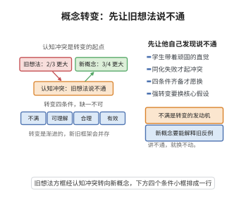

# 数学学习中的概念转变

> **一句话大白话**：学生的错误想法（迷思概念）不会自己消失——得先让他看到"旧想法说不通"（认知冲突），再给出一个他能懂、说得通还能用的新概念，他才会愿意换掉旧想法。改想法比记新知识难得多，需要时间和反复冲突。
>
> **小例子**：学生以为"$\tfrac23$ 比 $\tfrac34$ 大"（因为分子分母分别看都觉得 2 比 3 小、于是误判）。老师拿出两个一样大的圆，一个分 3 份涂 2 份、一个分 4 份涂 3 份，学生直观看到 $\tfrac34$ 涂色更多——啧，旧想法说不通了！再通分 $\tfrac23=\tfrac8{12}<\tfrac9{12}=\tfrac34$，新方法既讲得通又用得上，概念转变完成。

## 一、定理介绍

> **前置依赖**：Piaget同化与顺应平衡机制、认知冲突理论、Fischbein直觉概念研究、Posner概念转变四条件、Vosniadou渐进转变理论。

数学学习中的概念转变（Conceptual Change）研究学生如何用新概念取代错误的先有/迷思概念。它基于 Piaget 的同化与顺应平衡机制，并由 Posner 等人（1982）给出概念转变所需满足的四个条件。理论认为有效教学须主动制造认知冲突，促使学生在"不满→可理解→合理→有效"四条件下重构认知结构，而非简单灌输新定义。

## 几何直观

图意在说明：只有先制造认知冲突，再让新概念可理解、合理、有效，学生才愿意真正换掉旧想法。

## 二、原理思路

先有概念顽固且与直觉绑定（Fischbein 的直觉研究），因此不会自动退场。Piaget 的平衡机制给出转变路径：同化失败产生认知冲突 → 顺应调整认知结构 → 达到新平衡。Posner 的四条件刻画了"何时愿意换"的充分条件。转变有强弱之分，且按 Vosniadou 是渐进、非一次性的过程——新旧框架可能长期并存，依情境切换。

## 三、定理的严格表述

**定理（概念转变机制）**：学生在数学学习中常持有与标准概念不一致的先有/迷思概念；有效教学须引发认知冲突以促使概念转变发生。概念转变（特别是有意的强转变）发生需满足四个条件：

1. **对现有概念的不满**：学习者意识到旧概念无法解释某些现象；
2. **新概念的可理解性**：新概念对学习者有意义、可被理解；
3. **新概念的合理性**：新概念与学习者其他信念一致；
4. **新概念的有效性**：新概念能解决旧概念无法解决的问题。

**机制**：同化（新信息纳入旧结构）与顺应（调整结构适应新信息）经由平衡调节；转变可为弱转变（补充修正）或强转变（更换核心假设体系）。

## 四、证明过程

**论证（用认知冲突理论）**：

**步骤1（先有概念的存在性）**：学习者非空白进入课堂，累积大量直觉与朴素概念。典型迷思：几何"图形越大面积越大"、概率"赌徒谬误"、代数"等号表示计算结果"、函数"必须有公式"、极限"永远达不到"。Fischbein（1987）指出直觉概念与形式概念冲突且顽固难改。

**步骤2（认知冲突机制）**：新信息无法被同化时产认知冲突，成为概念转变驱动力；Piaget 的同化、顺应与平衡提供了机制框架。

**步骤3（转变四条件）**：Posner（1982）提出上述四条件，缺一不可；教学设计据此构造"直觉上合理但导致矛盾"的情境，引导多表征联系与讨论反思。

**步骤4（转变类型）**：弱转变（框架内补充修正，如同化）与强转变（更换核心信念，如算术思维→代数思维）。Vosniadou（1994）表明转变渐进、非一次性，学习者可能同时持新旧框架按情境切换。$\square$

## 五、应用与意义

概念转变理论把教学起点从"讲新课"前移到"诊断迷思"：先摸清学生的先有概念，再设计冲突情境、留足反复冲突与讨论的时间，借助多表征促成转变。它解释了为何有些"讲过的知识"学生仍长期用错，也指导了以学生为中心、重建构而非灌输的教学观，是建构主义教学理论与课程改革的重要支柱。

## 课堂问答

**老师**：学生的迷思概念为什么不会自己消失？要把它换掉需满足哪些条件？

**学生**：先给结论——因为先有概念与直觉绑定且顽固，不会自动退场；换掉它需要 Posner 的四条件：对现有概念不满、新概念可理解、新概念合理、新概念有效，缺一不可。机制是 Piaget 的同化失败产生认知冲突、继而顺应调整结构。例：学生以为 $\tfrac23>\tfrac34$，通分得 $\tfrac23=\tfrac8{12}<\tfrac9{12}=\tfrac34$，旧想法说不通、新方法讲得通又用得上，转变才发生。

**老师（追问）**：认知冲突为什么是必要的？不制造冲突、直接把新定义讲清行不行？

**学生**：不行。若新信息能被旧结构同化，学生就会把新定义硬塞进旧框架，表面接受、实际仍用错。必须有信息无法被同化，才触发顺应。常见误区是老师以为"讲过"就等于"换了"，而没有冲突的灌输只会留下长期并存的迷思。

**老师（拓展）**：弱转变与强转变的区别是什么？转变是一次性的吗？

**学生**：弱转变是框架内的补充修正（相当同化），强转变是更换核心假设体系，如从算术思维转向代数思维。按 Vosniadou 的观点转变是渐进而非一次性的，新旧框架可能长期并存、按情境切换——这正是为什么教学要留足反复冲突与讨论的时间。
