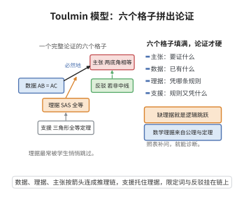

# 数学论证的Toulmin模型

> **一句话大白话**：一个完整的数学论证就像一张需填齐的"证明表"：你得说清"要证啥"（主张）、"凭啥"（数据）、"靠哪条道理"（理据）、"这道理又凭什么站得住"（支援）、"结论多硬"（限定词），还得想到"什么情况下这话会失效"（反驳）。六个格子都填上，论证才够硬。
>
> **小例子**：证"等腰三角形两底角相等"。主张：$\angle B=\angle C$；数据：$AB=AC$ 作中线 $AD$；理据："两边及其夹角相等则全等（SAS）"；支援：三角形全等定理；限定词：必然地；反驳：除非 $AD$ 不是中线（由等腰性质可排除）。六要素齐备，论证完整严谨。

## 一、定理介绍

> **前置依赖**：论证结构分析（主张-数据-理据框架）、数学证明的公理演绎性、逻辑推理链概念、课堂社会数学规范（Yackel & Cobb）、元认知反思。

Toulmin 论证模型由 Stephen Toulmin 在《论证的使用》（The Uses of Argument, 1958）中提出，为分析"论证"提供了一个包含主张、数据、理据、支援、限定词、反驳六要素的结构框架。Krummheuer（1995）将其引入数学教育研究，用于分析课堂上的数学论证过程；Weber、Yackel 与 Cobb 等的研究表明它能揭示学生推理中的隐含假设与逻辑跳跃，是诊断与发展学生论证能力的有效工具。

## 几何直观

图意在说明：完整论证要同时给出主张、数据、理据、支援、限定词与反驳，缺了理据就是逻辑跳跃。

## 二、原理思路

模型区分"做了什么推断"与"凭什么这么做"，从而把论证的可信度拆解为可见的要素。数学论证的特殊性在于其理据来自定义、公理与定理，支援是公理系统的基础假设，故可追求演绎确定性。六个要素共同构成一条从数据经理据到主张的推理链；缺一（尤其常缺"理据"）即逻辑跳跃，教师可据表定位并补问。

## 三、定理的严格表述

**定理（Toulmin 论证模型）**：任何论证可由以下六要素完整刻画：

- **主张（Claim）**：需被证明的数学陈述，如"$\angle B=\angle C$"；
- **数据（Data）**：支持主张的事实或证据，如"$AB=AC$"；
- **理据（Warrant）**：从数据到主张的推理规则，如"等腰三角形底角相等定理"或"SAS"；
- **支援（Backing）**：对理据的进一步支持，如"三角形全等定理"；
- **限定词（Qualifier）**：主张的确定性程度，如"必然地""很可能"；
- **反驳（Rebuttal）**：使主张失效的条件，如"除非 $AD$ 不是中线"。

## 四、证明过程

**论证（用论证结构分析）**：

**步骤1（基本结构）**：界定六要素在数学语境下的含义（如"三、严格表述"所列），指出主张即待证陈述，数据即证据，理据即推理规则等。

**步骤2（数学论证特殊性）**：数学理据为定义、公理、定理，支援为公理系统基础假设，且可追求演绎确定性——这与日常论证（常带概率性）不同。

**步骤3（应用于示例）**：用"等腰三角形两底角相等"作完整分析——主张 $\angle B=\angle C$，数据 $AB=AC$ 及内错角相等，理据 SAS，支援全等定理，限定词"必然地"，反驳"除非 $AD$ 不是中线"，并链式给出 $\triangle ABO\cong\triangle CDO\Rightarrow AO=OC$ 的完整推理链。

**步骤4（教学价值）**：诊断功能（定位缺失环节，如只有数据与主张却无理据）、发展功能（训练更完整的论证结构）、评价功能（结构化评估论证能力）；Yackel & Cobb（1996）表明课堂"社会数学规范"对论证能力发展至关重要。$\square$

## 五、应用与意义

Toulmin 模型把"证明教学"从记步骤提升为理解"从数据到主张的逻辑推理链"，帮助学生识别并补全缺失环节，引导对"什么是好的数学论证"的元认知反思。它既作为教师诊断课堂论证的工具，也作为评价学生论证能力的框架，加深了论证教学的理论基础，是数学教育中论证与证明研究的核心分析工具。

## 课堂问答

**老师**：一个完整的数学论证由哪六个要素构成？请各举一例。

**学生**：结论是主张、数据、理据、支援、限定词、反驳六要素。以"等腰三角形两底角相等"为例：主张 $\angle B=\angle C$，数据 $AB=AC$ 并作中线 $AD$，理据是 SAS 全等，支援是三角形全等定理，限定词"必然地"，反驳"除非 $AD$ 不是中线"。六者串成从数据经理据到主张的推理链。

**老师（追问）**：论证中最常缺失、又最致命的是哪一环？

**学生**：理据。常见错误是只给数据和主张，跳过"凭什么从数据推到主张"的推理规则，那就是逻辑跳跃。教师用这张表能定位缺口、补问缺失环节，从而把证明教学从记步骤提升为理解推理链。

**老师（拓展）**：数学论证与日常论证的关键差别在哪？

**学生**：差别不在结构而在理据的来源与强度。数学的理据来自定义、公理与定理，支援是公理系统的基础假设，因而可追求演绎确定性，限定词常是"必然地"；日常论证的理据常带概率性，限定词多是"很可能"。所以数学论证即使出现反驳项，也往往能由公理系统排除掉。
