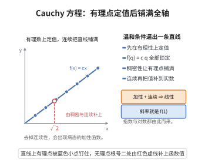

# Cauchy 函数方程及其连续解

> **一句话大白话**：如果一个函数满足"和的函数值 = 函数值的和"，那么在有理数上它只能是对应的正比函数 $f(x)=cx$；再加上哪怕一丁点儿"连续性"（或单调、或有界），这条直线结论就会铺满整个实数轴——不加这种温和条件，还会冒出无比怪异的解。
>
> **小例子**：$f(x)=3x$ 显然满足 $f(x+y)=f(x)+f(y)$。若只知道 $f(1)=3$，则 $f(q)=3q$ 对一切有理数 $q$ 成立；再由连续性取有理数列 $q_n\to\sqrt2$，得 $f(\sqrt2)=3\sqrt2$。

## 一、定理介绍

> **前置依赖**：实数完备性定理的等价性、微积分基本定理、函数的连续性与极限、指数函数与对数函数、有理数与实数稠密性

**Cauchy 函数方程**（Cauchy's functional equation）是最简单的函数方程：

$$
f(x+y)=f(x)+f(y),\qquad \forall x,y\in\mathbb R .
$$

满足它的函数称为**加性函数**（additive function）。由 Cauchy 在 1821 年的《分析教程》中系统讨论，它成为函数方程理论的原型。不加任何正则性条件时，加性函数就是 $\mathbb R$ 作为 $\mathbb Q$-向量空间的 $\mathbb Q$-线性映射：存在 Hamel 基，可取基上任意值再线性延拓，因此存在大量**不连续**的加性函数（需用选择公理；在 Solovay 模型中"所有函数可测"故不存在）。

一旦加上正则性条件，结论立刻变得"正常"：本条目所证的定理是——若 $f$ 在某一点连续（等价地：在某个区间上有界、在某点可导、单调、可测、或图像不在任何稠密集上），则

$$
f(x)=cx,\qquad c=f(1),
$$

即在 $\mathbb R$ 上是一条过原点的直线。

**为什么这条"温和条件下的直线结论"值得单独成条目？** 因为它是**把连续解从离散（有理）信息推广到连续（实数）信息**的标准范式，其证明只用到"先在有理性上定值、再用稠密性与连续性延拓"这两步，而这正是[实数完备性定理的等价性](../第17级-实分析/实数完备性定理的等价性.md)与稠密性的典型用法。它也是刻画指数函数、对数函数（韦伯定律中的对数律）、线性长度与面积测度、以及概率论中"可加性 ⇒ 线性"这类命题的统一工具。

## 几何直观

图意在说明：加性函数先在有理数上被锁成直线，再加连续性就能铺满整个实数轴。

## 二、原理思路

**第一步：从"加性"榨出有理数上的线性。** 由 $f(x+y)=f(x)+f(y)$ 反复迭代可得：对任意 $n\in\mathbb N$、$x\in\mathbb R$，

$$
f(nx)=nf(x),\qquad f\Bigl(\frac xn\Bigr)=\frac{f(x)}{n}\ \ (\text{取 }x=ny\text{ 即得}),
$$

以及 $f(0)=0$、$f(-x)=-f(x)$（由 $0=f(0)=f(x+(-x))=f(x)+f(-x)$）。综合起来：对一切有理数 $q\in\mathbb Q$，

$$
f(q)=qf(1)=cq,\qquad c:=f(1).
$$

也就是说，$f$ 在有理数上的取值被一个常数 $c$ **完全锁定**——这一步只用了加性，没有用到任何正则性。

**第二步：用稠密性 + 连续性把结论推到整个实数轴。** 取任意 $x\in\mathbb R$，由有理数在实数中的稠密性，存在有理数列 $q_n\to x$。由第一步 $f(q_n)=cq_n\to cx$；若 $f$ 在 $x$ 处连续（或只在 $0$ 处连续，配合加性可推处处连续），则

$$
f(x)=\lim_n f(q_n)=\lim_n cq_n=cx .
$$

于是 $f$ 是一条直线。

**第三步：弱条件如何升级为连续。** 统计与工程中有时只知道"$f$ 在某个区间上有界"或"$f$ 单调"。这些条件可以推出连续性：例如若 $f$ 在 $(-\delta,\delta)$ 上有界 $|f|\le M$，则对任意 $h\to0$，取整数 $m$ 使 $m|h|\le\delta<(m+1)|h|$，由加性与有界性得 $|f(h)|\le M/m\to0$，即 $f$ 在 $0$ 处连续，进而处处连续。

**第四步：对数与指数情形。** 若 $g>0$ 满足乘性方程 $g(x+y)=g(x)g(y)$ 且 $g$ 在某点连续，取 $f=\ln g$ 即得 $f(x+y)=f(x)+f(y)$ 且 $f$ 连续，故 $f(x)=cx$，从而 $g(x)=\mathrm e^{cx}$。这就是"连续乘性函数必为指数函数"。

## 三、定理的严格表述

**（Cauchy 函数方程的基本解）** 设 $f:\mathbb R\to\mathbb R$ 满足 $f(x+y)=f(x)+f(y)$ 对一切 $x,y\in\mathbb R$ 成立。则：

(1) $f(0)=0$，$f(-x)=-f(x)$；

(2) 对一切 $q\in\mathbb Q$ 有 $f(q)=q\,f(1)$，即 $f$ 在 $\mathbb Q$ 上是 $\mathbb Q$-线性的；

(3) 记 $c=f(1)$，则 $f$ 是 $\mathbb Q$-线性映射 $\mathbb R\to\mathbb R$（把 $\mathbb R$ 视为 $\mathbb Q$-向量空间），且

$$
f\Bigl(\sum_{i}\lambda_i b_i\Bigr)=\sum_i\lambda_i f(b_i),\qquad \lambda_i\in\mathbb Q ,
$$

其中 $\{b_i\}$ 为任意 $\mathbb Q$-基（Hamel 基）。

**（连续解定理）** 设 $f:\mathbb R\to\mathbb R$ 加性。则以下各条两两等价：

(a) $f$ 在 $\mathbb R$ 上连续；

(b) $f$ 在某一点 $x_0$ 连续；

(c) $f$ 在 $0$ 处连续；

(d) $f$ 在某个非退化区间上有界；

(e) $f$ 单调（不减或不增）；

(f) $f$ 是 Lebesgue 可测；

并且当这些条件成立时，存在常数 $c\in\mathbb R$ 使

$$
f(x)=cx,\qquad \forall x\in\mathbb R\ (\text{即 }c=f(1)).
$$

**（推论：连续乘性函数）** 设 $g:\mathbb R\to(0,\infty)$ 满足 $g(x+y)=g(x)g(y)$ 且在一点连续。则存在 $c\in\mathbb R$ 使 $g(x)=\mathrm e^{cx}$。

**（推论：Cauchy 方程的"病态解"存在性）** 在 ZFC 中，存在不连续的加性函数 $f$（即不是任何线性函数）。事实上 $f$ 不连续的充要条件是其图像在 $\mathbb R^2$ 中稠密。这类函数不可测、无界于任何区间、不单调。

**（推论：Weierstrass 型补充）** 若 $f$ 加性且在一点可导，则 $f$ 线性；更一般地，若 $f$ 在某点具有有限的单侧导数，则 $f(x)=f'(0)\,x$。

## 四、证明过程

**步骤 1：基本恒等式。**

$f(0)=f(0+0)=f(0)+f(0)\Rightarrow f(0)=0$。$0=f(0)=f(x+(-x))=f(x)+f(-x)\Rightarrow f(-x)=-f(x)$。

**步骤 2：$f(nx)=nf(x)$ 与 $f(x/n)=f(x)/n$。**

对 $n\in\mathbb N$ 作归纳：$n=1$ 显然；$f((n+1)x)=f(nx)+f(x)=nf(x)+f(x)=(n+1)f(x)$。由 $f(-nx)=-f(nx)$ 得对一切 $n\in\mathbb Z$ 成立。

对 $x/n$：由 $x=n\cdot(x/n)$ 与上式得 $f(x)=nf(x/n)$，故 $f(x/n)=f(x)/n$。

**步骤 3：有理数上的取值。**

对 $q=m/n\in\mathbb Q$（$m\in\mathbb Z$，$n\in\mathbb N_{>0}$）：

$$
f(q)=f\Bigl(m\cdot\frac1n\Bigr)=m\,f\Bigl(\frac1n\Bigr)=\frac mn f(1)=q\,f(1).
$$

记 $c=f(1)$，得 $f(q)=cq$。

**步骤 4：连续解。**

设 $f$ 连续（条件 (a)）。对任意 $x\in\mathbb R$，由 $\mathbb Q$ 在 $\mathbb R$ 中稠密，取有理数列 $q_n\to x$。由步骤 3，$f(q_n)=cq_n$。由 $f$ 在 $x$ 处连续，

$$
f(x)=\lim_{n\to\infty}f(q_n)=\lim_{n\to\infty}cq_n=cx .
$$

故 $f$ 为线性函数。

**步骤 5：弱条件 ⇒ 连续。**

**(b) ⇒ (c)**：设 $f$ 在 $x_0$ 连续。对任意 $h\to0$，$f(h)=f(x_0+h)-f(x_0)\to f(x_0)-f(x_0)=0=f(0)$，故 $f$ 在 $0$ 连续。

**(c) ⇒ (a)**：设 $f$ 在 $0$ 连续。对任意 $x$，$f(x+h)-f(x)=f(h)\to0\ (h\to0)$，故 $f$ 在 $x$ 连续。

**(d) ⇒ (c)**：设 $|f|\le M$ 于区间 $(-\delta,\delta)$ 上。给定 $\varepsilon>0$，取正整数 $m>\dfrac{M}{\varepsilon}$ 并令 $\eta=\dfrac{\delta}{m}$。则对 $|h|<\eta$，有 $m|h|<\delta$，于是由加性 $f(mh)=mf(h)$ 且 $|f(mh)|\le M$，得

$$
|f(h)|=\frac{|f(mh)|}{m}\le\frac{M}{m}<\varepsilon .
$$

故 $f$ 在 $0$ 连续，由 (c) ⇒ (a) 得处处连续。

**(e) ⇒ (d)**：单调函数在紧区间上有界（由单调性，$f(|x|\le1)\subseteq[f(-1),f(1)]$ 或反序）。

**(f) ⇒ (d)**：设 $f$ 可测。若 $f$ 不可测则有反例；此处用标准引理：可测的加性函数必连续。证明：由可测性，存在区间 $I$ 使 $f$ 在 $I$ 上有界（Steinhaus 型论证：$f^{-1}((-1,1))$ 为可测集且正测度，故其差不集含区间 $(-\delta,\delta)$，在其中 $f$ 有界），再由 (d) ⇒ (a)。

由 (a)–(f) 的等价链与步骤 4，结论 $f(x)=cx$ 成立。$\square$

**步骤 6：连续乘性函数。**

设 $g>0$ 且 $g(x+y)=g(x)g(y)$、$g$ 在某点连续。则 $g>0$ 处处成立（$g(x)=g(x/2)^2>0$），故可定义 $f=\ln g$，它是加性函数：

$$
f(x+y)=\ln g(x+y)=\ln(g(x)g(y))=\ln g(x)+\ln g(y)=f(x)+f(y).
$$

由 $g$ 连续得 $f$ 连续，由步骤 4 得 $f(x)=cx$，即 $g(x)=\mathrm e^{cx}$。$\square$

**步骤 7：病态解的存在（简要）。**

把 $\mathbb R$ 视为 $\mathbb Q$-向量空间，由选择公理取 Hamel 基 $\{b_i\}_{i\in I}$（每个实数唯一写成有限 $\mathbb Q$-线性组合）。任取实数族 $\{c_i\}$，定义

$$
f\Bigl(\sum_i\lambda_i b_i\Bigr)=\sum_i\lambda_i c_i .
$$

由 Hamel 基的唯一性，$f$ 良定义、加性。若取 $\{c_i\}$ 与 $\{b_i\}$ 不成比例，则 $f$ 不是线性函数，由步骤 5 的等价链知 $f$ 不连续、无界于任何区间、不可测。同时 $\{f(x):x\in\mathbb R\}=\mathbb R$ 且其图像在 $\mathbb R^2$ 中稠密。$\square$

**步骤 8：与微积分基本定理的联系。**

设 $f$ 连续加性，由步骤 4 得 $f(x)=cx$，于是

$$
\int_0^1 f(t)\,\mathrm dt=\frac c2,\qquad f(x)=\int_0^x c\,\mathrm dt ,
$$

即 $f$ 是常数函数的积分（由[微积分基本定理](../第11级-单变量微积分/微积分基本定理.md)保证）。反之，若 $f$ 由"对某个连续函数积分"得到且加性，同样落入线性情形。这给出"连续加性 ⇒ 线性 ⇒ 其导数恒为常数"的循环刻画，是微积分中"加性与积分互换"的具体体现。$\square$

## 五、应用与意义

**1. 对数律与心理物理学。** 韦伯定律（见[韦伯定律](./韦伯定律.md)）断言"恰可分辨差 $\Delta I^{th}(I)$ 与刺激强度 $I$ 成正比"，若假设感觉量 $S(I)$ 满足"刺激强度按比例变化时感觉量作加性变化"，则化为 Cauchy 方程，在连续性假设下得 $S(I)=k\ln I$——这就是 Fechner 对数律。本条目给出该结论的严格依据。

**2. 指数函数、对数函数与复数域刻画。** 连续乘性函数必为 $\mathrm e^{cx}$，连续加性函数必为 $cx$，这是 $\exp$、$\ln$ 的**公理化刻画**：只要"加性 + 连续"就唯一确定了它们，无需幂级数。

**3. 测度与长度的可加性。** 长度、面积、概率测度都要求"可加性"；Cauchy 方程的正则性定理说明"可加 + 有界 ⇒ 线性"，这是测度论中"可加集函数正则性"的原型（如"平移不变、可加、有界的集函数必为 Lebesgue 测度的倍数"）。

**4. 病态函数与选择公理。** 不连续加性函数的存在性是"选择公理导致病态对象"的最著名例子之一；它说明"可测性""连续性"等正则性假设在分析中不可省略，也是 Solovay 模型、Lebesgue 可测性理论的重要教材案例。

**5. 一般化与函数方程理论。** Cauchy 方程是一整类函数方程的起点：线性方程 $f(x+y)=f(x)+f(y)$、乘性方程、Jensen 方程 $f\bigl(\tfrac{x+y}2\bigr)=\tfrac{f(x)+f(y)}2$、二次方程 $f(x+y)+f(x-y)=2f(x)+2f(y)$、以及 D'Alembert 方程 $f(x+y)+f(x-y)=2f(x)f(y)$；在**稳定性**方向则是 Hyers–Ulam 定理（近似解与精确解的距离有界），广泛用于泛函分析与近似理论。

**6. 概率与统计中的可加性。** 特征函数、累积量、独立和的可加性等结论都用到"加性 + 连续性 ⇒ 线性/指数"这一基本机制；中心极限定理的证明中"特征函数乘性"的正则性处理与连续乘性函数的刻画同源。

## 课堂问答

**老师**：加性函数 $f(x+y)=f(x)+f(y)$ 在有理性上有唯一形式吗？在实数上也一样吗？

**学生**：有理数上完全被锁定。由 $f(nx)=nf(x)$、$f(x/n)=f(x)/n$ 与 $f(-x)=-f(x)$，对任意 $q\in\mathbb Q$ 有 $f(q)=qf(1)=cq$。但到实数上仅凭加性还不够——不加正则性会冒出大量病态解（在 Hamel 基上任意取值再线性延拓）。只有加上连续性（或单调、有界、可测等任一温和条件），才有 $f(x)=cx$。

**老师（追问）**：为什么"在一点连续"就足以保证处处线性？

**学生**：因为 $f$ 在 $x_0$ 连续可推出在 $0$ 连续：$f(h)=f(x_0+h)-f(x_0)\to0$，再由 $f(x+h)-f(x)=f(h)\to0$ 得处处连续。有了处处连续，取有理数列 $q_n\to x$ 用稠密性得 $f(x)=\lim f(q_n)=\lim cq_n=cx$。

**老师（拓展）**：乘性方程 $g(x+y)=g(x)g(y)$ 会给出什么？要小心什么？

**学生**：取 $f=\ln g$ 化为加性方程，由连续解 $f(x)=cx$ 得 $g(x)=\mathrm e^{cx}$，即连续乘性函数必为指数函数。常见误区是忽略正则性：若 $f$ 不连续，则其图像在 $\mathbb R^2$ 中稠密、不可测、无界于任何区间，此时既不能写 $f(x)=cx$，也不能用积分或导数来刻画它。
