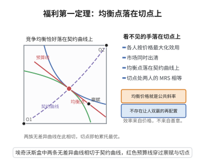

# 福利经济学第一基本定理

> **一句话大白话**：完全竞争市场里，"各人自扫门前雪"促成的竞争均衡，居然一定是"让所有人没法同时变得更好"的帕累托最优——看不见的手确实把个人自利推向了社会最优。
>
> **小例子**：市场价格把每种资源标好价，消费者按预算挑最满意的、生产者按价格追最大利润。这四条自利行为撑起的均衡，结果却保证：不存在任何重新分配让某人变好而又没人变差。

## 一、定理介绍

> **前置依赖**：效用最大化、利润最大化、局部非饱和性、市场出清（Walras律）、帕累托最优定义

福利经济学第一基本定理断言：在完全竞争市场中，任何竞争均衡都是**帕累托最优**的——即不存在可行的重新配置使至少一个人的境况变好而无人变差。它用严格数学形式表达了"看不见的手"（Adam Smith）的核心思想，是竞争性市场效率性的理论保证。

## 几何直观

图意在说明：竞争均衡处两人的边际替代率相等，切点落在契约曲线上，因此均衡必是帕累托最优。

## 二、原理思路

证明采用反证 + 加总矛盾。核心观察：在均衡中，消费者因效用最大化，若偏好更优的消费束 $\tilde x_i$，其价值必不低于均衡束 $x_i^*$（否则可在预算内购买而与最优矛盾）；局部非饱和性把弱 ≥ 提升为严格 > 当偏好严格劣同时。对偏好严格改善的总支出加总得严格不等式。另一方面，生产者利润最大化使均衡产量价值不低于备选产量，结合市场出清给出反向不等式，制造矛盾。

## 三、定理的严格表述

设 $(p^*,(x_i^*)_{i=1}^I,(y_j^*)_{j=1}^J)$ 为竞争均衡（价格 $p^*$、优消费束 $x_i^*$、利润最大生产计划 $y_j^*$ 且市场出清）。则不存在可行配置 $(\tilde x_i,\tilde y_j)$ 满足 $\tilde x_i\succsim_i x_i^*$ 全体成立且至少一个严格偏好 $\succ_i$。

## 四、证明过程

**步骤1：建立模型。** 考虑 $I$ 个消费者、$J$ 个生产者的经济及竞争均衡 $(p^*,x_i^*,y_j^*)$。

**步骤2：反证法假设。** 设存在帕累托优配置 $(\tilde x_i,\tilde y_j)$：全体 $\tilde x_i\succsim_i x_i^*$，且某 $i_0$ 严格偏好；可行性 $\sum_i\tilde x_i=\sum_i e_i+\sum_j\tilde y_j$，$\tilde y_j\in Y_j$。

**步骤3：利用效用最大化条件。** 由局部非饱和，$\tilde x_i\succsim_i x_i^* \Rightarrow p^*\cdot\tilde x_i\ge p^*\cdot x_i^*$；$\tilde x_i\succ_i x_i^* \Rightarrow p^*\cdot\tilde x_i> p^*\cdot x_i^*$。

**步骤4：消费者支出加总。** 因至少一人严格改善，
$$
\sum_{i}p^*\cdot\tilde x_i>\sum_{i}p^*\cdot x_i^*.
$$

**步骤5：利润最大化与市场出清。** 利润最大化给出 $p^*\cdot\tilde y_j\le p^*\cdot y_j^*$；市场出清 $\sum_i x_i^*=\sum_i e_i+\sum_j y_j^*$，故
$$
\sum_i p^*\cdot x_i^*=\sum_i p^*\cdot e_i+\sum_j p^*\cdot y_j^*\ge \sum_i p^*\cdot e_i+\sum_j p^*\cdot\tilde y_j.
$$

**步骤6：导出矛盾。** 由可行性，$\sum_i p^*\cdot\tilde x_i=\sum_i p^*\cdot e_i+\sum_j p^*\cdot\tilde y_j\le\sum_i p^*\cdot x_i^*$，与步骤 4 严格不等矛盾。故无帕累托优配置。

**结论（$\square$）**：竞争均衡是帕累托最优的。

## 五、应用与意义

该定理是市场效率理论的基石，为自由竞争市场提供规范性辩护：分散决策能达到社会最优。它构成福利经济学效率分析、一般均衡福利性质以及"市场失灵"（外部性、垄断破坏出清）讨论的标准参照系，是经济政策理论论证中反复引用的核心命题。

## 课堂问答

**老师**：竞争均衡为什么一定帕累托最优？

**学生**：结论用反证加"价值加总"得到：若存在帕累托更优配置且某人严格改善，则由局部非饱和得 $\sum_i p^*\cdot\tilde x_i>\sum_i p^*\cdot x_i^*$；另一方面利润最大化与市场出清给出反向不等式，二者矛盾。

**老师（追问）**：局部非饱和在这里起什么作用？

**学生**：它把"不更差"从弱不等式提升为严格不等式——若 $\tilde x_i\succsim_i x_i^*$ 则 $p^*\cdot\tilde x_i\ge p^*\cdot x_i^*$，否则可在预算内买到更优束而违反效用最大化；正是这一步保证加总后出现严格不等。

**老师（拓展）**：这条定理的边界在哪里？

**学生**：它只保证效率、不涉及公平，且依赖完全竞争与无外部性；一旦有外部性、垄断或公共品，价格不能反映边际社会成本，市场失灵使结论失效——这正是福利经济学需要第二定理与政策干预的原因。
