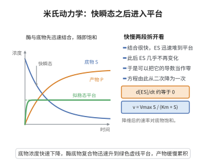

# Michaels-Menten动力学的拟稳态近似

> **一句话大白话**：酶-底物反应里，酶-底物复合物的生成销毁往往极快、很快达"假平衡"，于是可把它当作几乎没有积累的量直接消掉，剩下一个简洁的速率公式——酶催化速率随底物浓度呈"双曲线趋于饱和"。
>
> **小例子**：反应 $E+S\overset{k_1}{\underset{k_{-1}}{\rightleftharpoons}}ES\to E+P$ 里 $ES$ 很快稳态，得到速率 $v=\frac{V_{\max}[S]}{K_m+[S]}$：底物少时 $v\propto[S]$、底物多时 $v\to V_{\max}$（饱和）。

## 一、定理介绍

> **前置依赖**：质量作用定律、拟稳态近似（QSSA）、质量守恒、代数求根、时间尺度分离

Michaels-Menten 动力学是酶促反应速率的基本模型。对反应
$$
E+S\underset{k_{-1}}{\overset{k_1}{\rightleftharpoons}}ES\xrightarrow{k_2}E+P,
$$
在**拟稳态近似**（QSSA，即 $d[ES]/dt\approx0$）假设下，产物生成速率由
$$
v=\frac{V_{\max}[S]}{K_m+[S]},\qquad V_{\max}=k_2E_T,\quad K_m=\frac{k_{-1}+k_2}{k_1}
$$
给出，其中 $E_T=[E]+[ES]$ 为总酶浓度。

## 几何直观

图意在说明：复合物在极短时间内饱和，此后导数近似为零，方程由此降维成饱和速率式。

## 二、原理思路

QSSA 的合理性在于酶催化时间尺度分离：$ES$ 的生成/分解远比底物的整体消耗与产物积累快，故 $[ES]$ 迅速逼近其准平衡值，"几乎不积累"。将 QSSA 方程代入守恒式 $[E]=E_T-[ES]$，解出 $[ES]$ 的代数形式，代入产物速率 $v=k_2[ES]$ 即得 Michaels-Menten 方程。其双曲线饱和行为源自 $[ES]$ 对 $[S]$ 的饱和逼近。

## 三、定理的严格表述

对上述单底物单酶反应，假设 $[ES]$ 满足拟稳态 QSSA（时间尺度分离，$k_1,k_{-1},k_2$ 相对大），则
$$
[E]=E_T-[ES],\qquad
\frac{d[ES]}{dt}=k_1[S](E_T-[ES])-(k_{-1}+k_2)[ES]=0,
$$
解得
$$
[ES]=\frac{E_T[S]}{K_m+[S]},\qquad
v=\frac{d[P]}{dt}=k_2[ES]=\frac{V_{\max}[S]}{K_m+[S]},
$$
其中 $V_{\max}=k_2E_T$，$K_m=(k_{-1}+k_2)/k_1$。

## 四、证明过程

**步骤1：写出各物种速率方程。**
$$
\frac{d[S]}{dt}=-k_1[S][E]+k_{-1}[ES],\qquad
\frac{d[ES]}{dt}=k_1[S][E]-(k_{-1}+k_2)[ES],\qquad
\frac{d[P]}{dt}=k_2[ES].
$$

**步骤2：守恒与 QSSA。** 总酶守恒 $[E]+[ES]=E_T$；拟稳态令 $d[ES]/dt\approx0$。

**步骤3：解代数方程。** 代入守恒并令零：
$$
k_1[S](E_T-[ES])=(k_{-1}+k_2)[ES]\implies [ES]=\frac{E_T[S]}{K_m+[S]},\ K_m=\frac{k_{-1}+k_2}{k_1}.
$$

**步骤4：得速率公式。** $v=d[P]/dt=k_2[ES]=\frac{V_{\max}[S]}{K_m+[S]}$。

**步骤5：极限行为。** $[S]\ll K_m$ 时 $v\approx\frac{V_{\max}}{K_m}[S]$（一级），$[S]\gg K_m$ 时 $v\to V_{\max}$（饱和、零级），恰为实验观测的双曲线饱和。

**步骤6：适用范围。** QSSA 近似成立要求 $E_T\ll S_0+K_m$ 等时间尺度分离条件（$k_1,k_{-1}$ 大而 $k_2$ 较小），保证 $[ES]$ 快速进入并在整个反应期近似占据其准平衡态。

**结论（$\square$）**：拟稳态近似导出 Michaels-Menten 饱和速率公式。

## 五、应用与意义

Michaels-Menten 方程是酶学、药理学（药物-受体动力学）与代谢建模的基础速率定律，$K_m$、$V_{\max}$ 是表征酶特性的标准参数，广泛用于药物剂量与代谢通量分析。QSSA 本身更是一般多时间尺度生物反应系统降维与模型化简的范式方法。

## 课堂问答

**老师**：酶促反应 $E+S\rightleftharpoons ES\to E+P$ 中，凭什么可以令 $d[ES]/dt\approx0$？这算哪门子近似？

**学生**：结论——这是**时间尺度分离**下的拟稳态近似（QSSA），能得到饱和速率 $v=\frac{V_{\max}[S]}{K_m+[S]}$。理由：把总酶守恒 $[E]=E_T-[ES]$ 代入并令导数为零，
$$k_1[S](E_T-[ES])=(k_{-1}+k_2)[ES]$$
解得 $[ES]=\frac{E_T[S]}{K_m+[S]}$，其中 $K_m=\frac{k_{-1}+k_2}{k_1}$，再乘 $k_2$ 即得 $v$。常见误区：以为 $[ES]$ 真的"不变"——它只是变化率相对底物消耗可忽略，并非数值恒定。

**老师（追问）**：那 QSSA 何时会失效？若底物远少于酶、即 $E_T\gg S_0+K_m$ 会怎样？

**学生**：此时 $[ES]$ 会在反应早期快速"吸走"几乎全部底物，无法迅速进入准稳态，QSSA 给出错误的初始瞬态；标准 QSSA 的适用条件正是 $E_T\ll S_0+K_m$（Segel–Slemrod 修正）。补充极限行为：$[S]\ll K_m$ 时 $v\approx\frac{V_{\max}}{K_m}[S]$ 呈一级，$[S]\gg K_m$ 时 $v\to V_{\max}$ 呈零级饱和。

**老师（拓展）**：把 QSSA 放到更一般的多时间尺度反应网络里，它的地位是什么？

**学生**：QSSA 是**模型降维**的典范——用快变量（如 $[ES]$）关于慢变量的代数关系把它消去，将奇异摄动 ODE 化为低维系统；这正是 Tikhonov 定理与 Fenichel 慢流形在生物化学中的特例，也解释了为何"非元反应一般不服从质量作用律"。
