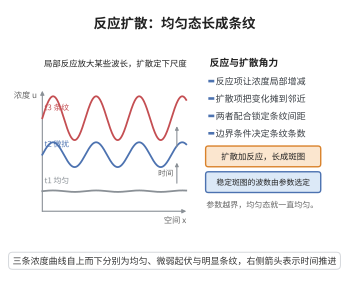

# 反应-扩散方程

> **一句话大白话**：一种物质浓度的局部变化，等于"化学反应制造或消耗的量"加上"扩散搬进来或搬出去的量"。
>
> **小例子**：池塘里养分 $u$ 一边按 $f(u)=ru(1-u/K)$ 增殖，一边以通量 $\boldsymbol J=-D\nabla u$ 向低浓度处扩散，于是 $\partial_t u=D\nabla^2u+f(u)$；BZ 反应波与动物皮毛斑纹都用它建模。

## 一、定理介绍

> **前置依赖**：质量作用定律、守恒律方程基本理论、热方程的基本解、二阶线性PDE分类、椭圆型方程最大值原理

反应-扩散方程是生物数学与化学动力学的基本偏微分方程：

$$
\frac{\partial u}{\partial t}=\nabla\cdot\big(D\nabla u\big)+f(u),\qquad
\text{常系数时}\qquad \frac{\partial u}{\partial t}=D\nabla^2u+f(u),
$$

其中 $u(\boldsymbol x,t)$ 为浓度，$D>0$ 为扩散系数，$f$ 为反应速率（由质量作用定律给出）。它由**守恒律 + Fick 定律**拼成：守恒律说"浓度变化 $=$ 反应净生成 $-$ 通量散度"，Fick 定律说"通量正比于浓度梯度的反向"。本条目给出方程的严格推导、解的不变区间（比较原理）与稳态的线性稳定性分析，后者是 Turing 不稳定性条件的出发点。

## 几何直观

图意在说明：反应项放大特定波长，扩散项锁定空间尺度，二者合力把均匀态塑造成稳定斑图。

## 二、原理思路

1. **守恒**：对任意控制体 $V$，$\frac{d}{dt}\int_Vu\,dV=\int_Vf(u)\,dV-\oint_{\partial V}\boldsymbol J\cdot\boldsymbol n\,dA$，用散度定理与局域化得 $\partial_tu+\nabla\cdot\boldsymbol J=f(u)$。
2. **本构（Fick 定律）**：$\boldsymbol J=-D\nabla u$，代入即得反应-扩散方程。
3. **反应项**：$f$ 由质量作用定律给出（如 $f(u)=ru(1-u/K)$、$f(u)=u(1-u)$）。
4. **适定性**：用**比较原理**（抛物型最大值原理）证明解落在不变区间 $[0,K]$ 内。
5. **线性化**：在均匀稳态 $u^*$ 处展开，扰动模态增长率由 $f'(u^*)-D\mu_k$ 给出，$\mu_k$ 为拉普拉斯特征值。

## 三、定理的严格表述

**（反应-扩散方程）** 设 $u\ge0$ 为浓度，$\boldsymbol J$ 为通量密度，$f$ 为反应速率，则

$$
\frac{\partial u}{\partial t}=\nabla\cdot\big(D\nabla u\big)+f(u)\quad\text{于 }\Omega\times(0,T),
$$

常系数时即 $\partial_tu=D\nabla^2u+f(u)$，配合初值 $u(\boldsymbol x,0)=u_0(\boldsymbol x)$ 与边值（Dirichlet $u|_{\partial\Omega}=g$ 或 Neumann $\partial_{\boldsymbol n}u|_{\partial\Omega}=h$）。

**（不变区间 / 比较原理）** 设 $f\in C^1(\mathbb R)$，$f(0)\ge0$，且存在 $K>0$ 使 $f(K)\le0$。若 $u$ 为 $\Omega\times[0,T]$ 上的光滑解且初值与边值满足 $0\le u\le K$，则 $0\le u\le K$ 于 $\Omega\times[0,T]$。

**（线性稳定性）** 设 $u^*$ 为均匀稳态（$f(u^*)=0$）。在零通量（Neumann）边界下，把 $u=u^*+\varepsilon\phi_k(\boldsymbol x)e^{\lambda t}$ 代入并保留一阶项，其中 $-\nabla^2\phi_k=\mu_k\phi_k$（$0=\mu_0<\mu_1\le\cdots$），则各模态增长率为

$$
\lambda_k=f'(u^*)-D\mu_k ,
$$

故均匀模态（$k=0$）稳定当且仅当 $f'(u^*)<0$。

## 四、证明过程

**步骤 1：从守恒律导出局域方程**

对任意固定控制体 $V\subseteq\Omega$（不随物质运动），单位时间内 $V$ 内总量的增加等于其内反应净生成量减去穿出 $\partial V$ 的净通量：

$$
\frac{d}{dt}\int_Vu\,dV=\int_Vf(u)\,dV-\oint_{\partial V}\boldsymbol J\cdot\boldsymbol n\,dA .
$$

$u$ 光滑故导数可移入积分，右端用高斯散度定理把面积分化为体积分，得

$$
\int_V\Big(\frac{\partial u}{\partial t}+\nabla\cdot\boldsymbol J-f(u)\Big)dV=0\qquad\text{对一切 }V .
$$

被积函数连续，由体积局域化（守恒律方程基本理论中的局域化步骤）得 $\partial_tu+\nabla\cdot\boldsymbol J=f(u)$。$\square$

**步骤 2：Fick 定律与方程的合并**

Fick 定律断言通量沿浓度下降方向、大小正比于梯度：$\boldsymbol J=-D\nabla u$。代入上式得 $\partial_tu=\nabla\cdot(D\nabla u)+f(u)$，$D$ 为常数时即 $\partial_tu=D\nabla^2u+f(u)$。反应项由质量作用定律给出：单分子反应给出线性项，自催化 $A+2X\to3X$ 给出 $ku^2$，逻辑斯蒂增长给出 $ru(1-u/K)$。按二阶线性PDE分类，这是**抛物型**方程（时间一阶、空间二阶）。$\square$

**步骤 3：比较原理**

**引理** 设 $u,v$ 光滑且

$$
\partial_tu-D\nabla^2u-f(u)\ \le\ \partial_tv-D\nabla^2v-f(v)\quad\text{于 }\Omega\times(0,T),
$$

并在抛物边界 $\big(\partial\Omega\times[0,T]\big)\cup\big(\Omega\times\{0\}\big)$ 上 $u\le v$。则 $u\le v$。

**证明**：令 $w=v-u$、$W=e^{-\lambda t}w$，其中 $\lambda>\sup|f'|$。由中值定理 $c:=\frac{f(v)-f(u)}{v-u}$ 满足 $|c|\le\lambda$，且

$$
\partial_tW-D\nabla^2W-(c-\lambda)W\ge0,\qquad c-\lambda<0 .
$$

反设 $W$ 取负值，则 $W$ 在某内点 $(\boldsymbol x_0,t_0)$（$t_0>0$）达到负的最小值。该点 $\nabla W=\boldsymbol 0$、$\nabla^2W\ge0$ 且 $\partial_tW\le0$，于是 $0\ge\partial_tW-D\nabla^2W\ge(c-\lambda)W>0$，矛盾。故 $W\ge0$，即 $v\ge u$。$\square$

**步骤 4：不变区间**

取常值 $\underline u\equiv0$，由 $f(0)\ge0$ 得 $\partial_t\underline u-D\nabla^2\underline u-f(\underline u)=-f(0)\le0$，故 $\underline u$ 是**下解**，且初值 $u_0\ge0$、边值 $\ge0$ 使抛物边界上 $\underline u\le u$；由步骤 3 得 $u\ge0$。

取常值 $\bar u\equiv K$，由 $f(K)\le0$ 得 $\partial_t\bar u-D\nabla^2\bar u-f(\bar u)=-f(K)\ge0$，故 $\bar u$ 是**上解**，且 $u_0\le K$、边值 $\le K$ 使抛物边界上 $u\le\bar u$；由步骤 3 得 $u\le K$。合并得 $0\le u\le K$。$\square$

**步骤 5：稳态与线性化**

均匀稳态 $u^*$ 满足 $f(u^*)=0$。由 $f(u^*+\varepsilon\phi_ke^{\lambda t})=f(u^*)+\varepsilon f'(u^*)\phi_ke^{\lambda t}+O(\varepsilon^2)$ 与 $-\nabla^2\phi_k=\mu_k\phi_k$，代入方程比较 $\varepsilon$ 一阶项得

$$
\lambda\,\phi_ke^{\lambda t}=\big(f'(u^*)-D\mu_k\big)\phi_ke^{\lambda t}
\ \Longrightarrow\ \lambda_k=f'(u^*)-D\mu_k .
$$

因 $\mu_k\ge0$（$\mu_0=0$ 对应常值模态），所有模态稳定当且仅当 $f'(u^*)<0$（此时一切 $\lambda_k<0$）。若 $f'(u^*)>0$，均匀模态失稳，系统可能演化出非均匀结构——这是 Turing 分析与图样形成的起点。稳态问题 $0=D\nabla^2u+f(u)$ 的常值判据也可由椭圆型方程最大值原理直接读出。$\blacksquare$

## 五、应用与意义

**在生物数学与化学中的作用**：

1. **空间传播**：Fisher–KPP 方程 $\partial_tu=D\nabla^2u+ru(1-u/K)$ 描述优势基因或传染病的空间扩张，其行波解给出恒定扩张速度。
2. **形态发生**：Turing 不稳定性条件在此方程上给出"扩散诱导失稳"判据，解释动物斑纹与发育中的周期性结构。
3. **化学与神经传导**：BZ 反应、Gray–Scott 模型与扩散耦合的神经元模型都以反应-扩散方程为核心，产生斑图与螺旋波。

**理论意义**：方程把"局部反应"（常微分动力学）与"空间扩散"（由热方程的基本解所刻画的平滑机制）耦合起来。当 $f\equiv0$ 时它退化为热方程，解由热核卷积给出；反应项的存在使系统既不单调平滑也不完全确定。比较原理保证浓度不越界，是模型"生物合理性"的数学保证；线性化则把稳定性化为代数特征值问题，为非线性图样分析提供入口。

## 课堂问答

**老师**：$\partial_t u=D\nabla^2u+f(u)$ 里扩散项与反应项各扮什么角色，能否严格说明解不会越界？

**学生**：结论——它由守恒律加 Fick 定律合成，且解满足**不变区间** $0\le u\le K$。理由：守恒 $\partial_tu=-\nabla\cdot\boldsymbol J+f(u)$，代入 $\boldsymbol J=-D\nabla u$ 得方程；比较原理用抛物型最大值原理，令 $w=v-u$、$W=e^{-\lambda t}w$（$\lambda>\sup|f'|$），反设 $W$ 在某内点取负最小则 $0\ge\partial_tW-D\nabla^2W\ge(c-\lambda)W>0$ 矛盾。取 $\underline u\equiv0$（$f(0)\ge0$）与 $\bar u\equiv K$（$f(K)\le0$）即得。常见误区：以为 $f$ 任意都保正——需这类符号条件。

**老师（追问）**：线性化后模态增长率 $\lambda_k=f'(u^*)-D\mu_k$ 说明了什么？

**学生**：说明单物种时**扩散只会压制空间异质模态**（$D\mu_k\ge0$ 使 $\lambda_k$ 更负），均匀模态 $k=0$ 稳定当且仅当 $f'(u^*)<0$；若 $f'(u^*)>0$ 则均匀模态先失稳，这是 Turing 分析的起点。换言之，单物种扩散总是"抹平"扰动，不会凭空制造斑图。

**老师（拓展）**：这个方程在生物数学里有哪些典型用途？

**学生**：Fisher–KPP 方程 $\partial_tu=D\nabla^2u+ru(1-u/K)$ 的行波解给出基因或传染病的空间扩张速度；Turing 机制解释斑纹；BZ 反应、Gray–Scott 模型与扩散耦合神经元产生螺旋波。它把"局部 ODE 反应"与"热方程式扩散平滑"耦合，$f\equiv0$ 时退化为热方程。
