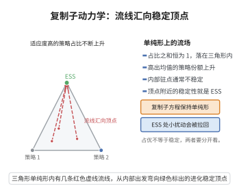

# 进化博弈的复制子动力学

> **一句话大白话**：在进化博弈里，"策略"像物种一样按自己的收益繁殖——收益高的策略在种群中的占比增大，收益低的占比缩水，这个"适者繁殖"的过程用复制子方程描述，其不动点常对应稳定的博弈均衡（ESS）。
>
> **小例子**：在"鹰-鸽"博弈中，若全鸽则鹰入侵占优、若全鹰则两败俱伤，复制子动态把比例推向"鹰鸽混合"的稳定不动点——正是进化稳定策略（ESS），对应现实中"适度好斗"的共存比例。

## 一、定理介绍

> **前置依赖**：进化稳定策略（ESS）、纳什均衡、频率依赖选择、Lyapunov稳定性定理

复制子动力学（Replicator Dynamics）刻画进化博弈中策略频率随时间的演化。设有 $n$ 种纯策略，频率向量 $x=(x_1,\dots,x_n)$，策略 $i$ 的适应度为 $f_i(x)$（由进化博弈的代价矩阵决定），平均适应度为 $\bar f(x)=\sum_j x_jf_j(x)$。则复制子方程
$$
\frac{dx_i}{dt}=x_i\big(f_i(x)-\bar f(x)\big)
$$
使收益高于平均的策略频率增长、低于平均的下降。

## 几何直观

图意在说明：份额按超出平均适应度的多少增长，流线被顶点吸住，那个顶点就是进化稳定策略。

## 二、原理思路

思想是"变异选择 + 收益即适应度"：策略按自身高于平均收益的幅度成比例增殖，频率随正比于相对适应度。该方程是连续时间的单调选择动力学，其 Lyapunov 分析与不动点分类给出与博弈论解概念的联系——非对称博弈的复制子任一点常对应纳什均衡，在对称博弈中其吸引子类对应于进化稳定策略（ESS）。

## 三、定理的严格表述

设策略 $i$ 相对收益 $f_i(x)$，平均收益 $\bar f(x)$，复制子方程
$$
\frac{dx_i}{dt}=x_i\big(f_i(x)-\bar f(x)\big),\qquad \sum_i x_i=1,\ x_i\ge0.
$$
设 $\mathbf f$ 为对称二人博弈某支付矩阵的期望收益。则有：

1. 复制子任意不动点与混合纳什均恒等（$f_i(x)=\bar f(x)$ 对 $\mathrm{supp}(x)$ 成立⇔纳什）；
2. 若 ESS 存在，则相应混合策略是复制子动力学的 Lyapunov（渐近）稳定不动点。

## 四、证明过程

**步骤1：推导复制子方程。** 设 $i$ 个体数 $N_i$，出生率正比于适应度、速率 $r$，$N_i/N=\dot x_i=x_i f_i$，用 $N$ 归一化得 $dx_i/dt=x_i(f_i-\bar f)$。

**步骤2：不动点条件。** 不动点满足 $x_i=0$ 或 $f_i(x)=\bar f(x)$；在支撑上所有纯策略收益相等，恰为纳什均衡条件。

**步骤3：$x_i$ 支撑集不变。** $dx_i/dt=0$ 当 $x_i=0$，所以支撑集不扩张，简化分析。

**步骤4：ESS 的稳定性。** 对对称博弈，可用平均收益作为势/Lyapunov 量：径度随时间的演化满足 $\frac{d}{dt}\sum_ix_i(f_i-\bar f)\le0$（对可平均性博弈成立）。若 $x^*$ 为 ESS，则种内侵入受阻，故 $x^*$ 是 Lyapunov 稳定不动点，被复制子动态吸引。

**步骤5：收敛与分类。** 对 $2\times2$ 对称博弈，复制子流形一维，可直接判稳定不动点；ESS 恰对应渐近稳定不动点，非 ESS 的混合纳什则可能是鞍点或中心（如剪刀石头布）。

**结论（$\square$）**：复制子动力学把"适者繁殖"翻译成频率演化，其稳定不动点与 ESS 对应。

## 五、应用与意义

复制子动力学把博弈论与达尔文进化联结，广泛用于动物行为演化、合作与利他演化、群体事件选择及多领域"策略演化的生物学"，也是演化计算（进化算法）、社会契约与文化演化建模的标准工具。它直观解释"为何种群会稳定在某个混合策略"，是进化博弈的核心理论基础。

## 课堂问答

**老师**：复制子方程 $\dot x_i=x_i(f_i-\bar f)$ 里为什么乘的是 $x_i(f_i-\bar f)$，而不是 $f_i-\bar f$？

**学生**：结论——因为策略 $i$ 的个体数按自身适应度增长，频率 $x_i=N_i/N$ 的相对增长率恰为"超出平均"的部分。理由：出生率 $\propto f_i$，归一化后 $\dot x_i=x_i(f_i-\bar f)$。关键性质：$x_i=0$ 时 $\dot x_i=0$，故**支撑集不扩张**，简化分析。常见误区：以为不动点与纳什均衡一一对应——在支撑上收益相等正是纳什条件，但反过来纳什未必吸引。

**老师（追问）**：那复制子动力学和进化稳定策略（ESS）到底是什么关系？

**学生**：ESS 是更强的概念：若 $x^*$ 为 ESS，则种内入侵受阻，$x^*$ 是 Lyapunov 渐近稳定不动点；但渐近稳定不动点未必是 ESS（非对称博弈中两者可不重合，如石头剪刀布无 ESS 却有稳定混合纳什）。$2\times2$ 对称博弈中复制子流形一维，ESS 恰对应渐近稳定不动点，其余混合纳什可为鞍点或中心。

**老师（拓展）**：能否用一个"势"统一说明稳定性？

**学生**：对可平均（可势化）博弈，平均收益 $\bar f$ 可作 Lyapunov/势函数，沿轨道 $\frac{d}{dt}\sum_i x_i(f_i-\bar f)\le0$，轨道单调趋近吸引集；这正是把"适者繁殖"翻译为频率演化、并把博弈论与达尔文进化联结的数学根据。
