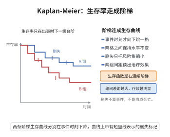

# Kaplan-Meier估计的一致性

> **一句话大白话**：生存分析里没必要假设生存曲线长什么样，直接按"到了每个事件时刻还存活的人当中挂了几个"逐步往下累积，就得到一个稳健的生存曲线估计——样本一多，它就逼近真正的生存曲线。
>
> **小例子**：病人 $T_i$ 若还没复发就被随访截断（删失），Kaplan-Meier 估计 $\hat S(t)=\prod_{t_i\le t}(1-\frac{d_i}{n_i})$ 会把这部分人算进"还在风险里"，从而无偏估算"到 $t$ 仍存活的比例"，且大样本下逐点一致收敛到真实 $S(t)$。

## 一、定理介绍

> **前置依赖**：计数过程与鞅、Nelson-Aalen估计、乘积限与乘积积分、鞅不等式

Kaplan-Meier（乘积限）估计是一致估计生存函数 $S(t)=P(T>t)$ 的非参数方法。对独立删失生存数据 $X_i=\min(T_i,C_i)$，$\delta_i=\mathbf1_{\{T_i\le C_i\}}$，
$$
\hat S(t)=\prod_{t_i\le t}\Big(1-\frac{d_i}{n_i}\Big),
$$
其中 $d_i$ 为 $t_i$ 事件数、$n_i$ 为 $t_i$ 时刻风险人数，则适当区间上一致收敛：
$$
\sup_{t\in[0,\tau]}|\hat S(t)-S(t)|\xrightarrow{p}0.
$$

## 几何直观

图意在说明：生存率只在事件发生时下一级台阶，删失只缩小风险集，阶梯因此是右连续且逐步下降的。

## 二、原理思路

乘积限估计通过"逐步更新生存概率"处理删失：在每个事件时刻，存活概率乘上"到这一时刻还没死"的占比，删失者仍计入风险分母 $n_i$ 从而不被误当作死亡。一致性证明用**计数过程鞅**：把 Nelson-Aalen 估计写为鞅积分 $\hat\Lambda(t)-\Lambda(t)=\int_0^t\frac{dM(s)}{Y(s)}$；由其方差 $\mathbb{E}\int_0^t\frac{h(s)}{Y(s)}ds\to0$（$Y(s)\to\infty$）得 $\hat\Lambda\xrightarrow{p}\Lambda$，再由 $\hat S=e^{-\hat\Lambda}$ 与连续映射/乘积积分得以一致收敛。

## 三、定理的严格表述

设 $T_i,C_i$ 独立同分布且相互独立，观测 $X_i=\min(T_i,C_i)$，$\delta_i=\mathbf1_{\{T_i\le C_i\}}$。Kaplan-Meier 估计
$$
\hat S(t)=\prod_{t_i\le t}\Big(1-\frac{d_i}{n_i}\Big)
$$
满足：对满足 $P(T>\tau)>0$、$P(C>\tau)>0$ 的 $\tau$，
$$
\sup_{t\in[0,\tau]}|\hat S(t)-S(t)|=o_p(1).
$$

## 四、证明过程

**步骤1：定义计数与风险过程。** $N(t)=\sum_iN_i(t)$，$N_i(t)=\mathbf1_{\{X_i\le t,\delta_i=1\}}$；$Y(t)=\sum_iY_i(t)$，$Y_i(t)=\mathbf1_{\{X_i\ge t\}}$。

**步骤2：累积风险与 Nelson-Aalen。** $\Lambda(t)=-\ln S(t)$，Nelson-Aalen $\hat\Lambda(t)=\sum_{t_i\le t}\frac{d_i}{n_i}$，且 $\hat S=\prod(1-\frac{d_i}{n_i})\approx e^{-\hat\Lambda}$。

**步骤3：鞅表示。** $N$ 的补偿子 $\Lambda^*(t)=\int_0^tY(s)h(s)ds$，鞅 $M(t)=N(t)-\Lambda^*(t)$；Nelson-Aalen 偏差
$$
\hat\Lambda(t)-\Lambda(t)=\int_0^t\frac{dM(s)}{Y(s)}.
$$

**步骤4：方差计算。** $\text{Var}\int_0^t\frac{dM(s)}{Y(s)}=\mathbb E\int_0^t\frac{d\langle M\rangle(s)}{Y(s)^2}=\mathbb E\int_0^t\frac{h(s)}{Y(s)}ds\to0$，因 $Y(s)\to\infty$（$Y=O_p(n)$）。

**步骤5：Chebyshev 一致性。** 对任意 $\varepsilon>0$，
$$
P\Big(|\int_0^t\frac{dM(s)}{Y(s)}|>\varepsilon\Big)\le\frac1{\varepsilon^2}\mathbb E\int_0^t\frac{h(s)}{Y(s)}ds\to0,
$$
故 $\hat\Lambda(t)\xrightarrow{p}\Lambda(t)$。

**步骤6：汇总到 $\hat S$。** 由连续性/乘积积分表示 $\hat S(t)=\mathcal P_{s=0}^t(1-d\hat\Lambda(s))$，$\hat\Lambda$ 的一致收敛保证 $\hat S(t)\xrightarrow{p}e^{-\Lambda(t)}=S(t)$。

**步骤7：一致收敛加强。** 用鞅不等式（Lenglart）得 $\sup_{[0,\tau]}|\hat\Lambda-\Lambda|=o_p(1)$，进而 $\sup_{[0,\tau]}|\hat S-S|=o_p(1)$。

**结论（$\square$）**：Kaplan-Meier 估计一致收敛于真实生存函数。

## 五、应用与意义

Kaplan-Meier 曲线是生存分析最常用的可视化与推断工具，被广泛用于临床试验、肿瘤随访、器械与生物统计研究。其基于计数过程鞅的严格理论支撑了区间估计、组间比较（Log-rank）与 Cox 模型的配套推断，是现代统计学处理删失数据的基石。

## 课堂问答

**老师**：$\hat S(t)=\prod_{t_i\le t}(1-d_i/n_i)$ 是怎么处理删失的，凭什么一致？

**学生**：结论——删失者在事件时刻前始终计入风险分母 $n_i$，不会被误当死亡，且 $\hat S$ 在 $[0,\tau]$ 上一致收敛于 $S$。理由：$\hat S$ 为乘积限估计，$\hat\Lambda$ 为 Nelson–Aalen；由计数过程鞅 $M=N-\Lambda^*$ 得偏差表示 $\hat\Lambda(t)-\Lambda(t)=\int_0^t\frac{dM(s)}{Y(s)}$。常见误区：以为删失与死亡可随意等价——只有在**独立删失**下 $M$ 才是鞅，删失依赖才是偏倚来源。

**老师（追问）**：一致性怎么从"逐点"升级到"一致"？

**学生**：先算方差 $\text{Var}\int_0^t\frac{dM}{Y}=\mathbb E\int_0^t\frac{h(s)}{Y(s)}\,ds\to0$（风险集 $Y=O_p(n)\to\infty$），由 Chebyshev 得 $\hat\Lambda(t)\xrightarrow{p}\Lambda(t)$；再由乘积积分 $\hat S=\mathcal P_{s\le t}(1-d\hat\Lambda(s))$ 与连续映射得 $\hat S\xrightarrow{p}e^{-\Lambda}=S$；最后用 Lenglart 鞅不等式把 $\sup_{[0,\tau]}|\hat\Lambda-\Lambda|$ 也控住，即得一致收敛。

**老师（拓展）**：为什么要限制 $t\le\tau$ 且 $P(T>\tau)>0,\ P(C>\tau)>0$？

**学生**：因为末尾风险集可能变空使 $n_i=0$、$1-d_i/n_i$ 定义失效，$\hat S$ 在最大观测时间之后无定义（估不到 $S$ 的尾部）。限制 $\tau$ 使 $Y(\tau)$ 仍 $O_p(n)$ 有下界，保证分母可逆、方差估计与大数定律成立——这正是 KM 估计"尾部不稳"的根源。
