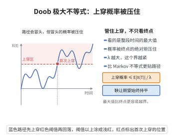

# 鞅不等式

> **一句话大白话**：鞅是“公平游戏”，它可以任意上下波动，但**整条路径上的最大偏移**仍被终点值牢牢控制——最大值超过 $\lambda$ 的概率乘上 $\lambda$ 不超过终点的期望。于是即便波动路径未知，极端偏离也被严格限制。
> **小例子**：赌徒每局公平下注，则“最坏时刻财富超过 $100$ 元的概率”不超过他最终期望财富除以 $100$；在生存分析中，Kaplan–Meier 与 Nelson–Aalen 的偏差过程是鞅，正是这条不等式把“可料二次变差趋于常数”升级为“整条曲线的**一致**收敛”。

## 一、定理介绍

> **前置依赖**：条件期望与滤子（filtration）、鞅与下鞅、Doob可选停止定理、非负随机变量的层饼表示、测度论中的 Fubini 定理与 Hölder 不等式、可料二次变差与可选采样恒等式

鞅不等式是概率论中刻画鞅“一致可控性”的一族核心估计，主要包括 Doob 极大不等式（$L^1$ 与 $L^p$ 形式）、Kolmogorov–Doob 不等式、Hájek–Rényi 不等式、Lenglart 支配不等式与 Burkholder–Davis–Gundy（BDG）不等式。它们的作用是把“整条路径的最大值”用“终点值”或“可料二次变差”控制，从而把逐点／依分布的收敛升级为**一致依概率收敛**。

在生物统计学中，生存分析里的核心过程几乎都是鞅：计数过程 $N(t)$ 关于自身历史的补偿子之差 $M=N-\Lambda$ 是鞅，Nelson–Aalen 估计量 $\hat\Lambda$ 的偏差过程、Kaplan–Meier 估计量的偏差过程、Cox 部分似然得分过程都是局部鞅。它们的相合性、渐近正态性与 Log-rank 检验的渐近分布，正是通过“鞅不等式 + 鞅中心极限定理”建立的。因此 Doob 极大不等式与 Lenglart 不等式是这些渐近结果从“依分布收敛”走向“依概率一致收敛”的技术支柱。

本文件给出四个可完全证明的核心不等式：Doob 的 $L^1$ 与 $L^p$ 极大不等式、它的直接推论 Kolmogorov–Doob 不等式、以及把极大值化为可料二次变差控制的 Lenglart 支配不等式，并给出它们在生存分析中的典型用法（Hájek–Rényi、BDG 等更强的形式在第五节作为推广列出）。

## 几何直观

图意在说明：鞅关注整段时间的最大值，上穿某个水平的概率被终点绝对矩与水平之比控制住。

## 二、原理思路

1. **把“最大值事件”改写为“首次穿越时刻”**：$\{M_n^*\ge\lambda\}=\{\tau\le n\}$，其中 $\tau=\inf\{k:M_k\ge\lambda\}\wedge n$ 是（有界）停时。
2. **在穿越时刻估值**：在该事件上必有 $M_\tau\ge\lambda$，故 $\lambda\,\mathbb P(\tau\le n)\le\mathbb E[M_\tau\mathbf 1_{\{\tau\le n\}}]\le\mathbb E[M_\tau]$。
3. **用可选采样控制 $\mathbb E[M_\tau]$**：对下鞅与有界停时 $\tau\le n$ 有 $\mathbb E[M_\tau]\le\mathbb E[M_n]$，于是得到 $\lambda\mathbb P(M_n^*\ge\lambda)\le\mathbb E[M_n]$。
4. **$L^p$ 版本用层饼公式与 Hölder 不等式**：$\mathbb E[(M_n^*)^p]=p\int_0^\infty\lambda^{p-1}\mathbb P(M_n^*>\lambda)\,d\lambda$，代入第 3 步并交换积分次序，再对 $\mathbb E[M_n(M_n^*)^{p-1}]$ 用 Hölder 不等式。
5. **Lenglart 不等式**：用一个可料递增过程 $Y$ 支配 $X$，把“穿越 $\lambda$”的事件按 $Y_T<\eta$ 与 $Y_T\ge\eta$ 分割，前一部分由支配性与“$Y$ 未超 $\eta$”控制，后一部分直接放弃（概率给出）。

## 三、定理的严格表述

**（Doob 极大不等式，$L^1$ 形式）** 设 $(M_n)_{n\ge0}$ 是关于滤子 $(\mathcal F_n)_{n\ge0}$ 的**非负下鞅**（即 $M_n\ge0$、$\mathbb E[M_n]<\infty$ 且 $\mathbb E[M_{n+1}\mid\mathcal F_n]\ge M_n$）。记 $M_n^*:=\max_{0\le k\le n}M_k$。则对一切 $\lambda>0$，
$$
\lambda\,\mathbb P\big(M_n^*\ge\lambda\big)\ \le\ \mathbb E\Big[M_n\,\mathbf 1_{\{M_n^*\ge\lambda\}}\Big]\ \le\ \mathbb E\big[M_n\big].
$$
**（Doob 极大不等式，$L^p$ 形式）** 设 $(M_n)$ 是关于 $(\mathcal F_n)$ 的鞅，$p>1$，$M_n^*:=\max_{0\le k\le n}|M_k|$。则
$$
\big\|M_n^*\big\|_p\ \le\ \frac{p}{p-1}\,\big\|M_n\big\|_p ,
\qquad\text{即}\qquad
\Big(\mathbb E\big[(M_n^*)^p\big]\Big)^{1/p}\le\frac{p}{p-1}\Big(\mathbb E\big[|M_n|^p\big]\Big)^{1/p},
$$
且常数 $\frac{p}{p-1}$ 是最优的（不可再减小）。

**（推论：Kolmogorov–Doob 不等式）** 设 $(M_n,\mathcal F_n)$ 为 $L^2$ 鞅，$M_0=0$，增量 $d_k=M_k-M_{k-1}$。则对一切 $\lambda>0$，
$$
\mathbb P\Big(\max_{1\le k\le n}|M_k|\ge\lambda\Big)\ \le\ \frac{1}{\lambda^2}\,\mathbb E\big[M_n^2\big]
=\frac{1}{\lambda^2}\sum_{k=1}^{n}\mathbb E\big[d_k^2\big] .
$$

**（Lenglart 支配不等式）** 设 $(X_n)_{0\le n\le N}$ 为非负适应过程，$(Y_n)_{0\le n\le N}$ 为非负、可料、非降过程（$Y_0=0$，$Y_n$ 关于 $\mathcal F_{n-1}$ 可测且 $\mathbb E[Y_N]<\infty$），满足**支配条件**
$$
\mathbb E\big[X_\tau\big]\le\mathbb E\big[Y_\tau\big]
\qquad\text{对一切有界停时 }\tau\ (\tau\le N).
$$
则对任意 $\lambda,\eta>0$，
$$
\mathbb P\Big(\sup_{0\le n\le N}X_n\ge\lambda\Big)\ \le\ \frac{\eta}{\lambda}\ +\ \mathbb P\big(Y_N\ge\eta\big).
$$

**（推论的推论：用二次变差控制局部鞅的最大值）** 设 $(M_n,\mathcal F_n)_{0\le n\le N}$ 为 $L^2$ 鞅，$M_0=0$，其可料二次变差 $\langle M\rangle_n=\sum_{k\le n}\mathbb E[d_k^2\mid\mathcal F_{k-1}]$。则对任意 $\lambda,\eta>0$，
$$
\mathbb P\Big(\sup_{0\le n\le N}|M_n|\ge\lambda\Big)\ \le\ \frac{\eta}{\lambda^2}\ +\ \mathbb P\big(\langle M\rangle_N\ge\eta\big).
$$

**（注：连续时间版本）** 若 $(M_t)_{t\le T}$ 为右连续下鞅（相应地鞅），则上述各不等式中的 $\max_{k\le n}$ 可换为 $\sup_{t\le T}$，结论不变。

## 四、证明过程

**步骤 1：构造穿越停时**

固定 $n\ge1$ 与 $\lambda>0$。定义
$$
\tau:\Omega\to\{0,1,\dots,n\},\qquad
\tau=\inf\big\{k\in\{0,\dots,n\}:M_k\ge\lambda\big\}\quad(\text{若集合为空则取 }\tau=n).
$$
由于 $M$ 适应，$\{\tau=k\}=\{M_0<\lambda,\dots,M_{k-1}<\lambda,M_k\ge\lambda\}\in\mathcal F_k$（$\lambda>0$、$M_k\ge0$，故 $M_0=0<\lambda$ 时无妨），故 $\tau$ 是停时，且 $\tau\le n$ 有界。

关键的事件等式：
$$
\big\{M_n^*\ge\lambda\big\}=\Big\{\max_{0\le k\le n}M_k\ge\lambda\Big\}=\{\tau\le n\} .
$$
（若 $M_n^*\ge\lambda$，则存在 $k\le n$ 使 $M_k\ge\lambda$，于是按定义取到的最早这样的 $k$ 满足 $\tau=k\le n$——注意此处即使最早穿越发生在 $k=n$ 也成立；反之若 $\tau\le n$，则由定义 $\tau$ 处必有 $M_\tau\ge\lambda$，故 $M^*_n\ge\lambda$。）

并且**在事件 $\{M^*_n\ge\lambda\}$ 上有 $M_\tau\ge\lambda$**：若 $\tau<n$，由定义 $M_\tau\ge\lambda$；若 $\tau=n$，则说明不存在 $k<n$ 使 $M_k\ge\lambda$，而事件 $\{M^*_n\ge\lambda\}$ 又成立，故只能是 $M_n\ge\lambda=M_\tau$。因此
$$
\lambda\,\mathbf 1_{\{M_n^*\ge\lambda\}}\ \le\ M_\tau\,\mathbf 1_{\{M_n^*\ge\lambda\}}\ \le\ M_\tau . \tag{1}
$$

**步骤 2：可选采样控制 $\mathbb E[M_\tau]$**

$M$ 是非负下鞅，$\tau\le n$ 是有界停时。由下鞅的可选采样定理（可用“鞅 $M_{k\wedge\tau}$ 之后再用 $\mathbb E[M_{k\wedge\tau}]\le\mathbb E[M_k]$ 的单调性”的初等论证：对每个 $k$，$Y_k:=M_{k\wedge\tau}$ 满足 $\mathbb E[Y_{k+1}\mid\mathcal F_k]\ge Y_k$，故 $(\mathbb E[Y_k])_k$ 非降，取 $k=n$ 得 $\mathbb E[M_\tau]=\mathbb E[Y_n]\ge\mathbb E[Y_0]=\mathbb E[M_0]$；这里我们需要的方向由“$M$ 下鞅 $\Rightarrow$ $\mathbb E[M_\tau]\le\mathbb E[M_n]$”给出，其标准证明为：把 $\tau$ 表示为 $\tau=\sum_{k=0}^{n}k\mathbf 1_{\{\tau=k\}}$，则 $M_n-M_\tau=\sum_{k=0}^{n-1}\mathbf 1_{\{\tau=k\}}(M_n-M_k)$，而 $M_n-M_k=\sum_{j=k+1}^{n}(M_j-M_{j-1})$，取条件期望逐项得
$$
\mathbb E\big[M_n-M_k\mid\mathcal F_k\big]=\sum_{j=k+1}^{n}\mathbb E\big[M_j-M_{j-1}\mid\mathcal F_k\big]\ge0 ,
$$
因为 $\mathbb E[M_j-M_{j-1}\mid\mathcal F_k]\ge0$（先对 $\mathcal F_{j-1}$ 取条件期望，再用下鞅性与 $\mathcal F_k\subseteq\mathcal F_{j-1}$ 和塔性质）。故
$$
\mathbb E\big[M_n-M_\tau\big]=\sum_{k=0}^{n-1}\mathbb E\Big[\mathbf 1_{\{\tau=k\}}\mathbb E\big[M_n-M_k\mid\mathcal F_k\big]\Big]\ge0,
\qquad\text{即}\qquad \mathbb E[M_\tau]\le\mathbb E[M_n] . \tag{2}
$$
（此处用到 $\{\tau=k\}\in\mathcal F_k$。）$\square$

**步骤 3：完成 $L^1$ 不等式**

对 (1) 取期望，并用 (2)：
$$
\lambda\,\mathbb P\big(M_n^*\ge\lambda\big)=\mathbb E\Big[\lambda\mathbf 1_{\{M_n^*\ge\lambda\}}\Big]
\le\mathbb E[M_\tau]\le\mathbb E[M_n] .
$$
同时由 $\mathbf 1_{\{M_n^*\ge\lambda\}}\le1$ 与 $M_n\ge0$（非负下鞅）得 $\mathbb E[M_n\mathbf 1_{\{M_n^*\ge\lambda\}}]\le\mathbb E[M_n]$，中间的等式形式也随之成立。$L^1$ 不等式得证。$\square$

**步骤 4：层饼表示**

设 $Z\ge0$ 满足 $\mathbb E[Z]<\infty$。由 Fubini 定理（非负被积函数）：
$$
\mathbb E[Z^p]=\int_\Omega Z^p\,d\mathbb P=\int_\Omega\Big(\int_0^{Z(\omega)}p\lambda^{p-1}\,d\lambda\Big)d\mathbb P
=p\int_0^\infty\lambda^{p-1}\,\mathbb P\big(Z>\lambda\big)\,d\lambda .
$$
取 $Z=M_n^*$（$p>1$）。注意对每个 $\lambda$，$\{M_n^*>\lambda\}=\{M_n^*\ge\lambda\}\setminus\{M_n^*=\lambda\}$，而 $\{M_n^*=\lambda\}$ 至多对可数个 $\lambda$ 具有正概率，故把步骤 3 的不等式中的 $\ge\lambda$ 换成 $>\lambda$ 不改变上述积分值：
$$
\mathbb E\big[(M_n^*)^p\big]=p\int_0^\infty\lambda^{p-1}\mathbb P\big(M_n^*>\lambda\big)\,d\lambda
\le p\int_0^\infty\lambda^{p-2}\,\mathbb E\big[M_n\mathbf 1_{\{M_n^*>\lambda\}}\big]\,d\lambda . \tag{3}
$$
$\square$

**步骤 5：交换积分次序**

对 (3) 的右端再次使用 Fubini（被积函数 $p\lambda^{p-2}M_n(\omega)\mathbf 1_{\{M_n^*(\omega)>\lambda\}}\ge0$）：
$$
p\int_0^\infty\lambda^{p-2}\,\mathbb E\big[M_n\mathbf 1_{\{M_n^*>\lambda\}}\big]d\lambda
=p\,\mathbb E\Big[M_n\int_0^{M_n^*}\lambda^{p-2}\,d\lambda\Big]
=\frac{p}{p-1}\,\mathbb E\Big[M_n\,(M_n^*)^{p-1}\Big]. \tag{4}
$$
（内层积分：$\int_0^{M_n^*}\lambda^{p-2}d\lambda=\frac{(M_n^*)^{p-1}}{p-1}$，因为 $p-1>0$。）$\square$

**步骤 6：Hölder 不等式给出 $L^p$ 不等式**

先化归到 $|M|$ 是非负下鞅的情形：若 $(M_k,\mathcal F_k)$ 是鞅，则 $(|M_k|,\mathcal F_k)$ 是非负下鞅（由 Jensen 不等式 $|\mathbb E[M_k\mid\mathcal F_{k-1}]|\le\mathbb E[|M_k|\mid\mathcal F_{k-1}]$），故步骤 1–5 对 $|M|$ 成立，即 (4) 中 $M_n$ 可写成 $|M_n|$。

由 Hölder 不等式（共轭指数 $p$ 与 $q=\frac{p}{p-1}$）：
$$
\mathbb E\Big[|M_n|\,(M_n^*)^{p-1}\Big]\le\big\|M_n\big\|_p\cdot\big\|(M_n^*)^{p-1}\big\|_q
=\big\|M_n\big\|_p\cdot\Big(\mathbb E\big[(M_n^*)^p\big]\Big)^{1-\frac1p},
$$
因为 $(p-1)q=p$。代入 (3)(4)：
$$
\big\|M_n^*\big\|_p^p=\mathbb E\big[(M_n^*)^p\big]\le\frac{p}{p-1}\big\|M_n\big\|_p\,\big\|M_n^*\big\|_p^{\,p-1}.
$$
又对每个 $k\le n$ 有 $\mathbb E[|M_k|^p]\le\mathbb E[|M_n|^p]$（由 $M_k=\mathbb E[M_n\mid\mathcal F_k]$ 与 Jensen 不等式），故 $\|M_n^*\|_p\le\sum_{k\le n}\|M_k\|_p<\infty$，可以约去 $\|M_n^*\|_p^{p-1}$：
$$
\big\|M_n^*\big\|_p\le\frac{p}{p-1}\big\|M_n\big\|_p .
$$
$L^p$ 极大不等式得证。$\square$

**步骤 7：Kolmogorov–Doob 不等式**

把步骤 3 的 $L^1$ 不等式应用于非负下鞅 $|M_k|^2$（$M$ 为鞅时 $|M|^2$ 是可积非负下鞅，由 Jensen）：取 $\Lambda=\lambda^2$，
$$
\lambda^2\,\mathbb P\Big(\sup_{k\le n}|M_k|^2\ge\lambda^2\Big)\le\mathbb E\big[|M_n|^2\big].
$$
而 $\{\sup_{k\le n}|M_k|^2\ge\lambda^2\}=\{\sup_{k\le n}|M_k|\ge\lambda\}$，故
$$
\mathbb P\Big(\max_{1\le k\le n}|M_k|\ge\lambda\Big)\le\frac{1}{\lambda^2}\mathbb E\big[M_n^2\big].
$$
又由 $M_0=0$ 与鞅增量的正交性（$\mathbb E[d_jd_k]=0,\ j\ne k$，因 $j<k$ 时 $\mathbb E[d_jd_k]=\mathbb E[d_j\mathbb E[d_k\mid\mathcal F_{k-1}]]=0$）：
$$
\mathbb E\big[M_n^2\big]=\sum_{j,k\le n}\mathbb E[d_jd_k]=\sum_{k\le n}\mathbb E\big[d_k^2\big]. \qquad\square
$$
（在一般情形 $\mathbb E[M_n^2]=\mathbb E[\langle M\rangle_n]$ 亦成立，见步骤 10。）

**步骤 8：Lenglart 不等式的预备（支配性与 $Y$ 的可料性）**

设 $X,Y$ 如定理所述。定义停时
$$
\tau=\inf\big\{n\in\{0,\dots,N\}:X_n\ge\lambda\big\}\quad(\text{若集合为空取 }\tau=N),
$$
则由 $X$ 适应得 $\{\tau\le n\}\in\mathcal F_n$，即 $\tau$ 为停时且 $\tau\le N$。

关键观察：在事件 $\{X^*_N\ge\lambda\}$（$X^*_N:=\sup_{n\le N}X_n$）上有 $X_\tau\ge\lambda$（与步骤 1 的论证相同：若 $\tau<N$ 由定义成立；若 $\tau=N$ 则说明 $X_n<\lambda$ 对一切 $n<N$，而事件成立迫使 $X_N\ge\lambda$）。于是对任意 $\mathcal F$-可测事件 $A\subseteq\{X^*_N\ge\lambda\}$，
$$
\lambda\,\mathbb P(A)\le\mathbb E\big[X_\tau\mathbf 1_A\big]\le\mathbb E[X_\tau]\le\mathbb E[Y_\tau]. \tag{5}
$$
又 $Y$ 非降、$\tau\le N$，故在事件 $\{Y_N<\eta\}$ 上有 $Y_\tau\le Y_N<\eta$，从而
$$
\mathbb E\big[Y_\tau\mathbf 1_{\{Y_N<\eta\}}\big]\le\eta\,\mathbb P\big(Y_N<\eta\big)\le\eta . \tag{6}
$$
$\square$

**步骤 9：完成 Lenglart 不等式**

把 $\{X^*_N\ge\lambda\}$ 按 $Y_N$ 分割：
$$
\mathbb P\big(X^*_N\ge\lambda\big)=\underbrace{\mathbb P\big(X^*_N\ge\lambda,\ Y_N<\eta\big)}_{=:P_1}+\underbrace{\mathbb P\big(X^*_N\ge\lambda,\ Y_N\ge\eta\big)}_{=:P_2}\le P_1+\mathbb P\big(Y_N\ge\eta\big).
$$
对 $P_1$ 用 (5) 与 (6)：取 $A=\{X^*_N\ge\lambda,\ Y_N<\eta\}\subseteq\{X^*_N\ge\lambda\}$（注意 $A$ 可测），得
$$
\lambda P_1\le\mathbb E\big[Y_\tau\mathbf 1_A\big]\le\mathbb E\big[Y_\tau\mathbf 1_{\{Y_N<\eta\}}\big]\le\eta ,
\qquad\text{即}\qquad P_1\le\frac{\eta}{\lambda} .
$$
合并两式即得
$$
\mathbb P\Big(\sup_{n\le N}X_n\ge\lambda\Big)\le\frac{\eta}{\lambda}+\mathbb P\big(Y_N\ge\eta\big). \qquad\blacksquare
$$

**步骤 10：用可料二次变差控制局部鞅最大值**

设 $M$ 为 $L^2$ 鞅、$M_0=0$。由可选采样恒等式（$k<l$ 时 $\mathbb E[M_l-M_k\mid\mathcal F_k]=0$，故）
$$
\mathbb E\big[M_{n\wedge\tau}^2\big]=\mathbb E\Big[\sum_{k\le n\wedge\tau}\mathbb E\big[d_k^2\mid\mathcal F_{k-1}\big]\Big]
=\mathbb E\big[\langle M\rangle_{n\wedge\tau}\big]
$$
对一切停时 $\tau$ 成立（对 $L^2$ 鞅这是 $|M|^2-\langle M\rangle$ 为鞅的直接推论，其中 $\langle M\rangle_n=\sum_{k\le n}\mathbb E[d_k^2\mid\mathcal F_{k-1}]$ 是**可料**且**非降**的）。因此取 $X_n:=|M_{n\wedge N}|^2$、$Y_n:=\langle M\rangle_{n\wedge N}$，则支配条件 $\mathbb E[X_\tau]=\mathbb E[Y_\tau]$ 对一切停时 $\tau\le N$ 精确成立（把 $X_\tau$ 写成 $|M_{\tau\wedge N}|^2$ 并用上式）。由 Lenglart 不等式，取 $\lambda\to\lambda^2$：
$$
\mathbb P\Big(\sup_{n\le N}|M_n|^2\ge\lambda^2\Big)\le\frac{\eta}{\lambda^2}+\mathbb P\big(\langle M\rangle_N\ge\eta\big),
$$
即
$$
\mathbb P\Big(\sup_{n\le N}|M_n|\ge\lambda\Big)\le\frac{\eta}{\lambda^2}+\mathbb P\big(\langle M\rangle_N\ge\eta\big). \qquad\blacksquare
$$
这条不等式是生存分析中的核心工具：只要可料二次变差 $\langle M\rangle_N$ 依概率趋于一个确定性常数（或趋于 $0$），就立刻得到鞅本身的**一致**依概率收敛，而无需逐点讨论。

**步骤 11：连续时间版本（可数化）**

设 $(M_t)_{t\le T}$ 右连续。取 $[0,T]$ 的可数稠密子集 $D=\{t_1,t_2,\dots\}$。由右连续性，$\sup_{t\le T}M_t=\sup_{t\in D}M_t=\sup_{j}M_{t_j}$，且这一上确界等于沿某个递增序列 $D_N\nearrow D$ 的 $\sup_{j\le N}$ 的极限。于是对每个 $N$，用步骤 3（或步骤 9 的离散形式）得不等式，再令 $N\to\infty$ 并用单调收敛（概率的单调连续性）即得连续时间版本。$\blacksquare$

## 五、应用与意义

**在生物统计学（生存分析）中的应用**：

1. **Kaplan–Meier / Nelson–Aalen 的相合性**：$\hat\Lambda(t)-\Lambda(t)=\int\frac{dM(s)}{Y(s)}$ 是局部鞅，其可料二次变差为 $\int\frac{d\Lambda(s)}{Y(s)}$。当风险集 $Y\to\infty$ 时该二次变差趋于 $0$，由步骤 10 即得 $\sup_t|\hat\Lambda(t)-\Lambda(t)|\xrightarrow{\mathbb P}0$；KM 估计的相合性由乘积积分与 $\hat\Lambda$ 的一致收敛得到。
2. **可料二次变差的定位与渐近正态**：在 $\langle M\rangle_T\to\sigma^2$（或趋于 $\int v\,d\Lambda$）后，用鞅中心极限定理（经由 Lenglart 与 Rebolledo 定理）得到 $\sqrt{n}(\hat\Lambda-\Lambda)\Rightarrow$ 高斯过程；Log-rank 检验的渐近分布、Cox 部分似然估计的渐近正态性（得分过程为局部鞅）都走这条路线。
3. **序贯检验与成组序贯设计**：Doob 极大不等式给出边界穿越概率的上界（“$\alpha$ 消耗函数”与 O'Brien–Fleming 边界的理论依据），使中期分析的假阳性控制有明确概率界。

**在概率论中的作用**：

- **鞅收敛定理**：上穿（upcrossing）数的期望估计依赖于极大不等式，从而得到 $L^1$ 有界鞅几乎必然收敛。
- **大数律与重对数律**：Kolmogorov–Doob 不等式是独立和与鞅的强极限定理的基本估计。
- **最优常数**：$L^p$ 不等式中的 $\frac{p}{p-1}$ 是最优的（由“单跳跃”型鞅逼近达到），说明该估计在不额外假设下不可改进；$p=1$ 时一般没有有限常数，需要 $M\log M$ 型（$L\log L$）可积性条件才能得到带常数的估计。

**推广与更强的形式**（此处仅列出，证明需专门的鞅论技术）：

- **Hájek–Rényi 不等式**：对鞅增量满足 $\mathbb E[d_k^2\mid\mathcal F_{k-1}]\le\sigma_k^2$、权重 $0<c_1\le\cdots\le c_n$ 有 $\mathbb P\big(\max_{k\le n}|S_k|/c_k\ge\lambda\big)\le\lambda^{-2}\sum_k\sigma_k^2/c_k^2$，用于随机加权和与序贯分析中的加权极大不等式。
- **Burkholder–Davis–Gundy 不等式**：对每个 $p>0$ 存在 $0<c_p\le C_p<\infty$ 使 $c_p\,\mathbb E\big[[M]_T^{p/2}\big]\le\mathbb E\big[\sup_{t\le T}|M_t|^p\big]\le C_p\,\mathbb E\big[[M]_T^{p/2}\big]$，把步骤 10 的 $L^2$ 控制推广到一切 $L^p$。
- **Doob–Meyer 分解**与**可料二次变差**：任意下鞅可唯一分解为鞅与可料非降过程之和，这是上述一切“用可料过程支配”的框架性基础；Lenglart 的原始形式对连续时间半鞅给出同样结论。
- **推广至连续局部鞅与计数过程**：对右连续局部鞅（不必 $L^2$），用局部化技术（先截断 $\tau_m=\inf\{t:\langle M\rangle_t\ge m\}$ 再用本文件的不等式）即可去掉可积性假设，直接用于生存分析中的计数过程。

## 课堂问答

**老师**：鞅的路径可以剧烈上下波动，凭什么能"整条路径"地控制它？

**学生**：结论——Doob 极大不等式用一个"首次穿越"停时把它化为终点估计：对非负下鞅 $M_n$ 与任意 $\lambda>0$，
$$\lambda\,\mathbb P\big(M_n^*\ge\lambda\big)\le\mathbb E\big[M_n\big],\qquad M_n^*:=\max_{0\le k\le n}M_k$$
证明要诀：$\{M_n^*\ge\lambda\}=\{\tau\le n\}$，且在该事件上 $M_\tau\ge\lambda$，再用下鞅可选采样 $\mathbb E[M_\tau]\le\mathbb E[M_n]$。常见误区：忽略 $\tau=n$ 情形——需分 $\tau<n$ 与 $\tau=n$ 两种情形验证 $M_\tau\ge\lambda$。

**老师（追问）**：$L^p$ 形式的常数 $\frac{p}{p-1}$ 是怎么冒出来的？

**学生**：用层饼公式把 $\mathbb E[(M_n^*)^p]$ 写成 $p\int_0^\infty\lambda^{p-1}\mathbb P(M_n^*>\lambda)\,d\lambda$，代入 $L^1$ 估计并交换积分次序得 $\le\frac{p}{p-1}\mathbb E[|M_n|(M_n^*)^{p-1}]$，再用 Hölder（共轭指数 $q=\frac{p}{p-1}$）得 $\|M_n^*\|_p\le\frac{p}{p-1}\|M_n\|_p$；该常数最优，$p=1$ 时一般无有限常数，需 $L\log L$ 条件。

**老师（拓展）**：把极大值换成"可料二次变差"控制的 Lenglart 不等式为什么在生存分析中尤其重要？

**学生**：因为计数过程的极大值难以直接控制，而 $\langle M\rangle$ 可料可控。Lenglart 支配不等式给出
$$\mathbb P\Big(\sup_{0\le n\le N}|M_n|\ge\lambda\Big)\le\frac{\eta}{\lambda^2}+\mathbb P\big(\langle M\rangle_N\ge\eta\big)$$
只要 $\langle M\rangle_N\xrightarrow{\mathbb P}0$，立即得 $M$ 的一致依概率收敛——这正是 KM / Nelson–Aalen 相合性及 Log-rank、Cox 渐近理论的支柱。
