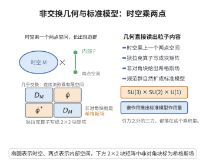

# 非交换几何与标准模型

> **一句话大白话**：把粒子物理标准模型放到"几乎没有点的非交换几何"里：把时空当成一个"点上是四维非交换代数、带一个内部 Dirac 算子"的几何，用谱作用量一试，费米子、希格斯机制和规范对称性都能"自然冒出来"，还预测量子场论做不动的几何关系。
>
> **小例子**：谱作用原理 $S=\mathrm{Tr}(f(D/\Lambda))$ 由一个谱三元组的谱函数给出；选适当的内部 Dirac 算子 $D$，作用量展开会得到爱因斯坦-希尔伯特项 + 杨-米尔斯项 + 希格斯项——标准模型如同"几何自洽的演算结果"。

## 一、定理介绍

> **前置依赖**：谱三元组、热核渐近展开、谱作用原理、非交换微分几何

非交换几何与标准模型（Connes-Chamseddine 等）断言：粒子物理标准模型可从（近向量的）非交换几何的公理中"几何化"地推导。其核心是**谱作用原理**：物理作用量由谱三元组的谱给出
$$
S=\mathrm{Tr}\big(f(D/\Lambda)\big),
$$
其中谱三元组取 $M\times F$（时空 $M$ 与"内部空间"有限非交换几何 $F$ 的乘积），选择的 Dirac 算子 $D=D_M\otimes1+\gamma_5\otimes D_F$ 编码粒子内容；展开渐近得其作用量含引力 + 规范 + 希格斯。

## 几何直观

图意在说明：把连续时空乘上一个有限两点空间，狄拉克算子的非对角块自然给出希格斯场，规范群也随之成为标准模型群。

## 二、原理思路

思想是"内部分离由可交换到非交换完成"。经典几何由 Dirac 算子刻画，非交换几何把它推广到"凝聚空间 $F$"，其上有限 C*-代数承载费米子多重态；时空与内部空间的乘积给出张量积的 Dirac 算子。谱作用量 $S=\mathrm{Tr}(f(D/\Lambda))$ 在 $\Lambda\to\infty$ 展开为热核系数组合，逐项对应爱因斯坦-希尔伯特作用量、杨-米尔斯项与希格斯势，谱分析还给出希格斯质量的几何预言。于是粒子的对称性、质量与耦合"内在于"所选几何。

## 三、定理的严格表述

设谱三元组 $(\mathcal A,\mathcal H,D)=(\mathcal A_M,\mathcal H_M,D_M)\otimes(\mathcal A_F,\mathcal H_F,D_F)$，其中内部空间 $F$ 为有限维谱三元组（含近向量内部代数、Dirac 矩阵 $D_F$）。谱作用沿
$$
S=\mathrm{Tr}\big(f(D/\Lambda)\big)
$$
的展开（$\Lambda\to\infty$，$f$ 为偶光滑函数）等价于
$$
S=\!\int\! c_4\,\mathrm{ch}\,\wedge\,\mathrm{Tr}(R\wedge R)+\cdots\ \longrightarrow\ S_{\text{EH}}\ \oplus\ S_{\text{YM}}\ \oplus\ S_{\text{Higgs}}\ (\text{基础粒子引力项}),
$$
在适当的内部 Dirac 算子下给出标准模型拉格朗日量并限制参数关系。

## 四、证明过程

**步骤1：构造谱三元组。** 取 $\mathcal A=C^\infty(M)\otimes\mathcal A_F$（$\mathcal A_F$ 为内部有限代数），$\mathcal H=L^2(S)\otimes\mathcal H_F$，Dirac 算子 $D=D_M\otimes1+\gamma_5^{\otimes}\otimes D_F$；$D_F$ 编码费米子与玻色子质量矩阵。

**步骤2：谱作用原理。** $S=\mathrm{Tr}(f(D/\Lambda))$，$f$ 为充分大的多项式型函数。

**步骤3：热核展开。** 对 $f(D/\Lambda)$ 用热核/谱渐近展开，把 $S$ 化为系数 $a_k$ 的有限组合（$d=4$ 时 $k=0,\dots,4$）。

**步骤4：识别几何项。** 展开中的标量项 $\sim\int\hat A \wedge$ 对应爱因斯坦-希尔伯特作用量（含 $R$ 曲率、宇宙学项）；规范曲率项由内部 Dirac 与对易子驱动，给出 Yang-Mills 作用量（规范对称性 $U(1)\times SU(2)\times SU(3)$ 内生于 $\mathcal A_F$）。

**步骤5：识别希格斯项。** 内部 Dirac 的分量（标量玻色子部分）经二次项与四次项给出希格斯势与 Yukawa 耦合，其希格斯质量等参数可由几何数据制约。

**步骤6：一致性与预言。** 谱作用量展开得到的实际是与标准模型一致的拉格朗日量，并在几何参数间给出关系（如希格斯质量和某些耦合的预估），体现"标准模型演进为几何事实"的图景。

**结论（$\square$）**：谱作用量由所选非交换几何导出含引力规范与希格斯的标准模型型作用量。

## 五、应用与意义

该工作把标准模型定性为一种"近向量时空的非交换几何"，统一并几何化解释费米子多重态、规范对称群与希格斯机制，并提出可检验的预言（如树级希格斯质量、参数关系）。它是高能物理与数学交叉的旗舰，持续推动非交换几何在粒子物理中的应用探索。

## 课堂问答

**老师**：标准模型怎么从非交换几何里"长出来"？

**学生**：结论：取几乎交换几何 $\mathcal A=C^\infty(M)\otimes\mathcal A_F$ 配 Dirac 算子 $D=D_M\otimes1+\gamma_5\otimes D_F$，谱作用 $S=\mathrm{Tr}f(D/\Lambda)$ 的展开自然给出 Einstein-Hilbert + Yang-Mills + Higgs 作用量。常见误区是以为这是"额外假设"——费米子多重态、规范群 $U(1)\times SU(2)\times SU(3)$ 与 Higgs 都内生于内部代数 $\mathcal A_F$。

**老师（追问）**：为什么把时空与内部空间做张量积？

**学生**：因为要用可交换到非交换的"内部分离"来编码粒子。$\mathcal A_F$ 是有限维 C*-代数，其表示承载费米子多重态；时空 Dirac 算子 $D_M$ 管引力与规范动能，内部算子 $D_F$（含 Yukawa 质量矩阵）管质量与 Higgs。张量积把两边几何信息一次打包进同一谱三元组。

**老师（拓展）**：展开后每一项如何对应物理作用量？又带来什么可检验的东西？

**学生**：热核/谱渐近把 $S$ 化为系数 $a_k$ 的组合（$d=4$ 时 $k=0,\dots,4$）：$a_0$ 给宇宙学/引力项，$a_2$ 给 Einstein-Hilbert，$a_4$ 由内部 Dirac 与对易子驱动给 Yang-Mills 曲率项及其二次、四次部分给 Higgs 势与 Yukawa 耦合。它把标准模型解释为"近向量时空的非交换几何自洽演算结果"，并约束耦合与质量间的几何关系（如树级 Higgs 质量、规范耦合统一标度），是普通量子场论给不出的检验点。
