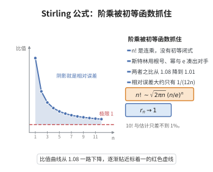

# Stirling 公式

> **一句话大白话**：$n!$ 虽然巨大，但它的增长完全被 $\sqrt{2\pi n}\,(n/e)^n$ 抓住，两者比值趋于 $1$。
>
> **小例子**：$n=10$ 时 $10!=3628800$，而 $\sqrt{20\pi}\,(10/e)^{10}\approx 3598696$，比值约为 $1.008$。

## 介绍

Stirling 公式（斯特林公式）给出阶乘的渐近表达式

$$
n!\sim\sqrt{2\pi n}\left(\frac ne\right)^n
$$

即两者之比随 $n\to\infty$ 趋于 $1$。它把离散的乘积 $n!$ 转化为只含初等函数的表达式，是估计组合数 $\binom nk$、概率分布尾项以及算法复杂度的关键工具。

该公式由詹姆斯·斯特林（James Stirling）于 1730 年给出。其证明有多种途径：用对数与积分比较、用欧拉–麦克劳林求和，或用沃利斯（Wallis）乘积确定常数。本条目采用后一思路：先证明 $n!\,e^n/n^{n+1/2}$ 收敛，再用沃利斯乘积求出极限 $\sqrt{2\pi}$。

它不仅是分析中的基本估计，也是中心极限定理中"二项分布逼近正态"的先导计算。

## 几何直观

图意在说明：n! 与斯特林估计之比随 n 增大趋于 1，相对误差大约只有 1/(12n)。

## 分析

**前置依赖**：数列极限、单调有界收敛定理、对数与指数函数、定积分 $\int_0^{\pi/2}\sin^n x\,dx$ 的递推、比较判别法（$\sum 1/n^2$ 收敛）

**定理内容**：

$$
\lim_{n\to\infty}\frac{n!}{\sqrt{2\pi n}\,\left(\frac ne\right)^n}=1
$$

等价地，令 $a_n=\dfrac{n!\,e^n}{n^{n+1/2}}$，则 $\lim_{n\to\infty}a_n=\sqrt{2\pi}$。

**数学内涵**：
- 常数 $2\pi$ 来自沃利斯乘积，反映的是"圆的面积/长度"信息。
- 取对数得 $\ln(n!)=n\ln n-n+\frac12\ln(2\pi n)+o(1)$，这是熵与信息论中常用的估计。

## 思考过程

先不管常数，只关心 $n!$ 的"主项"。取对数：$\ln(n!)=\sum_{k=1}^n\ln k$，它与积分 $\int_1^n\ln x\,dx=n\ln n-n+1$ 相差一个缓慢变化的量。可以证明

$$
b_n=\ln(n!)-(n+\tfrac12)\ln n+n
$$

是单调递减且有下界的，从而收敛到某个常数 $c$，于是 $n!\sim e^c\sqrt n\,(n/e)^n$。剩下的唯一任务就是求出 $e^c$。

求常数用沃利斯乘积：它把 $\frac{(2n)!!}{(2n-1)!!}$ 的极限钉在 $\sqrt{\pi n}$ 的量级上，而用上面的渐近式把同一个量写成 $e^c\sqrt{n/2}$，两相比较即得 $e^c=\sqrt{2\pi}$。这一"先定阶、后定常数"的分工是渐近分析的标准套路。

## 证明过程

**步骤 1：$b_n$ 单调递减。** 令 $b_n=\ln(n!)-(n+\tfrac12)\ln n+n$。计算

$$
b_n-b_{n+1}=\ln\frac{n!}{(n+1)!}-\Big(n+\tfrac12\Big)\ln n+\Big(n+\tfrac32\Big)\ln(n+1)-1=\Big(n+\tfrac12\Big)\ln\frac{n+1}{n}-1
$$

对 $t>0$ 有不等式 $\ln(1+t)>\dfrac{2t}{2+t}$（由 $\ln$ 的积分表示或泰勒展开可证）。取 $t=\frac1n$ 得 $\ln\!\big(1+\frac1n\big)>\dfrac{2}{2n+1}$，故

$$
\Big(n+\tfrac12\Big)\ln\frac{n+1}{n}>\Big(n+\tfrac12\Big)\frac{2}{2n+1}=1
$$

于是 $b_n-b_{n+1}>0$，即 $\{b_n\}$ 单调递减。

**步骤 2：$b_n$ 有下界。** 对 $t>0$ 还有 $\ln(1+t)<t-\dfrac{t^2}{2}+\dfrac{t^3}{3}$。取 $t=\frac1n$ 并展开 $(n+\tfrac12)\ln(1+\tfrac1n)$：

$$
\Big(n+\tfrac12\Big)\ln\frac{n+1}{n}<1+\frac{1}{12n^2}+\frac{1}{6n^3}\le 1+\frac{1}{4n^2}
$$

所以 $0<b_n-b_{n+1}<\dfrac{1}{4n^2}$。于是

$$
b_n=b_1-\sum_{k=1}^{n-1}(b_k-b_{k+1})>b_1-\frac14\sum_{k=1}^{\infty}\frac{1}{k^2}>-\infty
$$

即 $\{b_n\}$ 有下界。由单调有界收敛定理，$\{b_n\}$ 收敛，记极限为 $c$。因此

$$
a_n=\frac{n!\,e^n}{n^{n+1/2}}=e^{b_n}\longrightarrow e^c=:a>0
$$

**步骤 3：沃利斯乘积。** 令 $I_n=\int_0^{\pi/2}\sin^n x\,dx$。分部积分给出递推

$$
I_n=\frac{n-1}{n}I_{n-2}\quad(n\ge2),\qquad I_0=\frac\pi2,\quad I_1=1
$$

由此

$$
I_{2n}=\frac{(2n-1)!!}{(2n)!!}\cdot\frac\pi2,\qquad I_{2n+1}=\frac{(2n)!!}{(2n+1)!!}
$$

因 $0\le\sin x\le1$ 时 $\sin^{2n+1}x\le\sin^{2n}x\le\sin^{2n-1}x$，有 $I_{2n+1}\le I_{2n}\le I_{2n-1}$，代入得

$$
\frac{(2n)!!}{(2n+1)!!}\le\frac{(2n-1)!!}{(2n)!!}\cdot\frac\pi2\le\frac{(2n-2)!!}{(2n-1)!!}
$$

整理并夹逼，得沃利斯乘积

$$
\lim_{n\to\infty}\frac{1}{2n+1}\left(\frac{(2n)!!}{(2n-1)!!}\right)^2=\frac\pi2
$$

**步骤 4：用渐近式求该比。** 注意 $(2n)!!=2^n n!$，$(2n-1)!!=\dfrac{(2n)!}{2^n n!}$，故

$$
\frac{(2n)!!}{(2n-1)!!}=\frac{(2^n n!)^2}{(2n)!}
$$

由步骤 2，$n!\sim a\,n^{n+1/2}e^{-n}$，$(2n)!\sim a\,(2n)^{2n+1/2}e^{-2n}$，代入得

$$
\frac{(2n)!!}{(2n-1)!!}\sim\frac{2^{2n}a^2 n^{2n+1}e^{-2n}}{a\,2^{2n+1/2}n^{2n+1/2}e^{-2n}}=a\sqrt{\frac n2}
$$

**步骤 5：确定常数。** 于是

$$
\frac{1}{2n+1}\left(\frac{(2n)!!}{(2n-1)!!}\right)^2\sim\frac{1}{2n+1}\cdot a^2\frac n2\longrightarrow\frac{a^2}{4}
$$

与步骤 3 的沃利斯极限比较，得 $\dfrac{a^2}{4}=\dfrac\pi2$，即 $a^2=2\pi$。因 $a>0$，

$$
a=\sqrt{2\pi}
$$

从而 $n!\sim\sqrt{2\pi n}\,(n/e)^n$，即 Stirling 公式成立。$\square$

## 课堂问答

**老师**：斯特林公式常被写成 $n!\approx\sqrt{2\pi n}(n/e)^n$，那个"约等于"到底是什么意思？

**学生**：结论是一个渐近等价，即 $\lim_{n\to\infty}\frac{n!}{\sqrt{2\pi n}(n/e)^n}=1$；它不是近似等式，绝对误差其实趋于无穷，只是相对误差趋于零。

**老师（追问）**：证明里最容易卡住的是常数 $\sqrt{2\pi}$，你打算怎么把它定出来？

**学生**：分两步走：先令 $b_n=\ln(n!)-(n+\tfrac12)\ln n+n$，证明它单调递减有下界，得 $n!\sim e^c\sqrt n\,(n/e)^n$；再用沃利斯乘积定 $e^c$。

**老师（拓展）**：那为什么最终常数里会冒出一个 $\pi$？

**学生**：因为沃利斯乘积 $\lim_{n\to\infty}\frac1{2n+1}\left(\frac{(2n)!!}{(2n-1)!!}\right)^2=\frac{\pi}{2}$ 来自积分 $\int_0^{\pi/2}\sin^n x\,dx$，$\pi$ 是它的积分值。把它与渐近式给出的 $\frac{a^2}{4}$ 比较，即得 $a^2=2\pi$，从而 $a=\sqrt{2\pi}$。常见误区是把 $n!\approx$ 当成精确等式。

## 相关条目

- [比较判别法](./比较判别法.md)：证明中用到 $\sum 1/n^2$ 收敛等比较判别。
- [比值判别法](./比值判别法.md)：阶乘与幂的增长比较，常借助 Stirling 公式分析。
