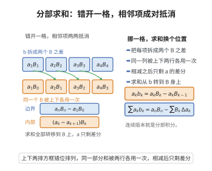

# 分部求和公式

> **一句话大白话**：把乘积级数的求和"挪一格"，就能把 $\sum a_kb_k$ 换成"用 $b_k$ 的部分和 $B_k$ 与 $a_k$ 的差分相乘"——求和与差分互换角色，正如分部积分把导数在 $f$ 与 $g$ 之间挪来挪去。

> **小例子**：取 $a_k=b_k=k$，则 $B_k=\frac{k(k+1)}{2}$、$a_{k+1}-a_k=1$，公式给出 $\sum_{k=1}^{n}k^2=a_nB_n-\sum_{k=1}^{n-1}B_k$；代 $n=3$ 验证：左端 $1+4+9=14$，右端 $3\cdot6-(1+3)=14$。

## 介绍

分部求和公式（summation by parts），又称阿贝尔变换（Abel transformation），是有限和的恒等变形：把 $\sum a_kb_k$ 中的因子 $b_k$ 写成部分和之差 $B_k-B_{k-1}$，再作错位相消，使求和落在 $B_k$ 上、差分落在 $a_k$ 上。它是级数收敛判别法的枢纽：狄利克雷判别法与阿贝尔判别法都只由它加上一次 Cauchy 准则得到。

连续情形的对应物是分部积分公式（$\int fg'=fg-\int f'g$）；两者共享同一机制——把导数（差分）在乘积的两个因子之间转移，从而让"好控制的那一个因子"去承担求和（积分）。这也是它在估计"振荡级数部分和"时特别有效的原因。

## 几何直观

图意在说明：拆开 b_k 后相邻项共享同一个部分和，求和因此转移到部分和与差分上。

## 分析

**前置依赖**：裂项求和公式、级数收敛的Cauchy准则、极限的四则运算法则。

**定理内容**：设 $\{a_k\}$、$\{b_k\}$ 为数列，记部分和 $B_k=\sum_{i=1}^{k}b_i$（约定 $B_0=0$）。则对任意 $1\le m<n$，

$$\sum_{k=m+1}^{n}a_kb_k=a_nB_n-a_{m+1}B_m-\sum_{k=m+1}^{n-1}(a_{k+1}-a_k)B_k .$$

若改记 $A_k=\sum_{i=1}^{k}a_i$，则对称地有 $\sum_{k=m+1}^{n}a_kb_k=A_nb_{n+1}-A_mb_{m+1}-\sum_{k=m+1}^{n}A_k(b_{k+1}-b_k)$，两种写法只是"谁求和、谁作差分"的角色互换。

**推论（部分和的估计）**：若 $|B_k|\le M$ 对一切 $k$ 成立，且 $\{a_k\}$ 单调，则

$$\Big|\sum_{k=m+1}^{n}a_kb_k\Big|\le 2M\big(|a_{m+1}|+|a_n|\big).$$

若进一步 $\{a_k\}$ 单调递减趋于 $0$，右端可化为 $2Ma_{m+1}$，这正是狄利克雷判别法所需的估计。

## 思考过程

核心只有一句：$b_k=B_k-B_{k-1}$。于是

$$\sum_{k=m+1}^{n}a_kb_k=\sum_{k=m+1}^{n}a_kB_k-\sum_{k=m+1}^{n}a_kB_{k-1} .$$

第二个和里把指标整体左移一格，即令 $j=k-1$，它变成 $a_{m+1}B_m+\sum_{j=m+1}^{n-1}a_{j+1}B_j$。与第一个和按同一指标 $k$ 对齐后，$k=m+1,\dots,n-1$ 的项两两配对成 $(a_k-a_{k+1})B_k$，只剩首尾两个"边界项" $a_nB_n$ 与 $-a_{m+1}B_m$。

这正是裂项求和中"错位相消"的手法，只不过消去的是公共的 $B_k$ 而不是 $1$。由此也能看出为什么会多出"边界项"：求和被掐断在 $m$ 与 $n$ 处，断口处必须补上两个端点值。

## 证明过程

**步骤 1：把 $b_k$ 写成部分和之差。** 由 $B_k=\sum_{i=1}^{k}b_i$ 的定义，$b_k=B_k-B_{k-1}$（$B_0=0$），故

$$\sum_{k=m+1}^{n}a_kb_k=\sum_{k=m+1}^{n}a_k\big(B_k-B_{k-1}\big)=\sum_{k=m+1}^{n}a_kB_k-\sum_{k=m+1}^{n}a_kB_{k-1}.$$

**步骤 2：错位相消（裂项求和）。** 对第二个和作指标替换 $j=k-1$：

$$\sum_{k=m+1}^{n}a_kB_{k-1}=\sum_{j=m}^{n-1}a_{j+1}B_j=a_{m+1}B_m+\sum_{k=m+1}^{n-1}a_{k+1}B_k .$$

代回步骤 1，把两个同指标 $k$ 的和合并：

$$\sum_{k=m+1}^{n}a_kb_k=a_nB_n+\sum_{k=m+1}^{n-1}a_kB_k-a_{m+1}B_m-\sum_{k=m+1}^{n-1}a_{k+1}B_k=a_nB_n-a_{m+1}B_m-\sum_{k=m+1}^{n-1}(a_{k+1}-a_k)B_k .$$

这正是所需公式。取 $m=0$ 时 $B_0=0$，边界项 $a_1B_0$ 消失，得常用形式 $\sum_{k=1}^{n}a_kb_k=a_nB_n-\sum_{k=1}^{n-1}(a_{k+1}-a_k)B_k$。

**步骤 3：部分和的估计。** 由三角不等式与 $|B_k|\le M$，

$$\Big|\sum_{k=m+1}^{n}a_kb_k\Big|\le |a_n||B_n|+|a_{m+1}||B_m|+\sum_{k=m+1}^{n-1}|a_{k+1}-a_k|\,|B_k|\le M\Big(|a_n|+|a_{m+1}|+\sum_{k=m+1}^{n-1}|a_{k+1}-a_k|\Big).$$

若 $\{a_k\}$ 单调，差分不变号，而单调数列的变差是端点之差：

$$\sum_{k=m+1}^{n-1}|a_{k+1}-a_k|=\Big|\sum_{k=m+1}^{n-1}(a_{k+1}-a_k)\Big|=|a_n-a_{m+1}| .$$

代入并放大即得 $\big|\sum_{k=m+1}^{n}a_kb_k\big|\le2M(|a_{m+1}|+|a_n|)$。

**步骤 4：由 Cauchy 准则导出收敛判别法。** 设 $\{a_k\}$ 单调趋于 $0$ 且 $|B_k|\le M$（若 $M=0$ 则 $b_k\equiv0$，结论平凡，故设 $M>0$）。给定 $\varepsilon>0$，取 $N$ 使 $k>N$ 时 $|a_k|<\dfrac{\varepsilon}{4M}$。那么当 $n>m>N$ 时，步骤 3 给出 $\big|\sum_{k=m+1}^{n}a_kb_k\big|<\varepsilon$。由级数收敛的 Cauchy 准则，$\sum a_kb_k$ 收敛——这就是狄利克雷判别法。若只知 $\sum b_k$ 收敛，则 $B_k$ 有界且 $\{a_k\}$ 单调有界、故收敛，同样的估计配合极限的四则运算法则即得阿贝尔判别法。

## 课堂问答

**老师**：分部求和公式和分部积分长得像双胞胎，它们的共同机制是什么？

**学生**：结论是 $\sum_{k=m+1}^n a_kb_k=a_nB_n-a_{m+1}B_m-\sum_{k=m+1}^{n-1}(a_{k+1}-a_k)B_k$，其中 $B_k=\sum_{i=1}^k b_i$；机制是把"差分"在乘积两因子间转移，让好控制的一方去承担求和。

**老师（追问）**：证明这一步最自然，为什么？

**学生**：因为 $b_k=B_k-B_{k-1}$，代入后错位相消，只剩下首尾边界项 $a_nB_n$ 与 $-a_{m+1}B_m$；连续版就是把差分换成导数、求和换成积分，得 $\int fg'=fg-\int f'g$。

**老师（拓展）**：它为什么成了级数判敛的枢纽？

**学生**：由 $|B_k|\le M$ 与单调性得估计 $\left|\sum_{k=m+1}^n a_kb_k\right|\le2M(|a_{m+1}|+|a_n|)$，正好把"部分和有界"和"因子趋零"翻译成 Cauchy 条件，一举得到狄利克雷判别法与阿贝尔判别法。常见误区是忘记边界项，或没有先把 $b_k$ 写成 $B_k-B_{k-1}$。

## 相关条目

- [狄利克雷判别法](./狄利克雷判别法.md)：以本公式为核心工具，证明中直接引用步骤 3 的估计。
- [阿贝尔判别法](./阿贝尔判别法.md)：同一估计在另一组条件下即得。
- [交错级数判别法](./交错级数判别法.md)：莱布尼茨判别法是本公式最简单的应用。
- [级数收敛的Cauchy准则](./级数收敛的Cauchy准则.md)：把本公式的估计翻译成收敛性。
- [裂项求和公式](../第07级-数列与数学归纳法/裂项求和公式.md)：本公式的相消机制即裂项求和的推广。
