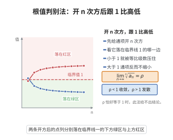

# 根值判别法

> **一句话大白话**：看每项开 $n$ 次方后的极限 $\rho$：$\rho<1$ 就减得比等比级数快而收敛，$\rho>1$ 就是不减反增而发散，$\rho=1$ 时此招失灵。
>
> **小例子**：$\sum\left(\frac{1}{2}\right)^n$ 中 $\sqrt[n]{a_n}=\frac12<1$，收敛于 $1$；而 $\sum 2^n$ 中 $\sqrt[n]{a_n}=2>1$，发散。

## 介绍

根值判别法（Root Test），又称柯西判别法（Cauchy's Test），由法国数学家奥古斯丁-路易·柯西提出，是判断正项级数收敛性的重要方法。该方法通过考察通项的 $n$ 次方根的极限来判断级数的收敛性，特别适用于通项含有 $n$ 次幂的级数。

## 几何直观

图意在说明：n 次方根的极限小于 1 时级数被等比级数压住而收敛，大于 1 则发散。

## 分析

**前置依赖**：比较判别法、几何级数、级数收敛的必要条件、极限

**定理内容**：设 $\sum a_n$ 是正项级数，且 $\lim_{n\to\infty}\sqrt[n]{a_n}=\rho$。
1. 若 $\rho<1$，则 $\sum a_n$ 收敛；
2. 若 $\rho>1$ 或 $\rho=\infty$，则 $\sum a_n$ 发散；
3. 若 $\rho=1$，判别法失效。

**前置知识**：
- 比较判别法
- 几何级数：$\sum_{n=0}^{\infty} r^n$ 在 $|r|<1$ 时收敛，$|r|\ge 1$ 时发散

**数学内涵**：
根值判别法的核心思想是：当 $n$ 很大时，$a_n\approx\rho^n$，即通项近似于等比数列。若 $\rho<1$，则通项以几何级数的速度衰减，级数收敛；若 $\rho>1$，则通项增长，级数发散。根值判别法通常比比值判别法适用范围更广，但在某些情况下比值判别法更易计算。

## 思考过程

设 $\rho<1$，取 $r$ 满足 $\rho<r<1$。存在 $N$，使得当 $n\ge N$ 时 $\sqrt[n]{a_n}<r$，即 $a_n<r^n$。

由于 $\sum r^n$ 是收敛的几何级数（$|r|<1$），由比较判别法，$\sum a_n$ 收敛。

若 $\rho>1$，取 $r$ 满足 $1<r<\rho$。存在 $N$，使得当 $n\ge N$ 时 $\sqrt[n]{a_n}>r>1$，即 $a_n>r^n>1$，通项不趋于零，级数发散。

## 证明过程

**证明**：

**情况一：$\rho<1$。**

取 $r$ 满足 $\rho<r<1$。由 $\lim_{n\to\infty}\sqrt[n]{a_n}=\rho$，存在 $N$，使得当 $n\ge N$ 时，
$$\sqrt[n]{a_n}<r$$
即 $a_n<r^n$。

级数 $\sum_{n=N}^{\infty}r^n$ 是公比 $r<1$ 的几何级数，故收敛。由比较判别法，$\sum_{n=N}^{\infty}a_n$ 收敛，从而 $\sum_{n=1}^{\infty}a_n$ 收敛。

**情况二：$\rho>1$。**

取 $r$ 满足 $1<r<\rho$。存在 $N$，使得当 $n\ge N$ 时，
$$\sqrt[n]{a_n}>r>1$$
即 $a_n>r^n>1$。

因此 $\lim_{n\to\infty}a_n\neq 0$，由级数收敛的必要条件，$\sum a_n$ 发散。

**情况三：$\rho=1$。**

判别法失效。例如 $\sum\frac{1}{n}$ 发散（$\sqrt[n]{1/n}\to 1$），$\sum\frac{1}{n^2}$ 收敛（$\sqrt[n]{1/n^2}\to 1$）。

$\square$

## 课堂问答

**老师**：根值判别法和比值判别法都拿"等比级数"做标尺，根值法的标尺是怎么搭的？

**学生**：结论是设正项级数满足 $\lim_{n\to\infty}\sqrt[n]{a_n}=\rho$，则 $\rho<1$ 收敛、$\rho>1$ 发散、$\rho=1$ 失效；它把 $a_n\approx\rho^n$ 当作判据。

**老师（追问）**：$\rho<1$ 那一步的严格推理是怎么走的？

**学生**：取 $\rho<r<1$，存在 $N$ 使 $n\ge N$ 时 $\sqrt[n]{a_n}<r$，即 $a_n<r^n$；由 $\sum r^n$ 收敛及比较判别法，$\sum a_n$ 收敛。$\rho>1$ 时同理取 $1<r<\rho$ 得 $a_n>r^n>1$，通项不趋零而发散。

**老师（拓展）**：为什么常说根值法比比值法"更强"？

**学生**：因为凡比值法能判的根值法多半也能判，反之不然。例如 $a_n=2^{-n-(-1)^n}$ 的比值不存在，但 $\sqrt[n]{a_n}\to\frac12$ 可用根值法判收敛。常见误区是 $\rho=1$ 时草率下结论，如 $\sum\frac1n$ 与 $\sum\frac1{n^2}$ 的 $\rho$ 都等于 $1$ 却一通一散。
