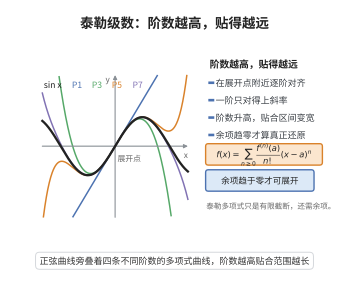

# 泰勒级数展开定理

> **一句话大白话**：好函数在某个点附近能用"各阶导数"攒成无穷多项式原样还原；只要误差项趋近于零，就能精确"复活"原函数——相当于用无数张微分的快照拼回原形。
>
> **小例子**：$e^x=1+x+\frac{x^2}{2!}+\frac{x^3}{3!}+\cdots$，取 $x=1$ 得 $e\approx 1+1+\frac12+\frac16+\cdots$，阶乘让余项趋近于零。

## 介绍

泰勒级数展开定理（Taylor Series Expansion Theorem）是函数论中的基本定理，表明解析函数在其收敛域内可以展开为幂级数（泰勒级数）。该定理是泰勒定理（带余项的泰勒展开）在余项趋于零时的直接推论，是函数逼近、数值计算、微分方程求解等领域的基础。

## 几何直观

图意在说明：余项趋于零时，泰勒多项式在收敛邻域内逐点逼近原函数。

## 分析

**前置依赖**：泰勒定理（带拉格朗日余项）、余项估计、函数的各阶导数、极限

**定理内容**：设函数 $f(x)$ 在 $x=a$ 的某邻域内具有任意阶导数，且泰勒余项 $R_n(x)\to 0$（$n\to\infty$），则 $f$ 在该邻域内可展开为泰勒级数：
$$f(x)=\sum_{n=0}^{\infty}\frac{f^{(n)}(a)}{n!}(x-a)^n$$

**常见展开**：
- $e^x=\sum_{n=0}^{\infty}\frac{x^n}{n!}$，$x\in\mathbb{R}$
- $\sin x=\sum_{n=0}^{\infty}\frac{(-1)^n x^{2n+1}}{(2n+1)!}$，$x\in\mathbb{R}$
- $\cos x=\sum_{n=0}^{\infty}\frac{(-1)^n x^{2n}}{(2n)!}$，$x\in\mathbb{R}$
- $\frac{1}{1-x}=\sum_{n=0}^{\infty}x^n$，$|x|<1$

**前置知识**：
- 泰勒定理（带 Lagrange 余项）：$f(x)=\sum_{k=0}^{n}\frac{f^{(k)}(a)}{k!}(x-a)^k+R_n(x)$
- 余项估计：$|R_n(x)|\le M\frac{|x-a|^{n+1}}{(n+1)!}$ 或更一般的估计

**数学内涵**：
泰勒级数展开定理的实质是：函数可以用其各阶导数信息构造的多项式无限逼近。当 $n\to\infty$ 时，泰勒多项式趋于泰勒级数，余项 $R_n(x)\to 0$ 保证了这种逼近的一致性。使得泰勒级数展开成立的函数称为解析函数。

## 思考过程

由泰勒定理，$f(x)=\sum_{k=0}^{n}\frac{f^{(k)}(a)}{k!}(x-a)^k+R_n(x)$。

若在 $x$ 处 $\lim_{n\to\infty}R_n(x)=0$，则
$$f(x)=\lim_{n\to\infty}\left(\sum_{k=0}^{n}\frac{f^{(k)}(a)}{k!}(x-a)^k+R_n(x)\right)=\sum_{k=0}^{\infty}\frac{f^{(k)}(a)}{k!}(x-a)^k$$

因此，泰勒级数展开定理的证明关键在于证明余项趋于零。

对于不同的函数，需要采用不同的余项估计方法。例如，对于 $e^x$，使用 Lagrange 余项：
$$|R_n(x)|\le e^{|x|}\frac{|x|^{n+1}}{(n+1)!}\to 0\quad (n\to\infty)$$

## 证明过程

**证明**：

设 $f$ 在 $x=a$ 的某邻域 $U$ 内具有任意阶导数。由泰勒定理，对任意 $x\in U$ 和任意正整数 $n$，存在 $\xi_n$ 介于 $a$ 和 $x$ 之间，使得
$$f(x)=\sum_{k=0}^{n}\frac{f^{(k)}(a)}{k!}(x-a)^k+R_n(x)$$
其中 $R_n(x)=\frac{f^{(n+1)}(\xi_n)}{(n+1)!}(x-a)^{n+1}$（Lagrange 余项）。

若对 $x\in U$，有 $\lim_{n\to\infty}R_n(x)=0$，则
$$f(x)=\lim_{n\to\infty}\sum_{k=0}^{n}\frac{f^{(k)}(a)}{k!}(x-a)^k=\sum_{k=0}^{\infty}\frac{f^{(k)}(a)}{k!}(x-a)^k$$

**示例**：证明 $e^x$ 的泰勒展开。

对 $f(x)=e^x$，$f^{(n)}(x)=e^x$，故 $f^{(n)}(0)=1$。

Lagrange 余项：$R_n(x)=\frac{e^{\xi_n}}{(n+1)!}x^{n+1}$，其中 $\xi_n$ 介于 0 和 $x$ 之间。

若 $x\ge 0$，则 $e^{\xi_n}\le e^x$；若 $x<0$，则 $e^{\xi_n}\le 1$。故 $|R_n(x)|\le e^{|x|}\frac{|x|^{n+1}}{(n+1)!}$。

对任意固定的 $x$，$\lim_{n\to\infty}\frac{|x|^{n+1}}{(n+1)!}=0$，因此 $\lim_{n\to\infty}R_n(x)=0$。

从而
$$e^x=\sum_{n=0}^{\infty}\frac{x^n}{n!},\quad \forall x\in\mathbb{R}$$

$\square$

## 课堂问答

**老师**：把函数写成泰勒级数，光有"各阶导数存在"够不够？

**学生**：不够，结论是还需余项 $R_n(x)\to0$（$n\to\infty$），才有 $f(x)=\sum_{n=0}^{\infty}\frac{f^{(n)}(a)}{n!}(x-a)^n$；否则级数可能收敛却并不等于 $f(x)$。

**老师（追问）**：以 $e^x$ 为例，你怎么把余项压到零？

**学生**：用拉格朗日余项 $R_n(x)=\frac{e^{\xi_n}}{(n+1)!}x^{n+1}$，得 $|R_n(x)|\le e^{|x|}\frac{|x|^{n+1}}{(n+1)!}$；而阶乘增长远快于幂，故对固定 $x$ 有 $R_n(x)\to0$。

**老师（拓展）**：能不能举个"泰勒级数存在但不等于 $f$"的反例？

**学生**：可以，经典例子是 $f(x)=e^{-1/x^2}$（$x\neq0$，$f(0)=0$），它在 $0$ 处各阶导数全为零，泰勒级数恒为 $0$，却只在 $x=0$ 处等于 $f$。这说明"任意阶可导"不等于"解析"，常见误区正是把两者混为一谈。
