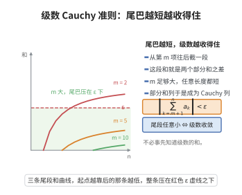

# 级数收敛的 Cauchy 准则

> **一句话大白话**：一个级数能否收住，只看它"靠后任意一小段"加起来能否小到任意小——这就是加和的"抱团"判定，不必知道最终和是多少。
>
> **小例子**：对级数 $1+\frac12+\frac14+\cdots$，靠后的一段 $\sum_{k=m+1}^n\frac1{2^k}<\frac1{2^m}$ 可任意小，故收敛到 $2$。

## 介绍

级数收敛的 Cauchy 准则（Cauchy Criterion for Series Convergence）由法国数学家奥古斯丁-路易·柯西（Augustin-Louis Cauchy）提出，是判断无穷级数收敛性的基本准则。该准则将级数收敛问题转化为部分和序列的 Cauchy 性，是分析级数收敛性的理论基础。许多级数判别法（如比较判别法、比值判别法）都可以追溯到该准则。

## 几何直观

图意在说明：从足够靠后的位置截取任意长的一段，其和都可任意小，级数便收敛。

## 分析

Cauchy收敛准则、部分和、数列极限

**定理内容**：级数 $\sum_{n=1}^{\infty} a_n$ 收敛当且仅当对任意 $\varepsilon>0$，存在正整数 $N$，使得当 $n>m>N$ 时，
$$\left|\sum_{k=m+1}^{n} a_k\right|<\varepsilon$$

**前置知识**：
- Cauchy 收敛准则（数列）：数列 $\{x_n\}$ 收敛当且仅当对任意 $\varepsilon>0$，存在 $N$，使得当 $n,m>N$ 时 $|x_n-x_m|<\varepsilon$

**数学内涵**：
级数 $\sum a_n$ 的部分和 $S_n=\sum_{k=1}^n a_k$ 构成一个数列。级数收敛当且仅当 $\{S_n\}$ 收敛。由数列的 Cauchy 收敛准则，$\{S_n\}$ 收敛当且仅当它是 Cauchy 列，即对任意 $\varepsilon>0$，存在 $N$，使得当 $n>m>N$ 时 $|S_n-S_m|<\varepsilon$。而 $S_n-S_m=\sum_{k=m+1}^n a_k$，即得准则。

## 思考过程

该准则的证明直接依赖于数列的 Cauchy 收敛准则。

设 $S_n=\sum_{k=1}^n a_k$ 为级数的部分和。则：
- 级数收敛 $\iff$ $\{S_n\}$ 收敛
- $\{S_n\}$ 收敛 $\iff$ $\{S_n\}$ 是 Cauchy 列（由 Cauchy 收敛准则）
- $\{S_n\}$ 是 Cauchy 列 $\iff$ 对任意 $\varepsilon>0$，存在 $N$，使得当 $n>m>N$ 时 $|S_n-S_m|<\varepsilon$
- $|S_n-S_m|=|\sum_{k=m+1}^n a_k|$

因此级数收敛的 Cauchy 准则成立。

## 证明过程

**证明**：

**必要性**：设级数 $\sum_{n=1}^{\infty} a_n$ 收敛，记 $S_n=\sum_{k=1}^n a_k$，$S=\lim_{n\to\infty}S_n$。

则 $\{S_n\}$ 收敛，由数列的 Cauchy 收敛准则，$\{S_n\}$ 是 Cauchy 列。即对任意 $\varepsilon>0$，存在 $N$，使得当 $n>m>N$ 时，$|S_n-S_m|<\varepsilon$。

而 $S_n-S_m=\sum_{k=1}^n a_k-\sum_{k=1}^m a_k=\sum_{k=m+1}^n a_k$，因此
$$\left|\sum_{k=m+1}^n a_k\right|<\varepsilon$$

**充分性**：设对任意 $\varepsilon>0$，存在 $N$，使得当 $n>m>N$ 时，$|\sum_{k=m+1}^n a_k|<\varepsilon$。

则对部分和数列 $\{S_n\}$，当 $n>m>N$ 时，$|S_n-S_m|=|\sum_{k=m+1}^n a_k|<\varepsilon$，故 $\{S_n\}$ 是 Cauchy 列。

由数列的 Cauchy 收敛准则，$\{S_n\}$ 收敛，即级数 $\sum_{n=1}^{\infty} a_n$ 收敛。

$\square$

## 课堂问答

**老师**：级数的 Cauchy 准则为什么能成为众多判别法共同的"母体"？

**学生**：结论是 $\sum a_n$ 收敛当且仅当对任意 $\varepsilon>0$ 存在 $N$，使 $n>m>N$ 时 $\left|\sum_{k=m+1}^n a_k\right|<\varepsilon$；它把收敛性翻译成部分和的 Cauchy 性。

**老师（追问）**：这个等价是怎么落到"部分和"上的？

**学生**：设 $S_n=\sum_{k=1}^n a_k$，则级数收敛 $\iff\{S_n\}$ 收敛 $\iff\{S_n\}$ 是 Cauchy 列；而 $S_n-S_m=\sum_{k=m+1}^n a_k$，把数列准则中的 $|S_n-S_m|$ 换成尾段和即得。

**老师（拓展）**：它怎么"生成"比较或比值判别法？

**学生**：正项级数用部分和单调有界与它等价；比较、比值、根值、积分判别法都是先用几何级数等去控制尾段和 $\sum_{k=m+1}^n a_k$，再套这条准则。常见误区是以为必须先知道和的数值，其实准则完全不需要极限以外的信息。
