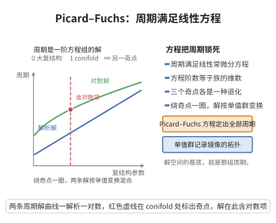

# Picard-Fuchs方程

> **一句话大白话**：当一族流形的复结构在参数 $t$ 上滑动时，各种"周期积分"（$\int_\gamma$ 全纯 $n$-形式）看起来像随便的函数，其实它们全被同一条线性常微分方程锁死；这条方程（Picard-Fuchs）就是周期积分的"身份证"。
>
> **小例子**：Legendre 椭圆曲线族 $y^2=x(x-1)(x-t)$ 的周期 $\Pi(t)=\oint \frac{dx}{y}$ 满足二阶方程 $t(1-t)\Pi''+(1-2t)\Pi'-\tfrac14\Pi=0$；而镜像五次流形的周期则满足四阶的 Picard-Fuchs 方程，正是用它才数出了 $N_1=2875$。

## 一、定理介绍

> **前置依赖**：Hodge分解定理、Calabi-Yau定理、幂级数解法、解析函数唯一性定理

Picard-Fuchs 方程是"周期满足的线性常微分方程"。设 $\pi:\mathcal X\to S$ 是光滑紧致代数族，纤维 $X_t$ 为 $n$ 维流形，$\Omega$ 为相对全纯 $n$-形式，$\gamma_t\in H_n(X_t,\mathbb Z)$ 局部常值，则周期
$$
\Pi(t)=\int_{\gamma_t}\Omega_t
$$
作为 $t$ 的函数满足一个系数为有理函数的线性 ODE
$$
L\Pi=\Big(a_0(t)+a_1(t)\frac{d}{dt}+\cdots+a_r(t)\frac{d^r}{dt^r}\Big)\Pi=0,\qquad r\le b_n=\dim H^n(X_t,\mathbb C).
$$
该方程称族 $\pi$ 的 Picard-Fuchs 方程，算子 $L$ 称 Picard-Fuchs 算子。在镜像对称中，它给出 B-模型一侧最核心的可计算工具：周期、镜像映射与 Yukawa 耦合都由 $L$ 的解读出。

## 几何直观

图意在说明：族的周期作为参数函数满足一个线性常微分方程，奇点处出现对数解，绕行则按单值群混合。

## 二、原理思路

核心是"有限维"三个字。取 $t$ 的一个局部坐标，$\Omega_t$ 及其对 $t$ 的各阶导数所在的上同调类都落在同一个**有限维**空间 $H^n(X_t,\mathbb C)$ 里（维数 $b_n$）。空间里的 $b_n+1$ 个向量必线性相关，于是存在
$$
\nabla_{\partial_t}^{r}[\Omega]=\sum_{k=0}^{r-1}c_k(t)\,\nabla_{\partial_t}^{k}[\Omega],\qquad r\le b_n,
$$
其中 $\nabla$ 是 Gauss-Manin 连接。把每个类沿闭链 $\gamma_t$ 积分，右边的"函数系数 × 周期"关系就变成 $\Pi$ 的线性 ODE。这解释了两个经验事实：方程阶数不超过 Betti 数，且**同一族的所有周期都是同一个 $L$ 的解**。

在奇点（如退化点）处，$L$ 有正则奇点，用幂级数解法（Frobenius 方法）可得解析解与带回款的 $\log$ 解；解的解析延拓与单值性变换则记录模空间的拓扑。

## 三、定理的严格表述

**定理**：设 $\pi:\mathcal X\to S$ 为 $n$ 维光滑紧致代数族，$S$ 为光滑曲线，$\Omega$ 为处处非零的相对全纯 $n$-形式，$\gamma_t\in H_n(X_t,\mathbb Z)$ 在 $S$ 上局部常值。则存在非零算子
$$
L=\frac{d^{r}}{dt^{r}}+a_{r-1}(t)\frac{d^{r-1}}{dt^{r-1}}+\cdots+a_0(t),\qquad a_i\in\mathbb C(t),\ r\le b_n,
$$
使对族中任意周期 $\Pi(t)=\int_{\gamma_t}\Omega_t$ 都有 $L\Pi=0$；且在 $\Omega$ 沿 $S$ 的解析延拓下该式整体成立。

**例 1（Legendre 椭圆曲线）**：$y^2=x(x-1)(x-t)$，$t\ne0,1$，
$$
t(1-t)\Pi''+(1-2t)\Pi'-\tfrac14\Pi=0 .
$$

**例 2（镜像五次流形）**：取 $z=(5\psi)^{-5}$，$\theta_z=z\frac{d}{dz}$，
$$
\Big[\theta_z^{4}-5z\prod_{j=1}^{4}\big(5\theta_z+j\big)\Big]\Pi=0,
$$
其大复结构极限处的解析解为 $\Pi_0(z)=\sum_{n\ge0}\frac{(5n)!}{(n!)^5}z^{n}$。

## 四、证明过程

**步骤1：建立上同调丛。** 令 $\mathcal H=R^n\pi_*\mathbb C\otimes_{\mathbb C}\mathcal O_S$，它是 $S$ 上秩为 $b_n$ 的全纯向量丛，含 Gauss-Manin 连接 $\nabla$（平坦，即 $\nabla^2=0$）。代表元 $[\Omega]\in\mathcal H$ 是 $S$ 上处处非零的整体截面。

**步骤2：导数的有限性。** 取局部水平标架 $\{s_1,\dots,s_{b_n}\}$（$\nabla s_i=0$，由 $\nabla$ 平坦性局部存在），写 $[\Omega]=\sum_\alpha f_\alpha(t)s_\alpha$。则
$$
\nabla_{\partial_t}^{k}[\Omega]=\sum_\alpha f_\alpha^{(k)}(t)\,s_\alpha,
$$
即协变导数就是标架系数求普通导数，所有 $\nabla^k[\Omega]$ 都落在同一 $b_n$ 维丛中。

**步骤3：线性相关性。** 向量 $[\Omega],\nabla[\Omega],\dots,\nabla^{b_n}[\Omega]$ 共 $b_n+1$ 个，落在秩 $b_n$ 的 $\mathcal H$ 里，故在函数域 $\mathbb C(t)$ 上线性相关：存在不全为零的 $a_r,\dots,a_0$ 使
$$
\sum_{k=0}^{r}a_k(t)\,\nabla_{\partial_t}^{k}[\Omega]=0\quad\text{于 }\mathcal H .
$$
取最小的 $r$ 并归一化 $a_r\equiv1$，得步骤2所需的关系。

**步骤4：积分得周期方程。** 对任意局部常值闭链 $\gamma_t$，$\Pi^{(k)}=\int_{\gamma_t}\nabla^k\Omega$，即周期是标架系数的固定整数线性组合 $c_\alpha=\int_{\gamma_t}s_\alpha$。把步骤3的关系逐项积分，
$$
0=\int_{\gamma_t}\sum_k a_k\nabla^k\Omega=\sum_k a_k(t)\int_{\gamma_t}\nabla^k\Omega=\big(L\Pi\big)(t),
$$
得 $L\Pi=0$。由于 $\gamma_t$ 沿 $S$ 局部常值而 $\mathcal H$ 的整体截面对应的 $L$ 由粘合唯一确定（解析函数唯一性定理），$L\Pi=0$ 整体成立，阶数 $r\le b_n$。

**步骤5：Legendre 例的验证。** 令 $\Pi=\sum_{n\ge0}a_nt^n$，代入 $t(1-t)\Pi''+(1-2t)\Pi'-\frac14\Pi$，收集 $t^n$ 的系数得
$$
(n+1)^2a_{n+1}-\Big(n^2+n+\tfrac14\Big)a_n=0 ,
$$
即 $a_{n+1}=a_n\frac{(n+\frac12)^2}{(n+1)^2}$，故 $a_n=\dfrac{(\frac12)_n^2}{(n!)^2}$，即 $\Pi\propto{}_2F_1\!\big(\tfrac12,\tfrac12;1;t\big)$，确为 Legendre 族的周期，验证完毕。本例中 $b_1=2$，故阶数恰为 $2$。

**步骤6：五次例与镜像应用。** 镜像五次流形复结构形变为 $1$ 参数，相应 $4$ 阶方程在 $z=0$（大复结构极限）处有正则奇点，幂级数解即 $\Pi_0$，再取对数解 $\Pi_1$ 构造镜像映射 $t=\Pi_1/\Pi_0$，对 $\Pi$ 求三次微商即得 Yukawa 耦合与 GW 不变量。

**结论（$\square$）**：族的所有周期被同一个阶数不超过 $b_n$ 的 Picard-Fuchs 方程 $L\Pi=0$ 统一支配。

## 五、应用与意义

Picard-Fuchs 方程是周期积分的"代数化"工具：把分析对象（积分）压缩成有限阶 ODE，使周期、镜像映射、Yukawa 耦合都能用幂级数与递归公式显式算出。在镜像对称中，它正是从 B-模型读出 A-模型 Gromov-Witten 不变量的可计算引擎（五次超曲面的 $2875,609250,\dots$）；更广泛地，它连接变化 Hodge 结构、单值性与模空间上的特殊函数理论，是代数几何与理论物理共同的基石之一。

## 课堂问答

**老师**：为什么一族流形的所有周期会被同一条线性 ODE 支配？

**学生**：结论：因为局部只有一个有限维上同调空间 $H^n(X_t,\mathbb C)$（维数 $b_n$），$\Omega_t$ 及其各阶协变导数都落在其中，$b_n+1$ 个向量必线性相关，于是存在阶数 $r\le b_n$、系数为有理函数的算子 $L$ 使 $L\Pi=0$。常见误区是以为每个周期有各自的方程——同一族共享同一个 $L$。

**老师（追问）**：证明的关键步骤是什么？

**学生**：设 $\mathcal H=R^n\pi_*\mathbb C\otimes\mathcal O_S$ 为秩 $b_n$ 的全纯丛，带平坦的 Gauss-Manin 连接 $\nabla$。取局部水平标架 $\{s_\alpha\}$，则协变导数就是标架系数求普通导数，$\nabla_{\partial_t}^k[\Omega]=\sum_\alpha f_\alpha^{(k)}s_\alpha$ 都落在同一丛中；故 $[\Omega],\nabla[\Omega],\dots,\nabla^{b_n}[\Omega]$ 线性相关，得 $\sum_{k=0}^r a_k(t)\nabla^k[\Omega]=0$，沿局部常值闭链 $\gamma_t$ 逐项积分即得 $L\Pi=0$。

**老师（拓展）**：举两个例子，并说明它在镜像对称中还缺哪一块才能算出曲线数？

**学生**：Legendre 族 $y^2=x(x-1)(x-t)$ 的周期 $\Pi=\oint\frac{dx}{y}$ 满足 $t(1-t)\Pi''+(1-2t)\Pi'-\frac14\Pi=0$，解为 $\Pi\propto{}_2F_1(\frac12,\frac12;1;t)$（$b_1=2$）；镜像五次取 $z=(5\psi)^{-5}$ 满足 $[\theta_z^4-5z\prod_{j=1}^4(5\theta_z+j)]\Pi=0$，解 $\Pi_0=\sum_n\frac{(5n)!}{(n!)^5}z^n$。还缺一座对齐坐标的桥：由对数解构造镜像映射 $t=\Pi_1/\Pi_0$，再对 $\Pi$ 求三次微商即得 Yukawa 耦合与 GW 不变量。
