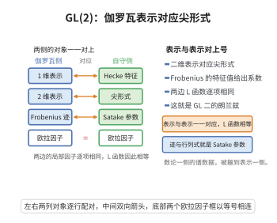

# GL(2)的Langlands对应

> **一句话大白话**：模形式（权重 $\ge 2$ 的尖点形式）的 Hecke 特征值所编码的信息，可以打包成一个二维 $\ell$-adic Galois 表示，并且两者的 L-函数完全相等。
>
> **小例子**：对权重 $k$ 的本原尖点形式 $f=\sum a_n q^n$，其Hecke特征值 $a_p$ 给出 Galois表示 $\rho_{f,\ell}$ 在Frobenius处的特征多项式 $X^2-a_p X+p^{k-1}$。

## 一、定理介绍

> **前置依赖**：模形式的Hecke特征值理论、自守表示与其局部分解、ℓ-adic上同调、Eichler-Shimura理论、Shimura簇

$GL(2)$ 的Langlands对应（即 Deligne–Milne 定理）断言：对任意数域 $F$，其 $GL_2(\mathbb{A}_F)$ 上的尖点自守表示与 $G_F$ 上的（适当限制了局部行为的）二维 $\ell$-adic Galois表示之间存在双射，且 L-函数匹配 $L(s,\pi)=L(s,\rho_\pi)$。特别地，经典模形式范畴对应的有限维 Galois表示由此被完全构造出来。

## 几何直观

图意在说明：二维伽罗瓦表示与 GL(2) 的尖形式一一对应，Frobenius 特征值给出系数，两边 L 函数逐项相同。

## 二、原理思路

思路在于把模形式嵌入到自守表示的语言，再通过代数簇的 $\ell$-adic 上同调取出 Galois 表示：模形式 $f$ 对应尖点自守表示 $\pi_f$；其 Hecke 特征值等于对应某些代数簇（如 Kuga–Sato 簇）上的自守形式；对这些簇取 $\ell$-adic 上同调即可解出二维 Galois 表示。证明的关键工具是 Langlands 纤维化与 Shimura 簇上同调的自守分解。

## 三、定理的严格表述

设 $F$ 为数域。存在从 $GL_2(\mathbb{A}_F)$ 的尖点自守表示到 $G_F$ 的二维 $\ell$-adic Galois表示（绝对不可约、奇数、在良好约化处非分歧）的双射 $\pi\mapsto\rho_\pi$，满足对每个位置 $v$（离散参数兼容时）：
$$
L(s,\pi_v)=L(s,\rho_\pi|_{G_{F_v}}),
$$
且局部 $\varepsilon$-因子亦匹配。特别地，权重 $k\ge2$ 的尖点模形式给出满足特征多项式 $\det(X-\rho_{f,\ell}(\mathrm{Frob}_p))=X^2-a_pX+p^{k-1}$ 的 Galois 表示。

## 四、证明过程

第一步把模形式 $f$ 翻译为 $GL_2(\mathbb{A}_{\mathbb{Q}})$ 自守表示 $\pi_f$，并指出Hecke算子 $T_p$ 作用与局部分量 $\pi_{f,p}$ 相关。第二步（Deligne 构造）将 $f$ 关联到 Kuga–Sato 簇上的微分形式，对其 $\ell$-adic 上同调取 $H^1$ 子表示得到二维 Galois 表示 $\rho_{f,p}$，满足非分歧点处 Frobenius 特征多项式为 $X^2-a_qX+q^{k-1}$。第三步利用 Eichler–Shimura 同态与 Matsushima 公式证明该 Galois 表示与自守表示的 L-函数一致。

## 五、应用与意义

$GL(2)$ 对应是 Langlands 纲领在"重量级"情形首次完全实现的成果。它把模形式与椭用性、Galois 表示成功耦合，是证明谷山–志村定理与 Fermat 大定理的必经之路，也是 Langlands 函子性猜测在二维算术群上最重要的检验样例。

## 课堂问答

**老师**：$GL(2)$ 对应（Deligne–Milne）断言的是什么双射？请把模形式情形下 Frobenius 的特征多项式写出来。

**学生**：先给结论：对数域 $F$，$GL_2(\mathbb{A}_F)$ 的尖点自守表示与 $G_F$ 的（局部行为受控的）二维 $\ell$-adic Galois 表示之间存在双射 $\pi\mapsto\rho_\pi$，并满足 $L(s,\pi_v)=L(s,\rho_\pi|_{G_{F_v}})$ 及局部 $\varepsilon$-因子匹配。对权重 $k\ge2$ 的尖点模形式 $f$，对应表示满足 $\det(X-\rho_{f,\ell}(\mathrm{Frob}_p))=X^2-a_p X+p^{k-1}$，即 $a_p$ 是 Frobenius 的迹、$p^{k-1}$ 是行列式。

**老师（追问）**：这个 Galois 表示是从哪里"取"出来的？证明的关键环节是什么？

**学生**：从代数簇的 $\ell$-adic 上同调里取：把 $f$ 翻译成自守表示 $\pi_f$，再关联到 Kuga–Sato 簇上的微分形式，对其 $H^1$ 取子表示得到二维 $\rho_{f,p}$，Frobenius 特征多项式由 Hecke 算子 $T_p$ 的作用给出。关键环节是 Eichler–Shimura 同态与 Shimura 簇上同调的自守分解（Langlands 纤维化），用以证明该 Galois 表示与自守表示的 L-函数一致。常见误区：以为对应只在 $\mathbb{Q}$ 上成立——它对数域 $F$ 也成立，只是一般需附加局部条件。

**老师（拓展）**：为什么说 $GL(2)$ 对应是纲领"重量级"情形的首次完全实现？它与费马大定理有什么联系？

**学生**：因为它第一次把模形式（自守侧）与椭圆曲线/二维 Galois 表示（算术侧）在 $GL_2$ 上完全耦合，给出 Langlands 函子性在二维算术群上最重要的检验样例。它正是证明谷山–志村（模性）定理与 Fermat 大定理的必经之路：Wiles 的 $R=T$ 与模性提升，最终就是把每条半稳定椭圆曲线的 $p$-adic 表示放进这个 $GL(2)$ 对应里。
