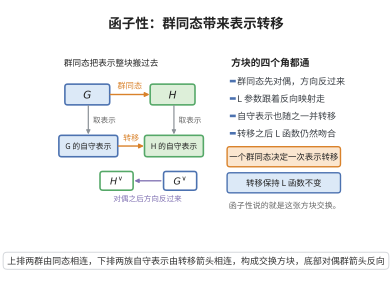

# Langlands函子性猜想
>
> **一句话大白话**：只要在 $L$-群侧有一个群同态 $^L H\to {}^L G$，那么凡是 $H$ 上出现的自守表示，就会"自动"变成 $G$ 上的自守表示——这就是朗兰兹函子性。
>
> **小例子**：用 $H=GL_1$、$G=GL_n$ 及 $^L H\to {}^L G$ 的恒等嵌入，类体论的一维表示诱导出 $GL_n$ 的 Eisenstein 系列自守表示。

## 一、定理介绍

> **前置依赖**：L-群的构造、局部Langlands对应、自守表示理论、稳定迹公式（Langlands-Arthur计划）、L-函数

Langlands函子性猜想（functoriality）断言：给定约化群 $H,G$ 及其 $L$-群间的（$L$-同态）同态 $\varphi:{}^L H\to {}^L G$，$H$ 上的每个自守表示 $\pi$ 应"升"为一个 $G$ 上的自守表示 $\operatorname{Lift}(\pi)$，并且局部 L-因子随之传递。它把局部Langlands对应与全局表示理论统一到一个基本机制下。

## 几何直观

图意在说明：群同态先对偶成反向映射，再推动自守表示整体转移，转移保持 L 函数不变。

## 二、原理思路

想法是把自守表示当作 $L$-群参数后"沿着箭头转化"：局部上，参数 $\phi_{\pi_v}:W_{F_v}\to {}^L H$ 经 $\varphi$ 复合得到 $^LG$ 的参数，从而得到 $G_{F_v}$ 的局部表示；全局上，把这些局部表示装配成 $G$ 的抽象空间表示，并验证其满足自守的尖点性/稳定化条件。

## 三、定理的严格表述

设 $H,G$ 为三角约化群，$\varphi:{}^L H\to {}^L G$ 为 $L$-同态（把 $\operatorname{Gal}$ 幂等保到 $\mathbb{C}$-幂等群）。则对 $H$ 的每个自守表示 $\pi$（适度合理），存在 $G$ 的自守表示 $\Pi$，使对几乎所有位 $v$ 与所有表示 $r$：
$$
L(s,\pi_v,r\circ\varphi)=L(s,\Pi_v,r).
$$
当 $\pi$ 尖点时，$\Pi$ 亦尖点（局部-全局兼容情形）。

## 四、证明过程

思路：先对每个 $v$ 仓库局部参数给出 $\Pi_v$（利用局部Langlands/局部基元），再用 Poincaré–Kim 的"端基元/光谱传输"方法检验这些局部表示可被装配成全局基元表示。证明常借助 L-函数与稳定迹公式（Langlands–Arthur 计划）比较两侧的迹，从而判断全局升的存在。

## 五、应用与意义

函子性被广泛认为是 Langlands 纲领的"主司号"— 它上承亨伯性质（自守形式乘积、对称幂升格），连接若当不可约表示的 $L$-函数，并在椭圆曲线（对称幂/自同构提升）和 Langlands 对应工具的传递性质中扮演必要角色。尽管一般情形仍未获完全证明，其特殊情形（如对称幂、基变更、安定端元）已取得重大进展。

## 课堂问答

**老师**：函子性猜想被称作 Langlands 纲领的"主司号"。请先精确说出它的输入与输出。

**学生**：先给结论：输入是一个 $L$-同态 $\varphi:{}^L H\to{}^L G$，输出是把 $H$ 的每个自守表示 $\pi$ "升"为 $G$ 的自守表示 $\Pi=\mathrm{Lift}(\pi)$，并保持局部 L-因子 $L(s,\pi_v,r\circ\varphi)=L(s,\Pi_v,r)$ 对几乎所有 $v$ 与所有表示 $r$ 成立。当 $\pi$ 尖点时 $\Pi$ 亦尖点（局部-全局相容情形）。

**老师（追问）**：机制上"升格"是怎么发生的？为什么它把局部对应与全局理论串成一体？

**学生**：机制是"沿箭头复合参数"：局部上参数 $\phi_{\pi_v}:W_{F_v}\to{}^L H$ 与 $\varphi$ 复合得 $W_{F_v}\to{}^L G$ 的参数，从而给出 $G$ 的局部表示；全局上把这些局部表示装配并验证尖点性/稳定化条件。常见误区：以为函子性是单条定理——它其实是一族猜想的统称，从一个 $L$-群的群同态出发，把局部与全局的自守信息统一到同一机制下。

**老师（拓展）**：函子性最著名的已证特例有哪些？为什么它们重要？

**学生**：对称幂升格（$\mathrm{Sym}^n$ 对应）、循环基变更，以及由稳定迹公式/Arthur 计划得到的若干端元情形。它们重要在于：一方面本身就是自守形式的强算术结论（如椭圆曲线的对称幂 L-函数），另一方面是证明模性定理与对应传递性的必要工具。一般情形仍未完全证明，这正是纲领的核心难点。
