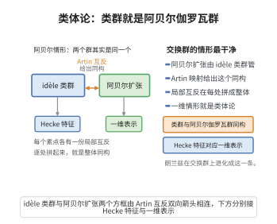

# GL(1)的Langlands对应（类体论）

> **一句话大白话**：数域的最大Abel扩张与adele环的商环一一对应——也就是说，"Abel的Galois群"就是"全体适合的局部乘法信息"揉在一起再模掉全局单位。
>
> **小例子**：对 $\mathbb{Q}$，$\text{Gal}(\mathbb{Q}^{\mathrm{ab}}/\mathbb{Q})\cong \mathbb{A}_{\mathbb{Q}}^\times/\mathbb{Q}^\times$，其阿贝尔部分等价于条件受控的 $\hat{\mathbb{Z}}^\times$，这正是 $p$-adic 因子与符号因子的来源。

## 一、定理介绍

> **前置依赖**：局部类体论与互反映射、Artin互反律、adele-idele理论、Galois群的Abel化

类体论（class field theory）是朗兰兹纲领在 $GL(1)$ 情形的经典形态。它断言，对任意数域（或全局域）$F$，其最大Abel扩张 $F^{\mathrm{ab}}$ 的Galois群与商 $\mathbb{A}_F^\times/F^\times$ 之间存在典范同构。这一同构把所有局部位上的互反映射拼合起来，形成了不可约 Abel 扩张的完整分类。

## 几何直观

图意在说明：阿贝尔情形下，idèle 类群与阿贝尔伽罗瓦群由 Artin 映射同构，局部互反逐处拼成整体。

## 二、原理思路

核心思想是把"Abel 扩张"这个算术对象翻译成"乘法群的商"。每个位 $v$（有限或无穷）给出一个局部位：对 $p$-adic 位，由范数群与 Frobenius 元素构造互反映射 $\theta_v:F_v^\times\to\text{Gal}(F_v^{\mathrm{ab}}/F_v)$；把这些局部映射嵌入 adele 环的乘法群，得到一个全局互反映射，其核恰为对角嵌入的 $F^\times$。于是 Galois 群的 Abel 化被实现为 adele-idele 类群上的自守商。

## 三、定理的严格表述

设 $F$ 为数域，$\mathbb{A}_F^\times$ 为其 adele 环的乘法群（idèles）。则存在典范同构
$$
\text{Gal}(F^{\mathrm{ab}}/F)\cong \mathbb{A}_F^\times/F^\times.
$$
等价地，$GL(1)$ 的自守表示（即 $\mathbb{A}_F^\times/F^\times$ 上的连续特征）一一对应于 $G_F$ 的一维Galois表示。该同构将 Frobenius元素发到对应的规范特征，从而保持 L-函数的匹配。

## 四、证明过程

证明分四步：先在每个局部域 $F_v$ 上建立局部类体论（互反映射 $\theta_v:F_v^\times\to W_{F_v}^{\mathrm{ab}}$），再将这些局部互反映射乘起来得到全局映射 $\theta=\prod_v\theta_v:\mathbb{A}_F^\times\to\text{Gal}(F^{\mathrm{ab}}/F)$，随后由 Artin 互反律证明 $\theta$ 满射且 $\ker\theta=F^\times$，最后由完全映射得到同构。对应的一维表示侧由Hecke特征与Galois一维表示经由该同构自然互换，且L-因子逐位匹配。

## 五、应用与意义

$GL(1)$ 情形的类体论既是朗兰兹纲领的基石，也是全局域的算术核心工具。它在虚二次域的复数乘法、Hecke L-函数的解析理论、以及解析/代数数论的互反律证明中起基础作用，并为 $GL(n)$ 的更高维推广确定了同构所应满足的各种性质（L-因子、$\varepsilon$-因子匹配）。

## 课堂问答

**老师**：$GL(1)$ 的 Langlands 对应就是类体论。请严格写出它断言的同构，并说明"$GL(1)$ 的自守表示"到底指什么。

**学生**：先给结论：$F$ 上存在典范同构 $\mathrm{Gal}(F^{\mathrm{ab}}/F)\cong\mathbb{A}_F^\times/F^\times$。左端是最大 Abel 扩张的 Galois 群，右端是 idele 类群。$GL(1)$ 的自守表示就是 $\mathbb{A}_F^\times/F^\times$ 上的连续特征，它们与 $G_F$ 的一维 Galois 表示（即 $G_F^{\mathrm{ab}}$ 的特征）一一对应，Frobenius 元素对到相应的 Hecke 特征，L-因子逐位匹配。

**老师（追问）**：这个同构是怎么证明的？为什么核恰好是 $F^\times$？

**学生**：分四步：每个位 $v$ 先建局部类体论，得 $\theta_v:F_v^\times\to\mathrm{Gal}(F_v^{\mathrm{ab}}/F_v)$；把它们乘起来得全局映射 $\theta=\prod_v\theta_v:\mathbb{A}_F^\times\to\mathrm{Gal}(F^{\mathrm{ab}}/F)$；再由 Artin 互反律证明 $\theta$ 满射且 $\ker\theta=F^\times$（对角嵌入的全局单位）；最后由完全性得同构。常见误区：以为商掉 $F^\times$ 会丢信息——恰恰相反，商掉它才得到不依赖位选取的互反对象。

**老师（拓展）**：既然 $GL(1)$ 只是 $GL(n)$ 的最低阶情形，为什么它仍被视作整个 Langlands 纲领的基石？

**学生**：因为 $n=1$ 已经确立了对应应当满足的全部模板：有典范同构、保 L-因子与 $\varepsilon$-因子、Frobenius 对到 Hecke 特征。高维 Langlands 的每一项要求都是这条同构在 $\mathbb{A}_G$ 上的自然推广；它在虚二次域的复数乘法、Hecke L-函数解析理论与互反律证明中仍是核心工具。
