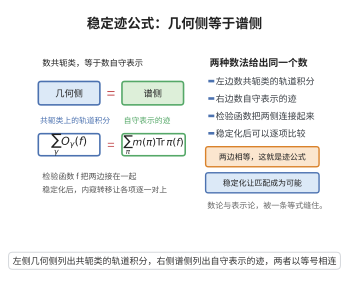

# 稳定迹公式

> **一句话大白话**：普通迹公式想把"自守表示"和"群元素的共轭类"这两本账对上，但账两边都太"细"——同一个 L-包里的表示分不清、同一个稳定共轭类里的共轭类也分不清；稳定迹公式干脆把这些分不清的东西先捆起来（用稳定轨道积分与稳定特征），账就变干净了，还能按"内视群"一块块切开。
>
> **小例子**：$GL(1)$ 情形就是类体论：稳定共轭类恰好是一个元素，$SO_\delta=O_\delta$，稳定迹公式退化为一维互反律的计数；而 $GL(2)$ 里稳定共轭类可能含多个共轭类，正是这一步"求和处理"让两侧不再依赖具体代表元的选取。

## 一、定理介绍

> **前置依赖**：Lefschetz迹公式、局部Langlands对应、诱导表示与Frobenius互反律、Langlands类体论对应

迹公式（Arthur–Selberg）是数论版的 Lefschetz 不动点公式：它把 $L^2(G(F)\backslash G(\mathbb{A}))$ 上算子 $R(f)=\int f(g)R(g)\,dg$ 的迹用两种方式各算一遍，
$$
\sum_{\pi\in\Pi(G)}m(\pi)\,\mathrm{tr}\,\pi(f)=\sum_{\gamma\in\{\text{椭圆共轭类}\}}\tau(G_\gamma)\int_{G_\gamma(\mathbb{A})\backslash G(\mathbb{A})}f(g^{-1}\gamma g)\,dg .
$$
左端是谱侧（自守表示的迹），右端几何侧是**轨道积分** $O_\gamma(f)$。

问题在于：右侧依赖代表元的选取，而稳定共轭类（在 $\bar F$ 上共轭）才是不变单位。**稳定迹公式**就是把右侧的轨道积分换成**稳定轨道积分**（同一稳定共轭类上求和）后得到的恒等式；再对该恒等式做**稳定化（stabilization）**，把它分解成各内视群（endoscopic group）$H$ 的稳定迹公式之和：
$$
ST^{G}(f)=\sum_{H\in\mathcal E(G)}\iota(G,H)\,ST^{H}(f^{H}),
$$
其中 $\iota(G,H)$ 为 Kottwitz–Shelstad 符号，$f\mapsto f^H$ 由基本引理提供的轨道积分匹配给出。

## 几何直观

图意在说明：对同一个检验函数，共轭类上的轨道积分之和等于自守表示特征标之和，稳定化后可逐项匹配。

## 二、原理思路

动机是"不变性"：谱侧对 $f$ 是自守不变量，所以几何侧必须能被整理成不依赖代表元的形式。做法有三层。

第一层，把**共轭**换成**稳定共轭**。$\gamma,\gamma'$ 稳定共轭指它们在 $G(\bar F)$ 下共轭；同一稳定共轭类中 $G(F)$-共轭类的个数由 Galois 上同调集 $\ker\!\big(H^1(F,G_\gamma)\to H^1(F,G)\big)$ 刻画（Kottwitz）。

第二层，把**轨道积分求和**。定义稳定轨道积分 $SO_\delta=\sum_{\delta'\sim_{st}\delta}O_{\delta'}$，配上 Kottwitz 符号 $\iota(G,\delta)$，几何侧的椭圆项就改写成按稳定类组织的和。

第三层，把**谱侧的 L-包捆起来**。局部 Langlands 对应把不可约表示分组成 L-包 $\Pi_\phi$，包内表示有相同的稳定特征 $S\Theta_\phi=\sum_{\pi\in\Pi_\phi}\Theta_\pi$。于是稳定迹公式的谱侧只含稳定特征，两侧都"稳定"了。

稳定化之所以能切开成内视群之和，是因为一个稳定共轭类的轨道积分与某个（较小）内视群的正则元素的稳定轨道积分匹配；这类"匹配"正是基本引理所断言。

## 三、定理的严格表述

设 $G$ 为数域 $F$ 上的连通约化群，$f\in C_c^\infty(G(\mathbb{A}))$ 为测试函数。对正则半单元 $\delta\in G(F)$ 定义轨道积分与稳定轨道积分
$$
O_\delta(f)=\int_{G_\delta(\mathbb{A})\backslash G(\mathbb{A})}f(g^{-1}\delta g)\,dg,\qquad SO_\delta(f)=\sum_{\delta'\sim_{st}\delta}O_{\delta'}(f).
$$

**定理（稳定迹公式）**：存在只依赖稳定共轭类的分布 $SO_\delta$ 与稳定特征 $S\Theta_\phi$，使
$$
\sum_{\phi} \big\langle \text{（权）},\,S\Theta_\phi\big\rangle(f)=\sum_{\{\delta\}_{st}}\iota(G,\delta)\,SO_\delta(f),
$$
即谱侧被 L-包（稳定特征）参数化，几何侧被稳定共轭类参数化。

**定理（稳定化/内视分解）**：设 $\mathcal E(G)$ 为 $G$ 的椭圆内视群集。则存在测试函数匹配 $f\mapsto f^{H}$（$f^H$ 的稳定轨道积分等于 $f$ 沿相应内视数据的转移），使
$$
I(f)=\sum_{H\in\mathcal E(G)}\iota(G,H)\,ST^{H}(f^{H}),
$$
其中 $I(f)$ 为非不变迹公式的谱侧，$\iota(G,H)\in\{\pm1\}$ 为 Kottwitz 符号。$H=G$ 项即 $G$ 自身的稳定迹公式。

## 四、证明过程

**步骤1：定义正则半单元与轨道积分。** 取 $\delta\in G(F)$ 正则半单元（中心化子为极大环面）。由 Weyl 积分公式，$O_\delta(f)=\int_{G_\delta(\mathbb{A})\backslash G(\mathbb{A})}f(g^{-1}\delta g)\,dg$ 绝对收敛，且满足 $O_{g\delta g^{-1}}(f)=O_\delta(f)$，即只依赖 $G(F)$-共轭类。

**步骤2：稳定共轭类的分类。** 称 $\delta\sim_{st}\delta'$ 若存在 $g\in G(\bar F)$ 使 $g\delta g^{-1}=\delta'$。对固定 $\delta$，测度论上唯一的结构是 $\delta$ 的 $G(F)$-共轭类落在其稳定类中的位置，由
$$
\ker\!\Big(H^1(F,G_\delta)\to H^1(F,G)\Big)
$$
刻画（Kottwitz 定理）；特别地该类的个数有限，故 $SO_\delta=\sum_{\delta'\sim_{st}\delta}O_{\delta'}$ 为有限和。

**步骤3：证明稳定轨道积分的不变性。** 因 $O_{\delta'}(f)=O_\delta(f)$ 对所有 $\delta'$ 稳定共轭于 $\delta$ 成立（步骤1），故 $SO_\delta(f)$ 与稳定类中代表元选择无关；进一步，$SO_\delta$ 在 $G(\mathbb{A})$ 的任意内自同构与 Galois 作用下不变，这正是"稳定"一词的含义。相对地，单个 $O_\delta$ 在稳定类内部可以不同，这是不稳定性的来源。

**步骤4：几何侧的稳定重整。** 迹公式几何侧的椭圆项为 $\sum_{\gamma}\tau(G_\gamma)\,\mathrm{vol}(G_\gamma(F)\backslash G_\gamma(\mathbb{A}))\,O_\gamma(f)$。把同一稳定类中的项合并，利用 Kottwitz 符号 $\iota(G,\delta)$ 与测度因子 $\tau$ 的关系
$$
\sum_{\gamma\sim_{st}\delta}\tau(G_\gamma)\,O_\gamma(f)=\iota(G,\delta)\,SO_\delta(f),
$$
即可把几何侧改写成只含 $SO_\delta$ 的形式，从而得到稳定迹公式。

**步骤5：谱侧的 L-包重编。** 由局部 Langlands 对应（诱导表示经由诱导表示与 Frobenius 互反律给出局部参数），$\Pi(G)$ 按参数 $\phi$ 分成 L-包。包内成员在稳定共轭元素上的特征值相同，故对 $f$ 取迹后包内差异只体现在稳定特征 $S\Theta_\phi$ 的权重上，谱侧可改写成仅含 $S\Theta_\phi$；$GL(1)$ 时包为单点，公式退化为类体论的计数。

**步骤6：稳定化与基本引理。** 对每个椭圆内视群 $H\in\mathcal E(G)$，构造 $G$ 的测试函数到 $H$ 的转移 $f\mapsto f^H$：要求对 $H$ 的稳定轨道积分有
$$
SO^{H}_{\gamma_H}(f^{H})=SO^{G}_{\delta}(f)\quad(\gamma_H\leftrightarrow\delta\text{ 匹配}).
$$
基本引理断言单位元处的这种匹配成立（Ngô 用 Hitchin 纤维化证明），它保证转移良定义。把所有 $H$ 的稳定迹公式按 $\iota(G,H)$ 加权求和，代入步骤4–5 的两种展开并逐项比较稳定轨道积分，即得内视分解
$$
I(f)=\sum_{H\in\mathcal E(G)}\iota(G,H)\,ST^{H}(f^{H}).
$$

**步骤7：结论。** 稳定迹公式与稳定化把"谱-几何"对应改造成"稳定特征-稳定共轭类"对应，并把比较不同群的谱问题化归为有限个内视群之间的匹配问题。

**结论（$\square$）**：$I(f)=\sum_{H}\iota(G,H)ST^{H}(f^H)$，且稳定迹公式的谱侧由 L-包、几何侧由稳定共轭类参数化。

## 五、应用与意义

稳定迹公式是 Langlands 纲领的技术主干。它把函子性、基变更、内视等比较问题转化为两侧稳定分布的逐项配对，成为 Arthur–Langlands 计划中证明自守表示分类与函子性（如对称幂升格、$GL(n)$ 内视分类）的核心工具；配合基本引理，它使"谱-几何"对应在一般约化群上获得可操作的稳定形式，也直接支撑了 GL(2) 型对应与模形式的算术应用。

## 课堂问答

**老师**：迹公式两侧本已相等，为什么还要做"稳定化"？先说稳定迹公式究竟动了哪一侧。

**学生**：先给结论：被动的是几何侧。普通迹公式的几何侧是轨道积分 $O_\gamma(f)=\int_{G_\gamma(\mathbb{A})\backslash G(\mathbb{A})}f(g^{-1}\gamma g)\,dg$，它依赖 $G(F)$-共轭类代表元的选取，而谱侧 $\sum_\pi m(\pi)\mathrm{tr}\,\pi(f)$ 是 $f$ 的自守不变量。要让两侧在"不变性"上对齐，就把同一稳定共轭类内的轨道积分求和，得到 $SO_\delta(f)=\sum_{\delta'\sim_{st}\delta}O_{\delta'}(f)$；同一稳定类中 $G(F)$-共轭类的个数由 Kottwitz 的 $\ker(H^1(F,G_\delta)\to H^1(F,G))$ 刻画且有限，所以这是有限和。

**老师（追问）**：那内视分解 $I(f)=\sum_{H\in\mathcal E(G)}\iota(G,H)\,ST^H(f^H)$ 里，转移 $f\mapsto f^H$ 凭什么存在？$GL(1)$ 又退化成了什么？

**学生**：$f^H$ 由基本引理保证：它要求稳定轨道积分匹配 $SO^H_{\gamma_H}(f^H)=SO^G_\delta(f)$，Ngô 用 Hitchin 纤维化证明了单位元处的情形，从而转移良定义。$GL(1)$ 时每个稳定共轭类只含一个 $G(F)$-共轭类，$SO_\delta=O_\delta$，公式退化为类体论的一维互反计数。常见误区：把"稳定"当成额外假设——其实它恰是把几何侧压成谱侧所需的那个自守不变量的必要操作。

**老师（拓展）**：请把它放进 Langlands 计划的框架里，说明它为什么是"比较不同群"的工具。

**学生**：因为稳定化把 $G$ 上的非不变迹公式 $I(f)$ 写成有限个内视群 $H\in\mathcal E(G)$ 的稳定迹公式之和，权重是 Kottwitz 符号 $\iota(G,H)\in\{\pm1\}$。于是基变更、函子性这类跨群谱问题，被化归为稳定分布的逐项配对 $SO^H_{\gamma_H}(f^H)=SO^G_\delta(f)$，这正是 Arthur–Langlands 计划（对称幂升格、$GL(n)$ 内视分类）的技术主干；更一般地，$H=G$ 那一项就是 $G$ 自身的稳定迹公式，其余项才承载"跨群"的信息。
