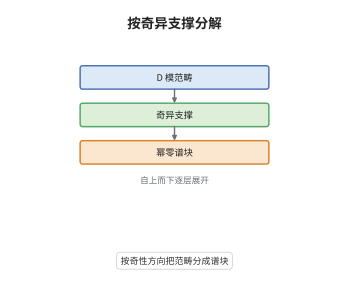

# Arinkin-Gaitsgory 谱分解

> **一句话大白话**：每个 D-模都带有奇性朝哪个方向的信息，Arinkin 与 Gaitsgory 把这些方向整理成谱空间上的支撑，并证明整个 D-模范畴可以按这些支撑分块，从而把几何 Langlands 猜想写成一个显式函子的等价性。
>
> **小例子**：$G=\mathbb G_m$ 时 $\mathrm{Bun}_G=\mathrm{Pic}(X)$，谱侧是 $\mathrm{LocSys}_{\mathbb G_m}$；谱分解退化成一个 Fourier–Mukai 变换，把 $\mathrm{Pic}$ 上的 D-模送到 $\mathrm{LocSys}$ 上支撑落在幂零锥内的相干层。

## 介绍

Arinkin 与 Gaitsgory 在 2015 年提出用奇异支撑组织几何 Langlands 的谱侧。他们先在导出栈上建立相干层的奇异支撑理论，再把它搬到 $\mathrm{LocSys}_{\check G}$，由此定义幂零支撑子范畴 $\mathrm{IndCoh}_{\mathrm{Nilp}}(\mathrm{LocSys}_{\check G})$，并构造一个与 Hecke 作用相容的 Langlands 函子。谱分解定理说明 $\mathrm{D\text{-}mod}(\mathrm{Bun}_G)$ 的每个对象在谱侧都有良定义的支撑，范畴可按支撑分块。这样原本含糊的几何 Langlands 猜想就被整理成一个具体函子是否为等价的问题，为后续工作提供了统一的框架。

## 几何直观

图意在说明：最底层是 $\mathrm{Bun}_G$ 上的 D-模范畴，往上按奇异支撑把它切成若干块，最上层每块对应 $\mathrm{LocSys}_{\check G}$ 上一个支撑落在幂零锥内的相干层范畴；谱分解就是说两侧的块一一对齐。

## 分析

**前置依赖**：导出范畴、奇异支撑、几何 Langlands；补充：IndCoh、DG 范畴、幂零锥。

**数学内涵**：
- 奇异支撑：对 $\mathrm{LocSys}_{\check G}$ 上的相干层 $\mathcal F$，$\mathrm{SingSupp}(\mathcal F)\subset T^*\mathrm{LocSys}_{\check G}$ 记录它沿哪些余方向不局部自由；在导出栈上要取相应的平移，才能与 D-模侧匹配。
- 幂零条件：整体幂零锥 $\mathrm{Nilp}\subset T^*\mathrm{LocSys}_{\check G}$ 由 $X$ 上的幂零 Higgs 场给出；$\mathrm{IndCoh}_{\mathrm{Nilp}}$ 是支撑落在 $\mathrm{Nilp}$ 内的子范畴。
- Langlands 函子：$\mathbb L_G:\mathrm{IndCoh}_{\mathrm{Nilp}}(\mathrm{LocSys}_{\check G})\to\mathrm{D\text{-}mod}(\mathrm{Bun}_G)$ 由 Hecke 作用定义；猜想它是等价，AG 证明它的构造与谱分解性质，并把问题归约为本质像。
- 常见误区：不能把 $\mathrm{D\text{-}mod}(\mathrm{Bun}_G)$ 直接等同于 $\mathrm{QCoh}(\mathrm{LocSys}_{\check G})$；必须换成 $\mathrm{IndCoh}$ 并把支撑限制在幂零锥，否则连最简单的例子都对不上。

**结构**：
1. 在导出栈上定义奇异支撑，证明它对 IndCoh 的六函子运算相容。
2. 用 Hecke 作用构造 $\mathbb L_G$，验证它与谱侧的作用交换。
3. 陈述谱分解定理，把几何 Langlands 猜想归约为 $\mathbb L_G$ 的本质像问题。

## 思考过程

几何 Langlands 的原始猜想写作 $\mathrm{D\text{-}mod}(\mathrm{Bun}_G)$ 与 $\mathrm{LocSys}$ 上某个相干层范畴等价，但 $GL_1$ 的例子说明右边不能简单取 $\mathrm{QCoh}$：Fourier–Mukai 变换送过去的层往往带有非平凡的奇性。Arinkin 与 Gaitsgory 的出发点是承认这种奇性，并把它当成结构而不是障碍。困难在于导出栈上原本没有现成的奇异支撑理论，他们必须重新建立局部模型、证明它与六函子相容，还要在 $\mathrm{LocSys}$ 这种非概形的对象上把支撑定义清楚。关键想法是引入幂零锥：$X$ 上的幂零 Higgs 场给出一个整体的余迷向子簇，只有支撑落在它里面的相干层才可能与 D-模对应。做完这些之后，猜想就变成了一个显式函子是否满的问题；AG 证明了函子的构造与谱分解，一般情形下的等价性在当时仍是猜想，后续工作才逐步推进。这里必须强调：谱分解给出的是框架与归约，不等于完整证明。

## 证明过程

**定理**：设 $X$ 为亏格 $g\ge2$ 的光滑射影曲线，$G$ 约化。则 (i) 存在函子 $\mathbb L_G:\mathrm{IndCoh}_{\mathrm{Nilp}}(\mathrm{LocSys}_{\check G})\to\mathrm{D\text{-}mod}(\mathrm{Bun}_G)$，与 Hecke 作用相容；(ii) $\mathrm{D\text{-}mod}(\mathrm{Bun}_G)$ 的每个对象在谱侧有良定义的奇异支撑，且按支撑的分层与 $\mathbb L_G$ 相容；(iii) 几何 Langlands 猜想断言 $\mathbb L_G$ 是等价。

**证明**：

### 1. 奇异支撑

在光滑情形，$\mathrm{SingSupp}(\mathcal F)$ 由局部上 $\mathcal F$ 的极小自由分解的支集粘出；在导出栈上取 $T^*$ 的相应平移，使支撑落在余切栈里。对 $\mathrm{IndCoh}$，奇异支撑对推出与拉回都相容，因此可以逐局部计算。

### 2. Langlands 函子

Hecke 堆给出 $\mathrm{D\text{-}mod}(\mathrm{Bun}_G)$ 上的交换作用。$\mathbb L_G$ 由谱侧的相干层按该作用展开定义：$\mathcal F\mapsto\mathbb L_G(\mathcal F)$ 是使所有 Hecke 算子同时作用的最小子对象。构造保证 $\mathbb L_G$ 与谱侧的张量结构、Hecke 作用都相容。

### 3. 谱分解与归约

谱分解定理断言：对 $\mathrm{D\text{-}mod}(\mathrm{Bun}_G)$ 的每个对象，其谱侧支撑的每个不可约分量都落在 $\mathrm{Nilp}$ 内，且限制到每个分量上 $\mathbb L_G$ 给出忠实函子。于是几何 Langlands 猜想等价于 $\mathbb L_G$ 的本质像是整个 $\mathrm{D\text{-}mod}(\mathrm{Bun}_G)$，即

$$
\mathbb L_G:\mathrm{IndCoh}_{\mathrm{Nilp}}(\mathrm{LocSys}_{\check G})\;\xrightarrow{\ \sim\ }\;\mathrm{D\text{-}mod}(\mathrm{Bun}_G)
$$

应为等价。$G$ 为环面时两边都可显式计算，等价成立；一般情形在 AG 的论文中是猜想，后续工作继续推进。$\square$

## 课堂问答

**老师**：为什么谱侧必须是 $\mathrm{IndCoh}$ 而不是普通的 $\mathrm{QCoh}$？

**学生**：因为 D-模侧的推出不是精确的，它会把奇性带到谱侧。$\mathrm{QCoh}$ 只记录局部自由的相干层，装不下这些带奇性的对象；$\mathrm{IndCoh}$ 允许不拟凝聚的推出，恰好容纳它们。$GL_1$ 的 Fourier–Mukai 变换就是最简单的证据：送过去的层一般不局部自由，只有用 $\mathrm{IndCoh}$ 才能写成等价。

**老师（追问）**：幂零锥这个限制条件在证明里起什么作用？

**学生**：它把谱侧从整个余切栈缩到一个余迷向子簇。没有这个限制，$\mathrm{IndCoh}$ 太大，函子既不忠实也不可能满；加上之后，谱侧每个对象都对应 $X$ 上的幂零 Higgs 场，才能与 $\mathrm{Bun}_G$ 的 Hecke 作用匹配。谱分解定理的分块也正是按这个锥的不可约分量进行的。

**老师（拓展）**：谱分解定理是否等于证明了整体几何 Langlands？

**学生**：不等于。谱分解给出的是框架与归约：它说明 D-模侧按奇异支撑分块、每块与谱侧的对应块相容，并把猜想化为 $\mathbb L_G$ 的本质像问题；AG 的论文中一般情形的等价性仍是猜想，只在环面等情形可完整验证。把归约当成完整证明是常见误读，后续工作正是在补上本质像这一步。
