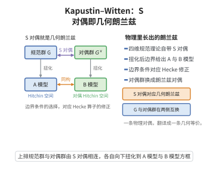

# GLC的Kapustin-Witten对偶

> **一句话大白话**：几何Langlands对应可以"从物理里长出来"——它是 $\mathcal{N}=4$ 超 Yang–Mills 的 S-对偶（电磁对偶）在拓扑约化下的等价物。
>
> **小例子**：对规范群 $G$ 的 $\mathcal{N}=4$ SYM 做 S-对偶，规范群变为 ${}^LG$、耦合 $g\to1/g$；这在拓扑约化后产出从 $\mathrm{Bun}_G$ D-模到 $\mathrm{LocSys}_{{}^LG}$ 层的对应。

## 一、定理介绍

> **前置依赖**：N=4超Yang-Mills理论、S-对偶（电磁对偶）、拓扑约化与二维TQFT、Wilson-＇t Hooft圈、几何Langlands的范畴化

Kapustin–Witten对偶断言：几何 Langlands 对应本质上就是 $\mathcal{N}=4$ 超 Yang–Mills（SYM）理论的 S-对偶（蒙哥马利–电磁对偶 $G\leftrightarrow{}^LG$）在 Wilson–'t Hooft 拓扑约化后的结果。它首次给出几何 Langlands 的物理推导与解释，把层论等价还原为场论的对偶对称性。

## 几何直观

图意在说明：四维规范理论的 S 对偶在扭化后落到 Hitchin 空间的 A 模型与 B 模型上，正是几何朗兰兹。

## 二、原理思路

考虑四维 $\mathcal{N}=4$ SYM 在形变 $AdS_5\times S^5$ 或一般超嘉grants上，通过沿时间方向做"顶分切"与变分拓扑量子场论约化到二维，得到代数—几何侧的两个"边界条件"。一侧得到 $\mathrm{Bun}_G$ 上的 D-模（来自 A-分支），另一侧得到 $\mathrm{LocSys}_{{}^LG}$ 上的层（来自 B-分支），而 S-对偶把两者交换并连接由 Hecke 算子给出的边界态。

## 三、定理的严格表述

设 $X$ 为光滑曲线，$G$ 约化群。考虑 $X\times\mathbb{R}^2$ 上的 $\mathcal{N}=4$ 超 Yang–Mills，用耦合常数与超势做二可变形。Kapustin–Witten 主张：存在物理推导使得拓扑约化后的等价
$$
\mathrm{D\text{-}mod}_G(\mathrm{Bun}_G)\;[\,A\text{ 分支}\,]\;\cong\;\mathrm{QCoh}_{{}^LG}(\mathrm{LocSys}_{{}^LG})\;[\,B\text{ 分支}\,]
$$
正是几何 Langlands 对应，且该对应由 $G\leftrightarrow{}^LG$ 的 S-对偶得到保证。

## 四、证明过程

论证按物理路线展开：先构造 $\mathcal{N}=4$ SYM 的四维 Lagrangian 及其超对称形变；然后做拓扑约化得到二维 TQFT，使 Wilson/'t Hooft 圈对应 Hecke 算子；接着论证 S-对偶 $G\leftrightarrow{}^LG$、$g\to1/g$ 交换 A-与 B-分支；最后把得到的边界态匹配为层论对应，从而"物理上推导"几何 Langlands。

## 五、应用与意义

该对偶从物理视角复兴并重新解释了几何 Langlands，为后续的范畴化（CuervoBelisle）、$\mathcal{N}=4$ 全息与超弦对应提供统一框架。它也把几何形变、量子化与 Hecke 特征的高阶修正在物理语言中给出组织方式，被视作几何 Langlands 的弦论/引力学证据。

## 课堂问答

**老师**：Kapustin–Witten 说几何 Langlands 是 $\mathcal{N}=4$ 超 Yang–Mills 的 S-对偶的拓扑约化。请点明 S-对偶交换了什么，又给出哪两个范畴。

**学生**：先给结论：$\mathcal{N}=4$ SYM 的 S-对偶把规范群 $G$ 换成 $^LG$、耦合常数 $g\to1/g$，并交换带 Wilson 圈的 A-分支与带 't Hooft 圈的 B-分支。拓扑约化后一侧得到 $\mathrm{Bun}_G$ 上的 D-模，另一侧得到 $\mathrm{LocSys}_{{}^LG}$ 上的拟凝聚层，等价 $\mathrm{D\text{-}mod}(\mathrm{Bun}_G)\cong \mathrm{QCoh}(\mathrm{LocSys}_{{}^LG})$ 正是几何 Langlands，由 S-对偶保证。

**老师（追问）**：物理上的 Wilson 圈与 't Hooft 圈，对应到数学上是哪个结构？为什么这是"解释"而非"证明"？

**学生**：'t Hooft 圈对应 Hecke 算子，它把 $\mathrm{Bun}_G$ 上的 D-模沿 $X$ 上的点 $x$ 搬运，正是几何 Langlands 中 Hecke 特征值的来源。说它是物理解释而非数学证明，因为论证依赖场论的 S-对偶与拓扑约化这类尚未完全公理化的输入；它给出对应应当成立的理由与结构预言，而非严格的代数几何证明。常见误区：以为 S-对偶直接等价于几何对应——实际需经拓扑约化才落到 $2$ 维的层论语句。

**老师（拓展）**：这个对偶对几何 Langlands 的后续发展有什么实际影响？

**学生**：它把几何 Langlands 从"层论巧合"提升为有弦论/引力学动机的结构，为范畴化、$\mathcal{N}=4$ 全息对偶与量子化/形变 Hecke 特征的高阶修正提供了统一框架，也促使后续工作从物理线索出发去构造严格的范畴等价。
