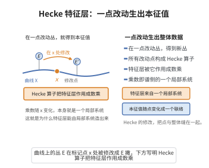

# Hecke特征值的几何构造
>
> **一句话大白话**：不需要逐点"猜测"一个局部系统，而可以直接从 $\mathrm{Bun}_G$ 上的 D-模和 Hecke 算子出发，把每个位置 $x$ 的 Hecke 作用"解出来"，从而整体地构造 Hecke 本征层对应的特征值（局部系统）。
>
> **小例子**：给定 Hecke 本征层 $\mathcal{F}$，$H_{x,V}(\mathcal{F})\cong\sigma_V(x)\boxtimes\mathcal{F}$ 直接给出每点 $x$ 的"本征值" $\sigma_V(x)$，把这些值拼起来就得到 $^LG$-局部系统 $\sigma$。

## 一、定理介绍

> **前置依赖**：Hecke算子与Hecke本征条件、局部系统的系数层族、表示论完备性、D-模理论

Hecke特征值的几何构造说明了如何在几何 Langlands 中"从 D-模读出局部系统"：对 $\mathrm{Bun}_G$ 上具 Hecke 本征性质的 D-模，Hecke 算子沿 $X$ 的参数化作用直接给出一个 $^LG$-局部系统（Hecke 特征值），它是构造逆方向函子（从 D-模到 $\mathrm{LocSys}_{{}^LG}$ 上的层）的关键步骤。

## 几何直观

图意在说明：Hecke 算子在一点改动丛，特征层被作用成数乘，而乘数随点变化正是一个局部系统。

## 二、原理思路

利用 Hecke 对应中包含参数点 $x\in X$ 这一事实：Hecke 算子 $H_x$ 随 $x$ 连续变化，其"本征值"随之给出局部系统。具体地，把 Hecke 本征条件 $H_{x,V}(\mathcal{F})\cong\sigma_V(x)\boxtimes\mathcal{F}$ 视作对任意表示 $V$ 与任意点 $x$ 的定义条件，从而定义一个 $^LG$ 的局部系统 $\sigma$ 的系数层 $\sigma_V$，再由各 $V$ 的值恢复 $\sigma$ 本身。

## 三、定理的严格表述

设 $\mathcal{F}\in\mathrm{D\text{-}mod}(\mathrm{Bun}_G)$ 满足 Hecke 本征性：对每个 $x\in X$ 与表示 $V\in\mathrm{Rep}({}^LG)$，有
$$
H_{x,V}(\mathcal{F})\;\cong\;\sigma_V(x)\boxtimes\mathcal{F},
$$
其中 $\sigma_V$ 为 $X$ 上某局部系统的秩 $\dim V$ 的系数层族。则存在唯一 $^LG$ 的局部系统 $\sigma$ 使得 $\sigma_V=\sigma_V^{V}$（即对应表示 $V$ 的系数层），即 Hecke 特征值给出一个整体的 $\sigma\in\mathrm{LocSys}_{{}^LG}(X)$。

## 四、证明过程

先固定某表示 $V$，把 Hecke 算子族 $H_{x,V}$ 组织成一个 $X$ 上的作用并对给定的 $\mathcal{F}$ 分析；再证该作用的本征部分满足局部系统（过渡/标准）公理，从而定义 $\sigma_V$；最后利用表示论完备性从 $\sigma_V$ 恢复 $\sigma$，并验证它与 $\mathcal{F}$ 唯一匹配。证明常依赖 $D$-模的刚性、绝对收敛与 Hecke 算子的相容条件。

## 五、应用与意义

Hecke 特征值的几何构造是几何 Langlands 中"D-模 ⇒ 局部系统"这一方向的基石，使逆函子 $\Phi$ 得以严格定义。它在 $p$-adic Langlands、模曲线 Hecke 代数理论以及 Langlands 对应"特征值决定对象"的口径中持续发挥关键作用。

## 课堂问答

**老师**：几何 Langlands 的逆方向要"从 D-模读出局部系统"。请写出 Hecke 本征性给出的定义式。

**学生**：先给结论：对具 Hecke 本征性的 $\mathcal{F}\in\mathrm{D\text{-}mod}(\mathrm{Bun}_G)$，每个 $x\in X$ 与表示 $V\in\mathrm{Rep}({}^LG)$ 满足 $H_{x,V}(\mathcal{F})\cong \sigma_V(x)\boxtimes\mathcal{F}$，其中 $\sigma_V$ 是 $X$ 上秩 $\dim V$ 的系数层族。把这些 $\sigma_V$ 沿 $X$ 拼起来，就得到整体的 $^LG$-局部系统 $\sigma\in\mathrm{LocSys}_{{}^LG}(X)$，即 Hecke 特征值。

**老师（追问）**：为什么光有 Hecke 本征条件就能"恢复"出整个 $\sigma$，而无需预先知道它？

**学生**：因为 Hecke 算子族 $H_{x,V}$ 随参数点 $x\in X$ 连续变化，本征条件对每个 $(x,V)$ 都给出一个约束，等价于要求 $\sigma_V$ 满足局部系统的过渡/标准公理，从而被唯一定义；再用表示论的完备性（各 $V$ 的系数层决定整个 $\sigma$），由 $\sigma_V$ 恢复 $\sigma$ 本身。证明依赖 D-模的刚性、绝对收敛与 Hecke 算子的相容条件。常见误区：以为要"猜"一个局部系统——恰恰相反，这个构造是把局部系统当作 Hecke 特征值解出来的。

**老师（拓展）**：这一步在几何 Langlands 的整条逻辑链里处于什么位置？

**学生**：它是"D-模 $\Rightarrow$ 局部系统"方向（逆函子 $\Phi$）的基石，使 Beilinson–Drinfeld 等价中把 $\mathcal{F}$ 映到 $\mathrm{LocSys}_{{}^LG}$ 上谱层这一步严格可行；也解释了为何"特征值决定对象"这一观念在 $p$-adic Langlands 与模曲线 Hecke 代数理论中反复出现。
