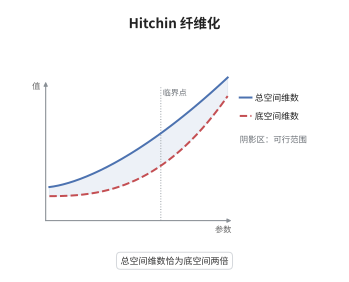

# Hitchin 纤维化与可积系统

> **一句话大白话**：把所有 Higgs 场的特征多项式系数收集起来当坐标，就得到一个半维的映射；它的一般纤维是谱曲线上的阿贝尔簇，所以整个空间是一个完全可积系统。
>
> **小例子**：取 $X$ 为亏格 $2$ 的曲线、$G=\mathrm{SL}_2$：$\dim\mathcal M_{\mathrm{Higgs}}=6$，$\mathcal A=H^0(X,K_X^2)$ 满足 $\dim\mathcal A=3$；谱曲线 $\tilde C\to X$ 是二次覆盖，$g_{\tilde C}=4g-3=5$，其 Prym 维数为 $5-2=3$，正好等于纤维维数。

## 介绍

Hitchin 纤维化把 Higgs 丛的模空间 $\mathcal M_{\mathrm{Higgs}}=T^*\mathrm{Bun}_G$ 映到由不变多项式系数构成的底空间 $\mathcal A$。这个映射的纤维是阿贝尔簇，且底空间维数恰为总空间的一半，于是它构成一个完全可积系统。它是 Hitchin 1987 年为构造高维可积系统而提出的，后来成为 Ngô 证明基本引理的关键工具，也被视为几何 Langlands 的经典极限。它把解 Higgs 场特征方程这件事变成在谱曲线上取线丛，把一个非线性问题化归为线性代数。

## 几何直观

图意在说明：两条直线的斜率分别对应总空间维数 $2(g-1)\dim G$ 与底空间维数 $(g-1)\dim G$，二者始终相差一倍；正因如此，一般纤维的维数与底空间相同，相互独立的 Hamilton 量个数刚好够用，系统才完全可积。

## 分析

**前置依赖**：Higgs 丛、辛几何、谱曲线；补充：Riemann–Roch、Prym 簇。

**数学内涵**：
- 总空间：$\mathcal M_{\mathrm{Higgs}}$ 是 $\mathrm{Bun}_G$ 的余切丛，点写作 $(E,\varphi)$，其中 $\varphi\in H^0(X,\mathrm{End}(E)\otimes K_X)$，带正则辛形式。
- 映射：$\chi(E,\varphi)=\big(p_i(\varphi)\big)_{i=1}^{r}$，$p_i$ 是次数 $d_i$ 的不变多项式，故 $\chi_i\in H^0(X,K_X^{d_i+1})$。对 $\mathrm{SL}_n$ 它就是特征多项式的系数。
- 可积性：$\{\chi_i,\chi_j\}=0$，且 $\dim\mathcal M=2\dim\mathcal A$，所以 $\chi$ 的一般纤维是拉格朗日子簇。
- 谱曲线：$\tilde C=\{\det(\varphi-\lambda\,\mathrm{id})=0\}\subset T^*X$，其中 $\lambda$ 是 $T^*X$ 上的 tautological 一形式；对 $\mathrm{GL}_n$，$\tilde C\to X$ 是 $n$ 次覆盖，$g_{\tilde C}=n^2(g-1)+1$。
- 常见误区：纤维不是点而是一族阿贝尔簇；对 $\mathrm{GL}_n$ 必须固定行列式或次数，$\chi$ 才 proper；$\dim\mathcal A$ 是 $(g-1)\dim G$，不是 $\dim G$。

**结构**：
1. 在 $T^*\mathrm{Bun}_G$ 上写出辛形式，确认 $\mathcal M_{\mathrm{Higgs}}$ 是辛的。
2. 用不变多项式造出 $\dim\mathcal A$ 个函数，验证它们泊松交换。
3. 用谱曲线把纤维识别为 Prym 的 torsor，再用维数相等与 properness 收尾。

## 思考过程

Hitchin 想找一个像 KdV 那样有大量对合守恒量的高维系统，但 Higgs 丛的模空间太大，直接写方程没有出路。他注意到真正该看的不是 $\varphi$ 本身，而是它的特征多项式：这些系数在共轭下不变，自动定义在模空间上，而且个数恰好是一半维数。接下来的障碍是证明纤维紧且是阿贝尔簇。谱曲线解决了这一点：特征方程 $\det(\varphi-\lambda)=0$ 把 $X$ 变成覆盖 $\tilde C$，而 $\varphi$ 不过是 $\tilde C$ 上的一个线丛，于是纤维是 $\tilde C$ 的 Jacobian，对 $\mathrm{SL}_n$ 则是 Prym，紧性来自线丛模空间本身。这个把算子变成曲线的技巧后来被 Ngô 用来计算 Hitchin 纤维上的轨道积分，从而证明基本引理；在几何 Langlands 里，它则是经典极限与量子化的几何载体。

## 证明过程

**定理**：设 $X$ 为亏格 $g\ge2$ 的光滑射影曲线，$G$ 半单。则 Hitchin 映射 $\chi:\mathcal M_{\mathrm{Higgs}}\to\mathcal A$ 是 proper 的完全可积系统：$\dim\mathcal M=2\dim\mathcal A$，存在 $\dim\mathcal A$ 个代数无关且泊松交换的函数，且 $\chi$ 的一般纤维是 $\mathrm{Prym}(\tilde C/X)$ 的 torsor。

**证明**：

### 1. 辛结构与维数

$\mathcal M_{\mathrm{Higgs}}=T^*\mathrm{Bun}_G$ 带典范辛形式，$\dim\mathrm{Bun}_G=(g-1)\dim G$，故 $\dim\mathcal M=2(g-1)\dim G$。另一方面，对每个不变多项式 $p_i$（次数 $d_i$）有 $\deg K^{d_i+1}=(d_i+1)(2g-2)$，由 Riemann–Roch 得

$$
\dim H^0(X,K^{d_i+1})=(d_i+1)(2g-2)-g+1=(2d_i+1)(g-1),
$$

再用 $\sum_i(2d_i+1)=\dim G$ 求和，得 $\dim\mathcal A=(g-1)\dim G=\tfrac12\dim\mathcal M$。

### 2. 泊松交换

$\chi_i=p_i(\varphi)$ 在 $\mathrm{Bun}_G$ 的纤维方向上不变，沿纤维平移给出 $\mathcal M_{\mathrm{Higgs}}$ 上的 Hamilton 向量场。在谱曲线光滑的开集上，纤维是阿贝尔簇，沿纤维平移的向量场两两交换，对应的 Hamilton 函数也就泊松交换：$\{\chi_i,\chi_j\}=0$。该开集稠密，故等式在整个 $\mathcal M_{\mathrm{Higgs}}$ 上成立。这 $\dim\mathcal A$ 个函数代数无关，因为 $\chi$ 的微分在一般点满秩。

### 3. 谱曲线与纤维

在 $T^*X$ 上取 tautological 一形式 $\lambda$，令 $\tilde C=\{\det(\varphi-\lambda\,\mathrm{id})=0\}$。对一般 $\varphi$，$\tilde C$ 光滑，$\pi:\tilde C\to X$ 为 $n$ 次覆盖，Riemann–Hurwitz 给出 $g_{\tilde C}=n^2(g-1)+1$。$\varphi$ 在 $\tilde C$ 上给出一个秩一的挠自由层，其次数由 $E$ 的拓扑固定；对 $\mathrm{SL}_n$，行列式条件把 Jacobian 换成 Prym，维数为

$$
g_{\tilde C}-g=(n^2-1)(g-1)=\dim\mathcal A .
$$

properness 由谱曲线的紧性与 Higgs 对的半稳定性（赋值判据）给出，于是 $\chi$ 是阿贝尔簇的纤维化，即完全可积系统。$\square$

## 课堂问答

**老师**：为什么把特征多项式的系数拿出来，而不是直接取 $\varphi$ 的分量？

**学生**：因为 $\varphi$ 的分量依赖于丛的平凡化，不是模空间上的函数；只有共轭不变的量才定义在 $\mathcal M_{\mathrm{Higgs}}$ 上。特征多项式的系数恰是 $\varphi$ 的共轭不变量，个数是 $\dim\mathcal A=(g-1)\dim G$，正好是一半维数，于是有希望凑成完全可积系统所需的独立守恒量。

**老师（追问）**：纤维是阿贝尔簇这一点，在证明里哪一步用到？

**学生**：用在泊松交换与可积性两处。泊松交换的论证依赖纤维是阿贝尔簇，沿纤维平移的向量场才两两交换；可积性则依赖纤维是拉格朗日且紧的，紧性由谱曲线与半稳定性给出，拉格朗日性由 $\dim\mathcal M=2\dim\mathcal A$ 与纤维维数相等推出。若纤维不是阿贝尔簇，这两步都断掉。

**老师（拓展）**：$\mathrm{GL}_n$ 与 $\mathrm{SL}_n$ 的 Hitchin 纤维有什么差别？

**学生**：$\mathrm{GL}_n$ 的纤维是谱曲线 Jacobian 的 torsor，因为行列式未被固定；$\mathrm{SL}_n$ 固定了行列式，纤维换成 Prym，维数少一维中心的贡献。若在 $\mathrm{GL}_n$ 上不固定行列式或次数，Hitchin 映射甚至不是 proper，纤维会跑向无穷，紧性论证失效。
