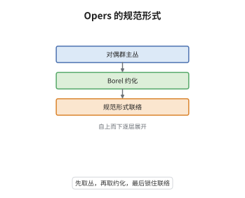

# Opers 理论

> **一句话大白话**：opers 是平坦联络里被钉死的一类：先选一个 Borel 约化，再要求联络在这个约化下呈规范形式，剩下的自由度就只剩底空间那么多了。
>
> **小例子**：$G=\mathrm{PGL}_2$ 时 oper 的局部形式是 $\nabla=d+q\,\mathbf e+\mathbf f$，其中 $\mathbf e,\mathbf f$ 是固定的 Chevalley 生成元，$q\in H^0(X,K_X^2)$；亏格 $2$ 时 $\dim H^0(X,K_X^2)=3$，故固定丛后 opers 构成 $3$ 维空间。

## 介绍

opers 是 Beilinson–Drinfeld 在 1990 年代系统化的对象，名字来自 Drinfeld 的 $\mathfrak{sl}_2$-opers。一个 $\check G$-oper 由对偶群主丛、Borel 约化与满足横向性条件的联络组成；局部上联络除固定的负单根部分外，其余全落在 Borel 里。opers 的模空间是一个向量空间的 torsor，维数恰为 $(g-1)\dim\check G$，与 Hitchin 底同维。它们在几何 Langlands 的谱侧扮演最刚性的角色：每个 oper 都给出 $\mathrm{Bun}_G$ 上的 Hecke 本征 D-模，而临界水平的 Feigin–Frenkel 中心正是 opers 上的函数。这把特征值从一个抽象局部系统具体化成可写的微分方程。

## 几何直观

图意在说明：最底层只是一个 $\check G$-主丛，往上加一个 Borel 约化，最上层再要求联络在该约化下呈规范形式；三层依次收紧，最后剩下的自由度与 Hitchin 底同维，这正是 opers 的模空间。

## 分析

**前置依赖**：主丛、联络、模空间；补充：Borel 约化、Chevalley 生成元、Feigin–Frenkel 中心。

**数学内涵**：
- 定义：$(\mathcal E,\nabla,\mathcal E_B)$，$\mathcal E_B$ 是 $\mathcal E$ 的 Borel 约化。对每个单根 $\alpha_i$，$\nabla$ 诱导的映射 $\mathcal E_B^{i}\to(\mathcal E/\mathcal E_B^{i})\otimes\Omega^1_X$ 是同构，这条横向性等价于局部规范形式

$$
\nabla=d+\sum_{i=1}^{r}\mathbf f_i+\boldsymbol\eta,\qquad \boldsymbol\eta\in\mathfrak b\otimes\Omega^1_X,
$$

其中 $\mathbf f_i$ 是负单根方向的固定 Chevalley 生成元，$\mathfrak b=\mathrm{Lie}(B)$。
- 模空间：$\mathrm{Op}_{\check G}(X)$ 是 $\bigoplus_{i=1}^{r}H^0(X,K_X^{d_i+1})$ 的 torsor，因此 $\dim\mathrm{Op}_{\check G}(X)=(g-1)\dim\check G$。
- 与 Hecke 特征值：Beilinson–Drinfeld 证明每个 oper 对应唯一的 Hecke 本征 D-模，其特征值就是这个 oper；临界水平下 Feigin–Frenkel 中心满足 $Z(\hat{\mathfrak g}_{\mathrm{crit}})\cong\mathrm{Fun}(\mathrm{Op}_{\check G}(D))$，BD 把它整体化。
- 常见误区：oper 不是任意平坦联络，横向性不可省；谱侧的群是 $\check G$，不要与 $G$ 混用；不同文献的归一化会差一个常数平移。

**结构**：
1. 用 Borel 约化把联络的负单根部分固定，写出横向性条件。
2. 用 Borel 规范变换消去多余项，得到局部规范形式并证明唯一性。
3. 计算形变空间，得到 torsor 结构与维数，再连到 Hecke 特征值。

## 思考过程

Drinfeld 在研究 $\mathfrak{sl}_2$ 仿射代数与 KdV 方程时发现，W 代数的作用可以写成一个规范形式的联络，二次微分就是它的自由参数。Beilinson 与 Drinfeld 把这一观察推广到任意约化群，定义了 $\check G$-opers，并意识到它们恰好是 Hitchin 可积系统量子化所对应的经典对象。真正的困难在于刚性：平坦联络的模空间是无穷维的，要挑出有限维的子簇必须加很强的约束。横向性条件的作用就在于此：它固定了负单根方向的系数，使规范变换的自由度只剩 Borel，于是模空间降成有限维。接下来必须证明这个有限维空间确实是 torsor，这要用形变理论算 $H^1$；算出来恰好是 $\bigoplus H^0(K^{d_i+1})$，与 Hitchin 底同维。最后一步是把 opers 与 Hecke 算子对接：BD 的量子化构造说明每个 oper 都是某个 Hecke 本征层的特征值，这一步把谱侧的点与自守侧的层真正连了起来。

## 证明过程

**定理**：设 $X$ 为亏格 $g\ge2$ 的光滑射影曲线，$\check G$ 单连通单。则 (i) $\mathrm{Op}_{\check G}(X)$ 是向量空间 $\bigoplus_{i=1}^{r}H^0(X,K_X^{d_i+1})$ 的 torsor，特别地非空且维数为 $(g-1)\dim\check G$；(ii) 每个 oper $\chi$ 对应唯一的 $\mathrm{Bun}_G$ 上 Hecke 本征 D-模 $\mathcal F_\chi$，其特征值为 $\chi$。

**证明**：

### 1. 横向性与规范形式

固定 Borel $B\subset\check G$ 与 $\mathcal E_B$ 的局部平凡化。横向性要求对每个单根，联络在 $\mathcal E_B^{i}/\mathcal E_B^{\ge i}$ 上诱导的映射非零，因而可经 Borel 规范变换把负单根方向的系数规范化成 $\mathbf f_i$。变换后的联络形如

$$
\nabla=d+\sum_{i=1}^{r}\mathbf f_i+\boldsymbol\eta,\qquad \boldsymbol\eta\in\mathfrak b\otimes\Omega^1_X .
$$

规范变换的自由度只剩 $\mathrm{Lie}(B)$，再往下的变换会改变 $\mathbf f_i$ 的系数，故该形式在同构意义下唯一。

### 2. 形变与维数

oper 的无穷小形变由 $\boldsymbol\eta$ 的变动给出，兼容 Borel 结构的形变空间是 $\bigoplus_i H^0(X,K_X^{d_i+1})$：第 $i$ 个分量对应单根 $\alpha_i$ 方向的系数，权为 $d_i+1$。障碍由 $H^1$ 的消没给出，因为 $\deg K^{d_i+1}>2g-2$，故形变是 unobstructed 的，$\mathrm{Op}_{\check G}(X)$ 是该向量空间的 torsor，维数为

$$
\sum_{i=1}^{r}(2d_i+1)(g-1)=(g-1)\dim\check G .
$$

### 3. Hecke 特征值

Beilinson–Drinfeld 的量子化理论把 opers 与临界水平的中心特征联系起来：对每个 oper $\chi$，取相应的中心特征，再用局部化与消没轮构造出 $\mathrm{Bun}_G$ 上的 D-模 $\mathcal F_\chi$。对每个 $x\in X$ 与表示 $V$，Hecke 算子 $H_{x,V}$ 在 $\mathcal F_\chi$ 上按 $\chi$ 的系数层作用成数乘，故 $\mathcal F_\chi$ 是 Hecke 本征层，特征值为 $\chi$；唯一性由 Hecke 本征条件的刚性给出。$\square$

## 课堂问答

**老师**：为什么说横向性条件是在做刚性筛选，而不是一个技术性假设？

**学生**：平坦联络的模空间是无穷维的，因为可以任意改动联络的每个系数。横向性要求联络在 Borel 约化的相邻分次之间由固定的 Chevalley 生成元给出同构，这等于把负单根方向的系数全部钉死，只剩 Borel 方向可动。可动的部分恰是 $\dim\mathcal A$ 维，于是模空间从无穷维降到有限维；没有这条条件，后面的 torsor 与维数计算都无从谈起。

**老师（追问）**：维数公式里的 $(2d_i+1)(g-1)$ 是怎么来的？

**学生**：第 $i$ 个自由参数是 $K_X^{d_i+1}$ 的一个截面。它的次数是 $(d_i+1)(2g-2)$，对 $d_i\ge1$ 有 $\deg>2g-2$，由 Riemann–Roch 得 $h^0=(d_i+1)(2g-2)-g+1=(2d_i+1)(g-1)$。对每个单根求和，用 $\sum_i(2d_i+1)=\dim\check G$，就得到 $(g-1)\dim\check G$，与 Hitchin 底同维。

**老师（拓展）**：opers 与量子化、Hitchin 系统之间是什么关系？

**学生**：opers 是 Hitchin 可积系统的经典极限对象：Hitchin 底参数化特征多项式，而 oper 把其中的系数解释成联络的规范形式，两者维数相同。沿这个方向作 Beilinson–Drinfeld 量子化，就把 opers 上的函数变成临界水平的中心，把 Hitchin 的 Hamilton 量变成 Hecke 算子。于是谱侧的一个 oper 就对应自守侧的一个 Hecke 本征层，这正是几何 Langlands 在 opers 这一子集上的具体实现；一般局部系统并不都是 opers，只有带正则奇性的那部分才落在其中。
