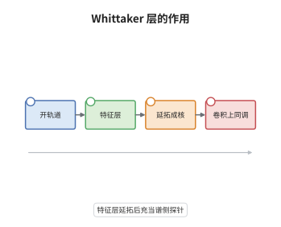

# Whittaker 层与几何 Langlands

> **一句话大白话**：Whittaker 层是把一个非退化特征贴到仿射 Grassmann 流形的开轨道上、再延拓到全空间得到的层；它像一根探针，插进去就能读出球面层对应的表示，也能在整体上把谱侧的层翻译成自守侧的 D-模。
>
> **小例子**：$G=\mathrm{SL}_2$ 时 $\omega(\mathrm{IC}_\lambda)=H^\bullet_c(\mathrm{Gr},\mathrm{IC}_\lambda\otimes\mathrm{Whit})$ 的维数是 $\lambda+1$，正是 $V_\lambda=\mathrm{Sym}^\lambda\mathbb C^2$ 的维数。

## 介绍

Whittaker 层是几何 Langlands 中探针型的基本对象：它由极大幂零子群 $U((t))$ 的非退化加法特征沿开轨道延拓而成，本身不球面，也不是 Hecke 本征层，却是几何 Satake 纤维函子的核心。在整体层面，Whittaker 层充当 Langlands 函子的核：把它与谱侧的相干层作卷积，就得到 $\mathrm{Bun}_G$ 上的 D-模。Gaitsgory 等人在 2010 年代系统发展了这条 Whittaker 路线，并把 Whittaker 层非零作为几何 Langlands 对应存在的判据。它把是否存在对应这样一个全局问题，压缩成某个具体对象是否为零的可计算问题。

## 几何直观

图意在说明：非退化特征先只定义在 $U((t))$ 的开轨道上，延拓到整个 $\mathrm{Gr}_G$ 后才成为 Whittaker 层；与球面层卷积再取紧支上同调，输出的向量空间就是 Satake 对应的表示，整条链把特征变成了纤维。

## 分析

**前置依赖**：几何 Satake 等价、D-模；补充：特征层、紧支上同调、消去定理。

**数学内涵**：
- 构造：$j:\mathrm{Gr}^\circ\hookrightarrow\mathrm{Gr}_G$ 是 $U((t))$ 开轨道的嵌入，$\mathcal L_\psi$ 是由 $\psi$ 决定的秩一局部系统，$\mathrm{Whit}=j_!\mathcal L_\psi[\dim U]$。用 $j_!$ 而非 $j_*$，是为了让紧支上同调可以直接计算。
- 局部作用：$\omega(\mathcal F)=H^\bullet_c(\mathrm{Gr}_G,\mathcal F\otimes\mathrm{Whit})$ 是球面范畴上的纤维函子，$\omega(\mathrm{IC}_\lambda)\cong V_\lambda$；这正是几何 Satake 的 Whittaker 归一化。
- 整体作用：在 $\mathrm{Bun}_G$ 上取 $U(\mathbb A)$ 按 $\psi$ 作用的 Whittaker 范畴，Whittaker 层给出的函子把 $\mathrm{LocSys}_{\check G}$ 上的相干层送到自守侧；其非零性是几何 Langlands 对应存在的判据（Gaitsgory 等，2010 年代）。
- 常见误区：Whittaker 层不是 $G[[t]]$-等变的，因而不在球面范畴内；它也不是 Hecke 本征层，不能拿它当自守侧的解。

**结构**：
1. 在开轨道上定义特征层，作紧支延拓得到 $\mathrm{Whit}$，并检查它的 $T$-权。
2. 用消去定理把 $\omega$ 写成一点处的纤维，验证它与 $V_\lambda$ 的权分解一致。
3. 把构造整体化，说明 Whittaker 层的非零性与对应存在之间的等价。

## 思考过程

几何 Satake 的证明一直卡在纤维函子从哪来：球面层本身没有显然的纤维，卷积只给出幺半结构。Frenkel 与 Gaitsgory 在研究几何 Eisenstein 级数时发现，非退化特征可以把开轨道压成一点，于是沿整个 $\mathrm{Gr}$ 的上同调塌缩成一个纤维。问题在于特征只定义在开轨道上，必须选一种延拓；选 $j_!$ 才能让紧支上同调与消去定理配合，选 $j_*$ 则得到非紧支的版本，归一化差一个平移。Gaitsgory 等人在 2010 年代把这一局部技巧整体化：在 $\mathrm{Bun}_G$ 上取 $U(\mathbb A)$ 的 Whittaker 范畴，把谱侧的相干层沿 Hecke 作用推过去，得到的对象是否为零，恰好反映对应是否存在。这条路线把几何 Langlands 从构造一个函子变成验证一个非零性，是 2010 年代最主要的推进方式之一。

## 证明过程

**定理**：设 $G$ 连通约化，$\psi$ 非退化。则 (i) $\omega(\mathcal F)=H^\bullet_c(\mathrm{Gr}_G,\mathcal F\otimes\mathrm{Whit})$ 定义球面范畴上的正合张量纤维函子，且 $\omega(\mathrm{IC}_\lambda)\cong V_\lambda$；(ii) 整体 Whittaker 层非零当且仅当相应的几何 Langlands 对应存在（Gaitsgory 等，2010 年代）。

**证明**：

### 1. 特征层与延拓

$U((t))$ 在 $\mathrm{Gr}_G$ 上的开轨道 $\mathrm{Gr}^\circ$ 是一个齐性空间，$\psi$ 在其上定义秩一局部系统 $\mathcal L_\psi$。取 $j_!\mathcal L_\psi[\dim U]$ 即得 $\mathrm{Whit}$；它的支集是整个 $\mathrm{Gr}_G$，但在 $\mathrm{Gr}^\circ$ 之外由零延拓给出，故紧支上同调只在有限个次数非零。

### 2. 消去与权分解

对 $G[[t]]$-等变层 $\mathcal F$，消去定理把 $\mathrm{Gr}_G$ 上的积分化为开轨道上的积分，再化为 Whittaker 点处的纤维，于是

$$
\omega(\mathcal F)\;\cong\;\mathcal F_{\mathrm{Whit}},
$$

是有限维向量空间。取 $\mathcal F=\mathrm{IC}_\lambda$，MV 轮给出的基按 $T$-权分解，权与 $V_\lambda$ 的权一致，故 $\omega(\mathrm{IC}_\lambda)\cong V_\lambda$。张量性由卷积的定义与 Künneth 公式得到。

### 3. 整体的非零性判据

在 $\mathrm{Bun}_G$ 上把 $\mathrm{Whit}$ 沿 Hecke 对应展开，得到函子 $\mathbb L^{\mathrm{Whit}}$，它把 $\mathrm{LocSys}_{\check G}$ 上的相干层送到 Whittaker 范畴。Gaitsgory 等人的结果是：这个函子的像非零，当且仅当对应的 Hecke 本征层存在；非零性因而成为几何 Langlands 的可检验判据。$\square$

## 课堂问答

**老师**：Whittaker 层为什么不在球面范畴里，却还能用来研究球面层？

**学生**：球面范畴要求 $G[[t]]$-等变，而 $\mathrm{Whit}$ 只在 $U((t))$ 的开轨道上有定义再零延拓，$G[[t]]$ 会把它送到别的轨道，等变性不成立。但纤维函子只需要一个能张量地探测 $\mathcal F$ 的对象，并不要求它也球面；$\mathrm{Whit}$ 的非等变性反而保证了卷积之后上同调只集中在一个纤维上，这正是我们要的定位效果。

**老师（追问）**：为什么选 $j_!$ 而不是 $j_*$？

**学生**：紧支版本与消去定理匹配。$j_!$ 把开轨道外的部分直接置零，紧支上同调 $H^\bullet_c$ 便能只在开轨道上积分，再由消去化为一点处的纤维；$j_*$ 保留边界上的截面，得到的是非紧支上同调，归一化差一个平移，且不能直接用消去定理比较。两者相差一个与 $\dim U$ 有关的平移，这正对应不同文献里的归一化常数。

**老师（拓展）**：为什么把 Whittaker 层非零当作整体对应的判据，而不是直接构造 Hecke 本征层？

**学生**：直接构造 Hecke 本征层需要先知道谱侧的局部系统，等于预设了对应。Whittaker 路线反其道而行：它只依赖 $U(\mathbb A)$ 与特征 $\psi$，把谱侧相干层沿 Hecke 作用推过去，若像为零则对应不存在，若不为零则得到自守侧的对象。这样就把存在性问题转成一个可计算的非零性问题，这也是 Gaitsgory 等人 2010 年代工作的核心思路。
