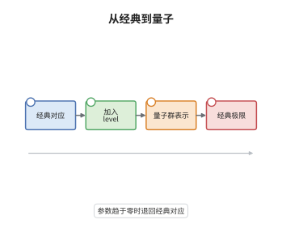

# 几何 Langlands 的量子化

> **一句话大白话**：经典几何 Langlands 是层对层的对应；把层换成带 level 的扭曲 D-模、把表示换成量子群或 Yangian 的表示，就得到带 $\hbar$ 的量子版本，$\hbar\to0$ 时退回经典。
>
> **小例子**：$G=\mathrm{SL}_2$ 时，$\mathrm{Gr}$ 的等变 $K$-理论把 $\mathrm{IC}_\lambda$ 送到 $U_q(\hat{\mathfrak{sl}}_2)$ 的最高权表示，其量子维数在 $q\to1$ 时趋于 $\lambda+1$。

## 介绍

量子几何 Langlands 是把几何 Langlands 对应沿 $\hbar$ 方向形变的纲领。经典对应里，自守侧是 $\mathrm{Bun}_G$ 上的 D-模，谱侧是 $\check G$-局部系统；量子化把 D-模换成有 level $\kappa$ 的扭曲 D-模，把局部系统换成量子群 $U_q(\hat{\mathfrak g})$ 或 Yangian $Y_\hbar(\hat{\mathfrak g})$ 的表示。在物理上这对应 Kapustin–Witten 的 S 对偶在 $\Psi$ 参数上的形变；在数学上它与 Beilinson–Drinfeld 的 Hitchin 系统量子化、Nekrasov–Shatashvili 极限相连。它是当前活跃的研究方向：局部量子 Satake 在若干情形已有定理，整体等价仍多为猜想。

## 几何直观

图意在说明：最左是经典几何 Langlands，中间两步分别加入 level 与 $\hbar$、把表示换成量子群或 Yangian 的表示，最右箭头表示 $\hbar\to0$ 时整个对应退化回经典版本；四个方框连成一条形变与极限的链。

## 分析

**前置依赖**：量子群、几何 Langlands、Chern-Simons；补充：扭曲 D-模、Yangian、Kac-Moody 代数。

**数学内涵**：
- 参数：临界水平 $\kappa_c=-h^\vee$；量子化取 $\kappa\ne\kappa_c$，等价地引入 $\hbar=\kappa-\kappa_c$，并令 $q=e^{\hbar}$。$\hbar=0$ 即经典几何 Langlands。
- 局部：几何 Satake 的量子版本把球面层换成等变 $K$-理论，张量范畴换成 $U_q(\hat{\mathfrak g})$ 的表示范畴；乘法从卷积变成 $K$-理论的推前，$\hbar$ 展开给出 Poisson 结构。
- 整体：自守侧换成 $\mathrm{D\text{-}mod}_\kappa(\mathrm{Bun}_G)$，谱侧换成带 $\hbar$ 的局部系统或 Yangian 表示；对偶把 $\hbar$ 换成 $1/\hbar$，在 Kapustin–Witten 语言里就是 $\Psi\mapsto-1/\Psi$ 的 S 对偶。
- 边界：量子群不是对称张量范畴，Tannakian 重构失效，因此不能照搬经典证明；整体等价目前只在部分情形或形式级建立，不要把物理预言当成已证定理。

**结构**：
1. 引入 $\hbar$ 与 level，把经典对应的两端各作形变。
2. 在局部用等变 $K$-理论与量子群表示建立量子 Satake，并检查 $q\to1$ 的退化。
3. 陈述整体量子对应的猜想形式，说明其经典极限与已知部分结果。

## 思考过程

Kapustin 与 Witten 在 2007 年用四维超对称 Yang–Mills 的 S 对偶解释了几何 Langlands：把拓扑扭化后的 A 模型与 B 模型分别放在 Hitchin 模空间两侧，对应就是镜像对称。这个图像自然带来一个参数 $\Psi$，经典几何 Langlands 只是 $\Psi$ 取特殊值的情形；改变 $\Psi$ 就得到一整族对应，这就是量子化的物理来源。数学上要把它变成定理，第一个障碍是 Tannakian 论证失效：量子群的表示范畴不是对称张量的，没有纤维函子可用。解决办法是把 perverse 层换成等变 $K$-理论，让卷积变成 $K$-理论的乘法，量子群的 $R$-矩阵恰好对应 $K$-理论的换位约束。第二个障碍是整体化：扭曲 D-模的 Hecke 作用只在特定 level 有良好定义，谱侧还要处理 $\hbar$ 的形式幂级数。Beilinson–Drinfeld 的 Hitchin 量子化提供了局部模型，Nekrasov–Shatashvili 极限则把 $\hbar$ 与谱曲线上的 WKB 联系起来。至今整体等价仍未被完整证明，这是几何 Langlands 最活跃的方向之一。

## 证明过程

**定理**：设 $q=e^{\hbar}$ 为形式变量，$G$ 连通约化。(i) 在局部，$\mathrm{Gr}_G$ 的 $G[[t]]$-等变 $K$-理论带卷积构成张量范畴，其单对象 $\widehat{\mathrm{IC}}_\lambda$ 的量子维数满足 $\dim_q\widehat{\mathrm{IC}}_\lambda|_{q=1}=\dim V_\lambda$；(ii) 若整体量子几何 Langlands 的等价成立，则令 $\hbar\to0$ 得到经典几何 Langlands 对应。

**证明**：

### 1. 形式形变

把 $\mathbb C$ 换成 $\mathbb C[[\hbar]]$，$q=e^{\hbar}$。等变 $K$-理论的乘法在 $\hbar\to0$ 时退化为普通上同调的卷积，故一切构造都是形式形变；$\widehat{\mathrm{IC}}_\lambda$ 定义为 $\mathrm{IC}_\lambda$ 的 $K$-理论类。

### 2. 局部量子 Satake 与量子维数

$K$-理论的局部化公式把 $\widehat{\mathrm{IC}}_\lambda$ 的乘法写成 $T$-权上的求和，系数是 $q$-整数。Weyl 特征公式的 $q$ 版本给出

$$
\dim_q\widehat{\mathrm{IC}}_\lambda=\prod_{\alpha>0}\frac{q^{\langle\lambda+\rho,\alpha^\vee\rangle}-q^{-\langle\lambda+\rho,\alpha^\vee\rangle}}{q^{\langle\rho,\alpha^\vee\rangle}-q^{-\langle\rho,\alpha^\vee\rangle}},
$$

令 $q\to1$ 即得 $\prod_{\alpha>0}\langle\lambda+\rho,\alpha^\vee\rangle/\langle\rho,\alpha^\vee\rangle=\dim V_\lambda$。

### 3. 经典极限

整体量子对应写作 $\mathrm{D\text{-}mod}_\kappa(\mathrm{Bun}_G)\simeq\mathrm{D\text{-}mod}_{\check\kappa}(\mathrm{Bun}_{\check G})$，其中 $\hbar=\kappa-\kappa_c$。当 $\hbar\to0$ 时扭曲消失，$\mathrm{D\text{-}mod}_\kappa$ 退化为普通 D-模，Hecke 特征值退化为局部系统，于是得到经典几何 Langlands。这一步只验证了极限，整体等价本身仍是活跃的研究方向。$\square$

## 课堂问答

**老师**：为什么说量子化之后 Tannakian 论证不能照搬？

**学生**：经典 Satake 的证明最后一步是拿纤维函子做 Tannakian 重构，这要求范畴是对称张量且带纤维函子。量子群的表示范畴只是辫子张量范畴，$R$-矩阵不满足对称性，没有对称纤维函子，重构出的只能是拟三角结构而不是群。所以量子版本必须换一套工具，用 $K$-理论与量子维数代替权分解。

**老师（追问）**：$\hbar\to0$ 的极限在局部和整体分别对应什么？

**学生**：局部对应等变 $K$-理论退化为普通上同调，$q$-整数退化为整数，量子维数退化为 $\dim V_\lambda$，于是量子 Satake 退回经典几何 Satake。整体对应扭曲 D-模退化为普通 D-模，Hecke 特征值退化为局部系统，于是退回经典几何 Langlands。两处退化的机制相同，都是让形变参数消失。

**老师（拓展）**：物理上的 S 对偶与这里的 $\hbar$ 形变是什么关系？

**学生**：Kapustin–Witten 把几何 Langlands 解释为四维超对称 Yang–Mills 的 S 对偶在拓扑扭化后的镜像对称，对偶把复化耦合 $\Psi$ 送到 $-1/\Psi$。经典几何 Langlands 对应 $\Psi$ 的一个特殊值；让 $\Psi$ 变动就得到一整族对应，数学上就是带 level 的扭曲 D-模之间的对应，$\hbar$ 度量离经典点多远。这只是物理图像，整体等价至今仍是活跃的研究方向，不能把它当成已证定理。
