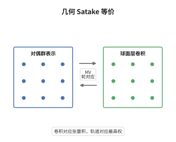

# 几何 Satake 等价

> **一句话大白话**：仿射 Grassmann 流形上那些在 $G[[t]]$ 里不变的层，用卷积相乘，整体恰好就是对偶群的表示范畴——局部几何朗兰兹讲的就是这件事。
>
> **小例子**：$G=\mathrm{SL}_2$ 时轨道由 $\lambda\in\mathbb Z_{\ge0}$ 标号，$\mathrm{IC}_\lambda*\mathrm{IC}_\mu=\bigoplus_\nu\mathrm{IC}_\nu^{\oplus N_{\lambda\mu}^{\nu}}$ 与 $V_\lambda\otimes V_\mu=\bigoplus_\nu N_{\lambda\mu}^{\nu}V_\nu$ 用的是同一组 Littlewood–Richardson 系数。

## 介绍

几何 Satake 等价是几何 Langlands 的局部一半。它把仿射 Grassmann 流形 $\mathrm{Gr}_G=G((t))/G[[t]]$ 上的球面层（$G[[t]]$-等变层）连同卷积运算，与 Langlands 对偶群 $\check G$ 的有限维表示范畴等同起来。这样"张量积"这种纯表示论运算就被翻译成"沿 $G[[t]]$-torsor 推出"这种纯几何运算，Hecke 算子的局部模型、权重重数与相交上同调都随之可算。Lusztig 与 Drinfeld 在 1980 年代提出这一猜想，Mirković–Vilonen 在 2007 年借助 MV 轮完成证明。它是整体几何 Langlands 的基石：整体 Hecke 算子不过是这个局部对应沿曲线逐点编织的结果。

## 几何直观

图意在说明：箭头两侧的对象一一对应，相交上同调层 $\mathrm{IC}_\lambda$ 对应不可约表示 $V_\lambda$；箭头保持乘法，左端的张量积与右端的卷积在对应下一致，下方则提示这种对应由 MV 轮给出具体的基。

## 分析

**前置依赖**：仿射 Grassmann 流形、D-模、表示论；补充：Tannakian 重构、MV 轮。

**数学内涵**：
- 对象与乘法：$\mathrm{Gr}_G$ 是 ind-概形，球面层指 $G[[t]]$-等变的 holonomic D-模（或 perverse 层）。卷积由 Hecke 堆 $\mathrm{Gr}_G\tilde\times\mathrm{Gr}_G\to\mathrm{Gr}_G$ 的推出定义，单位元是 $\mathrm{IC}_0$。
- 张量性：$\mathrm{IC}_\lambda*\mathrm{IC}_\mu$ 的分解重数与 $V_\lambda\otimes V_\mu$ 的重数相同，因此卷积是几何版的张量积；这也解释了为什么 $G$ 的群结构在谱侧换成了 $\check G$ 的表示论。
- 归一化：纤维函子取 $\omega(\mathcal F)=H^\bullet_c(\mathrm{Gr}_G,\mathcal F\otimes\mathrm{Whit})$，其中 $\mathrm{Whit}$ 是 Whittaker 层。"球面"指等变条件落在 $G[[t]]$ 一侧，"Whittaker"指探针落在 $U((t))$ 一侧；平移 $[\dim U]$ 与特征 $\psi$ 的选择只改变函子的同构类，不改变它给出的等价。
- 常见误区：并非 $\mathrm{Gr}_G$ 上所有 D-模都进入这个等价，必须限制在球面（$G[[t]]$-等变）子范畴；对偶的是 $\check G$ 而不是 $G$。

**结构**：
1. 用 $G[[t]]$-轨道分解 $\mathrm{Gr}_G=\bigsqcup_{\lambda}\mathrm{Gr}^\lambda$，写下每个轨道闭包的相交上同调层。
2. 用 Whittaker 函子把这些层送到向量空间，借 MV 轮算出维数与权重，与 $V_\lambda$ 比对。
3. 由纤维函子作 Tannakian 重构得到 $\check G$，再用生成元与 Hom 空间的一致性升级为范畴等价。

## 思考过程

Lusztig 在研究量子群的典范基时注意到，$\mathrm{Gr}_G$ 的轨道闭包与表示的最高权之间似乎存在一一对应，于是猜测球面层范畴应当就是 $\mathrm{Rep}(\check G)$。真正的障碍是"底"在哪里：卷积只给出幺半结构，没有现成的纤维函子，无法做 Tannakian 重构。Ginzburg 从卷积代数一侧逼近，但代数本身太大，难以直接比较。Mirković–Vilonen 的关键想法是用 $U((t))$ 的开轨道作探针：非退化特征把这个开轨道压成一点，剩下的 MV 轮恰好给出权重的几何基。这一步之所以必须用 perverse 层或 D-模，是因为要反复使用六函子与消去定理；换成一般层就既没有自对偶性也没有紧支上同调的消去。得到纤维函子之后，重构几乎是形式化的，剩下的工作只是把重构出的群与原根系数据对上。

## 证明过程

**定理**：设 $G$ 为 $\mathbb C$ 上连通约化群，$\check G$ 为其 Langlands 对偶。则存在张量等价

$$
\mathrm{Perv}_{G[[t]]}(\mathrm{Gr}_G)\;\simeq\;\mathrm{Rep}(\check G),\qquad \mathrm{IC}_\lambda\mapsto V_\lambda,
$$

其中 $\lambda$ 取遍支配余权；D-模版本同样成立。等价把卷积送到张量积，把 $\mathrm{IC}_\lambda$ 送到最高权 $\lambda$ 的不可约表示，并把 MV 轮送成 $V_\lambda$ 的一组权向量基。

**证明**：

### 1. 轨道分解与单性

$G[[t]]$ 在 $\mathrm{Gr}_G$ 上的轨道由支配余权 $\lambda$ 标号，$\mathrm{Gr}^\lambda=G[[t]]\cdot t^\lambda$ 是有限维的，其闭包为 $\overline{\mathrm{Gr}^\lambda}=\bigsqcup_{\mu\le\lambda}\mathrm{Gr}^\mu$。因此每个 $\mathrm{IC}_\lambda=j_{!*}\underline{\mathbb C}[\dim\mathrm{Gr}^\lambda]$ 是球面范畴中的单对象，且这些单对象两两不同构。

### 2. Whittaker 函子与 MV 轮

取极大幂零子群 $U\subset G$ 与非退化特征 $\psi:U((t))\to\mathbb G_a$。$U((t))$ 在 $\mathrm{Gr}_G$ 上有开轨道 $\mathrm{Gr}^\circ$，其上特征层记为 $\mathcal L_\psi$；令

$$
\mathrm{Whit}=j_!\mathcal L_\psi[\dim U],\qquad j:\mathrm{Gr}^\circ\hookrightarrow\mathrm{Gr}_G .
$$

对球面层 $\mathcal F$ 定义 $\omega(\mathcal F)=H^\bullet_c(\mathrm{Gr}_G,\mathcal F\otimes\mathrm{Whit})$。消去定理说明这个上同调只在有限个次数非零，且等于 $\mathcal F$ 在 Whittaker 点处的纤维。MV 轮 $S\subseteq\mathrm{Gr}^\lambda$ 是紧支维数恰为 $\langle\lambda,2\rho^\vee\rangle$ 的闭子簇，它们的基本类给出 $\omega(\mathrm{IC}_\lambda)$ 的一组基，并按 $T$-权分解成权向量，于是

$$
\dim\omega(\mathrm{IC}_\lambda)=\prod_{\alpha>0}\frac{\langle\lambda+\rho,\alpha^\vee\rangle}{\langle\rho,\alpha^\vee\rangle}=\dim V_\lambda .
$$

### 3. 张量性与重构

卷积的定义给出 $\omega(\mathcal F*\mathcal G)\cong\omega(\mathcal F)\otimes\omega(\mathcal G)$：把 Hecke 堆上的积分拆成两次单重积分即可。于是 $\omega$ 是球面范畴上的正合、忠实、张量函子。对紧生成的对象作 Tannakian 重构，得到一个约化群 $H$ 使球面范畴等价于 $\mathrm{Rep}(H)$；再由 $\omega(\mathrm{IC}_\lambda)$ 的权与 $\lambda$ 的配对可识别出 $H$ 的根系正是 $\check G$ 的根系，故 $H\cong\check G$。生成元 $\mathrm{IC}_\lambda$ 与其间的 Hom 空间都已比对，等价成立。$\square$

## 课堂问答

**老师**：纤维函子为什么必须用 Whittaker 层，直接取 $\mathrm{Gr}_G$ 的整体上同调不行吗？

**学生**：不行。$H^\bullet(\mathrm{Gr}_G,-)$ 对卷积不是张量的：卷积把两个层分别放在两个 $G[[t]]$-torsor 上，只有把其中一个定位到一点，Künneth 才能把它变成普通张量积。Whittaker 层正好完成这个定位，它把 $U((t))$ 的开轨道压成一点，使上同调退化为纤维。直接取整体上同调还会丢掉 $T$-权，得到的只是维数，无法区分 $\mathrm{IC}_\lambda$。

**老师（追问）**：$G[[t]]$-等变这个条件在哪一步不可省？

**学生**：在第 1 步和第 3 步都不可省。第 1 步里，只有球面层才由轨道闭包上的 IC 层生成，单性才成立；第 3 步里，$\omega$ 的正合性与张量性依赖 $\mathcal F$ 在 $G[[t]]$-torsor 上的等变性，否则卷积不封闭，$\omega(\mathcal F*\mathcal G)$ 也不再是有限维。去掉等变性后，剩下的范畴太大，连 Tannakian 重构的前提都不满足。

**老师（拓展）**：如果 $G$ 不连通或者取中心商，这个等价会怎么变？

**学生**：$\pi_0(G)$ 控制 $\mathrm{Gr}_G$ 的连通分支，$\check G$ 的中心则控制表示的分歧，两者在等价下互换角色。例如 $G=\mathrm{PGL}_n$ 的对偶是 $\mathrm{SL}_n$，球面范畴仍等价于 $\mathrm{Rep}(\mathrm{SL}_n)$；若改用不匹配的 Whittaker 归一化，就只能得到射影表示，因为中心特征没有对齐。更一般地，等变结构要按中心扩张相应改取。
