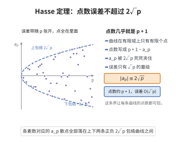

# Hasse定理

> **一句话大白话**：有限域上椭圆曲线的点数不会偏离 $q+1$ 太远——偏差被 $2\sqrt{q}$ 的"夹子"套住。
>
> **小例子**：对 $\mathbb{F}_q$ 上椭圆曲线，$\#E(\mathbb{F}_q)=q+1-t$ 且 $|t|\le2\sqrt{q}$，所以点数大致在 $q+1\pm2\sqrt{q}$ 之间。

## 一、定理介绍

> **前置依赖**：椭圆曲线的群律公式、Weil猜想（曲线情形）、ℓ-adic étale上同调、Lefschetz迹公式、Frobenius自同态

Hasse定理（Hasse边界）给出有限域 $\mathbb{F}_q$（$q=p^n$）上椭圆曲线 $E$ 的 $\mathbb{F}_q$-有理点计数（含 $O$）的精确界：
$$
|N_q-(q+1)|\le2\sqrt{q}.
$$
它把"数点"问题控制在刚性区间内，是椭圆曲线算术的基础结果，也是 Weil 猜想在曲线情形的直接体现。

## 几何直观

图意在说明：曲线在有限域上的点数几乎就是 p + 1，偏差 a_p 被 2√p 卡死在一条窄带里。

## 二、原理思路

Hasse 边界本质上是曲线情形 Weil 猜想的特例：Frobenius 自同态 $\mathrm{Frob}_q$ 在 $\ell$-adic 上同调 $H^1$ 上的迹的绝对值被特征值模约束（$|\alpha_i|=\sqrt{q}$）。由迹公式 $N_q=q+1-\alpha-\bar\alpha$（$\alpha$ 为 Frobenius 特征值）立即得到 $|N_q-(q+1)|=|2\Re\alpha|\le2\sqrt{q}$。

## 三、定理的严格表述

设 $E$ 为有限域 $\mathbb{F}_q$ 上的椭圆曲线，$N_q=\#E(\mathbb{F}_q)$（含无穷远点）。则
$$
|N_q-(q+1)|\le2\sqrt{q}.
$$
等价地，若 $t=N_q-q-1$ 为"迹"，则 $|t|\le2\sqrt{q}$，且 $t$ 的 x-特征值为共轭复根 $|\alpha|=|\bar\alpha|=\sqrt{q}$，满足 $\alpha\bar\alpha=q$。

## 四、证明过程

标准证明路线：转向 $\ell$-adic étale 上同调（$\ell\neq p$），Frobenius 在 $H^1(E_{\bar{\mathbb{F}}_q},\mathbb{Q}_\ell)$ 上作用特征值 $\alpha,\bar\alpha$；由 Weil 配对可得 $\alpha\bar\alpha=q$；Lefschetz–Grothendieck 迹公式给出 $N_q=1-(\alpha+\bar\alpha)+q=q+1-t$，其中 $t=\alpha+\bar\alpha=2\Re\alpha$；因 $|\alpha|=\sqrt{q}$，得 $|t|\le2\sqrt{q}$。亦可用代数几何+白对偶或元素计数直接证明。

## 五、应用与意义

Hasse 边界保证有限域上椭圆曲线点数接近 $q+1$，是椭圆曲线密码学安全性（子群阶、ECDLP 难度）与曲线点计数的理论根基。它也为一族 Weil 猜想的曲线情形奠定精确表述，是向一般黎曼假设推广的基础样例。

## 课堂问答

**老师**：请写出 Hasse 边界的精确不等式，并把"迹" $t$ 与 Frobenius 特征值联系起来。

**学生**：先给结论：对 $\mathbb{F}_q$ 上椭圆曲线 $E$，$N_q=\#E(\mathbb{F}_q)$（含无穷远点 $O$）满足 $|N_q-(q+1)|\le 2\sqrt{q}$，等价地 $t=N_q-q-1$ 满足 $|t|\le2\sqrt{q}$。这里 $t=\alpha+\bar\alpha$ 是两个 Frobenius 特征值之和，它们满足 $\alpha\bar\alpha=q$、$|\alpha|=|\bar\alpha|=\sqrt{q}$，故 $|t|=|2\Re\alpha|\le2\sqrt{q}$。

**老师（追问）**：这个界是从哪里来的？为什么说它是曲线情形 Weil 猜想的特例？

**学生**：来自 $\ell$-adic étale 上同调与迹公式：$\mathrm{Frob}_q$ 作用在 $H^1(E_{\bar{\mathbb{F}}_q},\mathbb{Q}_\ell)$ 上特征值为 $\alpha,\bar\alpha$，Weil 配对给出 $\alpha\bar\alpha=q$；Grothendieck–Lefschetz 迹公式给出 $N_q=1-(\alpha+\bar\alpha)+q=q+1-t$。而 $|\alpha|=\sqrt{q}$ 正是 Weil 猜想"特征值模为 $\sqrt{q}$"在曲线 $H^1$ 上的体现，所以 Hasse 边界是它的直接特例。常见误区：把它当成初等计数定理——其本质是 Frobenius 特征值的模约束。

**老师（拓展）**：这条界有什么实际用途？

**学生**：它保证有限域上椭圆曲线的点数接近 $q+1$，直接支撑椭圆曲线密码学中子群阶与 ECDLP 难度的分析；也为一族 Weil 猜想的曲线情形奠定精确表述，是向一般黎曼假设/Weil 猜想推广的基础样例。
