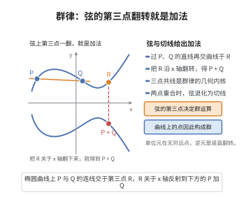

# 椭圆曲线的群律公式

> **一句话大白话**：椭圆曲线上的点可以用"弦切法"做加法，构成一个交换（Abel）群，无穷远点 $O$ 是单位元。
>
> **小例子**：对 $E:y^2=x^3+ax+b$ 上两点 $P,Q$，过 $P,Q$ 作弦交曲线于第三点 $R$，再对 $R$ 关于 $x$ 轴对称得到 $P+Q$——这正是群律的几何实现。

## 一、定理介绍

> **前置依赖**：三次曲线与射影几何、弦切法构造、Riemann-Roch定理、群论公理、除子与线性系

椭圆曲线群律是代数几何与数论最基本的构造之一：域 $K$ 上的椭圆曲线 $E$（带无穷远点 $O$ 的光滑三次曲线）的有理点集 $E(K)$ 在"弦切法"定义的加法下成为一个 Abel 群。它把三次曲线上的几何运算转化为群结构，是一切椭圆曲线算术（Mordell–Weil、有限域点计数、密码学）的起点。

## 几何直观

图意在说明：两点连线与曲线的第三交点，沿 x 轴翻下来就是它们的和，加法由此有了几何定义。

## 二、原理思路

核心想法是利用三次曲线的性质：过曲线上任意两点（或一点处切线）交出的第三条点唯一。定义 $P+Q$：作过 $P,Q$ 的直线交 $E$ 于第三点 $R$，令 $P+Q$ 为 $R$ 关于 $x$-轴的对称点。当 $P=Q$ 时用切线，边界情形用单位元 $O$ 处理。可验证该运算满足结合律、交换律，且 $O$ 为单位元、逆元为关于 $x$-轴对称的点。

## 三、定理的严格表述

设 $K$ 为域，$E:y^2=x^3+ax+b$（$4a^3+27b^2\neq0$）为 $E$ 仿射部分，$O=[0:1:0]$ 为无穷远点。定义 $E(K)$ 上的二元运算 $+$：对 $P,Q$，直线 $PQ$ 交 $E(\bar K)$ 于 $P,Q,R$，令 $P+Q$ 为 $R$ 的关于 $x$-轴的对称点（$P=Q$ 时用切线，$P=O$ 等边界情形特判）。则 $(E(K),+)$ 构成 Abel 群，单位元为 $O$。加法定理（显式公式）给出坐标。

## 四、证明过程

几何构造给出结合律面临的主要技术难点。论证一般用"三次曲线上三条直线"的等价：某配置理性对应三次交点，而 $P+(Q+R)=(P+Q)+R$ 归结为两个有理三次曲线均说出同一点，从而集合相等。也可用 Riemann–Roch 论：对 $\deg 3$ 除子 $D$，$E(K)\cong\ell(K)\setminus\{0\}/K^\times$ 群同构，群律自动满足结合律。常用代数—几何复合证明完成。

## 五、应用与意义

群律是椭圆曲线密码学（ECDLP）、Mordell–Weil 定理、有限域点计数（Hasse 边界）与模性定理的基础。它把数论与几何、代数无缝结合，并直接促成 Fermat 大定理的证明路径（谷山–志村 + Frey 曲线拐点）。

## 课堂问答

**老师**：请说明"弦切法"如何定义 $P+Q$，并写出单位元与逆元。

**学生**：先给结论：设 $E:y^2=x^3+ax+b$（要求 $4a^3+27b^2\ne0$），过 $P,Q$ 作直线交 $E$ 于第三点 $R$，令 $P+Q$ 为 $R$ 关于 $x$-轴的对称点；$P=Q$ 时用 $P$ 处切线，边界情形交给单位元 $O=[0:1:0]$。于是 $(E(K),+)$ 构成 Abel 群，单位元为 $O$，$P$ 的逆元是它关于 $x$-轴的对称点 $-P$。

**老师（追问）**：交换律很显然，结合律却是难点。如何证明 $(P+Q)+R=P+(Q+R)$？

**学生**：几何上把结合律归结为"两条直线与三次曲线交出的三个点的和为零"这一配置性质：比较 $(P+Q)+R$ 与 $P+(Q+R)$ 所对应的两个 $\deg 3$ 除子，利用三次曲线与直线交点的等价，证明两者落在同一有理三次上从而相等。更干净的办法是用 Riemann–Roch：对 $\deg 3$ 除子 $D$ 有 $E(K)\cong \ell(K)\setminus\{0\}/K^\times$ 的群同构，结合律自动成立。常见误区：以为群律只在实数域上"几何显然"——它需要代数化（射影坐标加显式加法公式）才能对任意域 $K$ 严格定义。

**老师（拓展）**：群律为什么是椭圆曲线算术的起点？

**学生**：因为它把所有椭圆曲线的算术都搬到一个 Abel 群上：Mordell–Weil 定理谈 $E(K)$ 的有限生成性，有限域点计数算 $|E(\mathbb{F}_q)|$，ECDLP 与椭圆曲线密码学都基于这个群；模性定理与 Frey 曲线把 Fermat 大定理也接进来，所以它是几何、代数与数论统一的枢纽。
