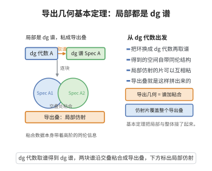

# Toën-Vezzosi的导出几何基本定理
>
> **一句话大白话**：Toën–Vezzosi 的系统奠定了导出代数几何的严格框架：定义导出 stack/概形、其 cotangent complex，并证明 Moore 论的基本性质（切空间、形变、函数环等）。
>
> **小例子**：$k$-派生 stack 的 cotangent complex $\mathbb{L}_X$ 通过 $\mathrm{Spec}\to X$ 的伯特扩散定义，其 $T^0,T^1,T^2$ 提供形变理论全部层级。

## 一、定理介绍

> **前置依赖**：$\infty$-范畴与model结构、$\mathbb{E}_\infty$-环与其$\mathrm{Spec}$、派生stack与概形、cotangent complex、谱中的拟凝聚层

Toën–Vezzosi 的导出代数几何基本定理（见《Homotopical Algebraic Geometry》）提供了以 $k$-模块与谱环构造导出 stack 与概形的系统方案：定义了 $\mathbb{E}_\infty$-概形、Ketchen（派生）stack、cotangent complex 及其对偶切复形，并证明了它们在其仿射/局部化下满足经典几何的全部性质适应——这就是"导出代数几何存在性/相容"的基本定理群。

## 几何直观

图意在说明：把环升级成 dg 代数再取谱，所得仿射片可以粘成导出叠，粘合数据带着高阶信息。

## 二、原理思路

用 model 及 $\infty$-范畴语言：以 $k$-模块谱（$E_\infty$）与 Hopf 的局部化定义 $\mathbb{E}_\infty$-概形为具 affine 覆盖的层，取其相对 stack 织入 $\mathrm{dg}$。cotangent complex $\mathbb{L}$ 经"mor利润最优切化"(Quillen/Lurie) 定义，掌切空间、形变与带偏差结构。基本定理监管：对 stack $X$，$\mathbb{L}_X$ 存在且相应 $T^i$ 刻画障碍，并对 hallmark 反 iter、平稳交、推前有良好行为。

## 三、定理的严格表述（要点）

设 $k$ 为基环（或谱），以 $\infty$-范畴 $\mathrm{Sch}_{k}^{\mathrm{der}}$ 表示 $k$ 上派生概形、$\mathrm{dSt}_k$ 表示派生 stack。则存在 cotangent 复形函子
$$
\mathbb{L}:\mathrm{dSt}_k^{\mathrm{op}}\to\mathrm{Sp}(\mathrm{QCoh}(\bullet))\quad\text{（或更高阶 $\infty$-范畴）}
$$
满足：(i) 对 affine stack，$\mathbb{L}_{\mathrm{Spec}\,A}=\mathbb{L}_{A/k}$（代数的 cotangent complex）；(ii) 形变函子由 $\mathbb{L}$ 表示的谱同构；(iii) 传达通用性质：交换图、推前与纤维积的完整性。

## 四、证明过程

依 Toën–Vezzosi 落实：先在 $\mathbb{E}_\infty$ 与 Hopf 代数证明 cotangent complex 的表示生存（dg-presentation）；延拓到 stack（用相对化与余积），确立切/障碍的谱 extraction；用 $\infty$-model 结构与 descend 证明传延、纤维积完整性与 monoid；最后建立该函手的普适性质使之成为原基本结构——即"任何派生 stack 的 cotangent 皆可算"。

## 五、应用与意义

Toën–Vezzosi 的工作为派生代数几何提供自洽严格框架，支撑派生模空间、导出 HD、derived schemes with shtuka 与几何 Langlands 的派生层面。它是现代高级几何研究不可缺的基准，也是 Lurie 体系的平行实现。

## 课堂问答

**老师**：Toën–Vezzosi 框架的"基本定理"在讲什么？

**学生**：结论：它给出派生概形/导出 stack 的严格构造，并证明 cotangent complex 的存在与其泛性质。设 $k$ 为基环（或谱），$\mathrm{dSt}_k$ 为派生 stack，则存在 cotangent 复形函子
$$\mathbb{L}:\mathrm{dSt}_k^{\mathrm{op}}\to\mathrm{Sp}(\mathrm{QCoh}(\bullet))$$
满足：对 affine，$\mathbb{L}_{\mathrm{Spec}\,A}=\mathbb{L}_{A/k}$；形变函子由 $\mathbb{L}$ 的谱同构表示；且对纤维积、推前与交换图保持完整。常见误区是以为它只是 Lurie 体系的重复，其实它用 model 范畴给出平行且自洽的构造。

**老师（追问）**：$\mathbb{L}$ 在证明中是怎么"造出来"的？

**学生**：先在 $\mathbb{E}_\infty$ 环与 Hopf 代数上由 dg-presentation 证明 cotangent complex 可表示；再经相对化与余积延拓到 stack，确立切空间/障碍的谱提取；用 $\infty$-model 结构与 descent 证传递性、纤维积完整性与幺半结构；最后建立该函子的泛性质——"任何派生 stack 的 cotangent 皆可算"。于是切空间 $\mathrm{H}^0\mathbb{L}$、障碍 $\mathrm{H}^1\mathbb{L}$、高阶 $T^i$ 全部就位。

**老师（拓展）**：它相对 Lurie 的意义在哪？

**学生**：它是导出代数几何的平行实现，用 $\mathbb{E}_\infty$-环 + model 结构刻画导出概形与派生 stack，并强调 cotangent complex 的普适计算。它支撑派生模空间、导出 Hitchin/HD、带 shtuka 的导出概形与几何 Langlands 的派生层面，是现代高级几何的基准框架之一。
