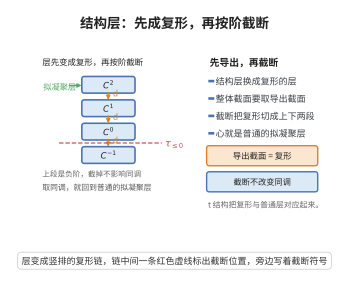

# 导出概形的结构层性质

> **一句话大白话**：导出概形是一层"把环代之以 $\mathbb{E}_\infty$-环"，其茎仍局部，并确实涵盖经典概形。
>
> **小例子**：导出概形 $(X,\mathcal{O}_X)$ 的结构层 $\mathcal{O}_X$ 是 $\mathbb{E}_\infty$-环的层，各点茎 $\mathcal{O}_{X,x}$ 局部，且 $\pi_0\mathcal{O}_X$ 复发现代概形。

## 一、定理介绍

> **前置依赖**：$\mathbb{E}_\infty$-环与其$\mathrm{Spec}$、谱层范畴、局部$\mathbb{E}_\infty$-环、同伦群层、拟凝聚层

导出概形（derived scheme）的结构层性质说明其"层"满足可范与可局部描述性质的若干点：结构层 $\mathcal{O}_X$ 取值于 $\mathbb{E}_\infty$-环的谱，茎 $\mathcal{O}_{X,x}$ 为局部 $\mathbb{E}_\infty$-环，配合 affine 覆盖下用 $\mathbb{E}_\infty$-环的 $\mathrm{Spec}$ 描述。由此导出概形成为经典概形的同伦-加细推广，兼容交点的派生结构。

## 几何直观

图意在说明：结构层取导出截面后成为复形，截断把复形切成上下两段，却不动它的同调。

## 二、原理思路

其基本要求由 Lurie/Toën–Vezzosi 建立：导出概形 = "被 $\mathbb{E}_\infty$-环局部化的局部环空间"，亦即具 affine 覆盖的谱层，每个 affine 片是谱环 $\mathrm{Spec}(A_i)$（$A_i$ 为 $\mathbb{E}_\infty$-环）。同伦群层 $\pi_j(\mathcal{O}_X)$ 承载派生结构，尤其 $\pi_t$（$t<0$）非零记录交点的多余同调信息，而 $\pi_0$ 复现经典结构层。

## 三、定理的严格表述

设 $(X,\mathcal{O}_X)$ 为导出概形，则其结构层 $\mathcal{O}_X$ 是一 $\mathbb{E}_\infty$-环的（谱）层，满足：
(1) 对每个 $x\in X$，茎 $\mathcal{O}_{X,x}$ 是局部 $\mathbb{E}_\infty$-环。
(2) 存在 affine 覆盖 $\{U_i=\mathrm{Spec}\,A_i\}$，$\mathcal{O}_X|_{U_i}\simeq\mathcal{O}_{\mathrm{Spec}\,A_i}$，$A_i$ 为 $\mathbb{E}_\infty$-环。
(3) 同伦群层 $\pi_j(\mathcal{O}_X)$ 为 $\mathcal{O}_X^{\mathrm{cl}}:=\pi_0(\mathcal{O}_X)$ 上的拟凝聚层。
(4) 对 $j<0$，$\pi_j(\mathcal{O}_X)=0$（若假设为导出概形还要求 $\pi_j=0$ 对 $j<0$ 时退化为经典结构层）。

## 四、证明过程

按 Lurie 证明：先在谱层范畴定义局部 $\mathbb{E}_\infty$-环与 affine 谱；验证谱层合成与前推性质；证明 $\pi_j(\mathcal{O}_X)$ 为拟凝聚（构造其过渡曲面与谱层模型）；利用覆盖粘贴 Uni 验证茎局部。最后说明 $\pi_0$ 给出经典结构层以连接普通几何。

## 五、应用与意义

导出概形是导出代数几何的地基：它精确处理交点（多余曲面、余切锥、派生交）、群作用与 moduli 的派生光滑性，被广泛用于陈氏、变换伽罗瓦表示、模约化与导出 stack 理论。其结构层性质让"把普通代数几何升级为结构一部"成为可能。

## 课堂问答

**老师**：导出概形与经典概形在"结构层"上的根本区别是什么？

**学生**：结论：结构层从环层升级为 $\mathbb{E}_\infty$-环的谱层。$(X,\mathcal{O}_X)$ 中 $\mathcal{O}_X$ 是 $\mathbb{E}_\infty$-环的层，满足：每点茎 $\mathcal{O}_{X,x}$ 是局部 $\mathbb{E}_\infty$-环；存在 affine 覆盖 $\{U_i=\mathrm{Spec}\,A_i\}$ 使 $\mathcal{O}_X|_{U_i}\simeq\mathcal{O}_{\mathrm{Spec}\,A_i}$；同伦群层 $\pi_j(\mathcal{O}_X)$ 是 $\pi_0(\mathcal{O}_X)$ 上的拟凝聚层。关键新信息在负阶：$\pi_{j}(\mathcal{O}_X)$（$j<0$）非零时记录交点的多余同调。常见误区是以为结构层只是"带 dg 结构的环层"。

**老师（追问）**：$\pi_0(\mathcal{O}_X)$ 扮演什么角色？负阶同伦群为什么重要？

**学生**：$\pi_0(\mathcal{O}_X)=\mathcal{O}_X^{\mathrm{cl}}$ 复现经典结构层，把导出概形接回普通代数几何。负阶 $\pi_j$（$j<0$）恰是经典层没有的：它们编码"派生交"里过相交/多余切向量的信息。若强制 $j<0$ 时 $\pi_j=0$，则退化为经典概形。因此导出概形是经典概形的同伦加细：几何点集不变，但结构层长了负阶的"记忆"。

**老师（拓展）**：这套定义在证明上要过哪些关？

**学生**：按 Lurie：先在谱层范畴中定义局部 $\mathbb{E}_\infty$-环与仿射谱，验证谱层的前推与合成；再证 $\pi_j(\mathcal{O}_X)$ 拟凝聚（构造谱层模型与过渡数据）；用覆盖粘贴验证茎的局部性；最后由 $\pi_0$ 给出经典结构层。它是导出代数几何处理交点、群作用与模空间派生光滑性的地基。
