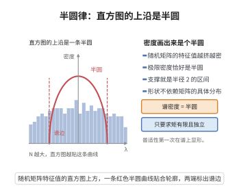

# Wigner半圆律

> **一句话大白话**：随机 Hermite 矩阵的特征值，在尺寸趋大时会"摊平"成一条半圆形的谱分布，与它内部的独立同分布条目几乎无关。
>
> **小例子**：$n\times n$ 的 GUE（或其他 Wigner 矩阵）的经验谱分布 $\mu_n$，当 $n\to\infty$ 时收敛到密度 $\rho(x)=\frac{1}{2\pi}\sqrt{4-x^2}$（$|x|\le2$）——半圆曲线。

## 一、定理介绍

> **前置依赖**：Wigner随机矩阵、经验谱测度、矩方法与迹、Catalan数与非交叉配对、Carleman矩判定

Wigner半圆律（Wigner 1955）断言：对一类适度条件的随机 Hermite 矩阵（Wigner 矩阵：独立（在对称条件下同分布）的实/复条目、对角与次对角尺度适当），其经验谱分布 $\mu_n$ 几乎必然收敛到 **半圆分布**——密度 $\rho(x)=\frac{1}{2\pi}\sqrt{4-x^2}$（支持 $[-2,2]$）。这是随机矩阵理论的第一条普适性定理。

## 几何直观

图意在说明：特征值越挤越密，归一化后的直方图贴上一条半圆，谱因此被关在半径有限的区间里。

## 二、原理思路

半圆律经矩方法证明：估计经验谱矩 $\frac1n\sum_i\lambda_i^k$ 的均值（trace 期望），四舍五入到图同构 — 非交叉配对（Catalan 结构）主导贡献，得到半圆分布矩 $m_{2k}=\mathrm{Cat}_k$（Catalan 数）、$m_{2k+1}=0$。再由矩的局部分散性（Wigner 的方差估计）加上 Carleman/矩判定，推出分布收敛；用 Borel–Cantelli 得到几乎必然收敛。

## 三、定理的严格表述

设 $H_n$（$n\times n$ Hermite 或对称实矩阵）为 Wigner 矩阵：$\mathrm{E}\,H_{ij}=0$、$\mathrm{Var}\,H_{ij}=1$（$i\ne j$），$\sup_{i\le n}\mathrm{E}|H_{ii}|$ 与次对角矩有界。令 $\mu_n=\frac1n\sum_{\lambda_i\le x}\delta$ 为经验谱测度。则存在 $\mu_n\Rightarrow\mu_{\mathrm{semi}}$（a.s.）对正态化（$\frac1{\sqrt n}H_n$ 或对次对角方差归一）成立，其中
$$
d\mu_{\mathrm{semi}}=\frac{1}{2\pi}\sqrt{4-x^2}\,\mathbf 1_{|x|\le2}\,dx.
$$

## 四、证明过程

矩原法：(1) 利用期望对非交叉配对计数（无向图与 $\lambda$ 幂的迹）估计 $\mathrm{E}\,\mathrm{tr}H^{2k}\sim n\cdot\mathrm{Cat}_k$；(2) 精细 Ihrgu 估计 $\mathrm{Var}$ 次级项（$\sim n^2$ 尺度下可忽略）；(3) 用 Carleman 条件保证矩序列确定唯一分布，得到有限迹矩趋于 Catalan 矩；(4) 由 Chebyshev+Borel–Cantelli 或 WDD 定理得到几乎必然弱收敛。

## 五、应用与意义

半圆律开启了随机矩阵普适性研究，是量子混沌、统计（GUE/GOE）、信号处理领域经验谱分析的基础。它与自由概率（半圆即自由高斯）、Wigner 猜测（邻近间距）和特征值统计的更精细普适定理紧密相连。

## 课堂问答

**老师**：Wigner 半圆律说的极限谱是什么？它与元素分布的关系？

**学生**：结论：Wigner 矩阵的经验谱几乎必然收敛到半圆分布，
$$d\mu_{\mathrm{semi}}=\frac{1}{2\pi}\sqrt{4-x^2}\,\mathbf 1_{|x|\le2}\,dx.$$
这是随机矩阵理论第一条普适性定理：只要条目独立、均值零、方差适当有界，极限就与分布细节无关。常见误区是以为要求高斯——半圆律对很广的 Wigner 矩阵都成立。

**老师（追问）**：半圆律为什么用矩方法证明？Catalan 数从哪里冒出来？

**学生**：因为经验谱矩 $\frac1n\sum\lambda_i^k=\frac1n\mathrm{tr}\,H^k$ 的期望可用迹的展开估计。$\mathrm{E}\,\mathrm{tr}\,H^{2k}$ 的领头项由指标的**非交叉配对**计数主导，其数目正是 Catalan 数 $\mathrm{Cat}_k$，奇数矩为 $0$。于是有限谱矩 $\to$ 半圆分布的矩 $m_{2k}=\mathrm{Cat}_k$；方差次级项为 $O(n^2)$ 可在 $n$ 尺度下忽略，Carleman 条件保证矩唯一确定分布，再由 Borel–Cantelli 得几乎必然弱收敛。

**老师（拓展）**：半圆律在更广图景中的位置？

**学生**：它是自由概率中"自由高斯"的谱，与 MP 定律（自由泊松）、Wigner 猜测（最近邻间距）、边缘普适性（TW 分布）共同构成随机矩阵普适性体系。它是量子混沌、统计与信号处理中经验谱分析的基础。

## 相关条目

- [Wigner 半圆律（第64级-随机矩阵理论）](../第64级-随机矩阵理论/Wigner半圆律.md)：与本条目为同一定理，另收录于第64级-随机矩阵理论，可交叉参考。
